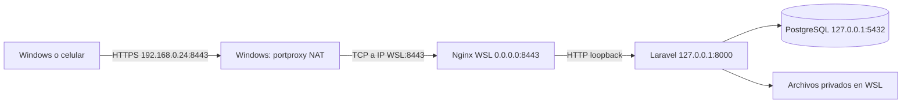

# Guía de puesta en marcha local de Transportes Líquidos

Fecha de trabajo: 17 de octubre de 2026. Equipo Windows 11 + WSL Ubuntu 26.04.
Proyecto: `/home/sronn/projects/transporte-liquidos`.

**Estado:** HTTPS está comprobado en WSL y Windows. El primer intento administrativo
creó 8443 y su regla privada, pero se detuvo por revocación de Schannel. El script
se corrigió; falta volver a ejecutarlo para completar el retiro de 8000/5173.
Acceso desde celular y login manual siguen pendientes. Los resultados
se actualizan en el registro del final. Un comando propuesto no equivale a ejecutado.

## 1. Introducción y objetivo

Queremos usar el sistema desde Windows y un celular en la misma Wi-Fi. Ambos
abrirán `https://192.168.0.24:8443/login`. Esa combinación de protocolo, dirección
y puerto es el **origen**: identifica cookies y almacenamiento del navegador.

Conservamos `transporte_db`, APP_KEY, credenciales, usuarios y registros de negocio.
No ejecutamos migraciones ni seeders. Las visitas web pueden crear sesiones
anónimas técnicas; eso es funcionamiento normal de Laravel, no datos de demostración.
Las 612 pruebas previas se ejecutaron aparte, con datos sintéticos. No prueban por
sí solas que el teléfono o la red actual funcionen.

## 2. Arquitectura en Windows y WSL



Una solicitud empieza en el navegador. Windows reenvía su conexión a WSL. Nginx
verifica TLS y descifra la solicitud; Laravel recibe HTTP interno y reconoce el
HTTPS exterior gracias a encabezados de un proxy de confianza. Laravel revisa
sesión, permisos y entradas. Si necesita datos, consulta PostgreSQL. La respuesta
JSON/HTML vuelve por Nginx y viaja cifrada al navegador. Vue modifica la interfaz.
Los archivos privados se descargan mediante controladores autorizados.

Solo Nginx se publica. Node sirve para **compilar**, no para ejecutar el build.
NAT reenvía TCP, no añade encabezados HTTP: puede ocultar la IP original del
celular. No se falsifica esa IP ni se reducen límites de login para compensarlo.

## 3. Herramientas utilizadas

| Herramienta | Verificación real | Función |
| --- | --- | --- |
| PHP | 8.5.4 | Ejecuta Laravel |
| Composer | 2.9.5 | Dependencias PHP ya instaladas |
| PostgreSQL | 18.6, clúster 18/main | Base existente |
| Node Linux/NVM | 24.21.0 | Herramientas frontend |
| pnpm | 11.22.0 | Ejecuta scripts del proyecto |
| Nginx | 1.28.3 | Proxy TLS |
| mkcert | 1.4.4-1ubuntu2, paquete extraído localmente | CA y certificado |

**Qué/por qué:** comprobar herramientas antes de cambiarlas evita instalar otra
versión o usar Node Windows por accidente. **Comandos:**

```bash
php -v
composer -V
node -p 'process.version + " " + process.execPath'
pnpm --version
command -v node pnpm nginx
pg_lsclusters
```

**Resultado esperado:** Node bajo `/home/sronn/.nvm/...`, pnpm Linux y PG18 online.
**Si falla:** revisar PATH/NVM antes de instalar. En este equipo npm también aparece
bajo `/mnt/c/laragon/...`; NVM se carga en `.profile` y puede faltar en otra terminal.
Se utiliza pnpm en todo el procedimiento; no se cambió la configuración del shell.

## 4. PostgreSQL existente y Laravel

**Qué/por qué:** verificar la base que ya tiene datos, sin reconstruirla.
Se comprobó una conexión Laravel con `BEGIN`, `SET TRANSACTION READ ONLY`, consultas
a `migrations` y `ROLLBACK`: PG18.6, **44 migraciones aplicadas, cero pendientes**.
La cuenta de aplicación no es superusuario, según la auditoría inicial.

Para consultar el estado del servicio y migraciones:

```bash
pg_lsclusters
php artisan migrate:status
```

El segundo comando consulta el registro; no aplica migraciones. No se usó durante
la puesta en marcha porque ya se compararon los nombres mediante SELECT. Resultado
esperado: 18/main online y todas las migraciones registradas. Si hay pendientes,
revisar y pedir autorización; no ejecutar comandos de recreación.

Si después de reiniciar el clúster está apagado:

```bash
sudo pg_ctlcluster 18 main start
```

Solo inicia el clúster **existente**. No crea una base. Si sudo solicita contraseña,
introducirla en la terminal, nunca en el chat. Comprobar después con `pg_lsclusters`.
No se modificaron `postgresql.conf`, `pg_hba.conf`, puerto ni credenciales.

## 5. `.env`, secretos y recuperación

**Qué:** cambiar únicamente el origen y las opciones de sesión necesarias.
**Por qué:** el navegador debe recibir URLs HTTPS y cookies que no viajen por HTTP.

| Variable | Valor aplicado | Explicación |
| --- | --- | --- |
| APP_URL | https://192.168.0.24:8443 | URL del entorno local |
| APP_DEBUG | false | Evita publicar trazas al compartir Wi-Fi |
| SESSION_DRIVER | database, conservado | Sesiones en PostgreSQL |
| SESSION_DOMAIN | null | Cookie del host actual, sin dominio amplio |
| SESSION_SECURE_COOKIE | true | Cookie solo sobre HTTPS |
| ASSET_URL | sin definir, conservado | Recursos del mismo origen |
| APP_KEY, DB_* y demás variables | conservadas | No regenerar ni copiar sus valores |

Antes de editar se creó una copia byte a byte 0600 en el directorio 0700
`~/.local/state/transporte-liquidos/private`. El archivo `backup-path` contiene su
ruta. El editor Python reemplazó solo esas cuatro claves y comparó todas las demás
líneas antes y después. **Coincidieron**. `.env` quedó 0600 y sigue ignorado por Git.
No se guardaron hashes ni valores secretos en esta guía.

Para verificar de nuevo sin imprimir secretos:

```bash
python3 - <<'PYENV'
from pathlib import Path
root=Path.home()/'.local/state/transporte-liquidos/private'
original=Path((root/'backup-path').read_text()).read_bytes()
current=Path('.env').read_bytes()
allowed={b'APP_URL',b'APP_DEBUG',b'SESSION_DOMAIN',b'SESSION_SECURE_COOKIE'}
protected=lambda data:[l for l in data.splitlines() if l.split(b'=',1)[0] not in allowed]
assert protected(original)==protected(current)
print('APP_KEY, credenciales y demas variables preservadas')
PYENV
```

El comando compara sin mostrar contenidos. Si falla, detenerse y revisar la diferencia
localmente sin publicarla. Para volver al `.env` anterior, detener Laravel y, solo
si no hubo cambios posteriores que deban conservarse:

```bash
transport_backup=$(cat "$HOME/.local/state/transporte-liquidos/private/backup-path")
cp -- "$transport_backup" .env
chmod 600 .env
```

Reiniciar Laravel después. No ejecutar `key:generate` ni `composer setup`.
No había configuración cacheada; no fue necesario borrarla.

## 6. Laravel y servidor interno

Se añadió en `bootstrap/app.php` confianza exclusivamente en `127.0.0.1`, con
Forwarded-For/Host/Port/Proto. Esto permite conservar HTTPS y el puerto 8443 al
generar enlaces. Un cliente externo no puede imponer esos valores. Dos pruebas
nuevas comprueban ambos comportamientos; la ruta de prueba solo existe en PHPUnit.

**Qué:** iniciar el router de desarrollo de Laravel directamente con PHP.
**Por qué:** permite aplicar límites de archivos al proceso que realmente escucha.

```bash
cd /home/sronn/projects/transporte-liquidos/public
php -d upload_max_filesize=12M -d post_max_size=14M \
  -S 127.0.0.1:8000 \
  /home/sronn/projects/transporte-liquidos/vendor/laravel/framework/src/Illuminate/Foundation/resources/server.php
```

`-S` inicia el servidor interno. `-d` aplica valores únicamente a ese proceso.
El router pertenece a Laravel y carga `public/index.php`; no es un archivo nuevo.
Se debe ejecutar **desde public**. Los límites dejan pasar archivos de 10.000.000
bytes más la envoltura multipart. La aplicación mantiene su propio límite exacto.

**Verificación:** `ss -lnt | rg ':8000'` debe mostrar `127.0.0.1:8000`.
Si está ocupado, identificar el proceso; no matar procesos desconocidos. Esta
terminal queda abierta. Es un servidor de desarrollo, no una configuración productiva.

## 7. pnpm, Vite y compilación Vue

**Qué:** convertir Vue/TypeScript/CSS en archivos estáticos. **Por qué:** la PWA
solo registra su SW cuando `import.meta.env.PROD` es verdadero.

```bash
cd /home/sronn/projects/transporte-liquidos
pnpm run typecheck
pnpm run build
```

El primer comando ejecuta `vue-tsc --noEmit`: comprueba tipos sin generar archivos.
El segundo ejecuta Vite build y genera `public/build`, su manifiesto y el SW.
Ambos **aprobaron**. Sigue el aviso previo de importación estática/dinámica de
DriverPortal/local.ts; no bloquea el build.

`public/hot` estaba ausente. Comprobarlo con `test ! -f public/hot`.
Si aparece, detener primero el Vite que lo creó y comprobar otra vez; no mantener
HMR al validar offline. No se borró ese archivo durante esta tarea.

Scripts disponibles: build, dev, typecheck, test:frontend, test:frontend-api,
test:e2e-workshop y test:e2e-workshop-execution. Usar `pnpm run NOMBRE`.
No hace falta `pnpm dev` para servir el build; no publicar el puerto 5173.

## 8. Nginx como proxy inverso

**Qué:** usar configuración propia, sin modificar `/etc/nginx`. **Por qué:** TLS
se termina en Nginx y PHP/PostgreSQL se mantienen internos.

Archivo real: `~/.config/transporte-liquidos/nginx.conf`:

```nginx
worker_processes 1;
pid /home/sronn/.local/state/transporte-liquidos/run/nginx.pid;
error_log /home/sronn/.local/state/transporte-liquidos/logs/nginx-error.log warn;
events { worker_connections 128; }
http {
    access_log /home/sronn/.local/state/transporte-liquidos/logs/nginx-access.log;
    client_body_temp_path /home/sronn/.local/state/transporte-liquidos/tmp/client;
    proxy_temp_path /home/sronn/.local/state/transporte-liquidos/tmp/proxy;
    server_tokens off;
    server {
        listen 0.0.0.0:8443 ssl;
        server_name 192.168.0.24;
        ssl_certificate /home/sronn/.local/state/transporte-liquidos/tls/cert.pem;
        ssl_certificate_key /home/sronn/.local/state/transporte-liquidos/tls/key.pem;
        ssl_protocols TLSv1.2 TLSv1.3;
        client_max_body_size 14m;
        location / {
            proxy_pass http://127.0.0.1:8000;
            proxy_http_version 1.1;
            proxy_set_header Host $http_host;
            proxy_set_header X-Forwarded-Host $http_host;
            proxy_set_header X-Forwarded-Port 8443;
            proxy_set_header X-Forwarded-Proto https;
            proxy_set_header X-Forwarded-For $remote_addr;
            proxy_set_header Connection "";
            proxy_buffering off;
        }
    }
}
```

`listen 0.0.0.0` permite llegar por la interfaz NAT. El firewall de Windows limita
el acceso exterior. Los encabezados se reemplazan con lo observado por Nginx;
no se propagan como autoridad encabezados arbitrarios del navegador.
Los logs y temporales están fuera del repositorio. Los logs no incluyen cuerpos,
cookies o contraseñas; las URLs pueden contener filtros, por eso siguen privados.

**Comprobar e iniciar:**

```bash
nginx -p "$HOME/.local/state/transporte-liquidos/" \
  -c "$HOME/.config/transporte-liquidos/nginx.conf" -t
nginx -p "$HOME/.local/state/transporte-liquidos/" \
  -c "$HOME/.config/transporte-liquidos/nginx.conf" -g 'daemon off;'
```

`-p` elige el directorio de ejecución; `-c`, el archivo; `-t` comprueba la sintaxis;
`daemon off` mantiene el servidor en primer plano. La comprobación aprobó.
Si hay error de certificado/ruta, corregirlo antes de iniciar; no omitir TLS.

## 9. HTTPS y certificados confiables

`sudo -n true` confirmó que la sesión no puede autenticar sudo. Se descargó
**solo mkcert**, autorizado, y se extrajo sin instalación global:

```bash
# Comando de descarga ejecutado inicialmente en la raíz del proyecto:
apt-get download mkcert
# El .deb se movió inmediatamente fuera del proyecto a la ruta siguiente.
dpkg-deb -x "$HOME/.local/state/transporte-liquidos/tools/mkcert_1.4.4-1ubuntu2_amd64.deb" \
  "$HOME/.local/state/transporte-liquidos/tools/mkcert"
```

Para repetir en otra máquina, descargar directamente desde ese directorio tools.
No ejecutar otra descarga para una instalación que ya funciona.

Generación realmente ejecutada, con directorios privados previamente creados:

```bash
export CAROOT="$HOME/.local/share/transporte-liquidos/ca"
"$HOME/.local/state/transporte-liquidos/tools/mkcert/usr/bin/mkcert" \
  -cert-file "$HOME/.local/state/transporte-liquidos/tls/cert.pem" \
  -key-file "$HOME/.local/state/transporte-liquidos/tls/key.pem" 192.168.0.24
openssl verify -CAfile "$CAROOT/rootCA.pem" \
  "$HOME/.local/state/transporte-liquidos/tls/cert.pem"
openssl x509 -in "$HOME/.local/state/transporte-liquidos/tls/cert.pem" \
  -noout -dates -ext subjectAltName
```

mkcert crea una CA si falta y firma un certificado para esa IP. `verify` aprobó;
el certificado contiene el SAN correcto y vence el 17 de enero de 2029. No renovar
ni regenerar la CA automáticamente; su cambio exige volver a establecer confianza.

La CA pública se importó y comprobó en Windows CurrentUser/Root con X509Store.
El proceso no requirió instalar la clave de la CA en Windows. Copias públicas:
`%LOCALAPPDATA%\TransportesLiquidos\rootCA.pem` y script administrativo.
Huella pública comprobada: `75B9566F2F3403B2830154F6D5198398AA024834`.

**Celular, pendiente manual:** transferir solo rootCA.pem por USB u otro canal
controlado. Android: instalar certificado CA de usuario desde las opciones de
seguridad/cifrado (el nombre depende del fabricante). iPhone: instalar el perfil
y habilitar confianza completa en Ajustes > General > Información > Ajustes de
confianza de certificados. Revisar que sea nuestra CA. Nunca transferir
rootCA-key.pem ni key.pem; confiar en una CA tiene alcance más amplio que este sitio.
Si un dispositivo administrado impide instalarla, no desactivar las validaciones.

## 10. Windows, WSL y celular

Auditoría actual: Windows Wi-Fi `192.168.0.24`, WSL `192.168.119.47`, modo NAT.
Comprobaciones de lectura:

```bash
ip -brief address
wslinfo --networking-mode
ss -lnt
```

En PowerShell:

```powershell
Get-NetIPConfiguration
netsh interface portproxy show all
```

El script obtiene la IP WSL al ejecutarse. Si cambia la IP Wi-Fi, se detiene: hay
que revisar APP_URL, SAN del certificado, server_name y regla/reenvío. Una reserva
DHCP del router puede estabilizarla, pero no se cambió el router.
No se activó mirrored networking. Ambos dispositivos deben usar el mismo origen;
no usar localhost en el teléfono. No se puede probar su Wi-Fi desde este proceso.

## 11. Puertos y firewall Windows

**Qué/por qué:** reenviar solo HTTPS 8443 y limitarlo a perfil Privado/subred local.
La sesión automatizada no es administradora. Se preparó este script y se copió a
`%LOCALAPPDATA%\TransportesLiquidos\configurar-windows.ps1`:

```powershell
$ErrorActionPreference = 'Stop'
$identity = [Security.Principal.WindowsIdentity]::GetCurrent()
$principal = [Security.Principal.WindowsPrincipal]::new($identity)
if (-not $principal.IsInRole([Security.Principal.WindowsBuiltInRole]::Administrator)) { throw 'Abre PowerShell como administrador y vuelve a ejecutar este archivo.' }
$lan = '192.168.0.24'
$addresses = @(Get-NetIPAddress -AddressFamily IPv4 -InterfaceAlias 'Wi-Fi')
if (-not ($addresses | Where-Object {$_.IPAddress -eq $lan})) { throw 'La IP Wi-Fi cambio. Revisa APP_URL, certificado y este script antes de continuar.' }
$wslAddress = ((wsl.exe -d Ubuntu hostname -I) -join ' ').Trim().Split(' ',[StringSplitOptions]::RemoveEmptyEntries)[0]
$parsed = $null
if (-not [Net.IPAddress]::TryParse($wslAddress,[ref]$parsed) -or $parsed.AddressFamily -ne [Net.Sockets.AddressFamily]::InterNetwork) { throw 'No se pudo obtener una IPv4 WSL valida.' }
$backup = Join-Path $env:LOCALAPPDATA ('TransportesLiquidos\red-'+(Get-Date -Format 'yyyyMMdd-HHmmss'))
New-Item -ItemType Directory -Force $backup | Out-Null
netsh interface portproxy dump | Out-File (Join-Path $backup 'portproxy-before.txt')
Get-NetFirewallRule -DisplayName 'Laravel WSL','Vite WSL' -ErrorAction SilentlyContinue | Select-Object Name,DisplayName,Enabled,Profile | Export-Clixml (Join-Path $backup 'firewall-before.xml')
netsh interface portproxy add v4tov4 listenaddress=$lan listenport=8443 connectaddress=$wslAddress connectport=8443
if ($LASTEXITCODE -ne 0) { throw 'No se pudo crear el reenvio 8443. Accesos anteriores conservados.' }
$ruleName = 'TransportesLiquidosLocalHttps'
if (-not (Get-NetFirewallRule -Name $ruleName -ErrorAction SilentlyContinue)) {
 New-NetFirewallRule -Name $ruleName -DisplayName 'Transportes Liquidos HTTPS local' -Direction Inbound -Action Allow -Protocol TCP -LocalAddress $lan -LocalPort 8443 -Profile Private -RemoteAddress LocalSubnet | Out-Null
} else {
 Set-NetFirewallRule -Name $ruleName -Enabled True -Direction Inbound -Action Allow -Profile Private
 Get-NetFirewallRule -Name $ruleName | Get-NetFirewallPortFilter | Set-NetFirewallPortFilter -Protocol TCP -LocalPort 8443 | Out-Null
 Get-NetFirewallRule -Name $ruleName | Get-NetFirewallAddressFilter | Set-NetFirewallAddressFilter -LocalAddress $lan -RemoteAddress LocalSubnet | Out-Null
}
$ca = Join-Path $PSScriptRoot 'rootCA.pem'
if (-not (Test-Path $ca)) { $ca = '\\wsl.localhost\Ubuntu\home\sronn\.local\share\transporte-liquidos\ca\rootCA.pem' }
$cert = [Security.Cryptography.X509Certificates.X509Certificate2]::new($ca)
$store = [Security.Cryptography.X509Certificates.X509Store]::new('Root','CurrentUser')
$store.Open('ReadWrite'); $store.Add($cert); $store.Close()
# Local mkcert CA has no revocation service. This ONE local curl check skips
# revocation only; chain, hostname and validity checks stay enabled. No -k.
curl.exe --noproxy '*' --ssl-no-revoke --fail --silent --show-error --max-time 10 -o NUL -w 'HTTPS Windows: %{http_code}\n' "https://${lan}:8443/up"
if ($LASTEXITCODE -ne 0) { throw 'HTTPS Windows no aprobo; se conservan 8000/5173. Revisa Nginx, NAT, firewall y confianza de CA.' }
# Remove old accesses only AFTER HTTPS has succeeded.
netsh interface portproxy delete v4tov4 listenaddress=0.0.0.0 listenport=8000
if ($LASTEXITCODE -ne 0) { Write-Warning 'Revisar reenvio anterior 8000 (puede estar ausente).' }
netsh interface portproxy delete v4tov4 listenaddress=0.0.0.0 listenport=5173
if ($LASTEXITCODE -ne 0) { Write-Warning 'Revisar reenvio anterior 5173 (puede estar ausente).' }
Get-NetFirewallRule -DisplayName 'Laravel WSL','Vite WSL' -ErrorAction SilentlyContinue | Disable-NetFirewallRule
Write-Output "CONFIGURACION COMPLETA. URL: https://${lan}:8443/login"
Write-Output "Backup de red: $backup"
netsh interface portproxy show all
Get-NetFirewallRule -Name $ruleName | Select-Object DisplayName,Enabled,Profile,Action | Format-Table
```

**Paso manual pendiente:** abrir PowerShell como administrador y ejecutar:

```powershell
powershell.exe -NoProfile -ExecutionPolicy Bypass -File "$env:LOCALAPPDATA\TransportesLiquidos\configurar-windows.ps1"
```

Bypass solo afecta a ese proceso; no cambia la política persistente. El script
guarda la configuración previa, configura NAT y una regla Privada/LocalSubnet,
valida TLS desde Windows con curl **sin -k** y solo entonces retira 8000/5173.
No habilita PostgreSQL. Si la red es Pública, revisar conscientemente el perfil;
no deshabilitar el firewall para arreglar una conexión.

**Resultado esperado:** HTTPS Windows 200, regla habilitada/Private y solo el
reenvío de este proyecto por 8443. Si falla, conservar el mensaje y los accesos
anteriores; no continuar suponiendo éxito. Otras reglas de firewall de Windows no
se auditan exhaustivamente aquí. También pueden existir políticas Hyper-V o del router.

**Reversión, PowerShell administrador, solo si se aplicó este cambio:**

```powershell
netsh interface portproxy delete v4tov4 listenaddress=192.168.0.24 listenport=8443
Remove-NetFirewallRule -Name TransportesLiquidosLocalHttps
# Usar la IP WSL actual comprobada; estos eran los valores previos:
netsh interface portproxy add v4tov4 listenaddress=0.0.0.0 listenport=8000 connectaddress=192.168.119.47 connectport=8000
netsh interface portproxy add v4tov4 listenaddress=0.0.0.0 listenport=5173 connectaddress=192.168.119.47 connectport=5173
Enable-NetFirewallRule -DisplayName 'Laravel WSL','Vite WSL'
```

Esto restaura accesos amplios anteriores: usarlo solo si se desea volver al estado
previo, no como configuración recomendada. Revisar los respaldos red-FECHA del
script si hubo cambios manuales posteriores. No importar indiscriminadamente un
volcado completo de red sobre otras configuraciones nuevas.

Para retirar confianza, después de dejar de usar estos certificados:

```powershell
Remove-Item 'Cert:\CurrentUser\Root\75B9566F2F3403B2830154F6D5198398AA024834'
```

Retirar también la CA del celular. Conservar copia de la clave solo si se necesitan
certificados futuros; almacenarla privada. No compartirla para resolver errores.

## 12. Autenticación, cookies, API y CSRF

Un login legítimo obtiene XSRF desde `/api/csrf` y envía la cookie y encabezado
X-XSRF-TOKEN. Laravel regenera sesión al autenticar y revisa cuenta/roles.
No hay tokens Sanctum ni API en otro dominio. Se conservan cookies host-only,
Secure, HttpOnly para sesión y SameSite=lax. XSRF no es HttpOnly porque lo lee JS.

Verificado en WSL: login servido con recursos HTTPS, sesión con flags correctos,
API anónima 401 y POST sin CSRF 419. No se probaron contraseñas, no se cambió el
administrador y no se añadieron cuentas.

**Login/logout manual, pendiente:** abrir la URL, escribir las credenciales existentes
sin enviarlas al chat, comprobar el módulo permitido, recargar para verificar sesión
y cerrar sesión. Confirmar que una página privada vuelve a solicitar login. Un
formulario rechazado no debe contarse como aprobado. No crear/modificar datos reales
para probar; el usuario no autorizó datos de demostración en esta base.

## 13. PWA, service worker e IndexedDB

El SW cachea solo la carcasa pública y recursos estáticos; no las APIs privadas ni
archivos subidos. IndexedDB guarda consultas y capturas por actor; la caché de
consulta tiene vigencia de 24 horas. La cola conserva UUID, archivos y conflictos;
se sincroniza con la aplicación abierta. No depende solo de navigator.onLine.

**Procedimiento manual en celular, pendiente:**

1. Confiar en la CA, abrir HTTPS sin advertencias y entrar con una cuenta autorizada.
2. Abrir Mis viajes; esperar la indicación de PWA preparada. Con el único administrador
   existente puede no haber viajes asignados: no inventar una asignación ni crear datos.
3. Instalar la aplicación si el navegador lo permite. En Chromium, revisar Service
   Workers/Storage por herramientas remotas si están disponibles; no borrar pendientes.
4. Activar modo avión y volver a abrir `/mis-viajes`. Debe recuperarse la carcasa
   pública. Los datos solo estarán disponibles si se descargaron antes.
5. Para probar captura/sincronización de negocio se necesita una cuenta/viaje y datos
   permitidos explícitamente. Sin esa autorización, detenerse en la comprobación de
   lectura; no afirmar que se validó una escritura offline.
6. Cuando se autoricen datos sintéticos, capturar offline, comprobar estado pendiente,
   reconectar con la aplicación abierta y confirmar una sola persistencia en servidor.
   Conservar y revisar conflictos; no repetir creando claves nuevas.

No cambiar dirección/puerto ni borrar el almacenamiento para simular una solución.
Un certificado con advertencia, HTTP de una IP LAN o Vite dev no prueban esta PWA.
La pérdida de IndexedDB no se resuelve con el respaldo de PostgreSQL.

## 14. Iniciar después de reiniciar Windows

**Qué/por qué:** los procesos actuales y la IP NAT no son una instalación automática.
No se configuró autoinicio ni systemd. Abrir Ubuntu desde Windows; después:

```bash
pg_lsclusters
# Solo si 18/main esta apagado:
sudo pg_ctlcluster 18 main start
ip -brief address
```

Si cambió la IP Wi-Fi, detenerse y actualizar certificado/configuración antes de usar.
Si solo cambió la IP WSL, el script Windows actualiza el reenvío hacia la nueva IP.

Terminal WSL A: ejecutar el comando PHP del capítulo 6 desde public.
Terminal WSL B: comprobar/iniciar Nginx con los comandos del capítulo 8.
Después ejecutar el script del capítulo 11 en PowerShell administrador y verificar
HTTPS 200 antes de abrir `https://192.168.0.24:8443/login` en ambos dispositivos.
No es necesario recompilar si no cambió el frontend. Si cambió, ejecutar typecheck/build
antes de iniciar la prueba offline, no durante una prueba de actualización del SW.

Los procesos iniciados por Codex no constituyen garantía de autoinicio tras reiniciar.
Para alertas diarias automáticas, opcionalmente y con el esquema ya preparado:

```bash
cd /home/sronn/projects/transporte-liquidos
php artisan schedule:work
```

No se inició el scheduler: no es necesario para la navegación y puede ejecutar
operaciones programadas. No se requieren Redis ni un worker para la sincronización
que realiza la página abierta del conductor.

## 15. Detener correctamente

Guardar trabajo y resolver capturas pendientes antes de cerrar la PWA. En la
terminal del servidor PHP, Ctrl+C. Nginx puede cerrarse ordenadamente con:

```bash
nginx -p "$HOME/.local/state/transporte-liquidos/" \
  -c "$HOME/.config/transporte-liquidos/nginx.conf" -s quit
```

`quit` deja terminar conexiones activas. Si se inició schedule:work, Ctrl+C en esa
terminal. Comprobar `ss -lnt` y no matar procesos ajenos. PostgreSQL puede permanecer
encendido; no es necesario detenerlo con la aplicación. Solo si se desea cerrar el
clúster existente y no hay otros usuarios/aplicaciones utilizándolo:

```bash
sudo pg_ctlcluster --mode fast 18 main stop
```

No ejecutar `wsl --shutdown` con trabajo o procesos sin guardar. Para retirar la
exposición de red sin detener la base, usar la reversión específica del capítulo 11.

## 16. Comprobar cada componente

En WSL, comprobación ejecutada, con confianza TLS explícita:

```bash
curl --noproxy '*' --resolve 192.168.0.24:8443:127.0.0.1 \
  --cacert "$HOME/.local/share/transporte-liquidos/ca/rootCA.pem" \
  --fail --silent --show-error -o /dev/null \
  -w 'HTTPS %{http_code}; TLS %{ssl_verify_result}\n' https://192.168.0.24:8443/up
ss -lnt | rg ':8443|:8000|:5432|:5173'
```

Resultado real: 200, TLS 0; solo Nginx 8443 en todas las interfaces, PHP/PG en
loopback y ningún Vite 5173. `--resolve` cambia el destino TCP sin cambiar el SAN
que se verifica. Este healthcheck no demuestra por sí solo conexión a PostgreSQL.

En Windows, después del paso administrador:

```powershell
curl.exe --noproxy '*' --ssl-no-revoke --fail --silent --show-error -o NUL -w '%{http_code}\n' https://192.168.0.24:8443/up
netsh interface portproxy show all
Get-NetFirewallRule -Name TransportesLiquidosLocalHttps | Select-Object Enabled,Profile,Action
Get-NetFirewallRule -Name TransportesLiquidosLocalHttps | Get-NetFirewallAddressFilter
```

Se espera 200 y regla Private/LocalSubnet. Nunca usar `-k` para declarar confianza
aprobada. Abrir login y revisar que CSS/JS se descarguen por HTTPS sin 404 ni mixed
content. El login real y archivos privados autorizados requieren intervención del
usuario; no adivinar contraseñas ni extraer archivos reales para demostrarlo.

Regresión ejecutada con base temporal exclusiva, no transporte_db:

```bash
bash tests/run-postgres.sh --filter 'LocalHttpsProxyTest|AccountSecurityTest|QueryExceptionSafetyTest|DriverPortalTest'
vendor/bin/pint --test bootstrap/app.php tests/Feature/LocalHttpsProxyTest.php
git diff --check
```

21 pruebas, 1.241 aserciones correctas. Las dos pruebas nuevas (6 aserciones) ya
están incluidas en ese total; no sumarlas otra vez. Pint aprobó. Los resultados
completos anteriores de 612 casos no se repitieron: no se atribuyen a esta entrega.

## 17. Problemas encontrados y soluciones

- Sudo requiere autenticación: mkcert se extrajo localmente; no se instalaron otros paquetes.
- Windows no concede administrador a esta sesión: script listo para ejecución manual;
  no se cambió la red fingiendo elevación ni se deshabilitó el firewall global.
- Reenvíos 8000/5173 apuntaban a loopback WSL: arquitectura final publica Nginx 8443.
- `php -d ... artisan serve` inicia un hijo PHP sin heredar esos `-d`: se detectó al
  revisar ServeCommand. Se detuvo solo nuestro lanzador y se inició PHP directamente
  con el router de Laravel; la explicación inicial del registro se corrigió aquí.
- Transferencia por EncodedCommand produjo un error de codificación en el lanzador:
  se repitió por entrada estándar y se comprobó la copia de archivos públicos.
- La importación de CA Windows tardó, pero terminó correctamente; no se declaró
  éxito hasta recibir la comprobación del almacén Root del usuario.

## 18. Diagnóstico de errores frecuentes

| Síntoma | Comprobar | Acción |
| --- | --- | --- |
| 502 en Nginx | PHP 127.0.0.1:8000, nginx-error.log | Iniciar el servidor interno correcto |
| Timeout celular | IP Wi-Fi/WSL, NAT, perfil Private, aislamiento Wi-Fi | Corregir regla específica; no abrir PG |
| Advertencia TLS | SAN, fecha, CA instalada en ese dispositivo | Corregir confianza o renovar hoja; no omitir validación |
| HTTP/mixed content | public/hot, proxy, APP_URL | Detener Vite y verificar encabezados HTTPS |
| 419 | Cookies, mismo origen, token XSRF | Recargar login; no quitar CSRF |
| 401/403 | Sesión, cuenta/roles/asignación | Acceso esperado si no está autorizado |
| Archivo 413 | Nginx14m y PHP12M/14M del proceso | Reiniciar con límites correctos, sin aumentar el contrato de negocio |
| Offline no reabre | HTTPS confiable, build, SW instalado | Completar instalación con conexión antes de modo avión |
| No hay datos offline | Descarga previa, cuenta, TTL 24h | No confundir carcasa con caché privada disponible |
| systemctl no funciona | PID1 init WSL | Usar pg_ctlcluster y procesos documentados |
| pnpm/node Windows | command -v, process.execPath | Inicializar NVM; no reinstalar paquetes a ciegas |

Revisar logs privados, no pegarlos íntegros si pueden incluir datos. No publicar
.env, cookies, cuerpos de autenticación ni claves para diagnosticar.

## 19. Repetir en otra computadora

1. Verificar sistema, PHP/extensiones, PG18, Node Linux, pnpm, Nginx y herramientas.
   No instalar automáticamente versiones nuevas; los locks fijan dependencias.
2. Clonar el repositorio. Preparar `.env` privado con credenciales de ese entorno.
   Si es una instalación nueva, una APP_KEY propia se crea una sola vez; este equipo
   conserva la existente. No copiar secretos del equipo original.
3. Con una base existente, verificar migraciones antes de cualquier cambio. Respaldar
   y aprobar las migraciones pendientes por separado. Nunca recrearla para arrancar.
4. Instalar dependencias desde locks mediante Composer/pnpm solo con autorización;
   aquí ya estaban instaladas y no se reinstalaron.
5. Crear directorios 0700 config/estado/CA/TLS/privado, logs/run/tools/tmp; ejecutar
   mkcert y configurar Nginx adaptando usuario/rutas/IP. No copiar claves de otra CA.
6. Aplicar el ajuste de proxy ya versionado; conservar aislamiento de PHP y PG.
7. Compilar, iniciar, probar TLS local. Configurar red privada Windows y confianza
   pública en cada dispositivo. Revisar el script: no usar las IP de este equipo.
8. Ejecutar comprobaciones; registrar fecha, versiones, resultados y pendientes.
   Sin acceso físico al celular no declarar validada su conexión.

## 20. Diferencias con producción

Este montaje usa CA privada, IP doméstica, NAT y servidor PHP de desarrollo. No
acredita capacidad para usuarios simultáneos, disponibilidad tras apagar Windows,
respaldo/recuperación ni HTTPS público. Un despliegue real necesita su propia
configuración, PHP-FPM/supervisión, secretos, TLS y red, observabilidad y respaldo
probado. No se accedió a Oracle Cloud. No se habilita facturación fiscal ni se
resuelven reglas de negocio pendientes mediante configuración local.

## Registro por etapas

- Inicio: autorización del usuario para configurar HTTPS, red y documentación.
- Auditoría anterior: 44 migraciones aplicadas; se verificará nuevamente antes de editar.
- Estado inicial: repositorio limpio; ninguna configuración de esta guía se declara
  aplicada hasta registrar su resultado.

### Etapa 1: base y secretos — ejecutada

Se volvió a comprobar `transporte_db` con `SET TRANSACTION READ ONLY`: PostgreSQL
18.6, 44 migraciones aplicadas y 0 pendientes. No se ejecutaron migraciones.
Copia byte a byte de `.env` en `~/.local/state/transporte-liquidos/private/`, con
carpeta 0700 y archivo 0600. El archivo privado `backup-path` indica su ubicación.
Después de editar se compararon todas las líneas excepto las cuatro variables
permitidas: coincidieron, incluidas APP_KEY, credenciales y demás secretos. `.env`
quedó con permisos 0600. No publicar ni adjuntar la copia.

### Etapa 2: herramienta y TLS — ejecutada

`sudo -n true` no pudo autenticar y la sesión Windows no es administradora. En
lugar de cambiar paquetes globales se ejecutó `apt-get download mkcert` y se
extrajo el mismo paquete 1.4.4-1ubuntu2 con `dpkg-deb -x` bajo
`~/.local/state/transporte-liquidos/tools/mkcert`. No se instalaron otras dependencias.

Se generó una CA en `~/.local/share/transporte-liquidos/ca` y un certificado con
SAN IP `192.168.0.24` en `~/.local/state/transporte-liquidos/tls`.
`openssl verify -CAfile .../ca/rootCA.pem .../tls/cert.pem`: **OK**.
La CA aún no se ha instalado en el almacén de confianza. La clave de la CA y la
clave TLS tienen permisos 0600; sus directorios, 0700.

Nginx dedicado: `~/.config/transporte-liquidos/nginx.conf`, escucha
`0.0.0.0:8443`, reenvía a `127.0.0.1:8000`, límite multipart 14 MiB y TLS 1.2/1.3.
`nginx -p ~/.local/state/transporte-liquidos/ -c ~/.config/transporte-liquidos/nginx.conf -t`:
**sintaxis y configuración correctas**. No se cambió `/etc/nginx`.

Se añadió confianza explícita en `127.0.0.1` en `bootstrap/app.php`, limitada a
Forwarded-For/Host/Port/Proto. Nginx reemplaza estos encabezados usando los valores
que él observa; no acepta como autoridad el encabezado aportado por el navegador.
Se añadieron dos regresiones para HTTPS del proxy y rechazo de suplantación desde
una IP externa en `tests/Feature/LocalHttpsProxyTest.php`.

### Etapa 3: servicios y comprobaciones WSL — ejecutada

`pnpm run typecheck`: aprobado. `pnpm run build`: aprobado; permanece el aviso
previo de importación estática/dinámica de DriverPortal/local.ts (no bloqueante).
No se utilizó npm. `public/hot` estaba ausente y se mantuvo ausente.

Laravel iniciado con:

```bash
php -d upload_max_filesize=12M -d post_max_size=14M artisan serve --host=127.0.0.1 --port=8000 --no-reload
```

Ese intento inicial NO transmitía los `-d` al hijo PHP de artisan serve. Se
sustituyó por el comando PHP directo del capítulo 6. `--no-reload` solo evitaba
reinicios automáticos al cambiar `.env`.
Nginx se inició con `daemon off;`, configuración y prefijo privados documentados.
`ss -lnt`: Nginx 0.0.0.0:8443, Laravel 127.0.0.1:8000 y PostgreSQL 127.0.0.1:5432.

Comando real para probar TLS sin depender todavía del reenvío Windows:

```bash
curl --noproxy '*' --resolve 192.168.0.24:8443:127.0.0.1 \
  --cacert "$HOME/.local/share/transporte-liquidos/ca/rootCA.pem" \
  --fail --silent --show-error -o /dev/null \
  -w 'HTTPS %{http_code}; TLS %{ssl_verify_result}\n' \
  https://192.168.0.24:8443/up
```

`--resolve` conserva el nombre/IP del certificado pero conecta al Nginx local;
`--cacert` confía solo en nuestra CA para esa invocación; `--noproxy` evita un
proxy del entorno; `--fail` señala errores HTTP. Resultado: **200; TLS 0**.
Esto demuestra TLS dentro de WSL, no todavía acceso desde el celular.

La página `/login` respondió con recursos HTTPS del mismo origen, sin referencias
HTTP mixtas. Se revisaron solamente atributos de cookies, nunca sus valores:
sesión Secure/HttpOnly/SameSite=lax y XSRF Secure/SameSite=lax.
La cookie XSRF debe poder leerla JavaScript, por eso no es HttpOnly.
API `/api/session` anónima: **401**. POST `/api/login` sin CSRF: **419**, antes de
validar credenciales. `/driver-sw.js`: **200**. Estas visitas generan sesiones
anónimas técnicas mediante Laravel; no modifican usuarios ni datos de negocio.

### Etapa 4: Windows — en curso

La CA pública se importó y comprobó en `Cert:\CurrentUser\Root` mediante
X509Store de Windows. Su huella pública es
`75B9566F2F3403B2830154F6D5198398AA024834`. No se copió ninguna clave privada.
Se copiaron únicamente `rootCA.pem` y `configurar-windows.ps1` a
`%LOCALAPPDATA%\TransportesLiquidos`.

El script administrativo crea respaldo de los reenvíos y del estado de las reglas
antiguas en `%LOCALAPPDATA%\TransportesLiquidos\red-FECHA`. Configura 8443 sobre
la IP Wi-Fi, perfil Privado y RemoteAddress LocalSubnet. Obtiene la IP WSL actual
con `wsl.exe -d Ubuntu hostname -I`. Verifica HTTPS con curl.exe, sin `-k`.
Solo si esa verificación aprueba elimina los reenvíos 8000/5173 y deshabilita las
reglas antiguas. No modifica el perfil de red ni abre PostgreSQL.

Requiere que el usuario lo ejecute en **PowerShell como administrador**:

```powershell
powershell.exe -NoProfile -ExecutionPolicy Bypass -File "$env:LOCALAPPDATA\TransportesLiquidos\configurar-windows.ps1"
```

Bypass se limita a ese proceso para permitir nuestro script local; no cambia la
política persistente de PowerShell. Revisar el archivo antes de ejecutarlo.
Si Windows solicita confirmar la CA, comprobar la huella anterior. Si falla TLS,
los accesos antiguos se conservan. Aún no se declara aprobada esta etapa.


### Incidencia Schannel y corrección acotada — ejecutada

El usuario ejecutó el script como administrador. La primera ejecución creó el
reenvío `192.168.0.24:8443 -> 192.168.119.47:8443` y una sola regla llamada
`TransportesLiquidosLocalHttps`, habilitada, perfil Private, LocalAddress
192.168.0.24 y RemoteAddress LocalSubnet. El error siguiente interrumpió el script
antes de retirar los accesos antiguos:

```text
curl: (35) schannel: CRYPT_E_NO_REVOCATION_CHECK (0x80092012)
HTTPS Windows: 000
```

**Causa comprobada:** Schannel intenta consultar revocación. La CA de desarrollo
mkcert no publica ese servicio/CRL. Esto no significaba certificado expirado, SAN
incorrecto ni CA desconocida. No se cambió la CA ni el certificado para resolverlo.

**Verificaciones reales:**

```bash
openssl verify -verify_ip 192.168.0.24 \
  -CAfile "$HOME/.local/share/transporte-liquidos/ca/rootCA.pem" \
  "$HOME/.local/state/transporte-liquidos/tls/cert.pem"
```

Resultado **OK**: cadena e IP válidas. La hoja tiene SAN IP 192.168.0.24, vigencia
del 17/10/2026 al 17/01/2029; la CA tiene CA:TRUE y vigencia hasta 17/10/2036.
Se confirmó su presencia en Root del usuario Windows por la huella pública anterior.

Comparación ejecutada desde Windows, conservando la comprobación de cadena y nombre:

```powershell
curl.exe --noproxy '*' --max-time 10 --silent --show-error --fail -o NUL -w 'HTTP %{http_code}\n' https://192.168.0.24:8443/up
curl.exe --noproxy '*' --ssl-no-revoke --max-time 10 --silent --show-error --fail -o NUL -w 'HTTP %{http_code}; TLS %{ssl_verify_result}\n' https://192.168.0.24:8443/up
```

Primero: CRYPT_E_NO_REVOCATION_CHECK y HTTP 000. Segundo: **HTTP 200; TLS 0**.
Esto aisló el error de revocación en esta conexión. Se corrigió únicamente esa
invocación local del script con `--ssl-no-revoke`, autorizado expresamente por el
usuario. No se usó `-k` ni `--insecure`; no se modificó Schannel, el registro,
la política TLS del equipo ni la validación de otros programas. Esta excepción
no es una recomendación para certificados públicos o entornos productivos.
[Significado de la opción en curl](https://curl.se/docs/manpage.html#--ssl-no-revoke).

Comprobación negativa ejecutada:

```powershell
curl.exe --noproxy '*' --ssl-no-revoke --max-time 10 --silent --show-error --fail --resolve nombre-incorrecto.invalid:8443:192.168.0.24 -o NUL https://nombre-incorrecto.invalid:8443/up
```

Resultado esperado y observado: **error 60, SEC_E_WRONG_PRINCIPAL**. El nombre del
certificado sigue verificándose. No se hizo ninguna consulta HTTP a la aplicación
con ese nombre incorrecto porque falló antes la negociación TLS.

**Estado conservado:** los reenvíos 8000/5173 siguen presentes y sus reglas siguen
habilitadas. No se crearon duplicados: una sola regla HTTPS y un reenvío 8443.
El script reutiliza el nombre estable de la regla y actualiza el mismo par de
IP/puerto NAT. Su sintaxis PowerShell se validó sin ejecutar los cambios.

**Siguiente paso del usuario**, PowerShell como administrador:

```powershell
powershell.exe -NoProfile -ExecutionPolicy Bypass -File "$env:LOCALAPPDATA\TransportesLiquidos\configurar-windows.ps1"
```

La copia Windows se verificó byte a byte contra la de WSL. También puede ejecutarse
la copia WSL mediante la ruta UNC del primer intento; ambas tienen la corrección.
Se espera `HTTPS Windows: 200` y `CONFIGURACION COMPLETA`. Solo después retirará los
accesos anteriores. Si vuelve a fallar, el script se detiene: conservar el error
sin publicar secretos. No se ha declarado ejecutada esa segunda pasada.

No se modificaron base, usuarios, credenciales, servicios ni certificados durante
esta corrección. Se actualizó el script externo y esta documentación.

## Despliegue de pruebas con Docker en Azure

La configuración separada para Azure Ubuntu 24.04 se describe en
[Docker Compose en Azure](../despliegue/AZURE-PRUEBAS.md). Usa PostgreSQL externo
en Oracle y no requiere modificar este entorno local.
