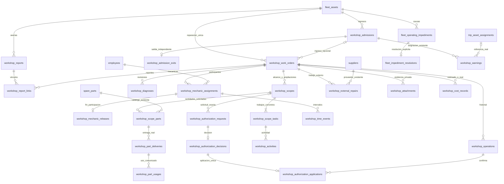

# Etapa 6.2 — Propuesta técnica del modelo de datos del Taller Mecánico

## Estado y fuentes de verdad

Base revisada: main, 861cc2d6b494121540cdd7de254bd00396bc7a5e.
La etapa 6.1 está publicada en 96338c73619becbb3ae5f32ef40b9de51d30bcf4;
el avance posterior de main corrige solo package-lock.json y se conserva sin cambios.
Se revisan AGENTS.md, ARCHITECTURE.md, [RN de Taller](REGLAS_TALLER_MECANICO.md),
[etapa 6.1](etapa-6-1.md), ER histórico, etapas 4.x y 5.2A–5.6 y el código citado abajo.

**Aprobado funcionalmente:** RN-TAL-01..28 y las aclaraciones D-TAL-01..13 recibidas
para esta etapa. **Propuesto para revisión humana:** tablas, nombres, precisión numérica,
índices, triggers, representación de impedimentos, permisos de entrega y orden de trabajo
que siguen. No se autoriza implementación por publicar este documento. No se crea SQL,
migración, modelo Laravel, API, interfaz ni prueba de aplicación; no se consulta una base.

Las decisiones de este documento sustituyen las preguntas correspondientes de 6.1 sin
renumerar ni alterar las 28 RN. Un detalle todavía no definido se identifica expresamente;
no se considera rechazada o pendiente una decisión funcional ya aprobada.

## Aclaraciones funcionales vigentes — D-TAL-01 a D-TAL-13

| Decisión aprobada | Consecuencia para el modelo |
| --- | --- |
| D-TAL-01 | Ampliación de la misma reparación en la misma orden, solicitada por mecánico y autorizada independientemente por administrador. Trabajos ya autorizados continúan. Otra avería requiere otra orden oficial. |
| D-TAL-02 | Preventivos por tiempo y kilometraje contemplados; primero registro manual. Ingreso físico preventivo bloquea hasta salida autorizada. Avisos automáticos solo con lecturas, frecuencias y criterios confiables. |
| D-TAL-03 | Conductor reporta incidencia durante viaje; secretaria/administrador registra reporte Taller; administrador autoriza previamente reparación, incluida externa. Viaje/asignaciones se conservan. Relevo de conductor pertenece a Transporte, con motivo, instante, anterior/nuevo, responsable e historial; no elimina impedimento del equipo. |
| D-TAL-04 | Mecánico registra terminación; administrador revisa trabajos, repuestos, tiempos y pendientes y cierra. Salida distinta y auditable; cerrar no desbloquea. |
| D-TAL-05 | Secretaria/administrador registra ingreso; administrador autoriza salida tras verificar impedimentos. Un ingreso puede relacionarse con varias órdenes independientes; sin liberaciones/cambios automáticos de viajes. |
| D-TAL-06 | Aprobación identifica trabajos y cantidades concretas. Rechazo impide ejecutar ese alcance; puede corregirse solicitud o tramitar cancelación. Modificación/ampliación requiere aprobación correspondiente, preservando versiones/decisiones. |
| D-TAL-07 | Secretaria/administrador solicita cancelación; solo administrador confirma, incluso sin ejecución. Trabajos/consumos se documentan y resuelven sin borrar ni devolver stock automáticamente. Cancelar no libera ni prueba reparación resuelta. |
| D-TAL-08 | Mecánico rectifica información técnica de su competencia en órdenes activas con historia; sensible y reapertura de terminada/cerrada/cancelada requieren aprobación administrativa. |
| D-TAL-09 | Varios reportes de una avería pueden vincularse a una orden. Secretaria/administrador asigna mecánicos; relación muchos a muchos, sin exclusividad de una orden por mecánico. Mecánico consulta asignadas, administrador todo. |
| D-TAL-10 | Ingreso con viaje asignado genera avisos a oficina; bloqueo de nuevas asignaciones incompatibles, conservación de viaje/asignaciones. Administrador gestiona mediante operaciones autorizadas de Transporte. Aprobación de conflicto no autoriza equipo mecánicamente bloqueado. |
| D-TAL-11 | CRC principal; conservar moneda original sin conversiones inventadas. Estimado distinto de real; reportes por reparación, activo, repuesto y mano de obra; trabajo efectivo distinto de indisponibilidad. |
| D-TAL-12 | Fotografías y PDF privados; administrador todo, secretaria según coordinación, mecánico evidencias de asignadas. Factura externa si existe, sin obligatoriedad de cierre no aprobada. Límites de archivos técnicos, no reglas comerciales. |
| D-TAL-13 | Mecánico solicita, administrador autoriza, persona habilitada registra entrega, mecánico confirma uso real. Hasta Inventario real: sin stock/saldos/movimientos ficticios. Identidad/permisos de entrega **requieren aprobación antes de implementar**. |

## Diagnóstico del código y entidades reutilizables

`Workshop` figura en docs/arquitectura.mmd, pero app/Modules/Workshop no existe.
El ER histórico WorkOrder → WorkTask → TaskAssignment no se copia: las actividades
son pasos de **una** reparación/servicio, no reparaciones independientes dentro de una orden.

| Existente, nombre y ubicación reales | Uso / límite |
| --- | --- |
| `app/Modules/FleetAndDocuments/Models/FleetAsset.php` / fleet_assets | UUID, code, type (tractor_unit/tanker), service_status (available/maintenance/out_of_service). Única identidad del activo. |
| TractorUnit / tractor_units, Tanker / tankers, Compartment / compartments en FleetAndDocuments | Especializaciones vigentes; no nuevas tablas de vehículos ni inventario de cisternas. Taller usa FleetAsset. |
| `app/Models/User.php` / users | PK bigint; actor auténtico, cuenta activa. No convertirla a UUID. |
| `app/Modules/AccessAndPersonnel/Models/Employee.php` / employees | UUID; user_id bigint opcional, is_active. Mecánicos participantes referencian el mismo empleado. |
| Role / roles y user_roles en AccessAndPersonnel | Roles técnicos administrator, secretary, driver, mechanic. No crear rol duplicado de mecánico ni suponer un rol de bodeguero existente. |
| `app/Modules/Inventory/Models/SparePart.php` / spare_parts | UUID, code, description, unit. Catálogo existente; **no contiene existencias ni movimientos**. |
| `app/Modules/Purchasing/Models/Supplier.php` / suppliers | UUID, name. Proveedor existente; no hay flujo real de compra/recepción. |
| Trip, TripAssetAssignment, TripAssetRelease, DriverAssignment, DriverRelease en TransportAndDispatch | Identidad e historial de ocupación. current = sin liberación, incluso viaje terminado/cancelado. No duplicarlos en Taller. |
| `app/Modules/TransportAndDispatch/Models/TripOdometerReading.php` | Lecturas y revisiones existentes por asignación de cabezal. Fuente futura de preventivo; no asumir odómetro fiable de cisterna ni compensar reinicio. |
| TransportAuthorizationRequest/Decision/Application y TransportChange | Patrón de contenido exacto y registro inmutable, pero FK/validaciones específicas de Transporte. No guardar decisiones Taller con trip_id falso ni construir un repositorio genérico. |
| `app/Modules/FleetAndDocuments/Infrastructure/PrivateDocumentStorage.php` | Almacenamiento privado/compensación a revisar como patrón. register devuelve Document y conciliación consulta Document; no es servicio genérico de evidencias de orden. |
| Document, DocumentType, DocumentConfigurationSnapshot en FleetAndDocuments | Documentación reglamentaria de activos, no adjuntos de órdenes. No añadir WorkOrder falso a esos modelos ni usar sus snapshots para evidencias. |
| `app/Providers/AppServiceProvider.php`, `app/Modules/TransportAndDispatch/Policies/TransportCorePolicy.php` | Gates reales y patrón de revalidar cuenta/rol. No hay Gates de Taller instalados. manage-fleet sigue administrativo; permisos Taller propios y acotados. |

## Convenciones técnicas propuestas

- Nuevas entidades PK UUID; FK a User bigint, a Employee/FleetAsset/SparePart/Supplier UUID.
  Todos los vínculos históricos con ON DELETE RESTRICT; no cascade ni soft-delete para esconder hechos.
- Instantes TIMESTAMPTZ(6), almacenados como instantes y presentados America/Costa_Rica.
  Distinguir occurred_at (hecho comunicado) de registered_at (reloj del servidor).
  Fechas de programación sin hora, si se añaden después, DATE; no convertirlas en ingreso real.
- TEXT para descripciones/motivos; CHECK no vacío cuando obligatorio y límites de entrada
  Laravel revisables. Estado/prioridad TEXT + CHECK; no catálogo duplicado para siete estados.
- Propuesta cantidades NUMERIC(18,6), costos NUMERIC(20,6), precisión a revisar antes de
  migraciones. No heredar NUMERIC(15,2) de **litros** a unidades de repuestos/mano de obra.
  Rechazar NaN/infinito y escala excesiva antes de redondeo implícito. Cantidades efectivas
  positivas, importes no negativos; ausencia de dato NULL, nunca default cero inventado.
- currency CHAR(3), CRC principal; original explícita cuando corresponda. No persistir
  equivalencia CRC o tipo de cambio desconocido ni sumar monedas distintas como un total.
- version bigint positiva en raíces mutables; UNIQUE raíz/from_version/to_version en
  auditoría con incremento exacto. Historial de hechos append-only, revisiones enlazadas.
- JSONB solo para snapshots de contenido/auditoría/evidencia de contexto, no como sustituto
  de FK ni líneas autorizadas relacionales. IDs en snapshots se validan contra su ámbito.
- El identificador UUID satisface RN-TAL-08. Código humano consecutivo, si se desea, requiere
  diseño/revisión adicional; no secuencia empresarial inventada en esta propuesta.

## Modelo entidad-relación propuesto

El diagrama es lógico y está dentro de Markdown. Nombres snake_case son **propuestos**,
no tablas presentes. Se omiten algunos enlaces de auditoría para legibilidad; el catálogo
siguiente enumera FK/relaciones restantes. PK UUID nueva y actor bigint aplican a todos.

FleetAsset 1:N órdenes; **sin UNIQUE activo/orden abierta**. Ingreso 1:N órdenes;
orden 0..1 ingreso propuesto (externas/en carretera pueden no tener ingreso físico).
Una orden puede existir antes de ingresar; no crear ingreso ficticio para completar una FK.
Tras una reapertura, vincular la misma orden a un segundo ingreso mediante una relación
histórica requiere revisión T04 abajo; no mover una FK histórica silenciosamente.

Employee N:M órdenes mediante participaciones con historial; un mecánico puede trabajar
en varias órdenes. Varios reportes de una avería → una orden; política de reutilizar un
reporte en más de una orden se deja para T04, no se presupone unicidad de report_id.

## Catálogo de tablas nuevas y atributos principales

Son **26 tablas propuestas**, agrupadas por responsabilidades. Cada PK es id UUID salvo
indicación contraria. “Actor/fechas” significa actor_id bigint FK users, occurred_at y
registered_at TIMESTAMPTZ(6), reason TEXT; se usan nombres específicos (created_by_id,
decided_by_id, etc.) al implementar, pendientes de revisión. Cada tabla tiene un motivo
funcional; no crear todos los grupos en una migración indivisible.

### Identificación, ingreso y participantes (1–7)

| # / tabla propuesta | Propósito y atributos/FK principales | Integridad e índices propuestos |
| --- | --- | --- |
| 1 workshop_reports | fleet_asset_id FK; trip_event_id UUID FK trip_events NULL para incidente informado por conductor; description TEXT; reporter_id bigint FK NULL si autor conocido, recorded_by_id bigint FK obligatorio; actor/fechas; previous_report_id FK propia NULL para rectificar. Separa comunicador del registrador Taller. | Vínculo trip_event debe corresponder a viaje con ese activo en su historial al hecho, no a otro activo. Índice activo/fecha; cadena de revisión sin ramas. Reporte conductor real se conserva en Transporte, no se le otorga crear reporte oficial Taller. |
| 2 workshop_admissions | fleet_asset_id FK; kind TEXT correctivo/preventivo; admitted_at; admitted_by_id bigint FK; reason; registered_at; version. No columna status de orden ni released_vehicle boolean. | Índice activo/fecha; actor oficina activo. No aprobar unicidad de ingreso abierto por activo todavía (T04). Estado físico abierto se deriva de ausencia de salida. |
| 3 workshop_work_orders | fleet_asset_id FK; admission_id FK NULL; kind correctivo/preventivo; description de única reparación/servicio; priority baja/normal/alta/urgente; status siete estados; created_at/created_by_id; version. | FK compuesta ingreso/activo para no vincular a otro vehículo. Índices activo/status, status/created_at. Descripción única reparación no se prueba con SQL semántico: oficina valida y auditoría conserva alcance. |
| 4 workshop_report_links | report_id FK; work_order_id FK; linked_by_id bigint FK; registered_at; motivo. Vincula varios reportes, no copia descripciones. | UNIQUE(report_id,work_order_id), trigger mismo activo. Desvinculación errónea mediante operación rectificativa rastreable, no DELETE oculto. |
| 5 workshop_mechanic_assignments | work_order_id FK; employee_id FK; starts_at/registered_at; assigned_by_id bigint FK; reason. | Mecánico empleado/cuenta activa con rol mechanic al asignar; índice orden/empleado/fecha; impedir duplicar participación vigente por pareja, permitir otras órdenes. |
| 6 workshop_mechanic_releases | assignment_id FK UNIQUE; ends_at; recorded_by_id bigint FK; reason; registered_at. Fin de participación, **no libera vehículo**. | ends_at >= starts_at; asignación del mismo ámbito; actor oficina. Serialización pareja para no solapar participaciones vigentes de la misma orden. |
| 7 workshop_diagnoses | work_order_id FK; mechanic_assignment_id FK NULL cuando administrador registra en nombre propio; problem, probable_cause, proposed_repair TEXT; previous_diagnosis_id FK; revision integer; actor/fechas. | Problema/causa/propuesta requeridos antes de solicitud inicial; autor mecánico asignado vigente o administrador. UNIQUE predecesor y raíz/revisión. Corrección conserva original; sensibilidad y terminales requieren aprobación. |

### Alcance y autorización (8–14)

| # / tabla propuesta | Propósito y atributos/FK principales | Integridad e índices propuestos |
| --- | --- | --- |
| 8 workshop_scopes | work_order_id FK; diagnosis_id FK; scope_kind initial/extension/revision; previous_scope_id FK NULL; revision; proposed_by_id bigint FK; description; registered_at. Snapshot relacional inmutable de alcance. | Mismo orden en diagnóstico/predecesor; no rama ambigua de reemplazo. Ampliación añade trabajo/repuesto; revisión no borra aprobación previa. Estado de autorización deriva de solicitud/decisión/aplicación, no modifica scope. |
| 9 workshop_scope_tasks | scope_id FK; description TEXT de trabajo concreto; line_number integer; supplier_id FK NULL si ejecución externa propuesta. | UNIQUE(scope_id,line_number); descripción no vacía. Todas las tareas pertenecen a la misma reparación; avería diferente no es una línea añadida. Al menos una tarea al solicitar aprobar reparación. |
| 10 workshop_scope_parts | scope_id FK; task_id FK dentro del scope NULL si repuesto general de esa reparación; spare_part_id FK; quantity NUMERIC(18,6); unit_snapshot TEXT; description_snapshot TEXT. | Cantidad concreta positiva al autorizar. Unidad coincide con catálogo al registrar, sin conversión inventada. UNIQUE(scope_id,line_number) con line_number integer adicional. No imponer UNIQUE repuesto: puede tener usos/tareas distintos. |
| 11 workshop_authorization_requests | work_order_id FK NULL; admission_id FK NULL; scope_id FK NULL; type TEXT reparación/ampliación/rectificación/reapertura/cancelación/salida; previous_request_id FK NULL; content JSONB objeto; target_version bigint cuando afecta raíz; requested_by_id bigint FK; reason; registered_at. | CHECK de combinación de FK según tipo; scope implica orden coincidente, salida implica ingreso/activo. Índice pendiente por tipo/fecha. Contenido reconstruido en servidor con IDs/versiones concretas, no actor o cantidad autorizada libre del cliente. Rechazo corregido = nueva solicitud/predecesor. |
| 12 workshop_authorization_decisions | request_id FK UNIQUE; decision approved/rejected; decided_by_id bigint FK; reason; registered_at. | Administrador activo exclusivo, inmutable. No UPDATE rejected→approved: nueva solicitud si se modifica; preservar denegación. |
| 13 workshop_operations | work_order_id/admission_id/report_id FK según raíz; operation_type TEXT; before_values/after_values JSONB; from_version/to_version bigint NULL para eventos sin raíz mutable; actor_id bigint FK; reason; occurred_at/registered_at; request_key UUID NULL; request_fingerprint TEXT NULL. Historial de transiciones/revisiones, recibo de comando y revisión administrativa. | FK explícitas, CHECK ámbito según acción; UNIQUE raíz/to_version y correlación exacta con actualización. Clave/fingerprint son propuesta durable para idempotencia T07, no activada ahora. Referencia a registros afectados se valida en SQL; no log sin relación al cambio. |
| 14 workshop_authorization_applications | decision_id FK UNIQUE; operation_id FK; applied_by_id bigint FK; registered_at. Activación de un scope o ejecución única de salida/cancelación/cierre autorizado/reapertura/rectificación. | Decisión aprobada, mismo ámbito/tipo/contenido exacto. Scope activo se reconoce por su aplicación una sola vez; no consumir misma decisión en otra operación. Varias decisiones pueden cubrir partes distintas de una operación solo si están explícitamente referidas y validadas. |

La revisión normal de cierre por administrador es una operación oficial auditable y no
necesita por defecto inventar una solicitud de aprobación adicional. Su autorización de rol
se comprueba en servidor/PostgreSQL. Rectificación sensible y reapertura sí requieren
solicitud/decisión/aplicación según D-TAL-08.

### Ejecución, repuestos y evidencia (15–21)

| # / tabla propuesta | Propósito y atributos/FK principales | Integridad e índices propuestos |
| --- | --- | --- |
| 15 workshop_activities | task_id FK; mechanic_assignment_id FK NULL para registro administrador; description, observations TEXT; previous_activity_id FK NULL; revision integer; actor/fechas. | Orden/tarea/participante coherentes; tarea dentro de scope activado para registrar ejecución. Revisiones append-only; no convertirse en reparación distinta ni aprobarse por escribir actividad. |
| 16 workshop_time_events | work_order_id FK; mechanic_assignment_id FK; event_type start/pause/resume/finish; actor/fechas; previous_event_id FK NULL para rectificación. | Secuencia temporal del mismo participante/orden y revisión sin ramas, serializada. No excluir participación paralela en otras órdenes. Modelo por participante propuesto para revisión T05; no representa nuevos estados de orden. |
| 17 workshop_part_deliveries | scope_part_id FK; quantity NUMERIC(18,6); delivered_to_assignment_id FK; recorded_by_id bigint FK; occurred_at/registered_at; reason; previous_delivery_id FK NULL. Entrega física comunicada, no movimiento stock. | Cantidad positiva dentro de línea autorizada; destinatario de esa orden. Rol/grant del registrador **pendiente de aprobación T01**. Agregado efectivo de entregas no excede cantidad autorizada; serializar línea y revisiones. |
| 18 workshop_part_usages | delivery_id FK; quantity NUMERIC(18,6); confirmed_by_id bigint FK; mechanic_assignment_id FK; occurred_at/registered_at; reason; previous_usage_id FK NULL. Uso real confirmado por mecánico. | Mismo ámbito, entrega anterior; uso efectivo <= cantidad entregada y autorizada, sin reutilizar línea para otra reparación. Autor asignado vigente, administrador acceso completo con identidad propia. No columna stock_balance ni supuesto movimiento Inventario. |
| 19 workshop_external_repairs | work_order_id FK; scope_task_id FK; supplier_id FK; description; performed_at; recorded_by_id bigint FK; registered_at; previous_record_id FK NULL. Hechos externos y proveedor; costo/factura mediante relaciones siguientes. | Scope externo activado y proveedor coincidente con autorizado. Orden propia/una reparación. No crear compras/pagos ni proveedor ficticio; factura puede faltar sin bloquear cierre por sí sola. |
| 20 workshop_attachments | work_order_id FK; category foto/documento/factura; external_repair_id FK NULL; storage_key TEXT único privado; mime TEXT; extension TEXT; size_bytes bigint; checksum TEXT; uploaded_by_id bigint FK; registered_at; previous_attachment_id FK NULL. | Asociación externa de la misma orden; archivo privado único sin sobrescritura. MIME/tamaño/categoría válidos y checksum técnico; no almacenamiento de bytes en PostgreSQL ni FK hacia Document de flota. Reemplazo enlaza original preservado. |
| 21 workshop_cost_records | work_order_id FK; scope_task_id/scope_part_id/usage_id/external_repair_id FK según origen; cost_kind labor/part/external; basis estimated/actual; amount NUMERIC(20,6) NULL; currency CHAR(3); description; previous_cost_id FK; actor/fechas. | CHECK combinación de FK, moneda presente si importe; estimated distinto de actual. Índice orden/basis/currency. Categorías fuera de labor/part/external no se habilitan; requieren revisión T06. Sin total convertido o costo pagado inventado. |

No duplicar importe de reparación externa en #19 y #21; la relación a costos reales
responde a RN-TAL-19. No sumar una factura y sus líneas de repuestos otra vez como costo.
Si la factura solo acredita costo externo global, mostrar cobertura y evitar doble conteo;
metodología de agregación/scope de costos pendiente T06.

Los faltantes se calculan comparando solicitado/autorizado/entregado, pero la **necesidad
comunicada** y su justificación requieren un hecho propio (#26), no asumir que toda diferencia
es una compra urgente. No entregar/usar ni crear stock a partir de un cálculo de faltante.

### Disponibilidad y coordinación (22–26)

| # / tabla propuesta | Propósito y atributos/FK principales | Integridad e índices propuestos |
| --- | --- | --- |
| 22 fleet_operating_impediments | **Propiedad FleetAndDocuments**: fleet_asset_id FK; kind taller/otra_causa_revisada; admission_id FK NULL; work_order_id FK NULL para causa de reparación concreta; effect maintenance/out_of_service; description; actor/fechas. Causas múltiples, sin copiar activo. | CHECK ámbito/origen; admisión/orden mismo activo; índice activo. Causa taller por ingreso persiste hasta salida; causa de avería puede existir aunque no haya ingreso físico. Activación de bloqueo en carretera debe confirmarse por función autorizada, no inferirse de cualquier reporte (T02). |
| 23 fleet_impediment_resolutions | impediment_id FK UNIQUE; operation_id FK; resolved_by_id bigint FK; resolved_at/registered_at; reason; evidence JSONB. Resolución explícita histórica. | No borrar ni actualizar causa; administrador para resolución que permite salida. Cambiar orden a cerrada/cancelada no inserta resolución automática. Resolución de causa no taller sigue política de Flota revisada T02. |
| 24 workshop_admission_exits | admission_id FK UNIQUE; authorization_application_id FK UNIQUE; exited_at; recorded_by_id bigint FK; registered_at; reason; reviewed_content JSONB. Salida administrativa/física confirmada, independiente del cierre de órdenes. | Administrador activo, aplicación tipo salida, mismo ingreso/activo y revisión actual de todas las causas. Tiempo >= ingreso. Índice fecha. No equivale a release de Transporte ni obliga a que available sea el resultado. |
| 25 workshop_warnings | admission_id FK; trip_asset_assignment_id FK NULL; work_order_id FK NULL; code TEXT; context JSONB; captured_by_id bigint FK; registered_at. Captura de impedimentos/asignaciones existentes para coordinación. | FK mismo activo/trip real; UNIQUE ingreso/asignación/code cuando corresponda. Advertencia inmutable; aclaraciones/resolución via #13 referenciando warning_id FK adicional. Índice ingreso/fecha. No inventar TripWarning de cierre de viaje para avisar ingreso Taller. |
| 26 workshop_material_needs | work_order_id FK; scope_part_id FK NULL; spare_part_id FK; quantity NUMERIC(18,6); description; requested_by_id bigint FK; occurred_at/registered_at; previous_need_id FK NULL. Faltante/necesidad de compra comunicado. | Misma orden si refiere línea; historial de revisiones. Cantidad positiva; condición de compra/autorización no equivale a compra ejecutada. Contrato futuro de solicitud de compra aprobado se definirá con Purchasing, no tabla Purchase ficticia. |

Las solicitudes de autorización **de compra** pueden añadir un FK a necesidad en #11
mediante diseño revisado de ese contrato; esta propuesta no sustituye decisiones de Compras
por una aprobación de reparación ni da por implementado el flujo de autorización de compra.
Si se habilita tramitación local previa, revisar tipo purchase_need y contenido de necesidades
antes de migrar; la regla de aprobación exclusiva administrativa ya está confirmada.

### Rectificaciones sin una tabla polimórfica genérica

En hechos técnicos se propone root_record_id UUID FK a la misma tabla (raíz=id en
el primer hecho), previous_*_id FK, revision integer positiva y UNIQUE(predecesor), con igualdad
de identidad (orden/activo/línea/participante) y raíz/revisión. Nunca sumar todas las revisiones:
consultar la hoja vigente de cada cadena, con UNIQUE(root_record_id,revision) y validación
de raíz/predecesor/identidad. Un uso sigue vinculado a la entrega histórica referenciada;
para validar cantidades se agrupa por la raíz de entrega y su revisión efectiva, sin mover
el FK del uso ni contar revisiones de uso dos veces. Reducir una entrega por debajo del uso
real confirmado se rechaza y se remite al procedimiento sensible, no borra el uso.
El motivo/actor/fecha y #13 registran anterior/nuevo.
Vínculos a la revisión autorizada de alcance no cambian por modificar una descripción técnica.
Para cambiar cantidad autorizada, entregar distinto alcance o revisar terminales debe existir
la aprobación correspondiente. FK a un registro equivocado no se “corrige” moviendo un hecho
a otra orden: procedimiento sensible explícito, revisión y efectos dependientes bajo validación.

#13 tendrá enlaces FK explícitos a hechos sensibles corregidos según acción, evitando entity_type
+ entity_id sin integridad. La lista exacta se revisará en implementación para no crear todos
los campos posibles indiscriminadamente; no usar un JSON libre como autorización funcional.

## Alcances, aplicaciones y límites cuantitativos

Una autorización inicial activa un scope inmutable con tareas/partes concretas. Ejecución y
entregas/usos referencian esas líneas activas, no una bandera general “orden autorizada”.
Cada ampliación añade otro scope y su propia aprobación/aplicación. La aprobación de ampliación
no revoca la inicial ni obliga a pausar la orden; el estado de la orden puede seguir en reparación
mientras la **solicitud** de ampliación está pendiente/rechazada.

Una decisión se aplica **una vez** para activar el alcance. Varias actividades/entregas parciales
dentro de él no reaplican la misma decisión: consumen la habilitación de sus líneas, con cantidades
agregadas verificadas. No requieren una nueva autorización por cada captura dentro del alcance
ya aprobado. Incrementos o reemplazos se aprueban explícitamente, sin doble habilitación de una
línea revisada ni sumar una revisión como si fuese ampliación adicional (T03).

Contenido de decisión: orden, scope/revisión, diagnóstico usado, tareas, proveedor externo cuando
corresponda, repuestos/unidades/cantidades y referencias relevantes. ID o hash por sí solo no basta;
validar comparación canónica con el contenido relacional confirmado. Cambios ajenos (asignar otro
mecánico, avance de actividad) no invalidan el scope aprobado. Para salida/reapertura/rectificación,
la aprobación referencia la versión y datos **afectados**, no se reutiliza después de cambiarlos.

Rechazo es inmutable y no cambia automáticamente el estado a cancelada. Corregir solicitud crea
nueva versión y vínculo al rechazo anterior. Alcance rechazado no habilita actividad ni partes;
solo la parte previamente aprobada puede continuar. Revocación/caducidad automática no se inventa.

## Estados y permisos del núcleo

Siete estados propuestos para persistir: pending_diagnosis, pending_authorization, authorized,
in_repair, finished, closed, cancelled. Prioridades low/normal/high/urgent, traducción UI española.
Son nombres técnicos para revisión, no nuevos estados empresariales. Espera de materiales y pausa
son eventos/condiciones; no octavo estado aprobado.

| Acción | Responsable confirmado | Regla de aplicación |
| --- | --- | --- |
| Crear orden/ingreso; asignar mecánico | Administrator o secretary | Actor actual, mismo activo/ámbito; reporte no prueba ingreso. |
| Diagnosticar, solicitar reparación/ampliación/repuestos | Mechanic de asignadas; administrator acceso completo | Diagnóstico previo, scope exacto. Oficina coordina solicitud, no aprueba. |
| Aprobar/rechazar alcance, reparación externa | Administrator exclusivamente | Decisión explícita; preservar rechazo/versiones. |
| Ejecutar, pausar, reanudar y registrar terminación | Mechanic asignado; administrator acceso completo | Scope aplicado, actividad técnica propia; fin de orden distinto de fin de cada participante. |
| Revisar/cerrar terminada | Administrator exclusivamente | Revisión de trabajos, repuestos, tiempos y pendientes conservada en operación; factura no es requisito nuevo. |
| Solicitar cancelación | Administrator o secretary | Motivo y hechos; no transición por solicitar. |
| Confirmar cancelación | Administrator exclusivamente | Revisar y documentar trabajos/consumos y su resolución, no devolución/desbloqueo automático. |
| Rectificar técnica en activa | Mechanic competente/asignado; administrator | Mantener historia. Clasificación concreta de sensibles revisada T03. |
| Rectificar sensible/reabrir terminal | Administrator autoriza; ejecutor según contenido/competencia | Solicitud, decisión y aplicación, estado objetivo explícito, no asumir vuelta a pendiente/in_repair. |
| Registrar entrega | **Pendiente de aprobación T01** | No conceder por ser mechanic/secretary ni por aprobar reparación. |
| Confirmar uso | Mechanic asignado; administrator acceso completo con su actor real | Cantidad efectiva dentro de entrega y autorización; no stock ficticio. |
| Autorizar/aplicar salida | Administrator exclusivamente | Revisión actual de impedimentos y salida auditable independiente. |
| Consultar evidencia | Administrator todo; secretary coordinación; mechanic asignadas | Definir acciones de coordinación sin conceder edición técnica ni acceso a otra orden. |

Gates propuestos, **no existentes ni aprobados aún**: record-workshop-intake,
manage-workshop-orders, assign-workshop-mechanics, work-on-workshop-order,
authorize-workshop-scope, close-workshop-order, cancel-workshop-order,
authorize-workshop-exit y record-workshop-part-delivery (solo tras T01).
Policies por recurso verán rol/cuenta/participación actuales, sin ampliar manage-fleet.
No introducir Gate::before que omita autorización explícita o integridad a administrador.

Transiciones: creación→pending_diagnosis; diagnóstico/solicitud inicial→pending_authorization;
aprobación aplicada→authorized; inicio autorizado→in_repair; terminación técnica→finished;
revisión administrativa→closed; cancelación confirmada→cancelled según estado permitido.
Aprobación pendiente de ampliación no cambia in_repair a pending_authorization. Reapertura de
terminal y cancelación de una orden ya cerrada requieren precisar destino/efectos (T03), no
conceder transiciones globales por disponer de una decisión administrativa.

## Impedimentos, ingreso y salida: una fuente de disponibilidad

Propuesta T02: las causas operativas pertenecen a FleetAndDocuments (#22/#23) y
fleet_assets.service_status continúa como **proyección protegida**, no como un segundo
estado editable de Taller. Fuente lógica: causas no resueltas; available solo sin causa
impeditiva, out_of_service si persiste una causa de ese efecto, maintenance si solo existen
causas de taller de ese efecto. Precedencia técnica a revisar, no clasificación de averías
aprobada ni autorización para sobreescribir un impedimento previo.

Ocupación se mantiene aparte en Transporte: ausencia de bloqueo mecánico no significa libre
si hay TripAssetAssignment current. Documentos faltantes/vencidos continúan advertencias.
Una excepción de ocupación no puede hacer eligible a un equipo maintenance/out_of_service.

1. Secretaria/administrador registra ingreso físico y causa de bloqueo en **una transacción**;
   captura asignaciones actuales como advertencias. No se escriben TripAssetRelease/Trip.
2. Se crean/vinculan órdenes independientes del mismo activo. Causas de averías que impiden
   operar permanecen identificadas aunque la orden cambie a finished/closed/cancelled.
3. Mecánico termina; administrador revisa/cierra orden. Esta operación registra revisión,
   no resuelve ingreso ni modifica automáticamente service_status.
4. Administrador solicita/decide salida con snapshot explícito de ingresos/causas/versiones
   y órdenes revisadas. Al aplicar, revalidar que no aparecieron causas/órdenes impeditivas,
   que las resoluciones autorizadas se registran y que otros impedimentos no se borran.
5. Registrar salida y resolución de la causa del ingreso atómicamente con proyección. Otros
   impedimentos pueden mantener out_of_service/maintenance, y ocupación mantiene conflictos.
   **Salida no garantiza available ni liberación física para un viaje.**

No exigir todas las órdenes cerradas si el negocio no ha aprobado esa condición: requiere
resolución de impedimentos y revisión administrativa, no equivalencia estado cerrado=resuelto.
T02 precisa cómo registrar/verificar resolución técnica y qué causa corresponde a cada orden,
para no permitir una salida con avería impeditiva sin resolver. Una orden cancelada conserva
su causa hasta resolución explícita; evitar levantar el bloqueo por cancelación.

**Datos previos:** no se consultan aquí. Antes de desplegar, identificar estados maintenance/
out_of_service sin causas conocidas. No convertirlos a available ni inventar avería, ingreso,
fecha o actor históricos. Mantener el impedimento observado y exigir conciliación administrativa
trazable; detener la migración/integración si no puede preservar correctamente su semántica.
Un snapshot de estado observado puede registrarse como tal, jamás como reparación histórica.

## Integridad PostgreSQL, Laravel y concurrencia

| Protección PostgreSQL propuesta | Validación/coord. Laravel necesaria |
| --- | --- |
| FK RESTRICT y FK compuestas orden/activo, ingreso/activo, scope/orden, línea/scope y participante/orden | Form Requests y Policies devuelven errores comprensibles; no aceptar IDs ajenos o actores cliente. |
| CHECK estado/prioridad/tipos, numéricos finitos, cantidad/importe y fechas; historial sin UPDATE/DELETE/TRUNCATE | Validación real de escala/unidad y campos permitidos antes de cast/redondeo. Adjuntos MIME/estructura fuera de SQL. |
| UNIQUE decisión/solicitud, aplicación/decisión, salida/ingreso, revisión/predecesor y participación vigente por pareja | Cargar y revalidar actor activo/rol/competencia, estado y alcance al confirmar, no solo al consultar. |
| Trigger ámbito/contenido/tipo de aprobación y role actual; actividad/entrega/uso requieren scope aplicado | Control del caso de uso y transacción breve; no meter reglas de negocio en controlador/Vue. |
| Restricciones diferidas de estado/auditoría y proyección de disponibilidad, incluyendo SQL directo | Escribir raíz+cambio+aplicación+causas/resoluciones dentro de unidad atómica; forzar validación antes de responder éxito. |
| Trigger/bloqueo de línea y agregado efectivo: entregado<=autorizado y usado<=entregado; revisions no contadas dos veces | Manejar conflicto sin retry ciego, mostrar cantidades confirmadas. Modificación autorizada con entregas previas debe validar efectos (T03). |
| UNIQUE recibo de comando en ámbito/clave y rechazo de fingerprint distinto, diseño T07 | No reintentar una mutación no confirmada sin clave segura; recuperar mediante consulta real. |

Bloqueo recomendado para revisar: pg_advisory_xact_lock(873210) existente, escritura de
transport_assignment_guard existente para invalidar snapshots obsoletos, luego activo,
raíces de Taller y líneas en orden estable de UUID. Es integración del coordinador existente,
no una segunda cerradura que deje escapar asignaciones. READ COMMITTED y versiones para
raíces; 40001/40P01/55P03 se tratan como conflictos y solo se reintenta comando idempotente.

Carreras a probar después: ingreso/asignación (si asignación confirma primero, ingreso advierte
sin liberarla; si ingreso primero, asignación nueva rechazada), salida/nuevo impedimento,
dos ampliaciones/dos entregas sobre cuota, uso/rectificación de entrega, cierre/cancelación,
doble decisión y reapertura/escritura técnica. Conservar lectura informativa de disponibilidad;
confirmación siempre revalida. No prohibir simultaneidad de órdenes o participación de un
mecánico en otras órdenes mediante exclusión temporal no aprobada.

## Impacto en módulos existentes e integración de relevo

| Componente real | Cambio futuro mínimo justificado / qué se conserva |
| --- | --- |
| `app/Modules/FleetAndDocuments/Application/FleetAdministration.php` | Actualmente save crea available y actualiza código/capacidades, no cambia service_status públicamente. Revisar compatibilidad de su bloqueo/creación con proyección protegida; evitar escritor genérico que levante causa Taller. Nuevas migraciones de integración, nunca editar publicadas. |
| `app/Modules/TransportAndDispatch/Application/AssignmentAvailability.php` | inspect/revalidate usan service_status=available. Con proyección correcta pueden conservar lógica; enriquecer razones para UI después, sin cálculo alternativo de elegibilidad. |
| `database/migrations/2026_10_11_000130_protect_trip_assignment_integrity.php` | Hoy protege elegibilidad SQL y conflictos/autoridad; conservar su comportamiento. Integración futura mediante nuevas restricciones/proyección, no cambio de esta migración. |
| `database/migrations/2026_10_12_000140_create_trip_operational_records.php` y TripOperations::start | Inicio oficial exige asignaciones y activos elegibles. Ingreso conserva asignaciones pero nuevo inicio/reprogramación que revalida no elude bloqueo. No cambiar viajes existentes para resolver ingreso. |
| AssignmentAdministration / TransportAssignmentOperation / DriverAssignment / DriverRelease | **Relevo ya soportado** por substitute(kind=driver): anterior/nuevo, motivo/actor/fecha, liberación del conductor saliente e inserción del entrante en la misma operación, sin soltar cabezal/cisterna. En in_progress requiere driver_substitution y conflicto adicional si corresponde. |
| `routes/transport.php`, AssignmentWriteRequest, TransportAdministration | Ya exponen POST trips/{id}/assignments/substitute y solicitud/decisión exacta de autorización. No proponer otro endpoint o tabla driver_reliefs ni cambiar regla administrativa de RN-TR-12. |
| TripEvent/report-trip-information | Conductor propio asignado puede comunicar incident/report; oficina registra reporte Taller vinculado a ese evento. No insertar orden oficial como conductor ni interpretar informe como permiso para reparar. |

Conductor entrante debe ser empleado/cuenta activa y rol driver; comprobar disponibilidad
real. La nueva decisión no revoca las reglas de conflictos/autorización vigentes: un relevo
a conductor ocupado no se presume disponible. Cambiar conductor no modifica causas de
FleetAsset; ese viaje no obtiene permiso para operar equipo bloqueado por registrar relevo.
La sustitución de cabezal existe con autorización según estado; la de cisterna **sigue bloqueada
por D05 de Transporte**. D-TAL-05 (ingreso/salida Taller) no resuelve ese D05: son decisiones
distintas. No inventar trasvase, comprobación de cisterna vacía ni sustitución general de vehículos.

Inventario futuro: vincular uso y movimiento real con contrato idempotente y FK cuando exista
la tabla de movimientos. No crear FK a una tabla inexistente ni un ID libre fingiendo movimiento.
No hay una operación de “reanudar viaje tras avería” que pueda invocarse como garantía de
continuación física. La sustitución de conductor comprueba al entrante y puede conservar
el equipo bloqueado; registrar ese relevo no acredita que el equipo esté reparado. Capturar
hechos operativos ya ocurridos tampoco debe fingir que se autorizó continuar. Resolver causas
y gestionar sustituciones autorizadas son procesos distintos; cualquier control nuevo de
continuación en Transporte se revisará por separado, sin inventar endpoint o estado aquí.

Compras futuro: necesidad aprobada → solicitud/compra/recepción real bajo Purchasing; preservar
referencia de origen, no aprobar compra por aprobación de reparación. No implementar finanzas.

Preventivos: work_order.kind preventivo, servicio único y registro manual de alcance/actividades.
No crear todavía tabla de frecuencias/planes, scheduler o contador propio. TripOdometerReading
puede aportar evidencia de kilometraje por cabezal; lecturas válidas, reinicios, última lectura
fiable y frecuencia deben verificarse antes de emitir aviso automático. Tiempo desde un servicio
es dato histórico, no una frecuencia empresarial deducida. Ingreso físico preventivo bloquea igual.

## Evidencia, costos y reportes

Propuesta técnica de archivos para revisión: PDF, JPEG (.jpg/.jpeg) y PNG, 1..10.000.000 bytes
por archivo, MIME y estructura coherentes, sin rutas libres; nombres UUID internos y checksum
SHA-256. Fotografías en otros formatos no se convierten automáticamente ni se aceptan por extensión.
Límite de número de adjuntos/retención requiere T08; no borrar historia por política inventada.

Servicio concreto de evidencia Taller con compensación segura siguiendo PrivateDocumentStorage;
registro/archivo confirmado no se elimina por una respuesta perdida. Transferencia de archivo
fuera de transacciones prolongadas, recibos privados y conciliación que compruebe FK/commit.
No modificar el reconciliador Fleet para que borre adjuntos que no conoce. En API futura no exponer
storage_key ni URL pública; administrador todo, secretaria coordinación, mecánico asignadas.
No factura obligatoria ni condición de vencimiento de Document trasladada a órdenes.

Costos: vistas por orden/activo/tipo de reparación/SparePart/mano de obra, separando estimado,
real, moneda original y ausencia de dato. No tasa de cambio ni pago declarado por adjuntar factura.
Frecuencia inicialmente por descripción/servicio existente y filtros; clasificaciones de averías
requieren revisar catálogo antes de crearlo. Tiempos por participante y unión de intervalos de
trabajo no se suman indistintamente con tiempo de indisponibilidad del activo. Varios impedimentos
simultáneos cuentan una sola vez al medir tiempo fuera de servicio (propuesta de cálculo T05).

## Decisiones técnicas y precisiones residuales para revisar

Las D-TAL funcionales anteriores están aprobadas; las preguntas de abajo delimitan el diseño
físico o un detalle todavía no fijado, sin reabrir las decisiones ya tomadas.

| ID / prioridad | Revisión necesaria antes de implementar | Recomendación, no autorización |
| --- | --- | --- |
| T01 / bloquea entregas | Identidad y permisos concretos del registrador habilitado (reserva explícita D-TAL-13). | Proponer grant nominativo administrado por administrator para usuarios activos mechanic o secretary; administrator mantiene acceso completo. No conceder por rol automáticamente ni crear warehouse role. Comparar tabla de habilitaciones auditables vs capacidad existente: hoy no hay catálogo de permisos/grants. Requiere aprobación de ese cambio y su revocación. |
| T02 / bloquea disponibilidad completa | Ownership de causas/proyección, prioridad de efectos, validación de resolución impeditiva, avería remota, datos service_status previos. Salida física con otro impedimento vs autorización para operar. | Mantener fuente Fleet; una salida puede dejar equipo no disponible, sin afirmar permiso para circular. No resolver avería por cerrar/cancelar. Conciliación explícita de estados previos desconocidos antes de migrar. |
| T03 / bloquea operaciones sensibles | Qué registros/campos son sensibles; reemplazo de scope aprobado con ejecución/entregas; estados destino de reapertura y cancelación de orden ya cerrada; forma de documentar resolución de trabajos/consumos. | Versiones/aprobación exacta; no revocación automática, reducción por debajo del uso, devolución ni reapertura a estado supuesto. Base/ampliación nuevas definidas sí pueden diseñarse independientemente. |
| T04 / media | ¿Un solo ingreso físicamente abierto por activo? Órdenes externas/previas, reapertura con nuevo ingreso, cardinalidad reportes→órdenes y revisión de enlaces. | Admitir orden sin ingreso físico y FK mismo activo. Antes de exigir unicidad o cambiar FK, revisar si asociación histórica N:M orden/ingreso es necesaria; no imponer la tabla puente sin razón. |
| T05 / media | Eventos por participante vs orden, escalas exactas de cantidades/costos, cálculo de horas efectivas/indisponibilidad y tiempos corregidos. | NUMERIC propuestos y TIMESTAMPTZ; no reglas de jornada/exclusividad/redondeo laboral. Cálculos explícitos, sin sumar solapes dos veces. |
| T06 / media | Alcance de consulta económica secretaria/mecánico, registrar costos, categorías y evitar doble conteo factura/partes/mano de obra. | CRC principal y moneda original ya aprobadas; no conversión o fórmula de precio. Mantener datos desconocidos NULL. Revisar accesos de coordinación sin retirar evidencia de órdenes asignadas aprobada. |
| T07 / alta para mutaciones | Idempotencia durable: ámbito de clave, fingerprint, retención y recuperación; aplicaciones/recibos y orden de locks con código actual. | Una clave por operación lógica y contenido; versiones+UNIQUE; no reintento ciego. Migración y pruebas concurrentes deben aprobarse dentro del diseño físico. |
| T08 / media | Límite técnico de archivos propuesto, retención y cantidad; servicio concreto de archivos/reconciliación Taller y campos de snapshot. | Reutilizar patrón privado sin acoplar Document a orden. No borrar evidencia original ni exigir factura para cerrar. |
| T09 / integración futura | Identidad del movement/recepción y entrega autorizada, necesidad aprobada de compra y fallo parcial intermodular. | Contratos reales cuando módulos estén implementados; antes solo hechos diferenciados, sin existencias simuladas. |

No añadir de forma preventiva tablas de personal, vehículos, almacenes, compras, movimientos,
planes automáticos, tarifas o facturas. Las 26 tablas propuestas son una descomposición para
revisión; pueden simplificarse físicamente si conservan FK, auditoría e invariantes, sin mezclar
solicitud/decisión/aplicación o disponibilidad/cierre de orden.

## Orden de implementación recomendado, después de aprobación expresa

1. Revisar T01–T04/T07 y autorizar modelo físico mínimo. Confirmar semántica de datos previos
   sin tocar transporte_db; aprobar plan de migraciones nuevas y bloqueo compatible.
2. Núcleo: reportes, órdenes, vínculos, participantes, diagnósticos y operaciones/auditoría.
   Roles/relaciones/revisiones; sin backend funcional en esta entrega.
3. Alcances iniciales y ampliaciones, tareas/partes y solicitudes/decisiones/aplicaciones;
   pruebas de contenido exacto y aprobaciones separadas sin paralizar trabajo anterior.
4. Ingresos, impedimentos, advertencias y salida bajo integración Fleet/Transporte; integridad
   de proyección y SQL directo, concurrencia ingreso/asignación/salida antes de habilitar uso.
5. Actividades/tiempos y revisión/cierre/cancelación/rectificación con efectos aprobados.
6. Necesidades, entregas (solo T01 autorizado), usos comunicados, costos y externo; no movimientos
   stock hasta Inventario real. Evidencias privadas y recuperación de almacenamiento.
7. API 6.3, frontend 6.4 y E2E 6.5 en autorizaciones separadas. No implementar relevo en Taller;
   verificar compatibilidad con sustitución existente de Transporte cuando se integren avisos.

Pruebas futuras: PostgreSQL 18 aislado con tests/run-postgres.sh, restricciones/FK y SQL directo,
permisos/rol revocado, dos sesiones, cuotas concurrentes, historial/revisiones, archivos privados,
respuesta perdida y transacciones fallidas. Suites reales navegador/Laravel/PG separadas de mocks.
Esta entrega no ejecuta migraciones ni pruebas de aplicación.

## Trazabilidad y verificación documental

| RN aprobadas | Cobertura en propuesta |
| --- | --- |
| RN-TAL-01, RN-TAL-05, RN-TAL-21, RN-TAL-22 | Ingreso/cierre/salida y causas separadas; tablas 2,22–25, integración de elegibilidad y concurrencia. |
| RN-TAL-02, RN-TAL-06, RN-TAL-07, RN-TAL-08 | Reporte vs orden oficial, reparación única y multiorden; tablas 1–4 y UUID/actor/prioridad. |
| RN-TAL-03, RN-TAL-04, RN-TAL-11, RN-TAL-12 | Diagnóstico, scope inicial/ampliación y contenido relacional; tablas 7–14/21, sin costos desconocidos inventados. |
| RN-TAL-09, RN-TAL-10, RN-TAL-15, RN-TAL-16 | Participantes múltiples, estados y trabajo/tiempo; tablas 5,6,13,15,16. |
| RN-TAL-13, RN-TAL-14 | Solicitud/autorización/entrega/uso/necesidad; tablas 10–14,17,18,26, contratos reales futuros. |
| RN-TAL-17, RN-TAL-19 | Externo, proveedor, costo y adjuntos privados; tablas 19–21, sin factura obligatoria. |
| RN-TAL-18, RN-TAL-20, RN-TAL-27 | Prioridades y cancelación/rectificación administrativa auditadas; tablas 3,11–14 y revisiones. |
| RN-TAL-23, RN-TAL-24, RN-TAL-25, RN-TAL-26, RN-TAL-28 | Historial, preventivos manuales, consultas por rol, costos/tiempos y evidencia de asignadas. Sin scheduler, frontend u offline en esta entrega. |

Verificar antes de publicar: 28 reglas conservadas sin cambios, 13 decisiones presentes,
referencias reales, catálogo y ER coherentes, enlaces locales y cambios solo Markdown.
El modelo se entrega para aprobación humana; no iniciar implementación al publicar.

Controles documentales ejecutados: las 26 tablas del catálogo tienen numeración única y
propósito explícito; las 13 decisiones funcionales están consolidadas; las 28 RN conservan
exactamente sus líneas originales y se trazan en esta propuesta. Archivos/clases y enlaces
locales citados comprobados; cambios limitados a los cuatro documentos de diseño/seguimiento.
`git diff --check` correcto. No se ejecutaron pruebas de aplicación ni operaciones de base
de datos; no se instaló dependencia ni se creó código funcional.
