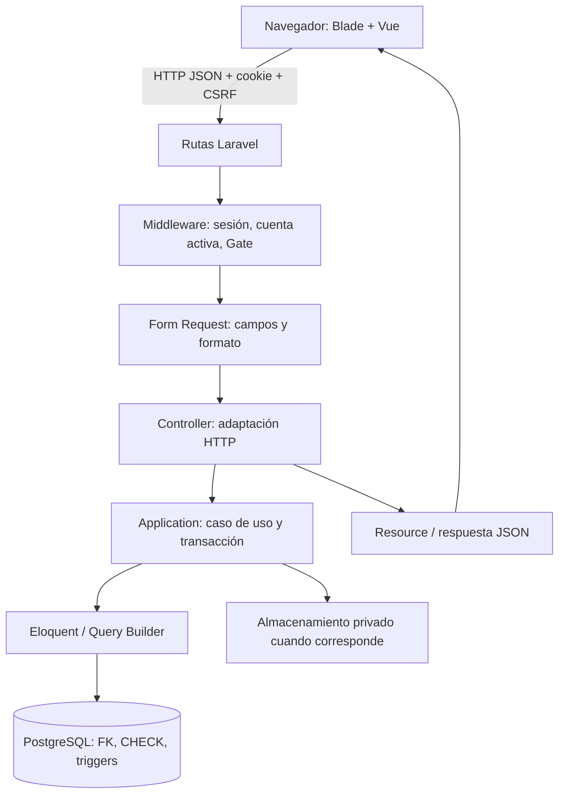

# 02. Tecnologías y arquitectura

## Vocabulario inicial

**Backend** es el programa del servidor que valida, autoriza y guarda datos. **Frontend** es la interfaz ejecutada en el navegador. Una **API** es un contrato de intercambio: aquí normalmente una petición HTTP y una respuesta JSON. JSON representa objetos/listas; no equivale a una tabla de base de datos.

**Laravel** es el framework PHP del backend: aporta rutas, sesión, validación, acceso a datos y consola. **Vue 3** construye interfaces reactivas: al cambiar un estado, actualiza el DOM. **TypeScript** añade tipos al JavaScript durante el desarrollo; no sustituye validar datos recibidos por HTTP. **PostgreSQL 18** persiste datos y ejecuta restricciones/triggers que protegen reglas aun ante escrituras SQL directas.

**Vite** compila los recursos del navegador; **Tailwind 4** proporciona utilidades CSS. **PWA** significa aplicación web progresiva: manifiesto y service worker permiten instalación y recursos offline. **IndexedDB** es la base local del navegador utilizada para las capturas del conductor. No es PostgreSQL ni una copia completa del sistema.

## Versiones y manifiestos

Consultar [`composer.json`](../../composer.json), [`composer.lock`](../../composer.lock), [`package.json`](../../package.json) y [`package-lock.json`](../../package-lock.json). Las restricciones como `^13.0` describen compatibilidad; el lock fija la resolución. El entorno utilizado durante las últimas validaciones documentadas fue PHP 8.4.24; PHP 8.5 es objetivo y no debe presentarse como ejecutado. Laravel 13, Vue 3.5.43, TypeScript 5.9.3 y Vite 8 corresponden a los manifiestos/resolución inspeccionados. La configuración estricta de TypeScript está en [`tsconfig.json`](../../tsconfig.json).

## Organización física

| Carpeta | Responsabilidad |
| --- | --- |
| `app/Modules/<Módulo>/Models` | Modelos Eloquent: tabla, conversiones de tipos y relaciones |
| `app/Modules/<Módulo>/Application` | Casos de uso, transacciones y coordinación |
| `app/Modules/<Módulo>/Http` | Controllers, Requests, Resources y middleware propios |
| `app/Modules/<Módulo>/Infrastructure` | Integraciones concretas, principalmente almacenamiento privado |
| `app/Models/User.php` | Cuenta autenticable compartida; no se duplica en cada módulo |
| `app/Providers/AppServiceProvider.php` | Registro de Gates, políticas y límite de inicio de sesión |
| `bootstrap/app.php` | Arranque HTTP y tratamiento centralizado de excepciones |
| `routes/` | Páginas, API con sesión, consola y scheduler |
| `database/migrations/` | Evolución ordenada de tablas, índices, funciones y triggers |
| `resources/views/` | Blade: HTML inicial que monta cada aplicación Vue |
| `resources/js/modules/` | Interfaz organizada por capacidades, contratos y adaptadores HTTP |
| `tests/` | Pruebas PHP, navegador, contratos y aislamiento PostgreSQL |
| `config/` | Parámetros de infraestructura; no son credenciales de ejemplo para copiar |

La arquitectura es **modular**: agrupa lo relacionado con una capacidad empresarial. Es **MVC** en la superficie HTTP: modelo para persistencia, vista para presentación y controlador para adaptar la petición. Los servicios de Application evitan que el controlador o Vue se conviertan en el lugar de reglas y transacciones. No hay un repositorio genérico obligatorio ni una interfaz artificial por cada clase.

**Eloquent** representa filas como objetos y relaciones. **Query Builder** construye consultas parametrizadas sin exigir un objeto por tabla. Se utilizan ambos. Un **Resource** selecciona explícitamente qué datos salen al cliente, por ejemplo omitir `storage_key` de documentos.

## Recorrido de una petición real

1. `resources/js/modules/TransportAndDispatch/components/RequestBoard.vue` abre el formulario y obtiene clientes/productos/rutas por lookups.
2. `CommandForm.vue` conserva una intención de alta. `creationIntent.ts` conserva su clave opaca entre reintentos; los datos privados no se guardan como formulario completo en sessionStorage.
3. El adaptador envía `POST /api/transport/requests`, JSON y `X-XSRF-TOKEN`, con la cookie de sesión.
4. `routes/backend.php` y `routes/transport.php` aplican autenticación, cuenta activa y `can:manage-transport-core`.
5. `TransportRequestWrite` verifica UUID, litros positivos en cadena decimal y fecha con zona. `TransportRequestController::store()` llama `TransportAdministration::createRequest()`.
6. La transacción obtiene el lock común, comprueba el recibo y confirma solicitud/recibo juntos. PostgreSQL verifica las referencias y restricciones.
7. La respuesta de alta es 201. El frontend actualiza la lista; si se pierde la respuesta, conserva clave/contenido para un reintento seguro.

## Límites de las capas

Ocultar un botón mejora el uso, pero no autoriza. Un tipo TypeScript previene errores del desarrollador, pero no protege contra un cliente modificado. Una comprobación `exists` impide referencias inexistentes, pero no prueba que un compartimento pertenezca a la cisterna de ese viaje. Esa relación exige controles del servicio y de PostgreSQL.

Las páginas usan navegación Laravel y varias raíces Vue, no una SPA universal con Vue Router. La PWA es una capacidad del portal del conductor; los demás módulos no adquieren automáticamente funcionamiento offline.
