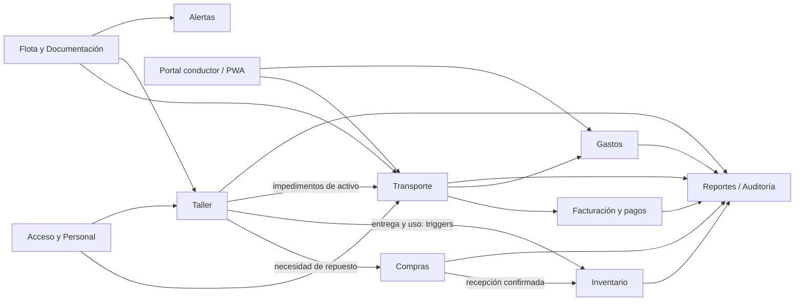
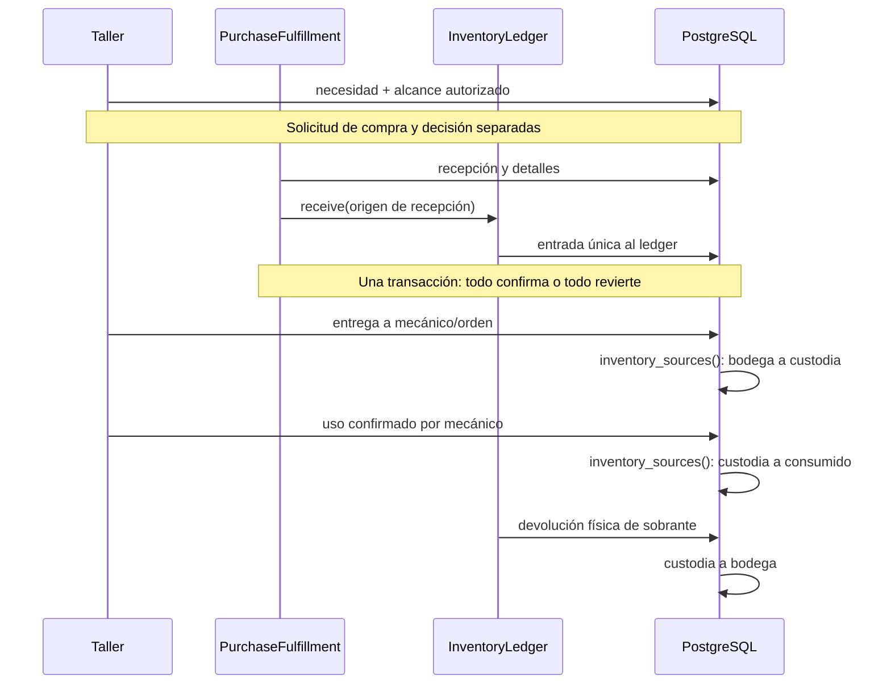

# 04. Comunicación entre módulos


## Qué cuenta como integración

Una **dependencia** ocurre cuando una capacidad necesita datos o comportamiento de otra. Puede ser una llamada PHP, una consulta a una tabla compartida o una regla PostgreSQL. No todo se comunica mediante HTTP: Vue llama a Laravel por HTTP; los servicios del mismo backend suelen llamar directamente a clases o usar la misma transacción.



Las flechas describen flujo de datos; no afirman que cada módulo invoque una interfaz pública de otro. Los [mapas de clases](03-modulos.md) y [triggers](base-de-datos/funciones-y-triggers.md) permiten distinguir la implementación concreta.

## Contratos compartidos importantes

| Integración | Implementación real | Garantía y límite |
| --- | --- | --- |
| Cuenta → actor | `User`, Gates, `EnsureActiveAccount`, `WorkshopAccess::fresh()` | El actor procede de sesión; no de `actor_id` del formulario |
| Recursos → selectores | Controladores de lookup de Transporte/Taller y consulta documental de activos | Se consultan datos persistidos; un selector no reserva ni autoriza |
| Taller → disponibilidad | `fleet_operating_impediments`, resoluciones y funciones de elegibilidad/asignación | No cancelar/liberar asignaciones históricas por un ingreso |
| Taller → Inventario | Función PostgreSQL `inventory_sources()` sobre fuentes de entrega/uso | El movimiento se confirma con su fuente; no hacer otro descuento en Vue/PHP |
| Compras → Inventario | `PurchaseFulfillment::record()` llama `InventoryLedger::receive()` | Recepción y entrada comparten transacción; origen único por detalle |
| Gastos → dinero | `ExpenseAdministration` reutiliza `BillingAndPayments\Application\Money` | Reutiliza aritmética, no modifica facturas ni saldo |
| Conductor → Transporte | `DriverTripRecords::write()` y `DriverOfflineContext::check()` | Contexto/asignación se revalidan bajo bloqueo, no confiar en caché |
| Conductor → Gastos | `ExpenseAdministration::create()/receipt()` | Registro pendiente y comprobante son operaciones vinculadas; no aprobación automática |
| Alertas → Documentación | `DocumentAlerts` consulta referencia actual y snapshots | Revisión no modifica documento ni genera bloqueo operativo |
| Lecturas consolidadas | `AdministrativeReports`, `AdministrativeAudit` | No ejecutan comandos del módulo al consultar |

## Un viaje con gasto y factura

1. Administración crea cliente, producto, sitios/ruta y recursos. Personal habilita al conductor.
2. Transporte crea solicitud/viaje y asigna recursos. Los identificadores referencian las mismas entidades; no se copian vehículos a otro módulo.
3. Inicio/carga/descarga conservan actores y producto/capacidades históricos. Cualquier diferencia necesita autorización específica para finalizar.
4. Conductor informa un gasto. `expenses.trip_id` mantiene el vínculo; revisiones/decisiones/comprobantes conservan su ciclo propio.
5. Oficina finaliza el viaje. Esto no crea una factura, gasto, pago ni liberación automática.
6. Oficina propone importe; administrador aprueba esa versión. Facturación crea detalle ligado a viaje y precio aprobado. Pagos reducen saldo derivado.
7. Reportes consulta cada fuente; no resta gastos de pagos para inventar utilidad neta. Auditoría presenta hechos registrados, sin multiplicarlos por cada relación hija.

```mermaid
sequenceDiagram
    participant O as Oficina
    participant T as TransportAdministration / TripOperations
    participant P as PostgreSQL
    participant E as ExpenseAdministration
    participant B as BillingPayments
    O->>T: crear / operar viaje
    T->>P: transacción + historial + constraints
    P-->>O: resultado confirmado
    O->>E: gasto asociado al viaje
    E->>P: identidad + revisión + recibo
    Note over E,P: No toca saldo de clientes
    O->>B: proponer y aprobar importe; facturar
    B->>P: factura + detalle + recibo atómicos
    O->>B: registrar pago
    B->>P: bloquear, verificar saldo, insertar pago
```

## Una reparación con compra y consumo

Una autorización de alcance define trabajos/repuestos de la reparación. Una autorización de compra decide adquirirlos. Son decisiones distintas y no intercambiables. La entrega física vincula orden y asignación del mecánico. El uso real no es idéntico a la entrega.



## Límites transaccionales

Una transacción de base de datos no revierte automáticamente un archivo en disco o una captura IndexedDB. Por eso archivos usan reserva/marcadores, verificación y compensación segura; la PWA conserva la captura hasta confirmación inequívoca. No eliminar un archivo histórico para “arreglar” una respuesta perdida.

Varias escrituras administrativas comparten el advisory lock transaccional `873210` y guardias. Esto evita que dos módulos observen disponibilidad incompatible durante una misma decisión. Las restricciones físicas permanecen necesarias ante SQL directo. Antes de ampliar integración, localizar tanto el servicio como los triggers: llamar un segundo servicio de descuento cuando el trigger ya lo hizo duplica el efecto.

No existe un bus genérico de eventos ni un sistema externo de notificaciones requerido por estas integraciones. Las advertencias documentales informan; los impedimentos mecánicos bloquean según sus reglas. No mezclar ambos conceptos.
