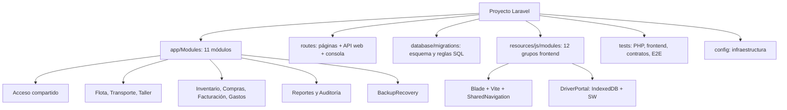

# 15. Índice y mapa del proyecto

## Índice navegable

1. [Problema empresarial, usuarios, alcance y límites](01-introduccion.md).
2. [Tecnologías, capas y recorrido de petición](02-tecnologias-y-arquitectura.md).
3. [Todos los módulos y sus mapas de clases/tablas/rutas](03-modulos.md).
4. [Dependencias, llamadas y transacciones entre dominios](04-comunicacion-entre-modulos.md).
5. [Diccionario completo y ER por dominio](05-base-de-datos.md).
6. [Router, validaciones, servicios y respuestas](06-api-y-backend.md).
7. [Pantallas, componentes, formularios y navegación](07-frontend.md).
8. [Persistencia, cola, comprobantes y conflictos offline](08-pwa-y-sincronizacion.md).
9. [Autenticación, autorización, archivos y SQL seguro](09-seguridad.md).
10. [Cifrado, recuperación, scheduler y despliegue](10-respaldos-y-operacion.md).
11. [Comandos, niveles de evidencia y resultados históricos](11-pruebas.md).
12. [Recorridos completos de pantalla a tablas](12-casos-practicos.md).
13. [Cómo localizar y cambiar sin romper reglas](13-mantenimiento-y-ampliacion.md).
14. [Términos técnicos explicados](14-glosario.md).
15. [Este índice, cobertura y mapa](15-indice-y-mapa-del-proyecto.md).

## Cobertura y procedencia

Manual contrastado con `main` base `4eb7da35307f0f6927e88d57f49abaaffd887aad`. El inventario se obtuvo de código, router y migraciones aplicadas a **un clúster PostgreSQL 18 nuevo aislado**, sin datos de empresa. No se leyó ni migró `transporte_db`, no se modificó `.env` ni código operativo. No se ejecutó la batería completa para documentar.

| Elemento | Cobertura | Dónde estudiar |
| --- | --- | --- |
| Módulos backend | 11 | Capítulo 03 y mapas individuales |
| Agrupaciones frontend | 12 | Capítulo 07 e inventario de archivos |
| Migraciones | 44 | Referencias por tabla y catálogo de funciones |
| Tablas | 105, incluidas técnicas | Índice del capítulo 05 |
| Columnas | 801 | Fichas completas por dominio |
| Funciones PostgreSQL | 102 | Catálogo de funciones y triggers |
| Triggers finales | 384 | Fichas de sus tablas |
| Rutas registradas | 268 declaraciones, GET/HEAD combinados | Apéndices del capítulo 06 |

## Mapa de módulos y persistencia propia

| Módulo real | Tablas propias del diccionario | Mapa |
| --- | --- | --- |
| `AccessAndPersonnel` — Acceso y Personal | 4 | [Clases y contratos](modulos/acceso-y-personal.md) |
| `FleetAndDocuments` — Flota y Documentación | 9 | [Clases y contratos](modulos/flota-y-documentacion.md) |
| `TransportAndDispatch` — Transporte y Despacho | 28 | [Clases y contratos](modulos/transporte.md) |
| `Workshop` — Taller Mecánico | 27 | [Clases y contratos](modulos/taller.md) |
| `Inventory` — Inventario | 7 | [Clases y contratos](modulos/inventario.md) |
| `Purchasing` — Compras | 9 | [Clases y contratos](modulos/compras.md) |
| `BillingAndPayments` — Facturación administrativa y pagos | 7 | [Clases y contratos](modulos/facturacion.md) |
| `Expenses` — Gastos | 5 | [Clases y contratos](modulos/gastos.md) |
| `AdministrativeReports` — Reportes administrativos | 0 | [Clases y contratos](modulos/reportes.md) |
| `AdministrativeAudit` — Auditoría administrativa | 0 | [Clases y contratos](modulos/auditoria.md) |
| `BackupRecovery` — Respaldos y recuperación | 0 | [Clases y contratos](modulos/respaldos.md) |
| Infraestructura Laravel | 9 | [Tablas técnicas](base-de-datos/infraestructura.md) |

Los lectores Reportes/Auditoría y Respaldos no necesitan tablas propias. Las tablas `spare_parts`/`suppliers` pertenecen a sus catálogos respectivos y se reutilizan; `fleet_operating_impediments` pertenece funcionalmente a disponibilidad de Taller aunque use activos de Flota. El diccionario asigna cada tabla a un único dominio para no contarla dos veces.

## Guías de profundización

- [Estados, cantidades, autorizaciones y agregaciones](modulos/estados-y-cantidades.md).
- [Inventario frontend completo](frontend/archivos.md).
- [Form Requests y reglas declaradas](api/validaciones.md).
- [Funciones PostgreSQL y triggers](base-de-datos/funciones-y-triggers.md).

## Fuentes complementarias

- [AGENTS.md](../../AGENTS.md): reglas de trabajo, datos y seguridad.
- [ARCHITECTURE.md](../../ARCHITECTURE.md): evolución y decisiones de arquitectura.
- [Reglas Transporte](../REGLAS_TRANSPORTE_DESPACHO.md) y [Taller](../REGLAS_TALLER_MECANICO.md): numeración empresarial y decisiones posteriores.
- [Modelo ER histórico](../modelo-er.mmd): contexto; contrastar con el diccionario final, no asumir que toda propuesta se implementó.
- [Validación integral](../validacion-integral.md) y [preparación productiva](../preparacion-produccion.md): evidencia y límites; no son autorización automática de despliegue.
- [PWA](../conductor-offline.md), [Inventario/Compras](../inventario-compras-operativo.md), [Facturación](../facturacion-administrativa-y-pagos.md), [Gastos](../gastos-y-portal-conductor.md), [Respaldos](../respaldos-y-recuperacion.md): contratos especializados.

## Recorridos de aprendizaje

**Explicar el sistema:** 01 → 02 → 03 → 04 → 12. **Trabajar backend:** 02 → 05 → 06 → 09 → 11 → 13. **Trabajar frontend/PWA:** 07 → 08 → 09 → 11. **Preparar operación:** 09 → 10 → evidencia de validación y preparación productiva.

## Decisiones y límites que no debe ocultar una exposición

Sustitución de cisterna D05, comportamiento RN-TR-17 ante permiso ausente, cambios de producto y tratamientos comerciales pendientes no se resuelven desde la interfaz. Facturación es interna, no fiscal. Gastos aprobados no acreditan pago. Inventario no valora existencias ni convierte monedas. Personal no tiene documentos de vencimiento implementados. Preventivos automáticos necesitan datos/criterios confiables. La PWA necesita aplicación abierta para sincronizar y pruebas físicas adicionales. La configuración real de servidor, copias externas, claves, RPO/RTO y recuperación periódica necesitan trabajo operativo.

El manual explica lo implementado y cómo estudiarlo; no declara cerrado lo pendiente ni certifica producción.
