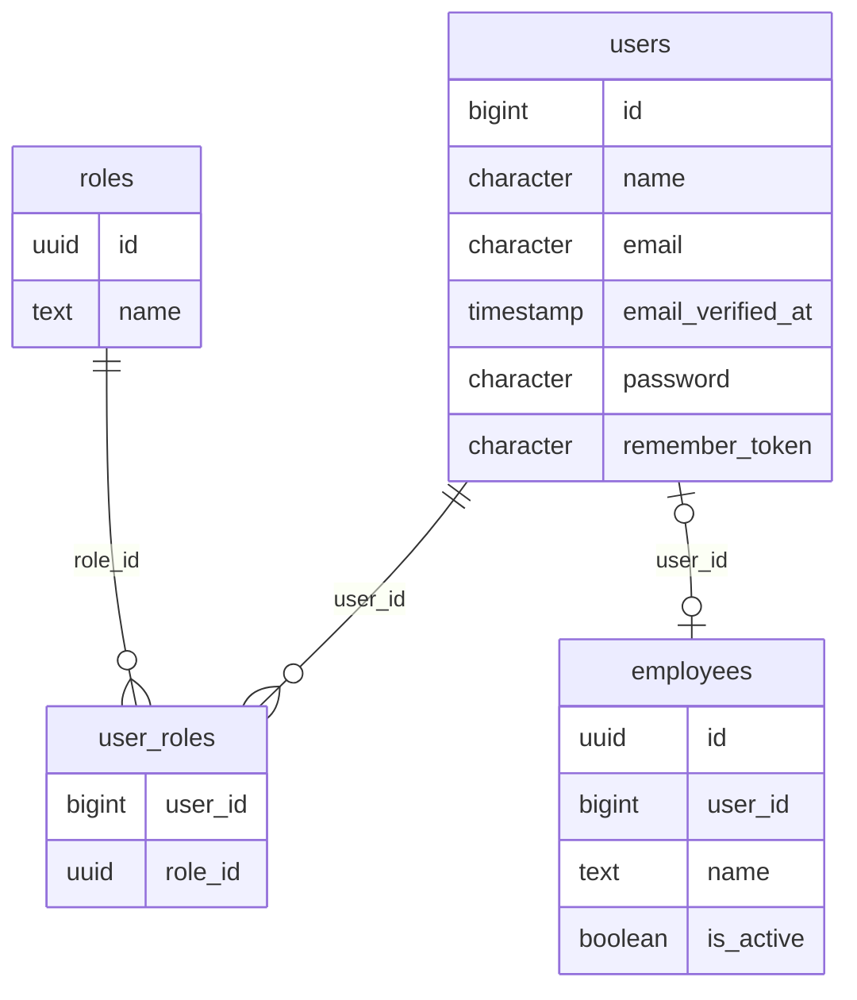

# Diccionario: Acceso y Personal

[Volver al capítulo de base de datos](../05-base-de-datos.md).

Este archivo describe el **esquema final**, no solo la migración inicial. `NULL` indica que una columna acepta ausencia de valor; un default es un valor generado si no se envía. Los CHECK y triggers también pueden limitar inserciones aparentemente válidas. Los ejemplos son consultas de estudio, no instrucciones para eludir servicios.

## Relaciones del dominio



El diagrama muestra FK reales y un subconjunto de columnas para que resulte legible. Las fichas siguientes contienen **todas** las columnas. Una referencia a otra tabla no duplica su entidad; consultar su ficha en el índice general.

## employees

**Propósito:** Persona trabajadora, con cuenta opcional única; reutilizada para conductores y mecánicos.

**Responsabilidad:** Acceso y Personal. **Migraciones relacionadas:** [2026_10_10_000020_prepare_access_and_personnel](../../../database/migrations/2026_10_10_000020_prepare_access_and_personnel.php), [2026_10_11_000120_create_trip_assignments](../../../database/migrations/2026_10_11_000120_create_trip_assignments.php), [2026_10_11_000130_protect_trip_assignment_integrity](../../../database/migrations/2026_10_11_000130_protect_trip_assignment_integrity.php), [2026_10_12_000140_create_trip_operational_records](../../../database/migrations/2026_10_12_000140_create_trip_operational_records.php), [2026_10_12_000180_create_workshop_core](../../../database/migrations/2026_10_12_000180_create_workshop_core.php), [2026_10_12_000190_protect_workshop_core](../../../database/migrations/2026_10_12_000190_protect_workshop_core.php), [2026_10_12_000210_protect_workshop_authorizations](../../../database/migrations/2026_10_12_000210_protect_workshop_authorizations.php), [2026_10_12_000250_protect_workshop_execution](../../../database/migrations/2026_10_12_000250_protect_workshop_execution.php), [2026_10_12_000260_create_workshop_materials](../../../database/migrations/2026_10_12_000260_create_workshop_materials.php), [2026_10_12_000290_protect_workshop_attachments](../../../database/migrations/2026_10_12_000290_protect_workshop_attachments.php), [2026_10_14_000330_create_inventory_ledger](../../../database/migrations/2026_10_14_000330_create_inventory_ledger.php), [2026_10_14_000370_create_administrative_expenses](../../../database/migrations/2026_10_14_000370_create_administrative_expenses.php).

**Modelos identificados:** [Employee](../../../app/Modules/AccessAndPersonnel/Models/Employee.php).

**Consultas directas identificadas:** [ExpenseAdministration](../../../app/Modules/Expenses/Application/ExpenseAdministration.php), [InventoryController](../../../app/Modules/Inventory/Http/Controllers/InventoryController.php), [WorkshopAccess](../../../app/Modules/Workshop/Application/WorkshopAccess.php), [WorkshopAttachments](../../../app/Modules/Workshop/Application/WorkshopAttachments.php), [WorkshopAuthorizations](../../../app/Modules/Workshop/Application/WorkshopAuthorizations.php), [WorkshopExecution](../../../app/Modules/Workshop/Application/WorkshopExecution.php), [WorkshopMaterialCorrections](../../../app/Modules/Workshop/Application/WorkshopMaterialCorrections.php), [WorkshopMaterials](../../../app/Modules/Workshop/Application/WorkshopMaterials.php), [WorkshopQueryController](../../../app/Modules/Workshop/Http/Controllers/WorkshopQueryController.php). La lista incluye lectores de reportes/auditoría y no sustituye las relaciones Eloquent.

**Relaciones Eloquent declaradas:**

- `Employee::user()` usa `belongsTo(User::class)`.

### Columnas

| Columna | Tipo PostgreSQL | ¿Admite NULL? | Default |
| --- | --- | --- | --- |
| `id` | `uuid` | No | Sin default |
| `user_id` | `bigint` | Sí | Sin default |
| `name` | `text` | No | Sin default |
| `is_active` | `boolean` | No | Sin default |

### Claves y restricciones

- **employees_user_id_foreign**: `FOREIGN KEY (user_id) REFERENCES users(id) ON DELETE RESTRICT`.
- **employees_id_not_null**: `NOT NULL id`.
- **employees_is_active_not_null**: `NOT NULL is_active`.
- **employees_name_not_null**: `NOT NULL name`.
- **employees_pkey**: `PRIMARY KEY (id)`.
- **employees_user_id_unique**: `UNIQUE (user_id)`.

### Índices

- `employees_pkey`: `CREATE UNIQUE INDEX employees_pkey ON public.employees USING btree (id)`.
- `employees_user_id_unique`: `CREATE UNIQUE INDEX employees_user_id_unique ON public.employees USING btree (user_id)`.

### Relaciones y cardinalidades

- `user_id` → [`users`](acceso-y-personal.md#users) (`id`): cada fila tiene cero o un padre; un padre admite como máximo una fila de esta tabla, sujeto a los CHECK/índices condicionales.

**Referencias entrantes:**

- `driver_assignments.employee_id` → `employees.id` (`driver_assignments_employee_id_foreign`).
- `workshop_mechanic_assignments.employee_id` → `employees.id` (`workshop_mechanic_assignments_employee_id_fkey`).

### Escritura, conservación y ejemplo

Catálogo o entidad administrable: altas y actualizaciones mediante los controladores/servicios del módulo. No hay eliminación física pública. Las restricciones de uso histórico y autorización siguen aplicando; activar/desactivar no equivale a borrar.

Sin triggers propios. Las reglas de aplicación siguen siendo necesarias.

```sql
SELECT id FROM employees LIMIT 5;
```

Permite reconocer el registro y su relación sin leer referencias privadas de archivos ni alterar el proceso. Para crearlo funcionalmente, seguir el caso del módulo en el capítulo 12.

## roles

**Propósito:** Catálogo de los cuatro roles técnicos aprobados.

**Responsabilidad:** Acceso y Personal. **Migraciones relacionadas:** [2026_10_10_000020_prepare_access_and_personnel](../../../database/migrations/2026_10_10_000020_prepare_access_and_personnel.php), [2026_10_11_000100_protect_transport_core_integrity](../../../database/migrations/2026_10_11_000100_protect_transport_core_integrity.php), [2026_10_11_000130_protect_trip_assignment_integrity](../../../database/migrations/2026_10_11_000130_protect_trip_assignment_integrity.php), [2026_10_12_000140_create_trip_operational_records](../../../database/migrations/2026_10_12_000140_create_trip_operational_records.php), [2026_10_12_000190_protect_workshop_core](../../../database/migrations/2026_10_12_000190_protect_workshop_core.php), [2026_10_12_000210_protect_workshop_authorizations](../../../database/migrations/2026_10_12_000210_protect_workshop_authorizations.php), [2026_10_12_000250_protect_workshop_execution](../../../database/migrations/2026_10_12_000250_protect_workshop_execution.php), [2026_10_12_000260_create_workshop_materials](../../../database/migrations/2026_10_12_000260_create_workshop_materials.php), [2026_10_12_000290_protect_workshop_attachments](../../../database/migrations/2026_10_12_000290_protect_workshop_attachments.php), [2026_10_13_000320_create_purchase_requests](../../../database/migrations/2026_10_13_000320_create_purchase_requests.php), [2026_10_14_000330_create_inventory_ledger](../../../database/migrations/2026_10_14_000330_create_inventory_ledger.php), [2026_10_14_000340_create_purchase_orders_and_receipts](../../../database/migrations/2026_10_14_000340_create_purchase_orders_and_receipts.php), [2026_10_14_000360_create_administrative_billing](../../../database/migrations/2026_10_14_000360_create_administrative_billing.php), [2026_10_14_000370_create_administrative_expenses](../../../database/migrations/2026_10_14_000370_create_administrative_expenses.php), [2026_10_14_000380_create_driver_operation_receipts](../../../database/migrations/2026_10_14_000380_create_driver_operation_receipts.php), [2026_10_16_000390_create_document_alert_reviews](../../../database/migrations/2026_10_16_000390_create_document_alert_reviews.php).

**Modelos identificados:** [Role](../../../app/Modules/AccessAndPersonnel/Models/Role.php).

**Consultas directas identificadas:** [WorkshopQueryController](../../../app/Modules/Workshop/Http/Controllers/WorkshopQueryController.php). La lista incluye lectores de reportes/auditoría y no sustituye las relaciones Eloquent.

**Relaciones Eloquent declaradas:**

- `Role::users()` usa `belongsToMany(User::class, 'user_roles', 'role_id', 'user_id')`.

### Columnas

| Columna | Tipo PostgreSQL | ¿Admite NULL? | Default |
| --- | --- | --- | --- |
| `id` | `uuid` | No | Sin default |
| `name` | `text` | No | Sin default |

### Claves y restricciones

- **roles_id_not_null**: `NOT NULL id`.
- **roles_name_not_null**: `NOT NULL name`.
- **roles_pkey**: `PRIMARY KEY (id)`.

### Índices

- `roles_pkey`: `CREATE UNIQUE INDEX roles_pkey ON public.roles USING btree (id)`.

### Relaciones y cardinalidades

No tiene FK físicas. Los vínculos solo lógicos, si existen, deben interpretarse en los servicios y no como integridad automática de PostgreSQL.

**Referencias entrantes:**

- `user_roles.role_id` → `roles.id` (`user_roles_role_id_foreign`).

### Escritura, conservación y ejemplo

Los cuatro roles se preparan con access:bootstrap-admin. La API solo lista roles; AccountAdministration asigna los existentes a cuentas. No hay CRUD público para crear nuevos roles ni borrarlos.

Sin triggers propios. Las reglas de aplicación siguen siendo necesarias.

```sql
SELECT id FROM roles LIMIT 5;
```

Permite reconocer el registro y su relación sin leer referencias privadas de archivos ni alterar el proceso. Para crearlo funcionalmente, seguir el caso del módulo en el capítulo 12.

## user_roles

**Propósito:** Unión muchos-a-muchos entre cuentas y roles.

**Responsabilidad:** Acceso y Personal. **Migraciones relacionadas:** [2026_10_10_000020_prepare_access_and_personnel](../../../database/migrations/2026_10_10_000020_prepare_access_and_personnel.php), [2026_10_11_000100_protect_transport_core_integrity](../../../database/migrations/2026_10_11_000100_protect_transport_core_integrity.php), [2026_10_11_000130_protect_trip_assignment_integrity](../../../database/migrations/2026_10_11_000130_protect_trip_assignment_integrity.php), [2026_10_12_000140_create_trip_operational_records](../../../database/migrations/2026_10_12_000140_create_trip_operational_records.php), [2026_10_12_000190_protect_workshop_core](../../../database/migrations/2026_10_12_000190_protect_workshop_core.php), [2026_10_12_000210_protect_workshop_authorizations](../../../database/migrations/2026_10_12_000210_protect_workshop_authorizations.php), [2026_10_12_000250_protect_workshop_execution](../../../database/migrations/2026_10_12_000250_protect_workshop_execution.php), [2026_10_12_000260_create_workshop_materials](../../../database/migrations/2026_10_12_000260_create_workshop_materials.php), [2026_10_12_000290_protect_workshop_attachments](../../../database/migrations/2026_10_12_000290_protect_workshop_attachments.php), [2026_10_13_000320_create_purchase_requests](../../../database/migrations/2026_10_13_000320_create_purchase_requests.php), [2026_10_14_000330_create_inventory_ledger](../../../database/migrations/2026_10_14_000330_create_inventory_ledger.php), [2026_10_14_000340_create_purchase_orders_and_receipts](../../../database/migrations/2026_10_14_000340_create_purchase_orders_and_receipts.php), [2026_10_14_000360_create_administrative_billing](../../../database/migrations/2026_10_14_000360_create_administrative_billing.php), [2026_10_14_000370_create_administrative_expenses](../../../database/migrations/2026_10_14_000370_create_administrative_expenses.php), [2026_10_14_000380_create_driver_operation_receipts](../../../database/migrations/2026_10_14_000380_create_driver_operation_receipts.php), [2026_10_16_000390_create_document_alert_reviews](../../../database/migrations/2026_10_16_000390_create_document_alert_reviews.php).

**Modelos identificados:** Query Builder/infraestructura, sin modelo Eloquent propio identificado.

**Consultas directas identificadas:** [BillingPayments](../../../app/Modules/BillingAndPayments/Application/BillingPayments.php), [ExpenseAdministration](../../../app/Modules/Expenses/Application/ExpenseAdministration.php), [DocumentAlerts](../../../app/Modules/FleetAndDocuments/Application/DocumentAlerts.php), [InventoryLedger](../../../app/Modules/Inventory/Application/InventoryLedger.php), [DriverTripRecords](../../../app/Modules/TransportAndDispatch/Application/DriverTripRecords.php), [WorkshopCommands](../../../app/Modules/Workshop/Application/WorkshopCommands.php), [WorkshopQueryController](../../../app/Modules/Workshop/Http/Controllers/WorkshopQueryController.php). La lista incluye lectores de reportes/auditoría y no sustituye las relaciones Eloquent.

### Columnas

| Columna | Tipo PostgreSQL | ¿Admite NULL? | Default |
| --- | --- | --- | --- |
| `user_id` | `bigint` | No | Sin default |
| `role_id` | `uuid` | No | Sin default |

### Claves y restricciones

- **user_roles_role_id_foreign**: `FOREIGN KEY (role_id) REFERENCES roles(id) ON DELETE RESTRICT`.
- **user_roles_user_id_foreign**: `FOREIGN KEY (user_id) REFERENCES users(id) ON DELETE RESTRICT`.
- **user_roles_role_id_not_null**: `NOT NULL role_id`.
- **user_roles_user_id_not_null**: `NOT NULL user_id`.
- **user_roles_pkey**: `PRIMARY KEY (user_id, role_id)`.

### Índices

- `user_roles_pkey`: `CREATE UNIQUE INDEX user_roles_pkey ON public.user_roles USING btree (user_id, role_id)`.
- `user_roles_role_id_index`: `CREATE INDEX user_roles_role_id_index ON public.user_roles USING btree (role_id)`.

### Relaciones y cardinalidades

- `role_id` → [`roles`](acceso-y-personal.md#roles) (`id`): cada fila tiene un padre; un padre admite varias filas de esta tabla, sujeto a los CHECK/índices condicionales.
- `user_id` → [`users`](acceso-y-personal.md#users) (`id`): cada fila tiene un padre; un padre admite varias filas de esta tabla, sujeto a los CHECK/índices condicionales.

**Referencias entrantes:** ninguna FK física apunta a esta tabla.

### Escritura, conservación y ejemplo

AccountAdministration sincroniza membresías al crear/editar cuenta, dentro de transacción y revalidación administrativa. No hay endpoint autónomo de membresías. Revocar pertenencia conserva cuenta y hechos históricos.

Sin triggers propios. Las reglas de aplicación siguen siendo necesarias.

```sql
SELECT user_id FROM user_roles LIMIT 5;
```

Permite reconocer el registro y su relación sin leer referencias privadas de archivos ni alterar el proceso. Para crearlo funcionalmente, seguir el caso del módulo en el capítulo 12.

## users

**Propósito:** Cuenta autenticable: identidad de acceso, hash de contraseña y activación; no es el empleado.

**Responsabilidad:** Acceso y Personal. **Migraciones relacionadas:** [0001_01_01_000000_create_users_table](../../../database/migrations/0001_01_01_000000_create_users_table.php), [2026_10_10_000020_prepare_access_and_personnel](../../../database/migrations/2026_10_10_000020_prepare_access_and_personnel.php), [2026_10_11_000040_create_fleet_documents](../../../database/migrations/2026_10_11_000040_create_fleet_documents.php), [2026_10_11_000060_create_transport_planning_core](../../../database/migrations/2026_10_11_000060_create_transport_planning_core.php), [2026_10_11_000070_create_transport_authorization_records](../../../database/migrations/2026_10_11_000070_create_transport_authorization_records.php), [2026_10_11_000080_create_transport_change_history](../../../database/migrations/2026_10_11_000080_create_transport_change_history.php), [2026_10_11_000090_create_trip_information_records](../../../database/migrations/2026_10_11_000090_create_trip_information_records.php), [2026_10_11_000100_protect_transport_core_integrity](../../../database/migrations/2026_10_11_000100_protect_transport_core_integrity.php), [2026_10_11_000120_create_trip_assignments](../../../database/migrations/2026_10_11_000120_create_trip_assignments.php), [2026_10_11_000130_protect_trip_assignment_integrity](../../../database/migrations/2026_10_11_000130_protect_trip_assignment_integrity.php), [2026_10_12_000140_create_trip_operational_records](../../../database/migrations/2026_10_12_000140_create_trip_operational_records.php), [2026_10_12_000180_create_workshop_core](../../../database/migrations/2026_10_12_000180_create_workshop_core.php), [2026_10_12_000190_protect_workshop_core](../../../database/migrations/2026_10_12_000190_protect_workshop_core.php), [2026_10_12_000200_create_workshop_authorizations](../../../database/migrations/2026_10_12_000200_create_workshop_authorizations.php), [2026_10_12_000210_protect_workshop_authorizations](../../../database/migrations/2026_10_12_000210_protect_workshop_authorizations.php), [2026_10_12_000220_create_workshop_availability](../../../database/migrations/2026_10_12_000220_create_workshop_availability.php), [2026_10_12_000240_create_workshop_execution](../../../database/migrations/2026_10_12_000240_create_workshop_execution.php), [2026_10_12_000260_create_workshop_materials](../../../database/migrations/2026_10_12_000260_create_workshop_materials.php), [2026_10_12_000270_create_workshop_costs](../../../database/migrations/2026_10_12_000270_create_workshop_costs.php), [2026_10_12_000280_create_workshop_attachments](../../../database/migrations/2026_10_12_000280_create_workshop_attachments.php), [2026_10_13_000320_create_purchase_requests](../../../database/migrations/2026_10_13_000320_create_purchase_requests.php), [2026_10_14_000330_create_inventory_ledger](../../../database/migrations/2026_10_14_000330_create_inventory_ledger.php), [2026_10_14_000340_create_purchase_orders_and_receipts](../../../database/migrations/2026_10_14_000340_create_purchase_orders_and_receipts.php), [2026_10_14_000360_create_administrative_billing](../../../database/migrations/2026_10_14_000360_create_administrative_billing.php), [2026_10_14_000370_create_administrative_expenses](../../../database/migrations/2026_10_14_000370_create_administrative_expenses.php), [2026_10_14_000380_create_driver_operation_receipts](../../../database/migrations/2026_10_14_000380_create_driver_operation_receipts.php), [2026_10_16_000390_create_document_alert_reviews](../../../database/migrations/2026_10_16_000390_create_document_alert_reviews.php), [2026_10_16_000400_create_transport_creation_receipts](../../../database/migrations/2026_10_16_000400_create_transport_creation_receipts.php).

**Modelos identificados:** [User](../../../app/Models/User.php).

**Consultas directas identificadas:** [AdministrativeAudit](../../../app/Modules/AdministrativeAudit/Application/AdministrativeAudit.php), [DocumentAlerts](../../../app/Modules/FleetAndDocuments/Application/DocumentAlerts.php), [InventoryController](../../../app/Modules/Inventory/Http/Controllers/InventoryController.php), [WorkshopQueryController](../../../app/Modules/Workshop/Http/Controllers/WorkshopQueryController.php). La lista incluye lectores de reportes/auditoría y no sustituye las relaciones Eloquent.

**Relaciones Eloquent declaradas:**

- `User::roles()` usa `belongsToMany(Role::class, 'user_roles', 'user_id', 'role_id')`.
- `User::employee()` usa `hasOne(Employee::class)`.

### Columnas

| Columna | Tipo PostgreSQL | ¿Admite NULL? | Default |
| --- | --- | --- | --- |
| `id` | `bigint` | No | `nextval('users_id_seq'::regclass)` |
| `name` | `character varying(255)` | No | Sin default |
| `email` | `character varying(255)` | No | Sin default |
| `email_verified_at` | `timestamp(0) without time zone` | Sí | Sin default |
| `password` | `character varying(255)` | No | Sin default |
| `remember_token` | `character varying(100)` | Sí | Sin default |
| `created_at` | `timestamp(0) without time zone` | Sí | Sin default |
| `updated_at` | `timestamp(0) without time zone` | Sí | Sin default |
| `login` | `text` | Sí | Sin default |
| `is_active` | `boolean` | No | `false` |

### Claves y restricciones

- **users_email_not_null**: `NOT NULL email`.
- **users_id_not_null**: `NOT NULL id`.
- **users_is_active_not_null**: `NOT NULL is_active`.
- **users_name_not_null**: `NOT NULL name`.
- **users_password_not_null**: `NOT NULL password`.
- **users_pkey**: `PRIMARY KEY (id)`.
- **users_email_unique**: `UNIQUE (email)`.
- **users_login_unique**: `UNIQUE (login)`.

### Índices

- `users_email_unique`: `CREATE UNIQUE INDEX users_email_unique ON public.users USING btree (email)`.
- `users_login_unique`: `CREATE UNIQUE INDEX users_login_unique ON public.users USING btree (login)`.
- `users_pkey`: `CREATE UNIQUE INDEX users_pkey ON public.users USING btree (id)`.

### Relaciones y cardinalidades

No tiene FK físicas. Los vínculos solo lógicos, si existen, deben interpretarse en los servicios y no como integridad automática de PostgreSQL.

**Referencias entrantes:**

- `billing_amount_decisions.decided_by_id` → `users.id` (`billing_amount_decisions_decided_by_id_fkey`).
- `billing_invoices.created_by_id` → `users.id` (`billing_invoices_created_by_id_fkey`).
- `billing_operations.actor_id` → `users.id` (`billing_operations_actor_id_fkey`).
- `billing_payments.recorded_by_id` → `users.id` (`billing_payments_recorded_by_id_fkey`).
- `billing_trip_amounts.requested_by_id` → `users.id` (`billing_trip_amounts_requested_by_id_fkey`).
- `document_alert_reviews.reviewed_by_id` → `users.id` (`document_alert_reviews_reviewed_by_id_fkey`).
- `documents.uploaded_by_id` → `users.id` (`documents_uploaded_by_id_foreign`).
- `driver_operation_receipts.actor_id` → `users.id` (`driver_operation_receipts_actor_id_fkey`).
- `employees.user_id` → `users.id` (`employees_user_id_foreign`).
- `expense_decisions.decided_by_id` → `users.id` (`expense_decisions_decided_by_id_fkey`).
- `expense_operations.actor_id` → `users.id` (`expense_operations_actor_id_fkey`).
- `expense_receipts.uploaded_by_id` → `users.id` (`expense_receipts_uploaded_by_id_fkey`).
- `expense_revisions.recorded_by_id` → `users.id` (`expense_revisions_recorded_by_id_fkey`).
- `expenses.created_by_id` → `users.id` (`expenses_created_by_id_fkey`).
- `fleet_impediment_resolutions.resolved_by_id` → `users.id` (`fleet_impediment_resolutions_resolved_by_id_fkey`).
- `fleet_operating_impediments.actor_id` → `users.id` (`fleet_operating_impediments_actor_id_fkey`).
- `inventory_applications.applied_by_id` → `users.id` (`inventory_applications_applied_by_id_fkey`).
- `inventory_corrections.requested_by_id` → `users.id` (`inventory_corrections_requested_by_id_fkey`).
- `inventory_decisions.decided_by_id` → `users.id` (`inventory_decisions_decided_by_id_fkey`).
- `inventory_movements.actor_id` → `users.id` (`inventory_movements_actor_id_fkey`).
- `inventory_operations.actor_id` → `users.id` (`inventory_operations_actor_id_fkey`).
- `inventory_returns.received_by_id` → `users.id` (`inventory_returns_received_by_id_fkey`).
- `load_items.recorded_by_id` → `users.id` (`load_items_recorded_by_id_foreign`).
- `purchase_fulfillment_operations.actor_id` → `users.id` (`purchase_fulfillment_operations_actor_id_fkey`).
- `purchase_orders.created_by_id` → `users.id` (`purchase_orders_created_by_id_fkey`).
- `purchase_receipts.received_by_id` → `users.id` (`purchase_receipts_received_by_id_fkey`).
- `purchase_request_decisions.decided_by_id` → `users.id` (`purchase_request_decisions_decided_by_id_fkey`).
- `purchase_requests.requested_by_id` → `users.id` (`purchase_requests_requested_by_id_fkey`).
- `purchasing_operations.actor_id` → `users.id` (`purchasing_operations_actor_id_fkey`).
- `transport_assignment_operations.actor_id` → `users.id` (`transport_assignment_operations_actor_id_foreign`).
- `transport_authorization_applications.applied_by_id` → `users.id` (`transport_authorization_applications_applied_by_id_foreign`).
- `transport_authorization_decisions.decided_by_id` → `users.id` (`transport_authorization_decisions_decided_by_id_foreign`).
- `transport_authorization_requests.requested_by_id` → `users.id` (`transport_authorization_requests_requested_by_id_foreign`).
- `transport_changes.actor_id` → `users.id` (`transport_changes_actor_id_foreign`).
- `transport_creation_receipts.actor_id` → `users.id` (`transport_creation_receipts_actor_id_fkey`).
- `transport_requests.registered_by_id` → `users.id` (`transport_requests_registered_by_id_foreign`).
- `trip_events.created_by_id` → `users.id` (`trip_events_created_by_id_foreign`).
- `trip_loads.recorded_by_id` → `users.id` (`trip_loads_recorded_by_id_foreign`).
- `trip_odometer_readings.recorded_by_id` → `users.id` (`trip_odometer_readings_recorded_by_id_foreign`).
- `trip_product_reviews.reviewed_by_id` → `users.id` (`trip_product_reviews_reviewed_by_id_foreign`).
- `trip_unloads.recorded_by_id` → `users.id` (`trip_unloads_recorded_by_id_foreign`).
- `trip_warning_resolutions.actor_id` → `users.id` (`trip_warning_resolutions_actor_id_foreign`).
- `trips.cancelled_by_id` → `users.id` (`trips_cancelled_by_id_foreign`).
- `trips.closed_by_id` → `users.id` (`trips_closed_by_id_foreign`).
- `trips.completed_by_id` → `users.id` (`trips_completed_by_id_foreign`).
- `trips.registered_by_id` → `users.id` (`trips_registered_by_id_foreign`).
- `trips.started_by_id` → `users.id` (`trips_started_by_id_foreign`).
- `unload_items.recorded_by_id` → `users.id` (`unload_items_recorded_by_id_foreign`).
- `user_roles.user_id` → `users.id` (`user_roles_user_id_foreign`).
- `workshop_activities.actor_id` → `users.id` (`workshop_activities_actor_id_fkey`).
- `workshop_admission_exits.recorded_by_id` → `users.id` (`workshop_admission_exits_recorded_by_id_fkey`).
- `workshop_admissions.admitted_by_id` → `users.id` (`workshop_admissions_admitted_by_id_fkey`).
- `workshop_attachments.uploaded_by_id` → `users.id` (`workshop_attachments_uploaded_by_id_fkey`).
- `workshop_authorization_applications.applied_by_id` → `users.id` (`workshop_authorization_applications_applied_by_id_fkey`).
- `workshop_authorization_decisions.decided_by_id` → `users.id` (`workshop_authorization_decisions_decided_by_id_fkey`).
- `workshop_authorization_requests.requested_by_id` → `users.id` (`workshop_authorization_requests_requested_by_id_fkey`).
- `workshop_cost_records.actor_id` → `users.id` (`workshop_cost_records_actor_id_fkey`).
- `workshop_diagnoses.actor_id` → `users.id` (`workshop_diagnoses_actor_id_fkey`).
- `workshop_external_repairs.recorded_by_id` → `users.id` (`workshop_external_repairs_recorded_by_id_fkey`).
- `workshop_material_needs.requested_by_id` → `users.id` (`workshop_material_needs_requested_by_id_fkey`).
- `workshop_mechanic_assignments.assigned_by_id` → `users.id` (`workshop_mechanic_assignments_assigned_by_id_fkey`).
- `workshop_mechanic_releases.recorded_by_id` → `users.id` (`workshop_mechanic_releases_recorded_by_id_fkey`).
- `workshop_operations.actor_id` → `users.id` (`workshop_operations_actor_id_fkey`).
- `workshop_order_admission_links.linked_by_id` → `users.id` (`workshop_order_admission_links_linked_by_id_fkey`).
- `workshop_part_deliveries.recorded_by_id` → `users.id` (`workshop_part_deliveries_recorded_by_id_fkey`).
- `workshop_part_usages.confirmed_by_id` → `users.id` (`workshop_part_usages_confirmed_by_id_fkey`).
- `workshop_report_links.linked_by_id` → `users.id` (`workshop_report_links_linked_by_id_fkey`).
- `workshop_reports.recorded_by_id` → `users.id` (`workshop_reports_recorded_by_id_fkey`).
- `workshop_reports.reporter_id` → `users.id` (`workshop_reports_reporter_id_fkey`).
- `workshop_scopes.proposed_by_id` → `users.id` (`workshop_scopes_proposed_by_id_fkey`).
- `workshop_time_events.actor_id` → `users.id` (`workshop_time_events_actor_id_fkey`).
- `workshop_warnings.captured_by_id` → `users.id` (`workshop_warnings_captured_by_id_fkey`).
- `workshop_work_orders.created_by_id` → `users.id` (`workshop_work_orders_created_by_id_fkey`).

### Escritura, conservación y ejemplo

Catálogo o entidad administrable: altas y actualizaciones mediante los controladores/servicios del módulo. No hay eliminación física pública. Las restricciones de uso histórico y autorización siguen aplicando; activar/desactivar no equivale a borrar.

Sin triggers propios. Las reglas de aplicación siguen siendo necesarias.

```sql
SELECT count(*) AS cantidad FROM users;
```

Inspecciona existencia/cantidad sin imprimir contraseñas, tokens, IDs de sesión ni payloads.
