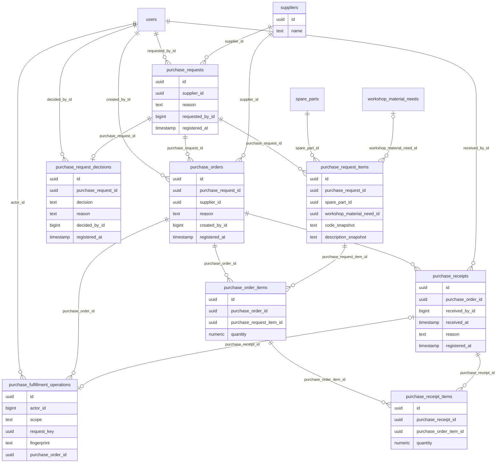

# Diccionario: Compras

[Volver al capítulo de base de datos](../05-base-de-datos.md).

Este archivo describe el **esquema final**, no solo la migración inicial. `NULL` indica que una columna acepta ausencia de valor; un default es un valor generado si no se envía. Los CHECK y triggers también pueden limitar inserciones aparentemente válidas. Los ejemplos son consultas de estudio, no instrucciones para eludir servicios.

## Relaciones del dominio



El diagrama muestra FK reales y un subconjunto de columnas para que resulte legible. Las fichas siguientes contienen **todas** las columnas. Una referencia a otra tabla no duplica su entidad; consultar su ficha en el índice general.

## purchase_fulfillment_operations

**Propósito:** Idempotencia y trazabilidad de crear órdenes y registrar recepciones.

**Responsabilidad:** Compras. **Migraciones relacionadas:** [2026_10_14_000340_create_purchase_orders_and_receipts](../../../database/migrations/2026_10_14_000340_create_purchase_orders_and_receipts.php).

**Modelos identificados:** Query Builder/infraestructura, sin modelo Eloquent propio identificado.

**Consultas directas identificadas:** [PurchaseFulfillment](../../../app/Modules/Purchasing/Application/PurchaseFulfillment.php). La lista incluye lectores de reportes/auditoría y no sustituye las relaciones Eloquent.

### Columnas

| Columna | Tipo PostgreSQL | ¿Admite NULL? | Default |
| --- | --- | --- | --- |
| `id` | `uuid` | No | Sin default |
| `actor_id` | `bigint` | No | Sin default |
| `scope` | `text` | No | Sin default |
| `request_key` | `uuid` | No | Sin default |
| `fingerprint` | `text` | No | Sin default |
| `purchase_order_id` | `uuid` | No | Sin default |
| `purchase_receipt_id` | `uuid` | Sí | Sin default |
| `registered_at` | `timestamp with time zone` | No | `clock_timestamp()` |

### Claves y restricciones

- **purchase_fulfillment_operations_check**: `CHECK ((((scope = 'order_create'::text) AND (purchase_receipt_id IS NULL)) OR ((scope = 'receipt_create'::text) AND (purchase_receipt_id IS NOT NULL))))`.
- **purchase_fulfillment_operations_fingerprint_check**: `CHECK ((fingerprint ~ '^[a-f0-9]{64}$'::text))`.
- **purchase_fulfillment_operations_scope_check**: `CHECK ((scope = ANY (ARRAY['order_create'::text, 'receipt_create'::text])))`.
- **purchase_fulfillment_operations_actor_id_fkey**: `FOREIGN KEY (actor_id) REFERENCES users(id) ON DELETE RESTRICT`.
- **purchase_fulfillment_operations_purchase_order_id_fkey**: `FOREIGN KEY (purchase_order_id) REFERENCES purchase_orders(id) ON DELETE RESTRICT`.
- **purchase_fulfillment_operations_purchase_receipt_id_fkey**: `FOREIGN KEY (purchase_receipt_id) REFERENCES purchase_receipts(id) ON DELETE RESTRICT`.
- **purchase_fulfillment_operations_actor_id_not_null**: `NOT NULL actor_id`.
- **purchase_fulfillment_operations_fingerprint_not_null**: `NOT NULL fingerprint`.
- **purchase_fulfillment_operations_id_not_null**: `NOT NULL id`.
- **purchase_fulfillment_operations_purchase_order_id_not_null**: `NOT NULL purchase_order_id`.
- **purchase_fulfillment_operations_registered_at_not_null**: `NOT NULL registered_at`.
- **purchase_fulfillment_operations_request_key_not_null**: `NOT NULL request_key`.
- **purchase_fulfillment_operations_scope_not_null**: `NOT NULL scope`.
- **purchase_fulfillment_operations_pkey**: `PRIMARY KEY (id)`.
- **purchasing_complete**: `TRIGGER DEFERRABLE INITIALLY DEFERRED`.
- **purchase_fulfillment_operations_actor_id_scope_request_key_key**: `UNIQUE (actor_id, scope, request_key)`.
- **purchase_fulfillment_operations_purchase_receipt_id_key**: `UNIQUE (purchase_receipt_id)`.

### Índices

- `purchase_fulfillment_operations_actor_id_scope_request_key_key`: `CREATE UNIQUE INDEX purchase_fulfillment_operations_actor_id_scope_request_key_key ON public.purchase_fulfillment_operations USING btree (actor_id, scope, request_key)`.
- `purchase_fulfillment_operations_pkey`: `CREATE UNIQUE INDEX purchase_fulfillment_operations_pkey ON public.purchase_fulfillment_operations USING btree (id)`.
- `purchase_fulfillment_operations_purchase_receipt_id_key`: `CREATE UNIQUE INDEX purchase_fulfillment_operations_purchase_receipt_id_key ON public.purchase_fulfillment_operations USING btree (purchase_receipt_id)`.
- `purchase_order_creation`: `CREATE UNIQUE INDEX purchase_order_creation ON public.purchase_fulfillment_operations USING btree (purchase_order_id) WHERE (scope = 'order_create'::text)`.

### Relaciones y cardinalidades

- `actor_id` → [`users`](acceso-y-personal.md#users) (`id`): cada fila tiene un padre; un padre admite varias filas de esta tabla, sujeto a los CHECK/índices condicionales.
- `purchase_order_id` → [`purchase_orders`](compras.md#purchase_orders) (`id`): cada fila tiene un padre; un padre admite varias filas de esta tabla, sujeto a los CHECK/índices condicionales.
- `purchase_receipt_id` → [`purchase_receipts`](compras.md#purchase_receipts) (`id`): cada fila tiene cero o un padre; un padre admite como máximo una fila de esta tabla, sujeto a los CHECK/índices condicionales.

**Referencias entrantes:** ninguna FK física apunta a esta tabla.

### Escritura, conservación y ejemplo

Registro histórico o recibo: la operación de aplicación inserta el hecho y conserva su trazabilidad. Las correcciones se tramitan con nuevas versiones, aplicaciones o compensaciones, no con un DELETE público. Consultar los triggers siguientes para la protección exacta de esta tabla; no inferir que cualquier UPDATE SQL está permitido.

**Triggers vigentes** (momento y operación exactos; funciones explicadas en [el catálogo](funciones-y-triggers.md)):

- `purchasing_complete`: `CREATE CONSTRAINT TRIGGER purchasing_complete AFTER INSERT ON public.purchase_fulfillment_operations DEFERRABLE INITIALLY DEFERRED FOR EACH ROW EXECUTE FUNCTION purchasing_fulfillment_complete()`.
- `purchasing_immutable`: `CREATE TRIGGER purchasing_immutable BEFORE DELETE OR UPDATE ON public.purchase_fulfillment_operations FOR EACH ROW EXECUTE FUNCTION purchasing_immutable()`.
- `purchasing_no_truncate`: `CREATE TRIGGER purchasing_no_truncate BEFORE TRUNCATE ON public.purchase_fulfillment_operations FOR EACH STATEMENT EXECUTE FUNCTION purchasing_immutable()`.
- `purchasing_validate`: `CREATE TRIGGER purchasing_validate BEFORE INSERT ON public.purchase_fulfillment_operations FOR EACH ROW EXECUTE FUNCTION purchasing_fulfillment_validate()`.

```sql
SELECT id, purchase_order_id, registered_at FROM purchase_fulfillment_operations LIMIT 5;
```

Permite reconocer el registro y su relación sin leer referencias privadas de archivos ni alterar el proceso. Para crearlo funcionalmente, seguir el caso del módulo en el capítulo 12.

## purchase_order_items

**Propósito:** Cantidad ordenada por renglón solicitado, sin exceder autorización.

**Responsabilidad:** Compras. **Migraciones relacionadas:** [2026_10_14_000340_create_purchase_orders_and_receipts](../../../database/migrations/2026_10_14_000340_create_purchase_orders_and_receipts.php).

**Modelos identificados:** [PurchaseOrderItem](../../../app/Modules/Purchasing/Models/PurchaseOrderItem.php).

**Relaciones Eloquent declaradas:**

- `PurchaseOrderItem::requestedItem()` usa `belongsTo(PurchaseRequestItem::class, 'purchase_request_item_id')`.
- `PurchaseOrderItem::receiptItems()` usa `hasMany(PurchaseReceiptItem::class)`.

### Columnas

| Columna | Tipo PostgreSQL | ¿Admite NULL? | Default |
| --- | --- | --- | --- |
| `id` | `uuid` | No | Sin default |
| `purchase_order_id` | `uuid` | No | Sin default |
| `purchase_request_item_id` | `uuid` | No | Sin default |
| `quantity` | `numeric` | No | Sin default |

### Claves y restricciones

- **purchase_order_items_quantity_check**: `CHECK (((quantity > (0)::numeric) AND (quantity <= 999999999999.999999) AND (scale(quantity) <= 6)))`.
- **purchase_order_items_purchase_order_id_fkey**: `FOREIGN KEY (purchase_order_id) REFERENCES purchase_orders(id) ON DELETE RESTRICT`.
- **purchase_order_items_purchase_request_item_id_fkey**: `FOREIGN KEY (purchase_request_item_id) REFERENCES purchase_request_items(id) ON DELETE RESTRICT`.
- **purchase_order_items_id_not_null**: `NOT NULL id`.
- **purchase_order_items_purchase_order_id_not_null**: `NOT NULL purchase_order_id`.
- **purchase_order_items_purchase_request_item_id_not_null**: `NOT NULL purchase_request_item_id`.
- **purchase_order_items_quantity_not_null**: `NOT NULL quantity`.
- **purchase_order_items_pkey**: `PRIMARY KEY (id)`.
- **purchase_order_items_purchase_order_id_purchase_request_ite_key**: `UNIQUE (purchase_order_id, purchase_request_item_id)`.

### Índices

- `purchase_order_items_pkey`: `CREATE UNIQUE INDEX purchase_order_items_pkey ON public.purchase_order_items USING btree (id)`.
- `purchase_order_items_purchase_order_id_purchase_request_ite_key`: `CREATE UNIQUE INDEX purchase_order_items_purchase_order_id_purchase_request_ite_key ON public.purchase_order_items USING btree (purchase_order_id, purchase_request_item_id)`.
- `purchase_order_items_request`: `CREATE INDEX purchase_order_items_request ON public.purchase_order_items USING btree (purchase_request_item_id)`.

### Relaciones y cardinalidades

- `purchase_order_id` → [`purchase_orders`](compras.md#purchase_orders) (`id`): cada fila tiene un padre; un padre admite varias filas de esta tabla, sujeto a los CHECK/índices condicionales.
- `purchase_request_item_id` → [`purchase_request_items`](compras.md#purchase_request_items) (`id`): cada fila tiene un padre; un padre admite varias filas de esta tabla, sujeto a los CHECK/índices condicionales.

**Referencias entrantes:**

- `purchase_receipt_items.purchase_order_item_id` → `purchase_order_items.id` (`purchase_receipt_items_purchase_order_item_id_fkey`).

### Escritura, conservación y ejemplo

Registro histórico o recibo: la operación de aplicación inserta el hecho y conserva su trazabilidad. Las correcciones se tramitan con nuevas versiones, aplicaciones o compensaciones, no con un DELETE público. Consultar los triggers siguientes para la protección exacta de esta tabla; no inferir que cualquier UPDATE SQL está permitido.

**Triggers vigentes** (momento y operación exactos; funciones explicadas en [el catálogo](funciones-y-triggers.md)):

- `purchasing_immutable`: `CREATE TRIGGER purchasing_immutable BEFORE DELETE OR UPDATE ON public.purchase_order_items FOR EACH ROW EXECUTE FUNCTION purchasing_immutable()`.
- `purchasing_no_truncate`: `CREATE TRIGGER purchasing_no_truncate BEFORE TRUNCATE ON public.purchase_order_items FOR EACH STATEMENT EXECUTE FUNCTION purchasing_immutable()`.
- `purchasing_validate`: `CREATE TRIGGER purchasing_validate BEFORE INSERT ON public.purchase_order_items FOR EACH ROW EXECUTE FUNCTION purchasing_fulfillment_validate()`.

```sql
SELECT id, purchase_order_id, quantity FROM purchase_order_items LIMIT 5;
```

Permite reconocer el registro y su relación sin leer referencias privadas de archivos ni alterar el proceso. Para crearlo funcionalmente, seguir el caso del módulo en el capítulo 12.

## purchase_orders

**Propósito:** Orden de compra creada desde solicitud aprobada.

**Responsabilidad:** Compras. **Migraciones relacionadas:** [2026_10_14_000340_create_purchase_orders_and_receipts](../../../database/migrations/2026_10_14_000340_create_purchase_orders_and_receipts.php).

**Modelos identificados:** [PurchaseOrder](../../../app/Modules/Purchasing/Models/PurchaseOrder.php).

**Relaciones Eloquent declaradas:**

- `PurchaseOrder::items()` usa `hasMany(PurchaseOrderItem::class)->select('purchase_order_items.*')->selectRaw('COALESCE((SELECT sum(r.quantity) FROM purchase_receipt_items r WHERE r.purchase_order_item_id=purchase_order_items.id),0)::text AS received_quantity')->selectRaw('(quantity-COALESCE((SELECT sum(r.quantity) FROM purchase_receipt_items r WHERE r.purchase_order_item_id=purchase_order_items.id),0))::text AS pending_quantity')`.
- `PurchaseOrder::receipts()` usa `hasMany(PurchaseReceipt::class)`.
- `PurchaseOrder::supplier()` usa `belongsTo(Supplier::class)`.

### Columnas

| Columna | Tipo PostgreSQL | ¿Admite NULL? | Default |
| --- | --- | --- | --- |
| `id` | `uuid` | No | Sin default |
| `purchase_request_id` | `uuid` | No | Sin default |
| `supplier_id` | `uuid` | No | Sin default |
| `reason` | `text` | No | Sin default |
| `created_by_id` | `bigint` | No | Sin default |
| `registered_at` | `timestamp with time zone` | No | `clock_timestamp()` |

### Claves y restricciones

- **purchase_orders_reason_check**: `CHECK ((length(btrim(reason)) > 0))`.
- **purchase_orders_created_by_id_fkey**: `FOREIGN KEY (created_by_id) REFERENCES users(id) ON DELETE RESTRICT`.
- **purchase_orders_purchase_request_id_fkey**: `FOREIGN KEY (purchase_request_id) REFERENCES purchase_requests(id) ON DELETE RESTRICT`.
- **purchase_orders_supplier_id_fkey**: `FOREIGN KEY (supplier_id) REFERENCES suppliers(id) ON DELETE RESTRICT`.
- **purchase_orders_created_by_id_not_null**: `NOT NULL created_by_id`.
- **purchase_orders_id_not_null**: `NOT NULL id`.
- **purchase_orders_purchase_request_id_not_null**: `NOT NULL purchase_request_id`.
- **purchase_orders_reason_not_null**: `NOT NULL reason`.
- **purchase_orders_registered_at_not_null**: `NOT NULL registered_at`.
- **purchase_orders_supplier_id_not_null**: `NOT NULL supplier_id`.
- **purchase_orders_pkey**: `PRIMARY KEY (id)`.
- **purchasing_complete**: `TRIGGER DEFERRABLE INITIALLY DEFERRED`.

### Índices

- `purchase_orders_pkey`: `CREATE UNIQUE INDEX purchase_orders_pkey ON public.purchase_orders USING btree (id)`.
- `purchase_orders_request`: `CREATE INDEX purchase_orders_request ON public.purchase_orders USING btree (purchase_request_id)`.

### Relaciones y cardinalidades

- `created_by_id` → [`users`](acceso-y-personal.md#users) (`id`): cada fila tiene un padre; un padre admite varias filas de esta tabla, sujeto a los CHECK/índices condicionales.
- `purchase_request_id` → [`purchase_requests`](compras.md#purchase_requests) (`id`): cada fila tiene un padre; un padre admite varias filas de esta tabla, sujeto a los CHECK/índices condicionales.
- `supplier_id` → [`suppliers`](compras.md#suppliers) (`id`): cada fila tiene un padre; un padre admite varias filas de esta tabla, sujeto a los CHECK/índices condicionales.

**Referencias entrantes:**

- `purchase_fulfillment_operations.purchase_order_id` → `purchase_orders.id` (`purchase_fulfillment_operations_purchase_order_id_fkey`).
- `purchase_order_items.purchase_order_id` → `purchase_orders.id` (`purchase_order_items_purchase_order_id_fkey`).
- `purchase_receipts.purchase_order_id` → `purchase_orders.id` (`purchase_receipts_purchase_order_id_fkey`).

### Escritura, conservación y ejemplo

Registro histórico o recibo: la operación de aplicación inserta el hecho y conserva su trazabilidad. Las correcciones se tramitan con nuevas versiones, aplicaciones o compensaciones, no con un DELETE público. Consultar los triggers siguientes para la protección exacta de esta tabla; no inferir que cualquier UPDATE SQL está permitido.

**Triggers vigentes** (momento y operación exactos; funciones explicadas en [el catálogo](funciones-y-triggers.md)):

- `purchasing_complete`: `CREATE CONSTRAINT TRIGGER purchasing_complete AFTER INSERT ON public.purchase_orders DEFERRABLE INITIALLY DEFERRED FOR EACH ROW EXECUTE FUNCTION purchasing_fulfillment_complete()`.
- `purchasing_immutable`: `CREATE TRIGGER purchasing_immutable BEFORE DELETE OR UPDATE ON public.purchase_orders FOR EACH ROW EXECUTE FUNCTION purchasing_immutable()`.
- `purchasing_no_truncate`: `CREATE TRIGGER purchasing_no_truncate BEFORE TRUNCATE ON public.purchase_orders FOR EACH STATEMENT EXECUTE FUNCTION purchasing_immutable()`.
- `purchasing_validate`: `CREATE TRIGGER purchasing_validate BEFORE INSERT ON public.purchase_orders FOR EACH ROW EXECUTE FUNCTION purchasing_fulfillment_validate()`.

```sql
SELECT id, registered_at FROM purchase_orders LIMIT 5;
```

Permite reconocer el registro y su relación sin leer referencias privadas de archivos ni alterar el proceso. Para crearlo funcionalmente, seguir el caso del módulo en el capítulo 12.

## purchase_receipt_items

**Propósito:** Cantidades efectivamente recibidas por detalle de orden; cada una origina una entrada única.

**Responsabilidad:** Compras. **Migraciones relacionadas:** [2026_10_14_000340_create_purchase_orders_and_receipts](../../../database/migrations/2026_10_14_000340_create_purchase_orders_and_receipts.php).

**Modelos identificados:** [PurchaseReceiptItem](../../../app/Modules/Purchasing/Models/PurchaseReceiptItem.php).

### Columnas

| Columna | Tipo PostgreSQL | ¿Admite NULL? | Default |
| --- | --- | --- | --- |
| `id` | `uuid` | No | Sin default |
| `purchase_receipt_id` | `uuid` | No | Sin default |
| `purchase_order_item_id` | `uuid` | No | Sin default |
| `quantity` | `numeric` | No | Sin default |

### Claves y restricciones

- **purchase_receipt_items_quantity_check**: `CHECK (((quantity > (0)::numeric) AND (quantity <= 999999999999.999999) AND (scale(quantity) <= 6)))`.
- **purchase_receipt_items_purchase_order_item_id_fkey**: `FOREIGN KEY (purchase_order_item_id) REFERENCES purchase_order_items(id) ON DELETE RESTRICT`.
- **purchase_receipt_items_purchase_receipt_id_fkey**: `FOREIGN KEY (purchase_receipt_id) REFERENCES purchase_receipts(id) ON DELETE RESTRICT`.
- **purchase_receipt_items_id_not_null**: `NOT NULL id`.
- **purchase_receipt_items_purchase_order_item_id_not_null**: `NOT NULL purchase_order_item_id`.
- **purchase_receipt_items_purchase_receipt_id_not_null**: `NOT NULL purchase_receipt_id`.
- **purchase_receipt_items_quantity_not_null**: `NOT NULL quantity`.
- **purchase_receipt_items_pkey**: `PRIMARY KEY (id)`.
- **purchasing_receipt_stock_complete**: `TRIGGER DEFERRABLE INITIALLY DEFERRED`.
- **purchase_receipt_items_purchase_receipt_id_purchase_order_i_key**: `UNIQUE (purchase_receipt_id, purchase_order_item_id)`.

### Índices

- `purchase_receipt_items_order`: `CREATE INDEX purchase_receipt_items_order ON public.purchase_receipt_items USING btree (purchase_order_item_id)`.
- `purchase_receipt_items_pkey`: `CREATE UNIQUE INDEX purchase_receipt_items_pkey ON public.purchase_receipt_items USING btree (id)`.
- `purchase_receipt_items_purchase_receipt_id_purchase_order_i_key`: `CREATE UNIQUE INDEX purchase_receipt_items_purchase_receipt_id_purchase_order_i_key ON public.purchase_receipt_items USING btree (purchase_receipt_id, purchase_order_item_id)`.

### Relaciones y cardinalidades

- `purchase_order_item_id` → [`purchase_order_items`](compras.md#purchase_order_items) (`id`): cada fila tiene un padre; un padre admite varias filas de esta tabla, sujeto a los CHECK/índices condicionales.
- `purchase_receipt_id` → [`purchase_receipts`](compras.md#purchase_receipts) (`id`): cada fila tiene un padre; un padre admite varias filas de esta tabla, sujeto a los CHECK/índices condicionales.

**Referencias entrantes:**

- `inventory_movements.purchase_receipt_item_id` → `purchase_receipt_items.id` (`inventory_receipt_source`).

### Escritura, conservación y ejemplo

Registro histórico o recibo: la operación de aplicación inserta el hecho y conserva su trazabilidad. Las correcciones se tramitan con nuevas versiones, aplicaciones o compensaciones, no con un DELETE público. Consultar los triggers siguientes para la protección exacta de esta tabla; no inferir que cualquier UPDATE SQL está permitido.

**Triggers vigentes** (momento y operación exactos; funciones explicadas en [el catálogo](funciones-y-triggers.md)):

- `purchasing_immutable`: `CREATE TRIGGER purchasing_immutable BEFORE DELETE OR UPDATE ON public.purchase_receipt_items FOR EACH ROW EXECUTE FUNCTION purchasing_immutable()`.
- `purchasing_no_truncate`: `CREATE TRIGGER purchasing_no_truncate BEFORE TRUNCATE ON public.purchase_receipt_items FOR EACH STATEMENT EXECUTE FUNCTION purchasing_immutable()`.
- `purchasing_receipt_stock_complete`: `CREATE CONSTRAINT TRIGGER purchasing_receipt_stock_complete AFTER INSERT ON public.purchase_receipt_items DEFERRABLE INITIALLY DEFERRED FOR EACH ROW EXECUTE FUNCTION purchasing_receipt_stock_complete()`.
- `purchasing_validate`: `CREATE TRIGGER purchasing_validate BEFORE INSERT ON public.purchase_receipt_items FOR EACH ROW EXECUTE FUNCTION purchasing_fulfillment_validate()`.

```sql
SELECT id, quantity FROM purchase_receipt_items LIMIT 5;
```

Permite reconocer el registro y su relación sin leer referencias privadas de archivos ni alterar el proceso. Para crearlo funcionalmente, seguir el caso del módulo en el capítulo 12.

## purchase_receipts

**Propósito:** Recepción física parcial/completa de una orden, responsable y fecha.

**Responsabilidad:** Compras. **Migraciones relacionadas:** [2026_10_14_000340_create_purchase_orders_and_receipts](../../../database/migrations/2026_10_14_000340_create_purchase_orders_and_receipts.php).

**Modelos identificados:** [PurchaseReceipt](../../../app/Modules/Purchasing/Models/PurchaseReceipt.php).

**Relaciones Eloquent declaradas:**

- `PurchaseReceipt::items()` usa `hasMany(PurchaseReceiptItem::class)`.

### Columnas

| Columna | Tipo PostgreSQL | ¿Admite NULL? | Default |
| --- | --- | --- | --- |
| `id` | `uuid` | No | Sin default |
| `purchase_order_id` | `uuid` | No | Sin default |
| `received_by_id` | `bigint` | No | Sin default |
| `received_at` | `timestamp with time zone` | No | Sin default |
| `reason` | `text` | No | Sin default |
| `registered_at` | `timestamp with time zone` | No | `clock_timestamp()` |

### Claves y restricciones

- **purchase_receipts_reason_check**: `CHECK ((length(btrim(reason)) > 0))`.
- **purchase_receipts_purchase_order_id_fkey**: `FOREIGN KEY (purchase_order_id) REFERENCES purchase_orders(id) ON DELETE RESTRICT`.
- **purchase_receipts_received_by_id_fkey**: `FOREIGN KEY (received_by_id) REFERENCES users(id) ON DELETE RESTRICT`.
- **purchase_receipts_id_not_null**: `NOT NULL id`.
- **purchase_receipts_purchase_order_id_not_null**: `NOT NULL purchase_order_id`.
- **purchase_receipts_reason_not_null**: `NOT NULL reason`.
- **purchase_receipts_received_at_not_null**: `NOT NULL received_at`.
- **purchase_receipts_received_by_id_not_null**: `NOT NULL received_by_id`.
- **purchase_receipts_registered_at_not_null**: `NOT NULL registered_at`.
- **purchase_receipts_pkey**: `PRIMARY KEY (id)`.
- **purchasing_complete**: `TRIGGER DEFERRABLE INITIALLY DEFERRED`.

### Índices

- `purchase_receipts_order`: `CREATE INDEX purchase_receipts_order ON public.purchase_receipts USING btree (purchase_order_id)`.
- `purchase_receipts_pkey`: `CREATE UNIQUE INDEX purchase_receipts_pkey ON public.purchase_receipts USING btree (id)`.

### Relaciones y cardinalidades

- `purchase_order_id` → [`purchase_orders`](compras.md#purchase_orders) (`id`): cada fila tiene un padre; un padre admite varias filas de esta tabla, sujeto a los CHECK/índices condicionales.
- `received_by_id` → [`users`](acceso-y-personal.md#users) (`id`): cada fila tiene un padre; un padre admite varias filas de esta tabla, sujeto a los CHECK/índices condicionales.

**Referencias entrantes:**

- `purchase_fulfillment_operations.purchase_receipt_id` → `purchase_receipts.id` (`purchase_fulfillment_operations_purchase_receipt_id_fkey`).
- `purchase_receipt_items.purchase_receipt_id` → `purchase_receipts.id` (`purchase_receipt_items_purchase_receipt_id_fkey`).

### Escritura, conservación y ejemplo

PurchaseFulfillment::record() confirma recepción física y detalles junto a entradas de Inventario. Aprobar solicitud/crear orden no aumenta stock. No hay edición/borrado genérico de recepciones confirmadas; pendientes se derivan de cantidades recibidas.

**Triggers vigentes** (momento y operación exactos; funciones explicadas en [el catálogo](funciones-y-triggers.md)):

- `purchasing_complete`: `CREATE CONSTRAINT TRIGGER purchasing_complete AFTER INSERT ON public.purchase_receipts DEFERRABLE INITIALLY DEFERRED FOR EACH ROW EXECUTE FUNCTION purchasing_fulfillment_complete()`.
- `purchasing_immutable`: `CREATE TRIGGER purchasing_immutable BEFORE DELETE OR UPDATE ON public.purchase_receipts FOR EACH ROW EXECUTE FUNCTION purchasing_immutable()`.
- `purchasing_no_truncate`: `CREATE TRIGGER purchasing_no_truncate BEFORE TRUNCATE ON public.purchase_receipts FOR EACH STATEMENT EXECUTE FUNCTION purchasing_immutable()`.
- `purchasing_validate`: `CREATE TRIGGER purchasing_validate BEFORE INSERT ON public.purchase_receipts FOR EACH ROW EXECUTE FUNCTION purchasing_fulfillment_validate()`.

```sql
SELECT id, purchase_order_id, registered_at FROM purchase_receipts LIMIT 5;
```

Permite reconocer el registro y su relación sin leer referencias privadas de archivos ni alterar el proceso. Para crearlo funcionalmente, seguir el caso del módulo en el capítulo 12.

## purchase_request_decisions

**Propósito:** Decisión administrativa sobre la solicitud de compra.

**Responsabilidad:** Compras. **Migraciones relacionadas:** [2026_10_13_000320_create_purchase_requests](../../../database/migrations/2026_10_13_000320_create_purchase_requests.php), [2026_10_14_000340_create_purchase_orders_and_receipts](../../../database/migrations/2026_10_14_000340_create_purchase_orders_and_receipts.php), [2026_10_14_000350_protect_approved_purchase_units](../../../database/migrations/2026_10_14_000350_protect_approved_purchase_units.php).

**Modelos identificados:** [PurchaseRequestDecision](../../../app/Modules/Purchasing/Models/PurchaseRequestDecision.php).

**Relaciones Eloquent declaradas:**

- `PurchaseRequestDecision::decidedBy()` usa `belongsTo(User::class)`.

### Columnas

| Columna | Tipo PostgreSQL | ¿Admite NULL? | Default |
| --- | --- | --- | --- |
| `id` | `uuid` | No | Sin default |
| `purchase_request_id` | `uuid` | No | Sin default |
| `decision` | `text` | No | Sin default |
| `reason` | `text` | No | Sin default |
| `decided_by_id` | `bigint` | No | Sin default |
| `registered_at` | `timestamp with time zone` | No | `clock_timestamp()` |

### Claves y restricciones

- **purchase_request_decisions_decision_check**: `CHECK ((decision = ANY (ARRAY['approved'::text, 'rejected'::text])))`.
- **purchase_request_decisions_reason_check**: `CHECK ((length(btrim(reason)) > 0))`.
- **purchase_request_decisions_decided_by_id_fkey**: `FOREIGN KEY (decided_by_id) REFERENCES users(id) ON UPDATE RESTRICT ON DELETE RESTRICT`.
- **purchase_request_decisions_purchase_request_id_fkey**: `FOREIGN KEY (purchase_request_id) REFERENCES purchase_requests(id) ON UPDATE RESTRICT ON DELETE RESTRICT`.
- **purchase_request_decisions_decided_by_id_not_null**: `NOT NULL decided_by_id`.
- **purchase_request_decisions_decision_not_null**: `NOT NULL decision`.
- **purchase_request_decisions_id_not_null**: `NOT NULL id`.
- **purchase_request_decisions_purchase_request_id_not_null**: `NOT NULL purchase_request_id`.
- **purchase_request_decisions_reason_not_null**: `NOT NULL reason`.
- **purchase_request_decisions_registered_at_not_null**: `NOT NULL registered_at`.
- **purchase_request_decisions_pkey**: `PRIMARY KEY (id)`.
- **purchasing_complete**: `TRIGGER DEFERRABLE INITIALLY DEFERRED`.
- **purchase_request_decisions_purchase_request_id_key**: `UNIQUE (purchase_request_id)`.

### Índices

- `purchase_request_decisions_pkey`: `CREATE UNIQUE INDEX purchase_request_decisions_pkey ON public.purchase_request_decisions USING btree (id)`.
- `purchase_request_decisions_purchase_request_id_key`: `CREATE UNIQUE INDEX purchase_request_decisions_purchase_request_id_key ON public.purchase_request_decisions USING btree (purchase_request_id)`.

### Relaciones y cardinalidades

- `decided_by_id` → [`users`](acceso-y-personal.md#users) (`id`): cada fila tiene un padre; un padre admite varias filas de esta tabla, sujeto a los CHECK/índices condicionales.
- `purchase_request_id` → [`purchase_requests`](compras.md#purchase_requests) (`id`): cada fila tiene un padre; un padre admite como máximo una fila de esta tabla, sujeto a los CHECK/índices condicionales.

**Referencias entrantes:**

- `purchasing_operations.decision_id` → `purchase_request_decisions.id` (`purchasing_operations_decision_id_fkey`).

### Escritura, conservación y ejemplo

Registro histórico o recibo: la operación de aplicación inserta el hecho y conserva su trazabilidad. Las correcciones se tramitan con nuevas versiones, aplicaciones o compensaciones, no con un DELETE público. Consultar los triggers siguientes para la protección exacta de esta tabla; no inferir que cualquier UPDATE SQL está permitido.

**Triggers vigentes** (momento y operación exactos; funciones explicadas en [el catálogo](funciones-y-triggers.md)):

- `purchasing_complete`: `CREATE CONSTRAINT TRIGGER purchasing_complete AFTER INSERT ON public.purchase_request_decisions DEFERRABLE INITIALLY DEFERRED FOR EACH ROW EXECUTE FUNCTION purchasing_complete()`.
- `purchasing_immutable`: `CREATE TRIGGER purchasing_immutable BEFORE DELETE OR UPDATE ON public.purchase_request_decisions FOR EACH ROW EXECUTE FUNCTION purchasing_immutable()`.
- `purchasing_no_truncate`: `CREATE TRIGGER purchasing_no_truncate BEFORE TRUNCATE ON public.purchase_request_decisions FOR EACH STATEMENT EXECUTE FUNCTION purchasing_immutable()`.
- `purchasing_unit_compatibility`: `CREATE TRIGGER purchasing_unit_compatibility BEFORE INSERT ON public.purchase_request_decisions FOR EACH ROW EXECUTE FUNCTION purchasing_unit_compatibility()`.
- `purchasing_validate`: `CREATE TRIGGER purchasing_validate BEFORE INSERT ON public.purchase_request_decisions FOR EACH ROW EXECUTE FUNCTION purchasing_validate()`.

```sql
SELECT id, registered_at FROM purchase_request_decisions LIMIT 5;
```

Permite reconocer el registro y su relación sin leer referencias privadas de archivos ni alterar el proceso. Para crearlo funcionalmente, seguir el caso del módulo en el capítulo 12.

## purchase_request_items

**Propósito:** Repuestos/cantidades solicitados y posible necesidad de Taller de origen.

**Responsabilidad:** Compras. **Migraciones relacionadas:** [2026_10_13_000320_create_purchase_requests](../../../database/migrations/2026_10_13_000320_create_purchase_requests.php), [2026_10_14_000340_create_purchase_orders_and_receipts](../../../database/migrations/2026_10_14_000340_create_purchase_orders_and_receipts.php), [2026_10_14_000350_protect_approved_purchase_units](../../../database/migrations/2026_10_14_000350_protect_approved_purchase_units.php).

**Modelos identificados:** [PurchaseRequestItem](../../../app/Modules/Purchasing/Models/PurchaseRequestItem.php).

### Columnas

| Columna | Tipo PostgreSQL | ¿Admite NULL? | Default |
| --- | --- | --- | --- |
| `id` | `uuid` | No | Sin default |
| `purchase_request_id` | `uuid` | No | Sin default |
| `spare_part_id` | `uuid` | No | Sin default |
| `workshop_material_need_id` | `uuid` | Sí | Sin default |
| `code_snapshot` | `text` | No | Sin default |
| `description_snapshot` | `text` | No | Sin default |
| `unit_snapshot` | `text` | No | Sin default |
| `quantity` | `numeric` | No | Sin default |

### Claves y restricciones

- **purchase_request_items_quantity_check**: `CHECK (((quantity > (0)::numeric) AND (quantity <= 999999999999.999999) AND (scale(quantity) <= 6)))`.
- **purchase_request_items_purchase_request_id_fkey**: `FOREIGN KEY (purchase_request_id) REFERENCES purchase_requests(id) ON UPDATE RESTRICT ON DELETE RESTRICT`.
- **purchase_request_items_spare_part_id_fkey**: `FOREIGN KEY (spare_part_id) REFERENCES spare_parts(id) ON UPDATE RESTRICT ON DELETE RESTRICT`.
- **purchase_request_items_workshop_material_need_id_fkey**: `FOREIGN KEY (workshop_material_need_id) REFERENCES workshop_material_needs(id) ON UPDATE RESTRICT ON DELETE RESTRICT`.
- **purchase_request_items_code_snapshot_not_null**: `NOT NULL code_snapshot`.
- **purchase_request_items_description_snapshot_not_null**: `NOT NULL description_snapshot`.
- **purchase_request_items_id_not_null**: `NOT NULL id`.
- **purchase_request_items_purchase_request_id_not_null**: `NOT NULL purchase_request_id`.
- **purchase_request_items_quantity_not_null**: `NOT NULL quantity`.
- **purchase_request_items_spare_part_id_not_null**: `NOT NULL spare_part_id`.
- **purchase_request_items_unit_snapshot_not_null**: `NOT NULL unit_snapshot`.
- **purchase_request_items_pkey**: `PRIMARY KEY (id)`.

### Índices

- `purchase_request_items_need`: `CREATE INDEX purchase_request_items_need ON public.purchase_request_items USING btree (workshop_material_need_id)`.
- `purchase_request_items_part`: `CREATE INDEX purchase_request_items_part ON public.purchase_request_items USING btree (spare_part_id)`.
- `purchase_request_items_pkey`: `CREATE UNIQUE INDEX purchase_request_items_pkey ON public.purchase_request_items USING btree (id)`.
- `purchase_request_items_request`: `CREATE INDEX purchase_request_items_request ON public.purchase_request_items USING btree (purchase_request_id)`.

### Relaciones y cardinalidades

- `purchase_request_id` → [`purchase_requests`](compras.md#purchase_requests) (`id`): cada fila tiene un padre; un padre admite varias filas de esta tabla, sujeto a los CHECK/índices condicionales.
- `spare_part_id` → [`spare_parts`](inventario.md#spare_parts) (`id`): cada fila tiene un padre; un padre admite varias filas de esta tabla, sujeto a los CHECK/índices condicionales.
- `workshop_material_need_id` → [`workshop_material_needs`](taller.md#workshop_material_needs) (`id`): cada fila tiene cero o un padre; un padre admite varias filas de esta tabla, sujeto a los CHECK/índices condicionales.

**Referencias entrantes:**

- `purchase_order_items.purchase_request_item_id` → `purchase_request_items.id` (`purchase_order_items_purchase_request_item_id_fkey`).

### Escritura, conservación y ejemplo

Registro histórico o recibo: la operación de aplicación inserta el hecho y conserva su trazabilidad. Las correcciones se tramitan con nuevas versiones, aplicaciones o compensaciones, no con un DELETE público. Consultar los triggers siguientes para la protección exacta de esta tabla; no inferir que cualquier UPDATE SQL está permitido.

**Triggers vigentes** (momento y operación exactos; funciones explicadas en [el catálogo](funciones-y-triggers.md)):

- `purchasing_immutable`: `CREATE TRIGGER purchasing_immutable BEFORE DELETE OR UPDATE ON public.purchase_request_items FOR EACH ROW EXECUTE FUNCTION purchasing_immutable()`.
- `purchasing_no_truncate`: `CREATE TRIGGER purchasing_no_truncate BEFORE TRUNCATE ON public.purchase_request_items FOR EACH STATEMENT EXECUTE FUNCTION purchasing_immutable()`.
- `purchasing_validate`: `CREATE TRIGGER purchasing_validate BEFORE INSERT ON public.purchase_request_items FOR EACH ROW EXECUTE FUNCTION purchasing_validate()`.

```sql
SELECT id, spare_part_id, quantity FROM purchase_request_items LIMIT 5;
```

Permite reconocer el registro y su relación sin leer referencias privadas de archivos ni alterar el proceso. Para crearlo funcionalmente, seguir el caso del módulo en el capítulo 12.

## purchase_requests

**Propósito:** Solicitud de compra con proveedor, motivo y responsable.

**Responsabilidad:** Compras. **Migraciones relacionadas:** [2026_10_13_000320_create_purchase_requests](../../../database/migrations/2026_10_13_000320_create_purchase_requests.php), [2026_10_14_000340_create_purchase_orders_and_receipts](../../../database/migrations/2026_10_14_000340_create_purchase_orders_and_receipts.php), [2026_10_14_000345_enable_office_purchase_requests](../../../database/migrations/2026_10_14_000345_enable_office_purchase_requests.php).

**Modelos identificados:** [PurchaseRequest](../../../app/Modules/Purchasing/Models/PurchaseRequest.php).

**Relaciones Eloquent declaradas:**

- `PurchaseRequest::supplier()` usa `belongsTo(Supplier::class)`.
- `PurchaseRequest::requestedBy()` usa `belongsTo(User::class)`.
- `PurchaseRequest::items()` usa `hasMany(PurchaseRequestItem::class)`.
- `PurchaseRequest::decision()` usa `hasOne(PurchaseRequestDecision::class)`.

### Columnas

| Columna | Tipo PostgreSQL | ¿Admite NULL? | Default |
| --- | --- | --- | --- |
| `id` | `uuid` | No | Sin default |
| `supplier_id` | `uuid` | No | Sin default |
| `reason` | `text` | No | Sin default |
| `requested_by_id` | `bigint` | No | Sin default |
| `registered_at` | `timestamp with time zone` | No | `clock_timestamp()` |

### Claves y restricciones

- **purchase_requests_reason_check**: `CHECK ((length(btrim(reason)) > 0))`.
- **purchase_requests_requested_by_id_fkey**: `FOREIGN KEY (requested_by_id) REFERENCES users(id) ON UPDATE RESTRICT ON DELETE RESTRICT`.
- **purchase_requests_supplier_id_fkey**: `FOREIGN KEY (supplier_id) REFERENCES suppliers(id) ON UPDATE RESTRICT ON DELETE RESTRICT`.
- **purchase_requests_id_not_null**: `NOT NULL id`.
- **purchase_requests_reason_not_null**: `NOT NULL reason`.
- **purchase_requests_registered_at_not_null**: `NOT NULL registered_at`.
- **purchase_requests_requested_by_id_not_null**: `NOT NULL requested_by_id`.
- **purchase_requests_supplier_id_not_null**: `NOT NULL supplier_id`.
- **purchase_requests_pkey**: `PRIMARY KEY (id)`.
- **purchasing_complete**: `TRIGGER DEFERRABLE INITIALLY DEFERRED`.

### Índices

- `purchase_requests_actor`: `CREATE INDEX purchase_requests_actor ON public.purchase_requests USING btree (requested_by_id)`.
- `purchase_requests_pkey`: `CREATE UNIQUE INDEX purchase_requests_pkey ON public.purchase_requests USING btree (id)`.
- `purchase_requests_supplier`: `CREATE INDEX purchase_requests_supplier ON public.purchase_requests USING btree (supplier_id)`.

### Relaciones y cardinalidades

- `requested_by_id` → [`users`](acceso-y-personal.md#users) (`id`): cada fila tiene un padre; un padre admite varias filas de esta tabla, sujeto a los CHECK/índices condicionales.
- `supplier_id` → [`suppliers`](compras.md#suppliers) (`id`): cada fila tiene un padre; un padre admite varias filas de esta tabla, sujeto a los CHECK/índices condicionales.

**Referencias entrantes:**

- `purchase_orders.purchase_request_id` → `purchase_requests.id` (`purchase_orders_purchase_request_id_fkey`).
- `purchase_request_decisions.purchase_request_id` → `purchase_requests.id` (`purchase_request_decisions_purchase_request_id_fkey`).
- `purchase_request_items.purchase_request_id` → `purchase_requests.id` (`purchase_request_items_purchase_request_id_fkey`).
- `purchasing_operations.purchase_request_id` → `purchase_requests.id` (`purchasing_operations_purchase_request_id_fkey`).

### Escritura, conservación y ejemplo

Registro histórico o recibo: la operación de aplicación inserta el hecho y conserva su trazabilidad. Las correcciones se tramitan con nuevas versiones, aplicaciones o compensaciones, no con un DELETE público. Consultar los triggers siguientes para la protección exacta de esta tabla; no inferir que cualquier UPDATE SQL está permitido.

**Triggers vigentes** (momento y operación exactos; funciones explicadas en [el catálogo](funciones-y-triggers.md)):

- `purchasing_complete`: `CREATE CONSTRAINT TRIGGER purchasing_complete AFTER INSERT ON public.purchase_requests DEFERRABLE INITIALLY DEFERRED FOR EACH ROW EXECUTE FUNCTION purchasing_complete()`.
- `purchasing_immutable`: `CREATE TRIGGER purchasing_immutable BEFORE DELETE OR UPDATE ON public.purchase_requests FOR EACH ROW EXECUTE FUNCTION purchasing_immutable()`.
- `purchasing_no_truncate`: `CREATE TRIGGER purchasing_no_truncate BEFORE TRUNCATE ON public.purchase_requests FOR EACH STATEMENT EXECUTE FUNCTION purchasing_immutable()`.
- `purchasing_validate`: `CREATE TRIGGER purchasing_validate BEFORE INSERT ON public.purchase_requests FOR EACH ROW EXECUTE FUNCTION purchasing_validate()`.

```sql
SELECT id, registered_at FROM purchase_requests LIMIT 5;
```

Permite reconocer el registro y su relación sin leer referencias privadas de archivos ni alterar el proceso. Para crearlo funcionalmente, seguir el caso del módulo en el capítulo 12.

## suppliers

**Propósito:** Catálogo de proveedores reutilizado por Compras y reparaciones externas.

**Responsabilidad:** Compras. **Migraciones relacionadas:** [2026_10_10_000010_create_base_catalogs](../../../database/migrations/2026_10_10_000010_create_base_catalogs.php), [2026_10_12_000200_create_workshop_authorizations](../../../database/migrations/2026_10_12_000200_create_workshop_authorizations.php), [2026_10_12_000260_create_workshop_materials](../../../database/migrations/2026_10_12_000260_create_workshop_materials.php), [2026_10_13_000320_create_purchase_requests](../../../database/migrations/2026_10_13_000320_create_purchase_requests.php), [2026_10_14_000340_create_purchase_orders_and_receipts](../../../database/migrations/2026_10_14_000340_create_purchase_orders_and_receipts.php).

**Modelos identificados:** [Supplier](../../../app/Modules/Purchasing/Models/Supplier.php).

### Columnas

| Columna | Tipo PostgreSQL | ¿Admite NULL? | Default |
| --- | --- | --- | --- |
| `id` | `uuid` | No | Sin default |
| `name` | `text` | No | Sin default |

### Claves y restricciones

- **suppliers_id_not_null**: `NOT NULL id`.
- **suppliers_name_not_null**: `NOT NULL name`.
- **suppliers_pkey**: `PRIMARY KEY (id)`.

### Índices

- `suppliers_pkey`: `CREATE UNIQUE INDEX suppliers_pkey ON public.suppliers USING btree (id)`.

### Relaciones y cardinalidades

No tiene FK físicas. Los vínculos solo lógicos, si existen, deben interpretarse en los servicios y no como integridad automática de PostgreSQL.

**Referencias entrantes:**

- `purchase_orders.supplier_id` → `suppliers.id` (`purchase_orders_supplier_id_fkey`).
- `purchase_requests.supplier_id` → `suppliers.id` (`purchase_requests_supplier_id_fkey`).
- `workshop_external_repairs.supplier_id` → `suppliers.id` (`workshop_external_repairs_supplier_id_fkey`).
- `workshop_scope_tasks.supplier_id` → `suppliers.id` (`workshop_scope_tasks_supplier_id_fkey`).

### Escritura, conservación y ejemplo

Catálogo o entidad administrable: altas y actualizaciones mediante los controladores/servicios del módulo. No hay eliminación física pública. Las restricciones de uso histórico y autorización siguen aplicando; activar/desactivar no equivale a borrar.

Sin triggers propios. Las reglas de aplicación siguen siendo necesarias.

```sql
SELECT id FROM suppliers LIMIT 5;
```

Permite reconocer el registro y su relación sin leer referencias privadas de archivos ni alterar el proceso. Para crearlo funcionalmente, seguir el caso del módulo en el capítulo 12.
