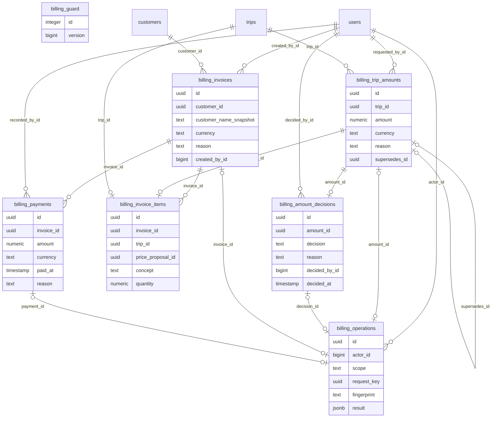

# Diccionario: Facturación administrativa y pagos

[Volver al capítulo de base de datos](../05-base-de-datos.md).

Este archivo describe el **esquema final**, no solo la migración inicial. `NULL` indica que una columna acepta ausencia de valor; un default es un valor generado si no se envía. Los CHECK y triggers también pueden limitar inserciones aparentemente válidas. Los ejemplos son consultas de estudio, no instrucciones para eludir servicios.

## Relaciones del dominio



El diagrama muestra FK reales y un subconjunto de columnas para que resulte legible. Las fichas siguientes contienen **todas** las columnas. Una referencia a otra tabla no duplica su entidad; consultar su ficha en el índice general.

## billing_amount_decisions

**Propósito:** Aprobación/rechazo de esa versión de importe.

**Responsabilidad:** Facturación administrativa y pagos. **Migraciones relacionadas:** [2026_10_14_000360_create_administrative_billing](../../../database/migrations/2026_10_14_000360_create_administrative_billing.php).

**Modelos identificados:** Query Builder/infraestructura, sin modelo Eloquent propio identificado.

**Consultas directas identificadas:** [BillingPayments](../../../app/Modules/BillingAndPayments/Application/BillingPayments.php), [BillingReviewController](../../../app/Modules/BillingAndPayments/Http/Controllers/BillingReviewController.php). La lista incluye lectores de reportes/auditoría y no sustituye las relaciones Eloquent.

### Columnas

| Columna | Tipo PostgreSQL | ¿Admite NULL? | Default |
| --- | --- | --- | --- |
| `id` | `uuid` | No | Sin default |
| `amount_id` | `uuid` | No | Sin default |
| `decision` | `text` | No | Sin default |
| `reason` | `text` | No | Sin default |
| `decided_by_id` | `bigint` | No | Sin default |
| `decided_at` | `timestamp with time zone` | No | `clock_timestamp()` |

### Claves y restricciones

- **billing_amount_decisions_decision_check**: `CHECK ((decision = ANY (ARRAY['approved'::text, 'rejected'::text])))`.
- **billing_amount_decisions_reason_check**: `CHECK ((length(btrim(reason)) > 0))`.
- **billing_amount_decisions_amount_id_fkey**: `FOREIGN KEY (amount_id) REFERENCES billing_trip_amounts(id) ON DELETE RESTRICT`.
- **billing_amount_decisions_decided_by_id_fkey**: `FOREIGN KEY (decided_by_id) REFERENCES users(id) ON DELETE RESTRICT`.
- **billing_amount_decisions_amount_id_not_null**: `NOT NULL amount_id`.
- **billing_amount_decisions_decided_at_not_null**: `NOT NULL decided_at`.
- **billing_amount_decisions_decided_by_id_not_null**: `NOT NULL decided_by_id`.
- **billing_amount_decisions_decision_not_null**: `NOT NULL decision`.
- **billing_amount_decisions_id_not_null**: `NOT NULL id`.
- **billing_amount_decisions_reason_not_null**: `NOT NULL reason`.
- **billing_amount_decisions_pkey**: `PRIMARY KEY (id)`.
- **billing_complete**: `TRIGGER DEFERRABLE INITIALLY DEFERRED`.
- **billing_amount_decisions_amount_id_key**: `UNIQUE (amount_id)`.

### Índices

- `billing_amount_decisions_amount_id_key`: `CREATE UNIQUE INDEX billing_amount_decisions_amount_id_key ON public.billing_amount_decisions USING btree (amount_id)`.
- `billing_amount_decisions_pkey`: `CREATE UNIQUE INDEX billing_amount_decisions_pkey ON public.billing_amount_decisions USING btree (id)`.

### Relaciones y cardinalidades

- `amount_id` → [`billing_trip_amounts`](facturacion.md#billing_trip_amounts) (`id`): cada fila tiene un padre; un padre admite como máximo una fila de esta tabla, sujeto a los CHECK/índices condicionales.
- `decided_by_id` → [`users`](acceso-y-personal.md#users) (`id`): cada fila tiene un padre; un padre admite varias filas de esta tabla, sujeto a los CHECK/índices condicionales.

**Referencias entrantes:**

- `billing_operations.decision_id` → `billing_amount_decisions.id` (`billing_operations_decision_id_fkey`).

### Escritura, conservación y ejemplo

Registro histórico o recibo: la operación de aplicación inserta el hecho y conserva su trazabilidad. Las correcciones se tramitan con nuevas versiones, aplicaciones o compensaciones, no con un DELETE público. Consultar los triggers siguientes para la protección exacta de esta tabla; no inferir que cualquier UPDATE SQL está permitido.

**Triggers vigentes** (momento y operación exactos; funciones explicadas en [el catálogo](funciones-y-triggers.md)):

- `billing_complete`: `CREATE CONSTRAINT TRIGGER billing_complete AFTER INSERT ON public.billing_amount_decisions DEFERRABLE INITIALLY DEFERRED FOR EACH ROW EXECUTE FUNCTION billing_complete()`.
- `billing_immutable`: `CREATE TRIGGER billing_immutable BEFORE DELETE OR UPDATE ON public.billing_amount_decisions FOR EACH ROW EXECUTE FUNCTION billing_immutable()`.
- `billing_no_truncate`: `CREATE TRIGGER billing_no_truncate BEFORE TRUNCATE ON public.billing_amount_decisions FOR EACH STATEMENT EXECUTE FUNCTION billing_immutable()`.
- `billing_validate`: `CREATE TRIGGER billing_validate BEFORE INSERT ON public.billing_amount_decisions FOR EACH ROW EXECUTE FUNCTION billing_validate()`.

```sql
SELECT id FROM billing_amount_decisions LIMIT 5;
```

Permite reconocer el registro y su relación sin leer referencias privadas de archivos ni alterar el proceso. Para crearlo funcionalmente, seguir el caso del módulo en el capítulo 12.

## billing_guard

**Propósito:** Guardia técnica financiera, no estado de factura.

**Responsabilidad:** Facturación administrativa y pagos. **Migraciones relacionadas:** [2026_10_14_000360_create_administrative_billing](../../../database/migrations/2026_10_14_000360_create_administrative_billing.php).

**Modelos identificados:** Query Builder/infraestructura, sin modelo Eloquent propio identificado.

**Consultas directas identificadas:** [BillingPayments](../../../app/Modules/BillingAndPayments/Application/BillingPayments.php). La lista incluye lectores de reportes/auditoría y no sustituye las relaciones Eloquent.

### Columnas

| Columna | Tipo PostgreSQL | ¿Admite NULL? | Default |
| --- | --- | --- | --- |
| `id` | `integer` | No | Sin default |
| `version` | `bigint` | No | `0` |

### Claves y restricciones

- **billing_guard_id_check**: `CHECK ((id = 1))`.
- **billing_guard_id_not_null**: `NOT NULL id`.
- **billing_guard_version_not_null**: `NOT NULL version`.
- **billing_guard_pkey**: `PRIMARY KEY (id)`.

### Índices

- `billing_guard_pkey`: `CREATE UNIQUE INDEX billing_guard_pkey ON public.billing_guard USING btree (id)`.

### Relaciones y cardinalidades

No tiene FK físicas. Los vínculos solo lógicos, si existen, deben interpretarse en los servicios y no como integridad automática de PostgreSQL.

**Referencias entrantes:** ninguna FK física apunta a esta tabla.

### Escritura, conservación y ejemplo

Guardia técnica: fila compartida cuyo contador se incrementa durante las transacciones para serializar/invalidar snapshots incompatibles. No es una entidad de negocio ni tiene CRUD público.

Sin triggers propios. Las reglas de aplicación siguen siendo necesarias.

```sql
SELECT id FROM billing_guard LIMIT 5;
```

Permite reconocer el registro y su relación sin leer referencias privadas de archivos ni alterar el proceso. Para crearlo funcionalmente, seguir el caso del módulo en el capítulo 12.

## billing_invoice_items

**Propósito:** Conceptos de viajes completos con importe aprobado exacto; un viaje no se factura dos veces.

**Responsabilidad:** Facturación administrativa y pagos. **Migraciones relacionadas:** [2026_10_14_000360_create_administrative_billing](../../../database/migrations/2026_10_14_000360_create_administrative_billing.php).

**Modelos identificados:** [AdministrativeInvoiceItem](../../../app/Modules/BillingAndPayments/Models/AdministrativeInvoiceItem.php).

**Consultas directas identificadas:** [AdministrativeReports](../../../app/Modules/AdministrativeReports/Application/AdministrativeReports.php), [BillingPayments](../../../app/Modules/BillingAndPayments/Application/BillingPayments.php), [BillingReviewController](../../../app/Modules/BillingAndPayments/Http/Controllers/BillingReviewController.php). La lista incluye lectores de reportes/auditoría y no sustituye las relaciones Eloquent.

### Columnas

| Columna | Tipo PostgreSQL | ¿Admite NULL? | Default |
| --- | --- | --- | --- |
| `id` | `uuid` | No | Sin default |
| `invoice_id` | `uuid` | No | Sin default |
| `trip_id` | `uuid` | No | Sin default |
| `price_proposal_id` | `uuid` | No | Sin default |
| `concept` | `text` | No | Sin default |
| `quantity` | `numeric` | No | `1` |
| `amount` | `numeric` | No | Sin default |

### Claves y restricciones

- **billing_invoice_items_amount_check**: `CHECK (((amount >= (0)::numeric) AND (amount <= 999999999999.99) AND (scale(amount) <= 2)))`.
- **billing_invoice_items_concept_check**: `CHECK ((length(btrim(concept)) > 0))`.
- **billing_invoice_items_quantity_check**: `CHECK ((quantity = (1)::numeric))`.
- **billing_invoice_items_invoice_id_fkey**: `FOREIGN KEY (invoice_id) REFERENCES billing_invoices(id) ON DELETE RESTRICT`.
- **billing_invoice_items_price_proposal_id_fkey**: `FOREIGN KEY (price_proposal_id) REFERENCES billing_trip_amounts(id) ON DELETE RESTRICT`.
- **billing_invoice_items_trip_id_fkey**: `FOREIGN KEY (trip_id) REFERENCES trips(id) ON DELETE RESTRICT`.
- **billing_invoice_items_amount_not_null**: `NOT NULL amount`.
- **billing_invoice_items_concept_not_null**: `NOT NULL concept`.
- **billing_invoice_items_id_not_null**: `NOT NULL id`.
- **billing_invoice_items_invoice_id_not_null**: `NOT NULL invoice_id`.
- **billing_invoice_items_price_proposal_id_not_null**: `NOT NULL price_proposal_id`.
- **billing_invoice_items_quantity_not_null**: `NOT NULL quantity`.
- **billing_invoice_items_trip_id_not_null**: `NOT NULL trip_id`.
- **billing_invoice_items_pkey**: `PRIMARY KEY (id)`.
- **billing_invoice_items_price_proposal_id_key**: `UNIQUE (price_proposal_id)`.
- **billing_invoice_items_trip_id_key**: `UNIQUE (trip_id)`.

### Índices

- `billing_invoice_items_pkey`: `CREATE UNIQUE INDEX billing_invoice_items_pkey ON public.billing_invoice_items USING btree (id)`.
- `billing_invoice_items_price_proposal_id_key`: `CREATE UNIQUE INDEX billing_invoice_items_price_proposal_id_key ON public.billing_invoice_items USING btree (price_proposal_id)`.
- `billing_invoice_items_trip_id_key`: `CREATE UNIQUE INDEX billing_invoice_items_trip_id_key ON public.billing_invoice_items USING btree (trip_id)`.
- `billing_items_invoice`: `CREATE INDEX billing_items_invoice ON public.billing_invoice_items USING btree (invoice_id)`.

### Relaciones y cardinalidades

- `invoice_id` → [`billing_invoices`](facturacion.md#billing_invoices) (`id`): cada fila tiene un padre; un padre admite varias filas de esta tabla, sujeto a los CHECK/índices condicionales.
- `price_proposal_id` → [`billing_trip_amounts`](facturacion.md#billing_trip_amounts) (`id`): cada fila tiene un padre; un padre admite como máximo una fila de esta tabla, sujeto a los CHECK/índices condicionales.
- `trip_id` → [`trips`](transporte.md#trips) (`id`): cada fila tiene un padre; un padre admite como máximo una fila de esta tabla, sujeto a los CHECK/índices condicionales.

**Referencias entrantes:** ninguna FK física apunta a esta tabla.

### Escritura, conservación y ejemplo

Registro histórico o recibo: la operación de aplicación inserta el hecho y conserva su trazabilidad. Las correcciones se tramitan con nuevas versiones, aplicaciones o compensaciones, no con un DELETE público. Consultar los triggers siguientes para la protección exacta de esta tabla; no inferir que cualquier UPDATE SQL está permitido.

**Triggers vigentes** (momento y operación exactos; funciones explicadas en [el catálogo](funciones-y-triggers.md)):

- `billing_immutable`: `CREATE TRIGGER billing_immutable BEFORE DELETE OR UPDATE ON public.billing_invoice_items FOR EACH ROW EXECUTE FUNCTION billing_immutable()`.
- `billing_no_truncate`: `CREATE TRIGGER billing_no_truncate BEFORE TRUNCATE ON public.billing_invoice_items FOR EACH STATEMENT EXECUTE FUNCTION billing_immutable()`.
- `billing_validate`: `CREATE TRIGGER billing_validate BEFORE INSERT ON public.billing_invoice_items FOR EACH ROW EXECUTE FUNCTION billing_validate()`.

```sql
SELECT id, invoice_id, trip_id, quantity FROM billing_invoice_items LIMIT 5;
```

Permite reconocer el registro y su relación sin leer referencias privadas de archivos ni alterar el proceso. Para crearlo funcionalmente, seguir el caso del módulo en el capítulo 12.

## billing_invoices

**Propósito:** Cabecera de factura administrativa interna de un cliente y una moneda.

**Responsabilidad:** Facturación administrativa y pagos. **Migraciones relacionadas:** [2026_10_14_000360_create_administrative_billing](../../../database/migrations/2026_10_14_000360_create_administrative_billing.php).

**Modelos identificados:** [AdministrativeInvoice](../../../app/Modules/BillingAndPayments/Models/AdministrativeInvoice.php).

**Consultas directas identificadas:** [AdministrativeReports](../../../app/Modules/AdministrativeReports/Application/AdministrativeReports.php), [BillingPayments](../../../app/Modules/BillingAndPayments/Application/BillingPayments.php). La lista incluye lectores de reportes/auditoría y no sustituye las relaciones Eloquent.

**Relaciones Eloquent declaradas:**

- `AdministrativeInvoice::items()` usa `hasMany(AdministrativeInvoiceItem::class, 'invoice_id')`.
- `AdministrativeInvoice::payments()` usa `hasMany(AdministrativePayment::class, 'invoice_id')`.

### Columnas

| Columna | Tipo PostgreSQL | ¿Admite NULL? | Default |
| --- | --- | --- | --- |
| `id` | `uuid` | No | Sin default |
| `customer_id` | `uuid` | No | Sin default |
| `customer_name_snapshot` | `text` | No | Sin default |
| `currency` | `text` | No | Sin default |
| `reason` | `text` | No | Sin default |
| `created_by_id` | `bigint` | No | Sin default |
| `registered_at` | `timestamp with time zone` | No | `clock_timestamp()` |

### Claves y restricciones

- **billing_invoices_currency_check**: `CHECK ((currency = ANY (ARRAY['CRC'::text, 'USD'::text])))`.
- **billing_invoices_reason_check**: `CHECK ((length(btrim(reason)) > 0))`.
- **billing_invoices_created_by_id_fkey**: `FOREIGN KEY (created_by_id) REFERENCES users(id) ON DELETE RESTRICT`.
- **billing_invoices_customer_id_fkey**: `FOREIGN KEY (customer_id) REFERENCES customers(id) ON DELETE RESTRICT`.
- **billing_invoices_created_by_id_not_null**: `NOT NULL created_by_id`.
- **billing_invoices_currency_not_null**: `NOT NULL currency`.
- **billing_invoices_customer_id_not_null**: `NOT NULL customer_id`.
- **billing_invoices_customer_name_snapshot_not_null**: `NOT NULL customer_name_snapshot`.
- **billing_invoices_id_not_null**: `NOT NULL id`.
- **billing_invoices_reason_not_null**: `NOT NULL reason`.
- **billing_invoices_registered_at_not_null**: `NOT NULL registered_at`.
- **billing_invoices_pkey**: `PRIMARY KEY (id)`.
- **billing_complete**: `TRIGGER DEFERRABLE INITIALLY DEFERRED`.

### Índices

- `billing_invoice_customer`: `CREATE INDEX billing_invoice_customer ON public.billing_invoices USING btree (customer_id, registered_at, id)`.
- `billing_invoices_pkey`: `CREATE UNIQUE INDEX billing_invoices_pkey ON public.billing_invoices USING btree (id)`.

### Relaciones y cardinalidades

- `created_by_id` → [`users`](acceso-y-personal.md#users) (`id`): cada fila tiene un padre; un padre admite varias filas de esta tabla, sujeto a los CHECK/índices condicionales.
- `customer_id` → [`customers`](transporte.md#customers) (`id`): cada fila tiene un padre; un padre admite varias filas de esta tabla, sujeto a los CHECK/índices condicionales.

**Referencias entrantes:**

- `billing_invoice_items.invoice_id` → `billing_invoices.id` (`billing_invoice_items_invoice_id_fkey`).
- `billing_operations.invoice_id` → `billing_invoices.id` (`billing_operations_invoice_id_fkey`).
- `billing_payments.invoice_id` → `billing_invoices.id` (`billing_payments_invoice_id_fkey`).

### Escritura, conservación y ejemplo

BillingPayments::invoice() confirma cabecera, detalles y recibo. Total, pagado, saldo y estado se derivan; no son campos editables de esta cabecera. No hay DELETE ni corrección/anulación posterior sin el procedimiento pendiente.

**Triggers vigentes** (momento y operación exactos; funciones explicadas en [el catálogo](funciones-y-triggers.md)):

- `billing_complete`: `CREATE CONSTRAINT TRIGGER billing_complete AFTER INSERT ON public.billing_invoices DEFERRABLE INITIALLY DEFERRED FOR EACH ROW EXECUTE FUNCTION billing_complete()`.
- `billing_immutable`: `CREATE TRIGGER billing_immutable BEFORE DELETE OR UPDATE ON public.billing_invoices FOR EACH ROW EXECUTE FUNCTION billing_immutable()`.
- `billing_no_truncate`: `CREATE TRIGGER billing_no_truncate BEFORE TRUNCATE ON public.billing_invoices FOR EACH STATEMENT EXECUTE FUNCTION billing_immutable()`.
- `billing_validate`: `CREATE TRIGGER billing_validate BEFORE INSERT ON public.billing_invoices FOR EACH ROW EXECUTE FUNCTION billing_validate()`.

```sql
SELECT id, registered_at FROM billing_invoices LIMIT 5;
```

Permite reconocer el registro y su relación sin leer referencias privadas de archivos ni alterar el proceso. Para crearlo funcionalmente, seguir el caso del módulo en el capítulo 12.

## billing_operations

**Propósito:** Recibos idempotentes de propuestas, decisiones, facturas y pagos.

**Responsabilidad:** Facturación administrativa y pagos. **Migraciones relacionadas:** [2026_10_14_000360_create_administrative_billing](../../../database/migrations/2026_10_14_000360_create_administrative_billing.php).

**Modelos identificados:** Query Builder/infraestructura, sin modelo Eloquent propio identificado.

**Consultas directas identificadas:** [BillingPayments](../../../app/Modules/BillingAndPayments/Application/BillingPayments.php). La lista incluye lectores de reportes/auditoría y no sustituye las relaciones Eloquent.

### Columnas

| Columna | Tipo PostgreSQL | ¿Admite NULL? | Default |
| --- | --- | --- | --- |
| `id` | `uuid` | No | Sin default |
| `actor_id` | `bigint` | No | Sin default |
| `scope` | `text` | No | Sin default |
| `request_key` | `uuid` | No | Sin default |
| `fingerprint` | `text` | No | Sin default |
| `result` | `jsonb` | No | Sin default |
| `registered_at` | `timestamp with time zone` | No | `clock_timestamp()` |
| `amount_id` | `uuid` | Sí | Sin default |
| `decision_id` | `uuid` | Sí | Sin default |
| `invoice_id` | `uuid` | Sí | Sin default |
| `payment_id` | `uuid` | Sí | Sin default |

### Claves y restricciones

- **billing_operations_check**: `CHECK ((num_nonnulls(amount_id, decision_id, invoice_id, payment_id) = 1))`.
- **billing_operations_fingerprint_check**: `CHECK ((fingerprint ~ '^[a-f0-9]{64}$'::text))`.
- **billing_operations_actor_id_fkey**: `FOREIGN KEY (actor_id) REFERENCES users(id) ON DELETE RESTRICT`.
- **billing_operations_amount_id_fkey**: `FOREIGN KEY (amount_id) REFERENCES billing_trip_amounts(id) ON DELETE RESTRICT`.
- **billing_operations_decision_id_fkey**: `FOREIGN KEY (decision_id) REFERENCES billing_amount_decisions(id) ON DELETE RESTRICT`.
- **billing_operations_invoice_id_fkey**: `FOREIGN KEY (invoice_id) REFERENCES billing_invoices(id) ON DELETE RESTRICT`.
- **billing_operations_payment_id_fkey**: `FOREIGN KEY (payment_id) REFERENCES billing_payments(id) ON DELETE RESTRICT`.
- **billing_operations_actor_id_not_null**: `NOT NULL actor_id`.
- **billing_operations_fingerprint_not_null**: `NOT NULL fingerprint`.
- **billing_operations_id_not_null**: `NOT NULL id`.
- **billing_operations_registered_at_not_null**: `NOT NULL registered_at`.
- **billing_operations_request_key_not_null**: `NOT NULL request_key`.
- **billing_operations_result_not_null**: `NOT NULL result`.
- **billing_operations_scope_not_null**: `NOT NULL scope`.
- **billing_operations_pkey**: `PRIMARY KEY (id)`.
- **billing_complete**: `TRIGGER DEFERRABLE INITIALLY DEFERRED`.
- **billing_operations_actor_id_scope_request_key_key**: `UNIQUE (actor_id, scope, request_key)`.
- **billing_operations_amount_id_key**: `UNIQUE (amount_id)`.
- **billing_operations_decision_id_key**: `UNIQUE (decision_id)`.
- **billing_operations_invoice_id_key**: `UNIQUE (invoice_id)`.
- **billing_operations_payment_id_key**: `UNIQUE (payment_id)`.

### Índices

- `billing_operations_actor_id_scope_request_key_key`: `CREATE UNIQUE INDEX billing_operations_actor_id_scope_request_key_key ON public.billing_operations USING btree (actor_id, scope, request_key)`.
- `billing_operations_amount_id_key`: `CREATE UNIQUE INDEX billing_operations_amount_id_key ON public.billing_operations USING btree (amount_id)`.
- `billing_operations_decision_id_key`: `CREATE UNIQUE INDEX billing_operations_decision_id_key ON public.billing_operations USING btree (decision_id)`.
- `billing_operations_invoice_id_key`: `CREATE UNIQUE INDEX billing_operations_invoice_id_key ON public.billing_operations USING btree (invoice_id)`.
- `billing_operations_payment_id_key`: `CREATE UNIQUE INDEX billing_operations_payment_id_key ON public.billing_operations USING btree (payment_id)`.
- `billing_operations_pkey`: `CREATE UNIQUE INDEX billing_operations_pkey ON public.billing_operations USING btree (id)`.

### Relaciones y cardinalidades

- `actor_id` → [`users`](acceso-y-personal.md#users) (`id`): cada fila tiene un padre; un padre admite varias filas de esta tabla, sujeto a los CHECK/índices condicionales.
- `amount_id` → [`billing_trip_amounts`](facturacion.md#billing_trip_amounts) (`id`): cada fila tiene cero o un padre; un padre admite como máximo una fila de esta tabla, sujeto a los CHECK/índices condicionales.
- `decision_id` → [`billing_amount_decisions`](facturacion.md#billing_amount_decisions) (`id`): cada fila tiene cero o un padre; un padre admite como máximo una fila de esta tabla, sujeto a los CHECK/índices condicionales.
- `invoice_id` → [`billing_invoices`](facturacion.md#billing_invoices) (`id`): cada fila tiene cero o un padre; un padre admite como máximo una fila de esta tabla, sujeto a los CHECK/índices condicionales.
- `payment_id` → [`billing_payments`](facturacion.md#billing_payments) (`id`): cada fila tiene cero o un padre; un padre admite como máximo una fila de esta tabla, sujeto a los CHECK/índices condicionales.

**Referencias entrantes:** ninguna FK física apunta a esta tabla.

### Escritura, conservación y ejemplo

Registro histórico o recibo: la operación de aplicación inserta el hecho y conserva su trazabilidad. Las correcciones se tramitan con nuevas versiones, aplicaciones o compensaciones, no con un DELETE público. Consultar los triggers siguientes para la protección exacta de esta tabla; no inferir que cualquier UPDATE SQL está permitido.

**Triggers vigentes** (momento y operación exactos; funciones explicadas en [el catálogo](funciones-y-triggers.md)):

- `billing_complete`: `CREATE CONSTRAINT TRIGGER billing_complete AFTER INSERT ON public.billing_operations DEFERRABLE INITIALLY DEFERRED FOR EACH ROW EXECUTE FUNCTION billing_complete()`.
- `billing_immutable`: `CREATE TRIGGER billing_immutable BEFORE DELETE OR UPDATE ON public.billing_operations FOR EACH ROW EXECUTE FUNCTION billing_immutable()`.
- `billing_no_truncate`: `CREATE TRIGGER billing_no_truncate BEFORE TRUNCATE ON public.billing_operations FOR EACH STATEMENT EXECUTE FUNCTION billing_immutable()`.
- `billing_validate`: `CREATE TRIGGER billing_validate BEFORE INSERT ON public.billing_operations FOR EACH ROW EXECUTE FUNCTION billing_validate()`.

```sql
SELECT id, registered_at, invoice_id FROM billing_operations LIMIT 5;
```

Permite reconocer el registro y su relación sin leer referencias privadas de archivos ni alterar el proceso. Para crearlo funcionalmente, seguir el caso del módulo en el capítulo 12.

## billing_payments

**Propósito:** Pagos parciales/totales registrados contra una factura; saldo derivado.

**Responsabilidad:** Facturación administrativa y pagos. **Migraciones relacionadas:** [2026_10_14_000360_create_administrative_billing](../../../database/migrations/2026_10_14_000360_create_administrative_billing.php).

**Modelos identificados:** [AdministrativePayment](../../../app/Modules/BillingAndPayments/Models/AdministrativePayment.php).

**Consultas directas identificadas:** [AdministrativeReports](../../../app/Modules/AdministrativeReports/Application/AdministrativeReports.php), [BillingPayments](../../../app/Modules/BillingAndPayments/Application/BillingPayments.php). La lista incluye lectores de reportes/auditoría y no sustituye las relaciones Eloquent.

### Columnas

| Columna | Tipo PostgreSQL | ¿Admite NULL? | Default |
| --- | --- | --- | --- |
| `id` | `uuid` | No | Sin default |
| `invoice_id` | `uuid` | No | Sin default |
| `amount` | `numeric` | No | Sin default |
| `currency` | `text` | No | Sin default |
| `paid_at` | `timestamp with time zone` | No | Sin default |
| `reason` | `text` | No | Sin default |
| `method` | `text` | Sí | Sin default |
| `recorded_by_id` | `bigint` | No | Sin default |
| `registered_at` | `timestamp with time zone` | No | `clock_timestamp()` |

### Claves y restricciones

- **billing_payments_amount_check**: `CHECK (((amount > (0)::numeric) AND (amount <= 999999999999.99) AND (scale(amount) <= 2)))`.
- **billing_payments_currency_check**: `CHECK ((currency = ANY (ARRAY['CRC'::text, 'USD'::text])))`.
- **billing_payments_method_check**: `CHECK (((method IS NULL) OR ((length(btrim(method)) >= 1) AND (length(btrim(method)) <= 255))))`.
- **billing_payments_reason_check**: `CHECK ((length(btrim(reason)) > 0))`.
- **billing_payments_invoice_id_fkey**: `FOREIGN KEY (invoice_id) REFERENCES billing_invoices(id) ON DELETE RESTRICT`.
- **billing_payments_recorded_by_id_fkey**: `FOREIGN KEY (recorded_by_id) REFERENCES users(id) ON DELETE RESTRICT`.
- **billing_payments_amount_not_null**: `NOT NULL amount`.
- **billing_payments_currency_not_null**: `NOT NULL currency`.
- **billing_payments_id_not_null**: `NOT NULL id`.
- **billing_payments_invoice_id_not_null**: `NOT NULL invoice_id`.
- **billing_payments_paid_at_not_null**: `NOT NULL paid_at`.
- **billing_payments_reason_not_null**: `NOT NULL reason`.
- **billing_payments_recorded_by_id_not_null**: `NOT NULL recorded_by_id`.
- **billing_payments_registered_at_not_null**: `NOT NULL registered_at`.
- **billing_payments_pkey**: `PRIMARY KEY (id)`.
- **billing_complete**: `TRIGGER DEFERRABLE INITIALLY DEFERRED`.

### Índices

- `billing_payment_invoice`: `CREATE INDEX billing_payment_invoice ON public.billing_payments USING btree (invoice_id, paid_at, id)`.
- `billing_payments_pkey`: `CREATE UNIQUE INDEX billing_payments_pkey ON public.billing_payments USING btree (id)`.

### Relaciones y cardinalidades

- `invoice_id` → [`billing_invoices`](facturacion.md#billing_invoices) (`id`): cada fila tiene un padre; un padre admite varias filas de esta tabla, sujeto a los CHECK/índices condicionales.
- `recorded_by_id` → [`users`](acceso-y-personal.md#users) (`id`): cada fila tiene un padre; un padre admite varias filas de esta tabla, sujeto a los CHECK/índices condicionales.

**Referencias entrantes:**

- `billing_operations.payment_id` → `billing_payments.id` (`billing_operations_payment_id_fkey`).

### Escritura, conservación y ejemplo

BillingPayments::payment() inserta pago positivo en moneda/saldo permitidos con lock y recibo atómico. Repetir la intención recupera resultado. No tiene edición/borrado o reversión confirmada sin el procedimiento pendiente.

**Triggers vigentes** (momento y operación exactos; funciones explicadas en [el catálogo](funciones-y-triggers.md)):

- `billing_complete`: `CREATE CONSTRAINT TRIGGER billing_complete AFTER INSERT ON public.billing_payments DEFERRABLE INITIALLY DEFERRED FOR EACH ROW EXECUTE FUNCTION billing_complete()`.
- `billing_immutable`: `CREATE TRIGGER billing_immutable BEFORE DELETE OR UPDATE ON public.billing_payments FOR EACH ROW EXECUTE FUNCTION billing_immutable()`.
- `billing_no_truncate`: `CREATE TRIGGER billing_no_truncate BEFORE TRUNCATE ON public.billing_payments FOR EACH STATEMENT EXECUTE FUNCTION billing_immutable()`.
- `billing_validate`: `CREATE TRIGGER billing_validate BEFORE INSERT ON public.billing_payments FOR EACH ROW EXECUTE FUNCTION billing_validate()`.

```sql
SELECT id, invoice_id, registered_at FROM billing_payments LIMIT 5;
```

Permite reconocer el registro y su relación sin leer referencias privadas de archivos ni alterar el proceso. Para crearlo funcionalmente, seguir el caso del módulo en el capítulo 12.

## billing_trip_amounts

**Propósito:** Propuestas/versiones del importe manual y moneda de un viaje.

**Responsabilidad:** Facturación administrativa y pagos. **Migraciones relacionadas:** [2026_10_14_000360_create_administrative_billing](../../../database/migrations/2026_10_14_000360_create_administrative_billing.php).

**Modelos identificados:** Query Builder/infraestructura, sin modelo Eloquent propio identificado.

**Consultas directas identificadas:** [BillingPayments](../../../app/Modules/BillingAndPayments/Application/BillingPayments.php), [BillingReviewController](../../../app/Modules/BillingAndPayments/Http/Controllers/BillingReviewController.php). La lista incluye lectores de reportes/auditoría y no sustituye las relaciones Eloquent.

### Columnas

| Columna | Tipo PostgreSQL | ¿Admite NULL? | Default |
| --- | --- | --- | --- |
| `id` | `uuid` | No | Sin default |
| `trip_id` | `uuid` | No | Sin default |
| `amount` | `numeric` | No | Sin default |
| `currency` | `text` | No | Sin default |
| `reason` | `text` | No | Sin default |
| `supersedes_id` | `uuid` | Sí | Sin default |
| `requested_by_id` | `bigint` | No | Sin default |
| `registered_at` | `timestamp with time zone` | No | `clock_timestamp()` |

### Claves y restricciones

- **billing_trip_amounts_amount_check**: `CHECK (((amount >= (0)::numeric) AND (amount <= 999999999999.99) AND (scale(amount) <= 2)))`.
- **billing_trip_amounts_currency_check**: `CHECK ((currency = ANY (ARRAY['CRC'::text, 'USD'::text])))`.
- **billing_trip_amounts_reason_check**: `CHECK ((length(btrim(reason)) > 0))`.
- **billing_trip_amounts_requested_by_id_fkey**: `FOREIGN KEY (requested_by_id) REFERENCES users(id) ON DELETE RESTRICT`.
- **billing_trip_amounts_supersedes_id_fkey**: `FOREIGN KEY (supersedes_id) REFERENCES billing_trip_amounts(id) ON DELETE RESTRICT`.
- **billing_trip_amounts_trip_id_fkey**: `FOREIGN KEY (trip_id) REFERENCES trips(id) ON DELETE RESTRICT`.
- **billing_trip_amounts_amount_not_null**: `NOT NULL amount`.
- **billing_trip_amounts_currency_not_null**: `NOT NULL currency`.
- **billing_trip_amounts_id_not_null**: `NOT NULL id`.
- **billing_trip_amounts_reason_not_null**: `NOT NULL reason`.
- **billing_trip_amounts_registered_at_not_null**: `NOT NULL registered_at`.
- **billing_trip_amounts_requested_by_id_not_null**: `NOT NULL requested_by_id`.
- **billing_trip_amounts_trip_id_not_null**: `NOT NULL trip_id`.
- **billing_trip_amounts_pkey**: `PRIMARY KEY (id)`.
- **billing_complete**: `TRIGGER DEFERRABLE INITIALLY DEFERRED`.
- **billing_trip_amounts_supersedes_id_key**: `UNIQUE (supersedes_id)`.

### Índices

- `billing_amount_trip`: `CREATE INDEX billing_amount_trip ON public.billing_trip_amounts USING btree (trip_id, registered_at, id)`.
- `billing_trip_amounts_pkey`: `CREATE UNIQUE INDEX billing_trip_amounts_pkey ON public.billing_trip_amounts USING btree (id)`.
- `billing_trip_amounts_supersedes_id_key`: `CREATE UNIQUE INDEX billing_trip_amounts_supersedes_id_key ON public.billing_trip_amounts USING btree (supersedes_id)`.

### Relaciones y cardinalidades

- `requested_by_id` → [`users`](acceso-y-personal.md#users) (`id`): cada fila tiene un padre; un padre admite varias filas de esta tabla, sujeto a los CHECK/índices condicionales.
- `supersedes_id` → [`billing_trip_amounts`](facturacion.md#billing_trip_amounts) (`id`): cada fila tiene cero o un padre; un padre admite como máximo una fila de esta tabla, sujeto a los CHECK/índices condicionales.
- `trip_id` → [`trips`](transporte.md#trips) (`id`): cada fila tiene un padre; un padre admite varias filas de esta tabla, sujeto a los CHECK/índices condicionales.

**Referencias entrantes:**

- `billing_amount_decisions.amount_id` → `billing_trip_amounts.id` (`billing_amount_decisions_amount_id_fkey`).
- `billing_invoice_items.price_proposal_id` → `billing_trip_amounts.id` (`billing_invoice_items_price_proposal_id_fkey`).
- `billing_operations.amount_id` → `billing_trip_amounts.id` (`billing_operations_amount_id_fkey`).
- `billing_trip_amounts.supersedes_id` → `billing_trip_amounts.id` (`billing_trip_amounts_supersedes_id_fkey`).

### Escritura, conservación y ejemplo

Registro histórico o recibo: la operación de aplicación inserta el hecho y conserva su trazabilidad. Las correcciones se tramitan con nuevas versiones, aplicaciones o compensaciones, no con un DELETE público. Consultar los triggers siguientes para la protección exacta de esta tabla; no inferir que cualquier UPDATE SQL está permitido.

**Triggers vigentes** (momento y operación exactos; funciones explicadas en [el catálogo](funciones-y-triggers.md)):

- `billing_complete`: `CREATE CONSTRAINT TRIGGER billing_complete AFTER INSERT ON public.billing_trip_amounts DEFERRABLE INITIALLY DEFERRED FOR EACH ROW EXECUTE FUNCTION billing_complete()`.
- `billing_immutable`: `CREATE TRIGGER billing_immutable BEFORE DELETE OR UPDATE ON public.billing_trip_amounts FOR EACH ROW EXECUTE FUNCTION billing_immutable()`.
- `billing_no_truncate`: `CREATE TRIGGER billing_no_truncate BEFORE TRUNCATE ON public.billing_trip_amounts FOR EACH STATEMENT EXECUTE FUNCTION billing_immutable()`.
- `billing_validate`: `CREATE TRIGGER billing_validate BEFORE INSERT ON public.billing_trip_amounts FOR EACH ROW EXECUTE FUNCTION billing_validate()`.

```sql
SELECT id, trip_id, registered_at FROM billing_trip_amounts LIMIT 5;
```

Permite reconocer el registro y su relación sin leer referencias privadas de archivos ni alterar el proceso. Para crearlo funcionalmente, seguir el caso del módulo en el capítulo 12.
