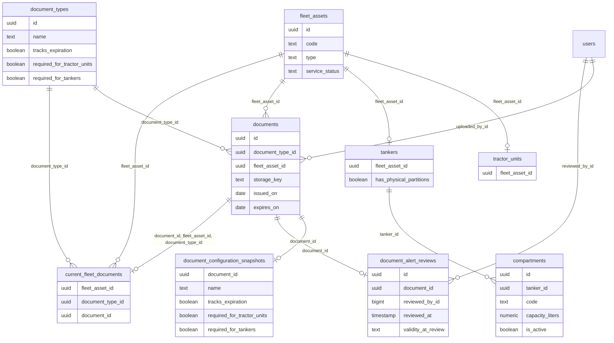

# Diccionario: Flota y Documentación

[Volver al capítulo de base de datos](../05-base-de-datos.md).

Este archivo describe el **esquema final**, no solo la migración inicial. `NULL` indica que una columna acepta ausencia de valor; un default es un valor generado si no se envía. Los CHECK y triggers también pueden limitar inserciones aparentemente válidas. Los ejemplos son consultas de estudio, no instrucciones para eludir servicios.

## Relaciones del dominio



El diagrama muestra FK reales y un subconjunto de columnas para que resulte legible. Las fichas siguientes contienen **todas** las columnas. Una referencia a otra tabla no duplica su entidad; consultar su ficha en el índice general.

## compartments

**Propósito:** Compartimentos de una cisterna, incluso el lógico de una cisterna sin divisiones; capacidad exacta en litros.

**Responsabilidad:** Flota y Documentación. **Migraciones relacionadas:** [2026_10_10_000030_create_fleet](../../../database/migrations/2026_10_10_000030_create_fleet.php), [2026_10_12_000140_create_trip_operational_records](../../../database/migrations/2026_10_12_000140_create_trip_operational_records.php).

**Modelos identificados:** [Compartment](../../../app/Modules/FleetAndDocuments/Models/Compartment.php).

**Relaciones Eloquent declaradas:**

- `Compartment::tanker()` usa `belongsTo(Tanker::class, 'tanker_id', 'fleet_asset_id')`.

### Columnas

| Columna | Tipo PostgreSQL | ¿Admite NULL? | Default |
| --- | --- | --- | --- |
| `id` | `uuid` | No | Sin default |
| `tanker_id` | `uuid` | No | Sin default |
| `code` | `text` | No | Sin default |
| `capacity_liters` | `numeric(12,2)` | No | Sin default |
| `is_active` | `boolean` | No | Sin default |

### Claves y restricciones

- **compartment_capacity_positive**: `CHECK (((capacity_liters > (0)::numeric) AND (capacity_liters <> 'NaN'::numeric)))`.
- **compartment_code_nonempty**: `CHECK ((btrim(code) <> ''::text))`.
- **compartments_tanker_id_foreign**: `FOREIGN KEY (tanker_id) REFERENCES tankers(fleet_asset_id)`.
- **compartments_capacity_liters_not_null**: `NOT NULL capacity_liters`.
- **compartments_code_not_null**: `NOT NULL code`.
- **compartments_id_not_null**: `NOT NULL id`.
- **compartments_is_active_not_null**: `NOT NULL is_active`.
- **compartments_tanker_id_not_null**: `NOT NULL tanker_id`.
- **compartments_pkey**: `PRIMARY KEY (id)`.
- **compartment_integrity**: `TRIGGER DEFERRABLE INITIALLY DEFERRED`.
- **compartments_tanker_id_code_unique**: `UNIQUE (tanker_id, code)`.

### Índices

- `compartments_pkey`: `CREATE UNIQUE INDEX compartments_pkey ON public.compartments USING btree (id)`.
- `compartments_tanker_id_code_unique`: `CREATE UNIQUE INDEX compartments_tanker_id_code_unique ON public.compartments USING btree (tanker_id, code)`.

### Relaciones y cardinalidades

- `tanker_id` → [`tankers`](flota-y-documentacion.md#tankers) (`fleet_asset_id`): cada fila tiene un padre; un padre admite varias filas de esta tabla, sujeto a los CHECK/índices condicionales.

**Referencias entrantes:**

- `load_items.compartment_id` → `compartments.id` (`load_items_compartment_id_foreign`).

### Escritura, conservación y ejemplo

Catálogo o entidad administrable: altas y actualizaciones mediante los controladores/servicios del módulo. No hay eliminación física pública. Las restricciones de uso histórico y autorización siguen aplicando; activar/desactivar no equivale a borrar.

**Triggers vigentes** (momento y operación exactos; funciones explicadas en [el catálogo](funciones-y-triggers.md)):

- `compartment_integrity`: `CREATE CONSTRAINT TRIGGER compartment_integrity AFTER INSERT OR DELETE OR UPDATE ON public.compartments DEFERRABLE INITIALLY DEFERRED FOR EACH ROW EXECUTE FUNCTION fleet_validate_roots()`.
- `compartment_lock_root`: `CREATE TRIGGER compartment_lock_root BEFORE INSERT OR DELETE OR UPDATE ON public.compartments FOR EACH ROW EXECUTE FUNCTION fleet_lock_root()`.
- `compartment_reject_truncate`: `CREATE TRIGGER compartment_reject_truncate BEFORE TRUNCATE ON public.compartments FOR EACH STATEMENT EXECUTE FUNCTION fleet_reject_truncate()`.

```sql
SELECT id, code FROM compartments LIMIT 5;
```

Permite reconocer el registro y su relación sin leer referencias privadas de archivos ni alterar el proceso. Para crearlo funcionalmente, seguir el caso del módulo en el capítulo 12.

## current_fleet_documents

**Propósito:** Puntero único al documento actual por activo y tipo.

**Responsabilidad:** Flota y Documentación. **Migraciones relacionadas:** [2026_10_11_000050_track_current_fleet_documents](../../../database/migrations/2026_10_11_000050_track_current_fleet_documents.php), [2026_10_16_000390_create_document_alert_reviews](../../../database/migrations/2026_10_16_000390_create_document_alert_reviews.php).

**Modelos identificados:** Query Builder/infraestructura, sin modelo Eloquent propio identificado.

**Consultas directas identificadas:** [Document](../../../app/Modules/FleetAndDocuments/Models/Document.php). La lista incluye lectores de reportes/auditoría y no sustituye las relaciones Eloquent.

### Columnas

| Columna | Tipo PostgreSQL | ¿Admite NULL? | Default |
| --- | --- | --- | --- |
| `fleet_asset_id` | `uuid` | No | Sin default |
| `document_type_id` | `uuid` | No | Sin default |
| `document_id` | `uuid` | No | Sin default |

### Claves y restricciones

- **current_document_identity**: `FOREIGN KEY (document_id, fleet_asset_id, document_type_id) REFERENCES documents(id, fleet_asset_id, document_type_id) ON DELETE RESTRICT`.
- **current_fleet_documents_document_type_id_foreign**: `FOREIGN KEY (document_type_id) REFERENCES document_types(id) ON DELETE RESTRICT`.
- **current_fleet_documents_fleet_asset_id_foreign**: `FOREIGN KEY (fleet_asset_id) REFERENCES fleet_assets(id) ON DELETE RESTRICT`.
- **current_fleet_documents_document_id_not_null**: `NOT NULL document_id`.
- **current_fleet_documents_document_type_id_not_null**: `NOT NULL document_type_id`.
- **current_fleet_documents_fleet_asset_id_not_null**: `NOT NULL fleet_asset_id`.
- **current_fleet_documents_pkey**: `PRIMARY KEY (fleet_asset_id, document_type_id)`.
- **current_fleet_documents_document_id_unique**: `UNIQUE (document_id)`.

### Índices

- `current_fleet_documents_document_id_unique`: `CREATE UNIQUE INDEX current_fleet_documents_document_id_unique ON public.current_fleet_documents USING btree (document_id)`.
- `current_fleet_documents_pkey`: `CREATE UNIQUE INDEX current_fleet_documents_pkey ON public.current_fleet_documents USING btree (fleet_asset_id, document_type_id)`.

### Relaciones y cardinalidades

- `document_id, fleet_asset_id, document_type_id` → [`documents`](flota-y-documentacion.md#documents) (`id, fleet_asset_id, document_type_id`): cada fila tiene un padre; un padre admite como máximo una fila de esta tabla, sujeto a los CHECK/índices condicionales.
- `document_type_id` → [`document_types`](flota-y-documentacion.md#document_types) (`id`): cada fila tiene un padre; un padre admite varias filas de esta tabla, sujeto a los CHECK/índices condicionales.
- `fleet_asset_id` → [`fleet_assets`](flota-y-documentacion.md#fleet_assets) (`id`): cada fila tiene un padre; un padre admite varias filas de esta tabla, sujeto a los CHECK/índices condicionales.

**Referencias entrantes:** ninguna FK física apunta a esta tabla.

### Escritura, conservación y ejemplo

Los triggers documentales mantienen el puntero dentro de la transacción de registro. UNIQUE/FK aseguran identidad compatible por activo/tipo. No elimina el anterior ni se decide mediante MAX(fecha).

**Triggers vigentes** (momento y operación exactos; funciones explicadas en [el catálogo](funciones-y-triggers.md)):

- `current_document_preserve`: `CREATE TRIGGER current_document_preserve BEFORE DELETE ON public.current_fleet_documents FOR EACH ROW EXECUTE FUNCTION fleet_document_preserve_history()`.
- `current_document_registration`: `CREATE TRIGGER current_document_registration BEFORE INSERT OR UPDATE ON public.current_fleet_documents FOR EACH ROW EXECUTE FUNCTION fleet_document_internal_reference()`.
- `current_document_truncate`: `CREATE TRIGGER current_document_truncate BEFORE TRUNCATE ON public.current_fleet_documents FOR EACH STATEMENT EXECUTE FUNCTION fleet_document_preserve_history()`.

```sql
SELECT fleet_asset_id FROM current_fleet_documents LIMIT 5;
```

Permite reconocer el registro y su relación sin leer referencias privadas de archivos ni alterar el proceso. Para crearlo funcionalmente, seguir el caso del módulo en el capítulo 12.

## document_alert_reviews

**Propósito:** Constancia de revisión de una alerta, sin renovar ni alterar su documento.

**Responsabilidad:** Flota y Documentación. **Migraciones relacionadas:** [2026_10_16_000390_create_document_alert_reviews](../../../database/migrations/2026_10_16_000390_create_document_alert_reviews.php).

**Modelos identificados:** Query Builder/infraestructura, sin modelo Eloquent propio identificado.

**Consultas directas identificadas:** [DocumentAlerts](../../../app/Modules/FleetAndDocuments/Application/DocumentAlerts.php). La lista incluye lectores de reportes/auditoría y no sustituye las relaciones Eloquent.

### Columnas

| Columna | Tipo PostgreSQL | ¿Admite NULL? | Default |
| --- | --- | --- | --- |
| `id` | `uuid` | No | Sin default |
| `document_id` | `uuid` | No | Sin default |
| `reviewed_by_id` | `bigint` | No | Sin default |
| `reviewed_at` | `timestamp with time zone` | No | `clock_timestamp()` |
| `validity_at_review` | `text` | No | Sin default |

### Claves y restricciones

- **document_alert_reviews_validity_at_review_check**: `CHECK ((validity_at_review = ANY (ARRAY['expired'::text, 'expiring_soon'::text])))`.
- **document_alert_reviews_document_id_fkey**: `FOREIGN KEY (document_id) REFERENCES documents(id) ON DELETE RESTRICT`.
- **document_alert_reviews_reviewed_by_id_fkey**: `FOREIGN KEY (reviewed_by_id) REFERENCES users(id) ON DELETE RESTRICT`.
- **document_alert_reviews_document_id_not_null**: `NOT NULL document_id`.
- **document_alert_reviews_id_not_null**: `NOT NULL id`.
- **document_alert_reviews_reviewed_at_not_null**: `NOT NULL reviewed_at`.
- **document_alert_reviews_reviewed_by_id_not_null**: `NOT NULL reviewed_by_id`.
- **document_alert_reviews_validity_at_review_not_null**: `NOT NULL validity_at_review`.
- **document_alert_reviews_pkey**: `PRIMARY KEY (id)`.
- **document_alert_reviews_document_id_key**: `UNIQUE (document_id)`.

### Índices

- `document_alert_reviews_document_id_key`: `CREATE UNIQUE INDEX document_alert_reviews_document_id_key ON public.document_alert_reviews USING btree (document_id)`.
- `document_alert_reviews_pkey`: `CREATE UNIQUE INDEX document_alert_reviews_pkey ON public.document_alert_reviews USING btree (id)`.

### Relaciones y cardinalidades

- `document_id` → [`documents`](flota-y-documentacion.md#documents) (`id`): cada fila tiene un padre; un padre admite como máximo una fila de esta tabla, sujeto a los CHECK/índices condicionales.
- `reviewed_by_id` → [`users`](acceso-y-personal.md#users) (`id`): cada fila tiene un padre; un padre admite varias filas de esta tabla, sujeto a los CHECK/índices condicionales.

**Referencias entrantes:** ninguna FK física apunta a esta tabla.

### Escritura, conservación y ejemplo

DocumentAlerts::review() inserta revisión única con actor/fecha; repetir recupera la existente. No renueva, edita ni oculta documento. Un reemplazo tiene atención independiente.

**Triggers vigentes** (momento y operación exactos; funciones explicadas en [el catálogo](funciones-y-triggers.md)):

- `document_alert_review_history`: `CREATE TRIGGER document_alert_review_history BEFORE DELETE OR UPDATE ON public.document_alert_reviews FOR EACH ROW EXECUTE FUNCTION fleet_document_preserve_history()`.
- `document_alert_review_no_truncate`: `CREATE TRIGGER document_alert_review_no_truncate BEFORE TRUNCATE ON public.document_alert_reviews FOR EACH STATEMENT EXECUTE FUNCTION fleet_document_preserve_history()`.
- `document_alert_review_validate`: `CREATE TRIGGER document_alert_review_validate BEFORE INSERT ON public.document_alert_reviews FOR EACH ROW EXECUTE FUNCTION document_alert_validate_review()`.

```sql
SELECT id FROM document_alert_reviews LIMIT 5;
```

Permite reconocer el registro y su relación sin leer referencias privadas de archivos ni alterar el proceso. Para crearlo funcionalmente, seguir el caso del módulo en el capítulo 12.

## document_configuration_snapshots

**Propósito:** Copia inmutable de los requisitos documentales aplicables al registrar cada documento.

**Responsabilidad:** Flota y Documentación. **Migraciones relacionadas:** [2026_10_11_000050_track_current_fleet_documents](../../../database/migrations/2026_10_11_000050_track_current_fleet_documents.php), [2026_10_16_000390_create_document_alert_reviews](../../../database/migrations/2026_10_16_000390_create_document_alert_reviews.php).

**Modelos identificados:** [DocumentConfigurationSnapshot](../../../app/Modules/FleetAndDocuments/Models/DocumentConfigurationSnapshot.php).

### Columnas

| Columna | Tipo PostgreSQL | ¿Admite NULL? | Default |
| --- | --- | --- | --- |
| `document_id` | `uuid` | No | Sin default |
| `name` | `text` | No | Sin default |
| `tracks_expiration` | `boolean` | No | Sin default |
| `required_for_tractor_units` | `boolean` | No | Sin default |
| `required_for_tankers` | `boolean` | No | Sin default |

### Claves y restricciones

- **document_configuration_snapshots_document_id_foreign**: `FOREIGN KEY (document_id) REFERENCES documents(id) ON DELETE RESTRICT`.
- **document_configuration_snap_required_for_tractor_units_not_null**: `NOT NULL required_for_tractor_units`.
- **document_configuration_snapshots_document_id_not_null**: `NOT NULL document_id`.
- **document_configuration_snapshots_name_not_null**: `NOT NULL name`.
- **document_configuration_snapshots_required_for_tankers_not_null**: `NOT NULL required_for_tankers`.
- **document_configuration_snapshots_tracks_expiration_not_null**: `NOT NULL tracks_expiration`.
- **document_configuration_snapshots_pkey**: `PRIMARY KEY (document_id)`.

### Índices

- `document_configuration_snapshots_pkey`: `CREATE UNIQUE INDEX document_configuration_snapshots_pkey ON public.document_configuration_snapshots USING btree (document_id)`.

### Relaciones y cardinalidades

- `document_id` → [`documents`](flota-y-documentacion.md#documents) (`id`): cada fila tiene un padre; un padre admite como máximo una fila de esta tabla, sujeto a los CHECK/índices condicionales.

**Referencias entrantes:** ninguna FK física apunta a esta tabla.

### Escritura, conservación y ejemplo

Los triggers de registro generan esta copia. No existe API para modificarla: un cambio posterior del tipo no reinterpreta el documento anterior.

**Triggers vigentes** (momento y operación exactos; funciones explicadas en [el catálogo](funciones-y-triggers.md)):

- `document_snapshot_history`: `CREATE TRIGGER document_snapshot_history BEFORE DELETE OR UPDATE ON public.document_configuration_snapshots FOR EACH ROW EXECUTE FUNCTION fleet_document_preserve_history()`.
- `document_snapshot_registration`: `CREATE TRIGGER document_snapshot_registration BEFORE INSERT ON public.document_configuration_snapshots FOR EACH ROW EXECUTE FUNCTION fleet_document_internal_reference()`.
- `document_snapshot_truncate`: `CREATE TRIGGER document_snapshot_truncate BEFORE TRUNCATE ON public.document_configuration_snapshots FOR EACH STATEMENT EXECUTE FUNCTION fleet_document_preserve_history()`.

```sql
SELECT document_id FROM document_configuration_snapshots LIMIT 5;
```

Permite reconocer el registro y su relación sin leer referencias privadas de archivos ni alterar el proceso. Para crearlo funcionalmente, seguir el caso del módulo en el capítulo 12.

## document_types

**Propósito:** Configuración documental vigente que el administrador puede gestionar.

**Responsabilidad:** Flota y Documentación. **Migraciones relacionadas:** [2026_10_11_000040_create_fleet_documents](../../../database/migrations/2026_10_11_000040_create_fleet_documents.php), [2026_10_11_000050_track_current_fleet_documents](../../../database/migrations/2026_10_11_000050_track_current_fleet_documents.php).

**Modelos identificados:** [DocumentType](../../../app/Modules/FleetAndDocuments/Models/DocumentType.php).

**Relaciones Eloquent declaradas:**

- `DocumentType::documents()` usa `hasMany(Document::class)`.

### Columnas

| Columna | Tipo PostgreSQL | ¿Admite NULL? | Default |
| --- | --- | --- | --- |
| `id` | `uuid` | No | Sin default |
| `name` | `text` | No | Sin default |
| `tracks_expiration` | `boolean` | No | Sin default |
| `required_for_tractor_units` | `boolean` | No | Sin default |
| `required_for_tankers` | `boolean` | No | Sin default |

### Claves y restricciones

- **document_types_name_not_empty**: `CHECK ((btrim(name) <> ''::text))`.
- **document_types_id_not_null**: `NOT NULL id`.
- **document_types_name_not_null**: `NOT NULL name`.
- **document_types_required_for_tankers_not_null**: `NOT NULL required_for_tankers`.
- **document_types_required_for_tractor_units_not_null**: `NOT NULL required_for_tractor_units`.
- **document_types_tracks_expiration_not_null**: `NOT NULL tracks_expiration`.
- **document_types_pkey**: `PRIMARY KEY (id)`.

### Índices

- `document_types_pkey`: `CREATE UNIQUE INDEX document_types_pkey ON public.document_types USING btree (id)`.

### Relaciones y cardinalidades

No tiene FK físicas. Los vínculos solo lógicos, si existen, deben interpretarse en los servicios y no como integridad automática de PostgreSQL.

**Referencias entrantes:**

- `current_fleet_documents.document_type_id` → `document_types.id` (`current_fleet_documents_document_type_id_foreign`).
- `documents.document_type_id` → `document_types.id` (`documents_document_type_id_foreign`).

### Escritura, conservación y ejemplo

DocumentAdministration::configure() permite alta/configuración al administrador. Los documentos anteriores conservan su snapshot; no hay eliminación pública ni configuración por secretaria.

Sin triggers propios. Las reglas de aplicación siguen siendo necesarias.

```sql
SELECT id FROM document_types LIMIT 5;
```

Permite reconocer el registro y su relación sin leer referencias privadas de archivos ni alterar el proceso. Para crearlo funcionalmente, seguir el caso del módulo en el capítulo 12.

## documents

**Propósito:** Versión de un documento de activo con fechas y referencia privada del archivo.

**Responsabilidad:** Flota y Documentación. **Migraciones relacionadas:** [2026_10_11_000040_create_fleet_documents](../../../database/migrations/2026_10_11_000040_create_fleet_documents.php), [2026_10_11_000050_track_current_fleet_documents](../../../database/migrations/2026_10_11_000050_track_current_fleet_documents.php), [2026_10_16_000390_create_document_alert_reviews](../../../database/migrations/2026_10_16_000390_create_document_alert_reviews.php).

**Modelos identificados:** [Document](../../../app/Modules/FleetAndDocuments/Models/Document.php).

**Relaciones Eloquent declaradas:**

- `Document::documentType()` usa `belongsTo(DocumentType::class)`.
- `Document::fleetAsset()` usa `belongsTo(FleetAsset::class)`.
- `Document::uploadedBy()` usa `belongsTo(User::class, 'uploaded_by_id')`.
- `Document::configurationSnapshot()` usa `hasOne(DocumentConfigurationSnapshot::class)`.

### Columnas

| Columna | Tipo PostgreSQL | ¿Admite NULL? | Default |
| --- | --- | --- | --- |
| `id` | `uuid` | No | Sin default |
| `document_type_id` | `uuid` | No | Sin default |
| `fleet_asset_id` | `uuid` | No | Sin default |
| `storage_key` | `text` | No | Sin default |
| `issued_on` | `date` | Sí | Sin default |
| `expires_on` | `date` | Sí | Sin default |
| `uploaded_by_id` | `bigint` | No | Sin default |
| `registered_at` | `timestamp(0) with time zone` | No | `CURRENT_TIMESTAMP` |

### Claves y restricciones

- **documents_date_order**: `CHECK (((issued_on IS NULL) OR (expires_on IS NULL) OR (issued_on <= expires_on)))`.
- **documents_storage_key_not_empty**: `CHECK ((btrim(storage_key) <> ''::text))`.
- **documents_document_type_id_foreign**: `FOREIGN KEY (document_type_id) REFERENCES document_types(id) ON DELETE RESTRICT`.
- **documents_fleet_asset_id_foreign**: `FOREIGN KEY (fleet_asset_id) REFERENCES fleet_assets(id) ON DELETE RESTRICT`.
- **documents_uploaded_by_id_foreign**: `FOREIGN KEY (uploaded_by_id) REFERENCES users(id) ON DELETE RESTRICT`.
- **documents_document_type_id_not_null**: `NOT NULL document_type_id`.
- **documents_fleet_asset_id_not_null**: `NOT NULL fleet_asset_id`.
- **documents_id_not_null**: `NOT NULL id`.
- **documents_registered_at_not_null**: `NOT NULL registered_at`.
- **documents_storage_key_not_null**: `NOT NULL storage_key`.
- **documents_uploaded_by_id_not_null**: `NOT NULL uploaded_by_id`.
- **documents_pkey**: `PRIMARY KEY (id)`.
- **documents_identity_unique**: `UNIQUE (id, fleet_asset_id, document_type_id)`.

### Índices

- `documents_document_type_id_expires_on_index`: `CREATE INDEX documents_document_type_id_expires_on_index ON public.documents USING btree (document_type_id, expires_on)`.
- `documents_fleet_asset_id_document_type_id_registered_at_index`: `CREATE INDEX documents_fleet_asset_id_document_type_id_registered_at_index ON public.documents USING btree (fleet_asset_id, document_type_id, registered_at)`.
- `documents_identity_unique`: `CREATE UNIQUE INDEX documents_identity_unique ON public.documents USING btree (id, fleet_asset_id, document_type_id)`.
- `documents_pkey`: `CREATE UNIQUE INDEX documents_pkey ON public.documents USING btree (id)`.
- `documents_uploaded_by_id_index`: `CREATE INDEX documents_uploaded_by_id_index ON public.documents USING btree (uploaded_by_id)`.

### Relaciones y cardinalidades

- `document_type_id` → [`document_types`](flota-y-documentacion.md#document_types) (`id`): cada fila tiene un padre; un padre admite varias filas de esta tabla, sujeto a los CHECK/índices condicionales.
- `fleet_asset_id` → [`fleet_assets`](flota-y-documentacion.md#fleet_assets) (`id`): cada fila tiene un padre; un padre admite varias filas de esta tabla, sujeto a los CHECK/índices condicionales.
- `uploaded_by_id` → [`users`](acceso-y-personal.md#users) (`id`): cada fila tiene un padre; un padre admite varias filas de esta tabla, sujeto a los CHECK/índices condicionales.

**Referencias entrantes:**

- `current_fleet_documents.document_id, fleet_asset_id, document_type_id` → `documents.id, fleet_asset_id, document_type_id` (`current_document_identity`).
- `document_alert_reviews.document_id` → `documents.id` (`document_alert_reviews_document_id_fkey`).
- `document_configuration_snapshots.document_id` → `documents.id` (`document_configuration_snapshots_document_id_foreign`).

### Escritura, conservación y ejemplo

DocumentAdministration::register() coordina archivo privado y nueva fila. Los triggers generan snapshot y referencia actual. Renovar inserta otra versión sin editar/borrar la anterior. Marcadores permiten compensar archivos nuevos fallidos sin eliminar históricos.

**Triggers vigentes** (momento y operación exactos; funciones explicadas en [el catálogo](funciones-y-triggers.md)):

- `fleet_document_current`: `CREATE TRIGGER fleet_document_current AFTER INSERT ON public.documents FOR EACH ROW EXECUTE FUNCTION fleet_document_register_current()`.
- `fleet_document_expiration`: `CREATE TRIGGER fleet_document_expiration BEFORE INSERT ON public.documents FOR EACH ROW EXECUTE FUNCTION fleet_document_validate_expiration()`.
- `fleet_document_history`: `CREATE TRIGGER fleet_document_history BEFORE DELETE OR UPDATE ON public.documents FOR EACH ROW EXECUTE FUNCTION fleet_document_preserve_history()`.
- `fleet_document_history_truncate`: `CREATE TRIGGER fleet_document_history_truncate BEFORE TRUNCATE ON public.documents FOR EACH STATEMENT EXECUTE FUNCTION fleet_document_preserve_history()`.

```sql
SELECT id, fleet_asset_id, registered_at FROM documents LIMIT 5;
```

Permite reconocer el registro y su relación sin leer referencias privadas de archivos ni alterar el proceso. Para crearlo funcionalmente, seguir el caso del módulo en el capítulo 12.

## fleet_assets

**Propósito:** Identidad común de un activo de flota: código, tipo y estado de servicio.

**Responsabilidad:** Flota y Documentación. **Migraciones relacionadas:** [2026_10_10_000030_create_fleet](../../../database/migrations/2026_10_10_000030_create_fleet.php), [2026_10_11_000120_create_trip_assignments](../../../database/migrations/2026_10_11_000120_create_trip_assignments.php), [2026_10_11_000130_protect_trip_assignment_integrity](../../../database/migrations/2026_10_11_000130_protect_trip_assignment_integrity.php), [2026_10_12_000140_create_trip_operational_records](../../../database/migrations/2026_10_12_000140_create_trip_operational_records.php), [2026_10_12_000180_create_workshop_core](../../../database/migrations/2026_10_12_000180_create_workshop_core.php), [2026_10_12_000190_protect_workshop_core](../../../database/migrations/2026_10_12_000190_protect_workshop_core.php), [2026_10_12_000220_create_workshop_availability](../../../database/migrations/2026_10_12_000220_create_workshop_availability.php), [2026_10_12_000230_protect_workshop_availability](../../../database/migrations/2026_10_12_000230_protect_workshop_availability.php).

**Modelos identificados:** [FleetAsset](../../../app/Modules/FleetAndDocuments/Models/FleetAsset.php).

**Consultas directas identificadas:** [AdministrativeReports](../../../app/Modules/AdministrativeReports/Application/AdministrativeReports.php), [WorkshopAccess](../../../app/Modules/Workshop/Application/WorkshopAccess.php), [WorkshopCore](../../../app/Modules/Workshop/Application/WorkshopCore.php), [WorkshopQueryController](../../../app/Modules/Workshop/Http/Controllers/WorkshopQueryController.php). La lista incluye lectores de reportes/auditoría y no sustituye las relaciones Eloquent.

**Relaciones Eloquent declaradas:**

- `FleetAsset::documents()` usa `hasMany(Document::class)`.
- `FleetAsset::tractorUnit()` usa `hasOne(TractorUnit::class, 'fleet_asset_id')`.
- `FleetAsset::tanker()` usa `hasOne(Tanker::class, 'fleet_asset_id')`.

### Columnas

| Columna | Tipo PostgreSQL | ¿Admite NULL? | Default |
| --- | --- | --- | --- |
| `id` | `uuid` | No | Sin default |
| `code` | `text` | No | Sin default |
| `type` | `text` | No | Sin default |
| `service_status` | `text` | No | `'available'::text` |

### Claves y restricciones

- **fleet_asset_code_nonempty**: `CHECK ((btrim(code) <> ''::text))`.
- **fleet_asset_service_status**: `CHECK ((service_status = ANY (ARRAY['available'::text, 'maintenance'::text, 'out_of_service'::text])))`.
- **fleet_asset_type**: `CHECK ((type = ANY (ARRAY['tractor_unit'::text, 'tanker'::text])))`.
- **fleet_assets_code_not_null**: `NOT NULL code`.
- **fleet_assets_id_not_null**: `NOT NULL id`.
- **fleet_assets_service_status_not_null**: `NOT NULL service_status`.
- **fleet_assets_type_not_null**: `NOT NULL type`.
- **fleet_assets_pkey**: `PRIMARY KEY (id)`.
- **fleet_asset_integrity**: `TRIGGER DEFERRABLE INITIALLY DEFERRED`.
- **workshop_projection_audit**: `TRIGGER DEFERRABLE INITIALLY DEFERRED`.
- **fleet_assets_code_unique**: `UNIQUE (code)`.

### Índices

- `fleet_assets_code_unique`: `CREATE UNIQUE INDEX fleet_assets_code_unique ON public.fleet_assets USING btree (code)`.
- `fleet_assets_pkey`: `CREATE UNIQUE INDEX fleet_assets_pkey ON public.fleet_assets USING btree (id)`.

### Relaciones y cardinalidades

No tiene FK físicas. Los vínculos solo lógicos, si existen, deben interpretarse en los servicios y no como integridad automática de PostgreSQL.

**Referencias entrantes:**

- `current_fleet_documents.fleet_asset_id` → `fleet_assets.id` (`current_fleet_documents_fleet_asset_id_foreign`).
- `documents.fleet_asset_id` → `fleet_assets.id` (`documents_fleet_asset_id_foreign`).
- `fleet_operating_impediments.fleet_asset_id` → `fleet_assets.id` (`fleet_operating_impediments_fleet_asset_id_fkey`).
- `tankers.fleet_asset_id` → `fleet_assets.id` (`tankers_fleet_asset_id_foreign`).
- `tractor_units.fleet_asset_id` → `fleet_assets.id` (`tractor_units_fleet_asset_id_foreign`).
- `trip_asset_assignments.fleet_asset_id` → `fleet_assets.id` (`trip_asset_assignments_fleet_asset_id_foreign`).
- `workshop_admissions.fleet_asset_id` → `fleet_assets.id` (`workshop_admissions_fleet_asset_id_fkey`).
- `workshop_operations.fleet_asset_id` → `fleet_assets.id` (`workshop_operations_fleet_asset_id_fkey`).
- `workshop_order_admission_links.fleet_asset_id` → `fleet_assets.id` (`workshop_order_admission_links_fleet_asset_id_fkey`).
- `workshop_reports.fleet_asset_id` → `fleet_assets.id` (`workshop_reports_fleet_asset_id_fkey`).
- `workshop_work_orders.fleet_asset_id` → `fleet_assets.id` (`workshop_work_orders_fleet_asset_id_fkey`).

### Escritura, conservación y ejemplo

FleetAdministration::save() crea activo/especialización y aplica ediciones admitidas. WorkshopAvailability recalcula service_status mediante workshop_asset_projection() después de cambiar impedimentos. No desbloquear con una edición libre del catálogo; no hay eliminación pública.

**Triggers vigentes** (momento y operación exactos; funciones explicadas en [el catálogo](funciones-y-triggers.md)):

- `fleet_asset_integrity`: `CREATE CONSTRAINT TRIGGER fleet_asset_integrity AFTER INSERT OR DELETE OR UPDATE ON public.fleet_assets DEFERRABLE INITIALLY DEFERRED FOR EACH ROW EXECUTE FUNCTION fleet_validate_roots()`.
- `workshop_projection_audit`: `CREATE CONSTRAINT TRIGGER workshop_projection_audit AFTER INSERT OR UPDATE ON public.fleet_assets DEFERRABLE INITIALLY DEFERRED FOR EACH ROW EXECUTE FUNCTION workshop_availability_audit()`.
- `workshop_projection_lock`: `CREATE TRIGGER workshop_projection_lock BEFORE INSERT OR UPDATE ON public.fleet_assets FOR EACH STATEMENT EXECUTE FUNCTION transport_assignment_lock()`.
- `workshop_projection_record`: `CREATE TRIGGER workshop_projection_record BEFORE INSERT OR UPDATE ON public.fleet_assets FOR EACH ROW EXECUTE FUNCTION workshop_fleet_status_record()`.

```sql
SELECT id, code FROM fleet_assets LIMIT 5;
```

Permite reconocer el registro y su relación sin leer referencias privadas de archivos ni alterar el proceso. Para crearlo funcionalmente, seguir el caso del módulo en el capítulo 12.

## tankers

**Propósito:** Especialización uno-a-uno del activo que es cisterna; indica divisiones físicas.

**Responsabilidad:** Flota y Documentación. **Migraciones relacionadas:** [2026_10_10_000030_create_fleet](../../../database/migrations/2026_10_10_000030_create_fleet.php), [2026_10_11_000130_protect_trip_assignment_integrity](../../../database/migrations/2026_10_11_000130_protect_trip_assignment_integrity.php).

**Modelos identificados:** [Tanker](../../../app/Modules/FleetAndDocuments/Models/Tanker.php).

**Relaciones Eloquent declaradas:**

- `Tanker::fleetAsset()` usa `belongsTo(FleetAsset::class, 'fleet_asset_id')`.
- `Tanker::compartments()` usa `hasMany(Compartment::class, 'tanker_id', 'fleet_asset_id')`.

### Columnas

| Columna | Tipo PostgreSQL | ¿Admite NULL? | Default |
| --- | --- | --- | --- |
| `fleet_asset_id` | `uuid` | No | Sin default |
| `has_physical_partitions` | `boolean` | No | Sin default |

### Claves y restricciones

- **tankers_fleet_asset_id_foreign**: `FOREIGN KEY (fleet_asset_id) REFERENCES fleet_assets(id)`.
- **tankers_fleet_asset_id_not_null**: `NOT NULL fleet_asset_id`.
- **tankers_has_physical_partitions_not_null**: `NOT NULL has_physical_partitions`.
- **tankers_pkey**: `PRIMARY KEY (fleet_asset_id)`.
- **tanker_integrity**: `TRIGGER DEFERRABLE INITIALLY DEFERRED`.

### Índices

- `tankers_pkey`: `CREATE UNIQUE INDEX tankers_pkey ON public.tankers USING btree (fleet_asset_id)`.

### Relaciones y cardinalidades

- `fleet_asset_id` → [`fleet_assets`](flota-y-documentacion.md#fleet_assets) (`id`): cada fila tiene un padre; un padre admite como máximo una fila de esta tabla, sujeto a los CHECK/índices condicionales.

**Referencias entrantes:**

- `compartments.tanker_id` → `tankers.fleet_asset_id` (`compartments_tanker_id_foreign`).

### Escritura, conservación y ejemplo

Catálogo o entidad administrable: altas y actualizaciones mediante los controladores/servicios del módulo. No hay eliminación física pública. Las restricciones de uso histórico y autorización siguen aplicando; activar/desactivar no equivale a borrar.

**Triggers vigentes** (momento y operación exactos; funciones explicadas en [el catálogo](funciones-y-triggers.md)):

- `tanker_integrity`: `CREATE CONSTRAINT TRIGGER tanker_integrity AFTER INSERT OR DELETE OR UPDATE ON public.tankers DEFERRABLE INITIALLY DEFERRED FOR EACH ROW EXECUTE FUNCTION fleet_validate_roots()`.
- `tanker_lock_root`: `CREATE TRIGGER tanker_lock_root BEFORE INSERT OR DELETE OR UPDATE ON public.tankers FOR EACH ROW EXECUTE FUNCTION fleet_lock_root()`.
- `tanker_reject_truncate`: `CREATE TRIGGER tanker_reject_truncate BEFORE TRUNCATE ON public.tankers FOR EACH STATEMENT EXECUTE FUNCTION fleet_reject_truncate()`.

```sql
SELECT fleet_asset_id FROM tankers LIMIT 5;
```

Permite reconocer el registro y su relación sin leer referencias privadas de archivos ni alterar el proceso. Para crearlo funcionalmente, seguir el caso del módulo en el capítulo 12.

## tractor_units

**Propósito:** Especialización uno-a-uno del activo que es cabezal.

**Responsabilidad:** Flota y Documentación. **Migraciones relacionadas:** [2026_10_10_000030_create_fleet](../../../database/migrations/2026_10_10_000030_create_fleet.php).

**Modelos identificados:** [TractorUnit](../../../app/Modules/FleetAndDocuments/Models/TractorUnit.php).

**Relaciones Eloquent declaradas:**

- `TractorUnit::fleetAsset()` usa `belongsTo(FleetAsset::class, 'fleet_asset_id')`.

### Columnas

| Columna | Tipo PostgreSQL | ¿Admite NULL? | Default |
| --- | --- | --- | --- |
| `fleet_asset_id` | `uuid` | No | Sin default |

### Claves y restricciones

- **tractor_units_fleet_asset_id_foreign**: `FOREIGN KEY (fleet_asset_id) REFERENCES fleet_assets(id)`.
- **tractor_units_fleet_asset_id_not_null**: `NOT NULL fleet_asset_id`.
- **tractor_units_pkey**: `PRIMARY KEY (fleet_asset_id)`.
- **tractor_unit_integrity**: `TRIGGER DEFERRABLE INITIALLY DEFERRED`.

### Índices

- `tractor_units_pkey`: `CREATE UNIQUE INDEX tractor_units_pkey ON public.tractor_units USING btree (fleet_asset_id)`.

### Relaciones y cardinalidades

- `fleet_asset_id` → [`fleet_assets`](flota-y-documentacion.md#fleet_assets) (`id`): cada fila tiene un padre; un padre admite como máximo una fila de esta tabla, sujeto a los CHECK/índices condicionales.

**Referencias entrantes:** ninguna FK física apunta a esta tabla.

### Escritura, conservación y ejemplo

Catálogo o entidad administrable: altas y actualizaciones mediante los controladores/servicios del módulo. No hay eliminación física pública. Las restricciones de uso histórico y autorización siguen aplicando; activar/desactivar no equivale a borrar.

**Triggers vigentes** (momento y operación exactos; funciones explicadas en [el catálogo](funciones-y-triggers.md)):

- `tractor_unit_integrity`: `CREATE CONSTRAINT TRIGGER tractor_unit_integrity AFTER INSERT OR DELETE OR UPDATE ON public.tractor_units DEFERRABLE INITIALLY DEFERRED FOR EACH ROW EXECUTE FUNCTION fleet_validate_roots()`.
- `tractor_unit_lock_root`: `CREATE TRIGGER tractor_unit_lock_root BEFORE INSERT OR DELETE OR UPDATE ON public.tractor_units FOR EACH ROW EXECUTE FUNCTION fleet_lock_root()`.
- `tractor_unit_reject_truncate`: `CREATE TRIGGER tractor_unit_reject_truncate BEFORE TRUNCATE ON public.tractor_units FOR EACH STATEMENT EXECUTE FUNCTION fleet_reject_truncate()`.

```sql
SELECT fleet_asset_id FROM tractor_units LIMIT 5;
```

Permite reconocer el registro y su relación sin leer referencias privadas de archivos ni alterar el proceso. Para crearlo funcionalmente, seguir el caso del módulo en el capítulo 12.
