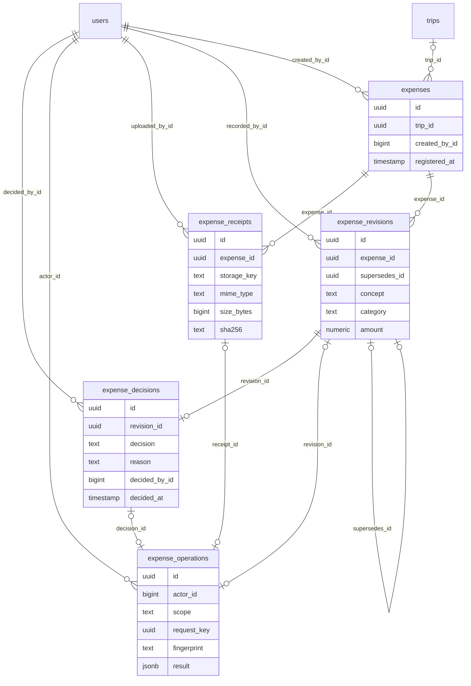

# Diccionario: Gastos

[Volver al capítulo de base de datos](../05-base-de-datos.md).

Este archivo describe el **esquema final**, no solo la migración inicial. `NULL` indica que una columna acepta ausencia de valor; un default es un valor generado si no se envía. Los CHECK y triggers también pueden limitar inserciones aparentemente válidas. Los ejemplos son consultas de estudio, no instrucciones para eludir servicios.

## Relaciones del dominio



El diagrama muestra FK reales y un subconjunto de columnas para que resulte legible. Las fichas siguientes contienen **todas** las columnas. Una referencia a otra tabla no duplica su entidad; consultar su ficha en el índice general.

## expense_decisions

**Propósito:** Decisión del administrador sobre una versión concreta, no comprobante de pago.

**Responsabilidad:** Gastos. **Migraciones relacionadas:** [2026_10_14_000370_create_administrative_expenses](../../../database/migrations/2026_10_14_000370_create_administrative_expenses.php).

**Modelos identificados:** [ExpenseDecision](../../../app/Modules/Expenses/Models/ExpenseDecision.php).

**Consultas directas identificadas:** [AdministrativeReports](../../../app/Modules/AdministrativeReports/Application/AdministrativeReports.php), [ExpenseAdministration](../../../app/Modules/Expenses/Application/ExpenseAdministration.php). La lista incluye lectores de reportes/auditoría y no sustituye las relaciones Eloquent.

### Columnas

| Columna | Tipo PostgreSQL | ¿Admite NULL? | Default |
| --- | --- | --- | --- |
| `id` | `uuid` | No | Sin default |
| `revision_id` | `uuid` | No | Sin default |
| `decision` | `text` | No | Sin default |
| `reason` | `text` | No | Sin default |
| `decided_by_id` | `bigint` | No | Sin default |
| `decided_at` | `timestamp with time zone` | No | `clock_timestamp()` |

### Claves y restricciones

- **expense_decisions_decision_check**: `CHECK ((decision = ANY (ARRAY['approved'::text, 'rejected'::text])))`.
- **expense_decisions_reason_check**: `CHECK (((length(btrim(reason)) >= 1) AND (length(btrim(reason)) <= 2000)))`.
- **expense_decisions_decided_by_id_fkey**: `FOREIGN KEY (decided_by_id) REFERENCES users(id) ON DELETE RESTRICT`.
- **expense_decisions_revision_id_fkey**: `FOREIGN KEY (revision_id) REFERENCES expense_revisions(id) ON DELETE RESTRICT`.
- **expense_decisions_decided_at_not_null**: `NOT NULL decided_at`.
- **expense_decisions_decided_by_id_not_null**: `NOT NULL decided_by_id`.
- **expense_decisions_decision_not_null**: `NOT NULL decision`.
- **expense_decisions_id_not_null**: `NOT NULL id`.
- **expense_decisions_reason_not_null**: `NOT NULL reason`.
- **expense_decisions_revision_id_not_null**: `NOT NULL revision_id`.
- **expense_decisions_pkey**: `PRIMARY KEY (id)`.
- **expense_audit**: `TRIGGER DEFERRABLE INITIALLY DEFERRED`.
- **expense_decisions_revision_id_key**: `UNIQUE (revision_id)`.

### Índices

- `expense_decisions_pkey`: `CREATE UNIQUE INDEX expense_decisions_pkey ON public.expense_decisions USING btree (id)`.
- `expense_decisions_revision_id_key`: `CREATE UNIQUE INDEX expense_decisions_revision_id_key ON public.expense_decisions USING btree (revision_id)`.

### Relaciones y cardinalidades

- `decided_by_id` → [`users`](acceso-y-personal.md#users) (`id`): cada fila tiene un padre; un padre admite varias filas de esta tabla, sujeto a los CHECK/índices condicionales.
- `revision_id` → [`expense_revisions`](gastos.md#expense_revisions) (`id`): cada fila tiene un padre; un padre admite como máximo una fila de esta tabla, sujeto a los CHECK/índices condicionales.

**Referencias entrantes:**

- `expense_operations.decision_id` → `expense_decisions.id` (`expense_operations_decision_id_fkey`).

### Escritura, conservación y ejemplo

Registro histórico o recibo: la operación de aplicación inserta el hecho y conserva su trazabilidad. Las correcciones se tramitan con nuevas versiones, aplicaciones o compensaciones, no con un DELETE público. Consultar los triggers siguientes para la protección exacta de esta tabla; no inferir que cualquier UPDATE SQL está permitido.

**Triggers vigentes** (momento y operación exactos; funciones explicadas en [el catálogo](funciones-y-triggers.md)):

- `expense_audit`: `CREATE CONSTRAINT TRIGGER expense_audit AFTER INSERT ON public.expense_decisions DEFERRABLE INITIALLY DEFERRED FOR EACH ROW EXECUTE FUNCTION expense_complete()`.
- `expense_history`: `CREATE TRIGGER expense_history BEFORE DELETE OR UPDATE ON public.expense_decisions FOR EACH ROW EXECUTE FUNCTION transport_preserve_history()`.
- `expense_no_truncate`: `CREATE TRIGGER expense_no_truncate BEFORE TRUNCATE ON public.expense_decisions FOR EACH STATEMENT EXECUTE FUNCTION transport_preserve_history()`.
- `expense_record`: `CREATE TRIGGER expense_record BEFORE INSERT ON public.expense_decisions FOR EACH ROW EXECUTE FUNCTION expense_validate()`.

```sql
SELECT id FROM expense_decisions LIMIT 5;
```

Permite reconocer el registro y su relación sin leer referencias privadas de archivos ni alterar el proceso. Para crearlo funcionalmente, seguir el caso del módulo en el capítulo 12.

## expense_operations

**Propósito:** Recibos idempotentes de registrar, corregir, decidir y adjuntar comprobantes de gastos.

**Responsabilidad:** Gastos. **Migraciones relacionadas:** [2026_10_14_000370_create_administrative_expenses](../../../database/migrations/2026_10_14_000370_create_administrative_expenses.php).

**Modelos identificados:** Query Builder/infraestructura, sin modelo Eloquent propio identificado.

**Consultas directas identificadas:** [ExpenseAdministration](../../../app/Modules/Expenses/Application/ExpenseAdministration.php). La lista incluye lectores de reportes/auditoría y no sustituye las relaciones Eloquent.

### Columnas

| Columna | Tipo PostgreSQL | ¿Admite NULL? | Default |
| --- | --- | --- | --- |
| `id` | `uuid` | No | Sin default |
| `actor_id` | `bigint` | No | Sin default |
| `scope` | `text` | No | Sin default |
| `request_key` | `uuid` | No | Sin default |
| `fingerprint` | `text` | No | Sin default |
| `result` | `jsonb` | No | Sin default |
| `revision_id` | `uuid` | Sí | Sin default |
| `decision_id` | `uuid` | Sí | Sin default |
| `receipt_id` | `uuid` | Sí | Sin default |
| `registered_at` | `timestamp with time zone` | No | `clock_timestamp()` |

### Claves y restricciones

- **expense_operations_check**: `CHECK ((num_nonnulls(revision_id, decision_id, receipt_id) = 1))`.
- **expense_operations_fingerprint_check**: `CHECK ((fingerprint ~ '^[a-f0-9]{64}$'::text))`.
- **expense_operations_actor_id_fkey**: `FOREIGN KEY (actor_id) REFERENCES users(id) ON DELETE RESTRICT`.
- **expense_operations_decision_id_fkey**: `FOREIGN KEY (decision_id) REFERENCES expense_decisions(id) ON DELETE RESTRICT`.
- **expense_operations_receipt_id_fkey**: `FOREIGN KEY (receipt_id) REFERENCES expense_receipts(id) ON DELETE RESTRICT`.
- **expense_operations_revision_id_fkey**: `FOREIGN KEY (revision_id) REFERENCES expense_revisions(id) ON DELETE RESTRICT`.
- **expense_operations_actor_id_not_null**: `NOT NULL actor_id`.
- **expense_operations_fingerprint_not_null**: `NOT NULL fingerprint`.
- **expense_operations_id_not_null**: `NOT NULL id`.
- **expense_operations_registered_at_not_null**: `NOT NULL registered_at`.
- **expense_operations_request_key_not_null**: `NOT NULL request_key`.
- **expense_operations_result_not_null**: `NOT NULL result`.
- **expense_operations_scope_not_null**: `NOT NULL scope`.
- **expense_operations_pkey**: `PRIMARY KEY (id)`.
- **expense_audit**: `TRIGGER DEFERRABLE INITIALLY DEFERRED`.
- **expense_operations_actor_id_scope_request_key_key**: `UNIQUE (actor_id, scope, request_key)`.
- **expense_operations_decision_id_key**: `UNIQUE (decision_id)`.
- **expense_operations_receipt_id_key**: `UNIQUE (receipt_id)`.
- **expense_operations_revision_id_key**: `UNIQUE (revision_id)`.

### Índices

- `expense_operations_actor_id_scope_request_key_key`: `CREATE UNIQUE INDEX expense_operations_actor_id_scope_request_key_key ON public.expense_operations USING btree (actor_id, scope, request_key)`.
- `expense_operations_decision_id_key`: `CREATE UNIQUE INDEX expense_operations_decision_id_key ON public.expense_operations USING btree (decision_id)`.
- `expense_operations_pkey`: `CREATE UNIQUE INDEX expense_operations_pkey ON public.expense_operations USING btree (id)`.
- `expense_operations_receipt_id_key`: `CREATE UNIQUE INDEX expense_operations_receipt_id_key ON public.expense_operations USING btree (receipt_id)`.
- `expense_operations_revision_id_key`: `CREATE UNIQUE INDEX expense_operations_revision_id_key ON public.expense_operations USING btree (revision_id)`.

### Relaciones y cardinalidades

- `actor_id` → [`users`](acceso-y-personal.md#users) (`id`): cada fila tiene un padre; un padre admite varias filas de esta tabla, sujeto a los CHECK/índices condicionales.
- `decision_id` → [`expense_decisions`](gastos.md#expense_decisions) (`id`): cada fila tiene cero o un padre; un padre admite como máximo una fila de esta tabla, sujeto a los CHECK/índices condicionales.
- `receipt_id` → [`expense_receipts`](gastos.md#expense_receipts) (`id`): cada fila tiene cero o un padre; un padre admite como máximo una fila de esta tabla, sujeto a los CHECK/índices condicionales.
- `revision_id` → [`expense_revisions`](gastos.md#expense_revisions) (`id`): cada fila tiene cero o un padre; un padre admite como máximo una fila de esta tabla, sujeto a los CHECK/índices condicionales.

**Referencias entrantes:** ninguna FK física apunta a esta tabla.

### Escritura, conservación y ejemplo

Registro histórico o recibo: la operación de aplicación inserta el hecho y conserva su trazabilidad. Las correcciones se tramitan con nuevas versiones, aplicaciones o compensaciones, no con un DELETE público. Consultar los triggers siguientes para la protección exacta de esta tabla; no inferir que cualquier UPDATE SQL está permitido.

**Triggers vigentes** (momento y operación exactos; funciones explicadas en [el catálogo](funciones-y-triggers.md)):

- `expense_audit`: `CREATE CONSTRAINT TRIGGER expense_audit AFTER INSERT ON public.expense_operations DEFERRABLE INITIALLY DEFERRED FOR EACH ROW EXECUTE FUNCTION expense_complete()`.
- `expense_history`: `CREATE TRIGGER expense_history BEFORE DELETE OR UPDATE ON public.expense_operations FOR EACH ROW EXECUTE FUNCTION transport_preserve_history()`.
- `expense_no_truncate`: `CREATE TRIGGER expense_no_truncate BEFORE TRUNCATE ON public.expense_operations FOR EACH STATEMENT EXECUTE FUNCTION transport_preserve_history()`.
- `expense_record`: `CREATE TRIGGER expense_record BEFORE INSERT ON public.expense_operations FOR EACH ROW EXECUTE FUNCTION expense_validate()`.

```sql
SELECT id, registered_at FROM expense_operations LIMIT 5;
```

Permite reconocer el registro y su relación sin leer referencias privadas de archivos ni alterar el proceso. Para crearlo funcionalmente, seguir el caso del módulo en el capítulo 12.

## expense_receipts

**Propósito:** Metadatos de comprobantes privados de un gasto.

**Responsabilidad:** Gastos. **Migraciones relacionadas:** [2026_10_14_000370_create_administrative_expenses](../../../database/migrations/2026_10_14_000370_create_administrative_expenses.php).

**Modelos identificados:** [ExpenseReceipt](../../../app/Modules/Expenses/Models/ExpenseReceipt.php).

**Consultas directas identificadas:** [ExpenseController](../../../app/Modules/Expenses/Http/Controllers/ExpenseController.php), [PrivateReceiptStorage](../../../app/Modules/Expenses/Infrastructure/PrivateReceiptStorage.php). La lista incluye lectores de reportes/auditoría y no sustituye las relaciones Eloquent.

### Columnas

| Columna | Tipo PostgreSQL | ¿Admite NULL? | Default |
| --- | --- | --- | --- |
| `id` | `uuid` | No | Sin default |
| `expense_id` | `uuid` | No | Sin default |
| `storage_key` | `text` | No | Sin default |
| `mime_type` | `text` | No | Sin default |
| `size_bytes` | `bigint` | No | Sin default |
| `sha256` | `text` | No | Sin default |
| `uploaded_by_id` | `bigint` | No | Sin default |
| `registered_at` | `timestamp with time zone` | No | `clock_timestamp()` |

### Claves y restricciones

- **expense_receipts_mime_type_check**: `CHECK ((mime_type = ANY (ARRAY['application/pdf'::text, 'image/jpeg'::text, 'image/png'::text])))`.
- **expense_receipts_sha256_check**: `CHECK ((sha256 ~ '^[a-f0-9]{64}$'::text))`.
- **expense_receipts_size_bytes_check**: `CHECK (((size_bytes >= 1) AND (size_bytes <= 10000000)))`.
- **expense_receipts_storage_key_check**: `CHECK ((storage_key ~ '^expenses/files/[a-f0-9-]{36}\.(pdf|jpg|png)$'::text))`.
- **expense_receipts_expense_id_fkey**: `FOREIGN KEY (expense_id) REFERENCES expenses(id) ON DELETE RESTRICT`.
- **expense_receipts_uploaded_by_id_fkey**: `FOREIGN KEY (uploaded_by_id) REFERENCES users(id) ON DELETE RESTRICT`.
- **expense_receipts_expense_id_not_null**: `NOT NULL expense_id`.
- **expense_receipts_id_not_null**: `NOT NULL id`.
- **expense_receipts_mime_type_not_null**: `NOT NULL mime_type`.
- **expense_receipts_registered_at_not_null**: `NOT NULL registered_at`.
- **expense_receipts_sha256_not_null**: `NOT NULL sha256`.
- **expense_receipts_size_bytes_not_null**: `NOT NULL size_bytes`.
- **expense_receipts_storage_key_not_null**: `NOT NULL storage_key`.
- **expense_receipts_uploaded_by_id_not_null**: `NOT NULL uploaded_by_id`.
- **expense_receipts_pkey**: `PRIMARY KEY (id)`.
- **expense_audit**: `TRIGGER DEFERRABLE INITIALLY DEFERRED`.
- **expense_receipts_storage_key_key**: `UNIQUE (storage_key)`.

### Índices

- `expense_files`: `CREATE INDEX expense_files ON public.expense_receipts USING btree (expense_id)`.
- `expense_receipts_pkey`: `CREATE UNIQUE INDEX expense_receipts_pkey ON public.expense_receipts USING btree (id)`.
- `expense_receipts_storage_key_key`: `CREATE UNIQUE INDEX expense_receipts_storage_key_key ON public.expense_receipts USING btree (storage_key)`.

### Relaciones y cardinalidades

- `expense_id` → [`expenses`](gastos.md#expenses) (`id`): cada fila tiene un padre; un padre admite varias filas de esta tabla, sujeto a los CHECK/índices condicionales.
- `uploaded_by_id` → [`users`](acceso-y-personal.md#users) (`id`): cada fila tiene un padre; un padre admite varias filas de esta tabla, sujeto a los CHECK/índices condicionales.

**Referencias entrantes:**

- `expense_operations.receipt_id` → `expense_receipts.id` (`expense_operations_receipt_id_fkey`).

### Escritura, conservación y ejemplo

Registro histórico o recibo: la operación de aplicación inserta el hecho y conserva su trazabilidad. Las correcciones se tramitan con nuevas versiones, aplicaciones o compensaciones, no con un DELETE público. Consultar los triggers siguientes para la protección exacta de esta tabla; no inferir que cualquier UPDATE SQL está permitido.

**Triggers vigentes** (momento y operación exactos; funciones explicadas en [el catálogo](funciones-y-triggers.md)):

- `expense_audit`: `CREATE CONSTRAINT TRIGGER expense_audit AFTER INSERT ON public.expense_receipts DEFERRABLE INITIALLY DEFERRED FOR EACH ROW EXECUTE FUNCTION expense_complete()`.
- `expense_history`: `CREATE TRIGGER expense_history BEFORE DELETE OR UPDATE ON public.expense_receipts FOR EACH ROW EXECUTE FUNCTION transport_preserve_history()`.
- `expense_no_truncate`: `CREATE TRIGGER expense_no_truncate BEFORE TRUNCATE ON public.expense_receipts FOR EACH STATEMENT EXECUTE FUNCTION transport_preserve_history()`.
- `expense_record`: `CREATE TRIGGER expense_record BEFORE INSERT ON public.expense_receipts FOR EACH ROW EXECUTE FUNCTION expense_validate()`.

```sql
SELECT id, expense_id, registered_at FROM expense_receipts LIMIT 5;
```

Permite reconocer el registro y su relación sin leer referencias privadas de archivos ni alterar el proceso. Para crearlo funcionalmente, seguir el caso del módulo en el capítulo 12.

## expense_revisions

**Propósito:** Concepto, categoría, importe, moneda, fecha y descripción de una versión del gasto.

**Responsabilidad:** Gastos. **Migraciones relacionadas:** [2026_10_14_000370_create_administrative_expenses](../../../database/migrations/2026_10_14_000370_create_administrative_expenses.php).

**Modelos identificados:** [ExpenseRevision](../../../app/Modules/Expenses/Models/ExpenseRevision.php).

**Consultas directas identificadas:** [AdministrativeReports](../../../app/Modules/AdministrativeReports/Application/AdministrativeReports.php), [ExpenseAdministration](../../../app/Modules/Expenses/Application/ExpenseAdministration.php). La lista incluye lectores de reportes/auditoría y no sustituye las relaciones Eloquent.

**Relaciones Eloquent declaradas:**

- `ExpenseRevision::decision()` usa `hasOne(ExpenseDecision::class, 'revision_id')`.

### Columnas

| Columna | Tipo PostgreSQL | ¿Admite NULL? | Default |
| --- | --- | --- | --- |
| `id` | `uuid` | No | Sin default |
| `expense_id` | `uuid` | No | Sin default |
| `supersedes_id` | `uuid` | Sí | Sin default |
| `concept` | `text` | No | Sin default |
| `category` | `text` | No | Sin default |
| `amount` | `numeric` | No | Sin default |
| `currency` | `text` | No | Sin default |
| `occurred_at` | `timestamp with time zone` | No | Sin default |
| `description` | `text` | Sí | Sin default |
| `reason` | `text` | Sí | Sin default |
| `recorded_by_id` | `bigint` | No | Sin default |
| `registered_at` | `timestamp with time zone` | No | `clock_timestamp()` |

### Claves y restricciones

- **expense_revisions_amount_check**: `CHECK (((amount > (0)::numeric) AND (amount <= 999999999999.99) AND (scale(amount) <= 2)))`.
- **expense_revisions_category_check**: `CHECK (((length(btrim(category)) >= 1) AND (length(btrim(category)) <= 255)))`.
- **expense_revisions_concept_check**: `CHECK (((length(btrim(concept)) >= 1) AND (length(btrim(concept)) <= 255)))`.
- **expense_revisions_currency_check**: `CHECK ((currency = ANY (ARRAY['CRC'::text, 'USD'::text])))`.
- **expense_revisions_expense_id_fkey**: `FOREIGN KEY (expense_id) REFERENCES expenses(id) ON DELETE RESTRICT`.
- **expense_revisions_recorded_by_id_fkey**: `FOREIGN KEY (recorded_by_id) REFERENCES users(id) ON DELETE RESTRICT`.
- **expense_revisions_supersedes_id_fkey**: `FOREIGN KEY (supersedes_id) REFERENCES expense_revisions(id) ON DELETE RESTRICT`.
- **expense_revisions_amount_not_null**: `NOT NULL amount`.
- **expense_revisions_category_not_null**: `NOT NULL category`.
- **expense_revisions_concept_not_null**: `NOT NULL concept`.
- **expense_revisions_currency_not_null**: `NOT NULL currency`.
- **expense_revisions_expense_id_not_null**: `NOT NULL expense_id`.
- **expense_revisions_id_not_null**: `NOT NULL id`.
- **expense_revisions_occurred_at_not_null**: `NOT NULL occurred_at`.
- **expense_revisions_recorded_by_id_not_null**: `NOT NULL recorded_by_id`.
- **expense_revisions_registered_at_not_null**: `NOT NULL registered_at`.
- **expense_revisions_pkey**: `PRIMARY KEY (id)`.
- **expense_audit**: `TRIGGER DEFERRABLE INITIALLY DEFERRED`.
- **expense_revisions_supersedes_id_key**: `UNIQUE (supersedes_id)`.

### Índices

- `expense_initial_revision`: `CREATE UNIQUE INDEX expense_initial_revision ON public.expense_revisions USING btree (expense_id) WHERE (supersedes_id IS NULL)`.
- `expense_revisions_pkey`: `CREATE UNIQUE INDEX expense_revisions_pkey ON public.expense_revisions USING btree (id)`.
- `expense_revisions_supersedes_id_key`: `CREATE UNIQUE INDEX expense_revisions_supersedes_id_key ON public.expense_revisions USING btree (supersedes_id)`.
- `expense_versions`: `CREATE INDEX expense_versions ON public.expense_revisions USING btree (expense_id, registered_at)`.

### Relaciones y cardinalidades

- `expense_id` → [`expenses`](gastos.md#expenses) (`id`): cada fila tiene un padre; un padre admite varias filas de esta tabla, sujeto a los CHECK/índices condicionales.
- `recorded_by_id` → [`users`](acceso-y-personal.md#users) (`id`): cada fila tiene un padre; un padre admite varias filas de esta tabla, sujeto a los CHECK/índices condicionales.
- `supersedes_id` → [`expense_revisions`](gastos.md#expense_revisions) (`id`): cada fila tiene cero o un padre; un padre admite como máximo una fila de esta tabla, sujeto a los CHECK/índices condicionales.

**Referencias entrantes:**

- `expense_decisions.revision_id` → `expense_revisions.id` (`expense_decisions_revision_id_fkey`).
- `expense_operations.revision_id` → `expense_revisions.id` (`expense_operations_revision_id_fkey`).
- `expense_revisions.supersedes_id` → `expense_revisions.id` (`expense_revisions_supersedes_id_fkey`).

### Escritura, conservación y ejemplo

Registro histórico o recibo: la operación de aplicación inserta el hecho y conserva su trazabilidad. Las correcciones se tramitan con nuevas versiones, aplicaciones o compensaciones, no con un DELETE público. Consultar los triggers siguientes para la protección exacta de esta tabla; no inferir que cualquier UPDATE SQL está permitido.

**Triggers vigentes** (momento y operación exactos; funciones explicadas en [el catálogo](funciones-y-triggers.md)):

- `expense_audit`: `CREATE CONSTRAINT TRIGGER expense_audit AFTER INSERT ON public.expense_revisions DEFERRABLE INITIALLY DEFERRED FOR EACH ROW EXECUTE FUNCTION expense_complete()`.
- `expense_history`: `CREATE TRIGGER expense_history BEFORE DELETE OR UPDATE ON public.expense_revisions FOR EACH ROW EXECUTE FUNCTION transport_preserve_history()`.
- `expense_no_truncate`: `CREATE TRIGGER expense_no_truncate BEFORE TRUNCATE ON public.expense_revisions FOR EACH STATEMENT EXECUTE FUNCTION transport_preserve_history()`.
- `expense_record`: `CREATE TRIGGER expense_record BEFORE INSERT ON public.expense_revisions FOR EACH ROW EXECUTE FUNCTION expense_validate()`.

```sql
SELECT id, expense_id, registered_at FROM expense_revisions LIMIT 5;
```

Permite reconocer el registro y su relación sin leer referencias privadas de archivos ni alterar el proceso. Para crearlo funcionalmente, seguir el caso del módulo en el capítulo 12.

## expenses

**Propósito:** Identidad de un gasto general o de un viaje, separada de sus revisiones.

**Responsabilidad:** Gastos. **Migraciones relacionadas:** [2026_10_14_000370_create_administrative_expenses](../../../database/migrations/2026_10_14_000370_create_administrative_expenses.php).

**Modelos identificados:** [Expense](../../../app/Modules/Expenses/Models/Expense.php).

**Consultas directas identificadas:** [AdministrativeReports](../../../app/Modules/AdministrativeReports/Application/AdministrativeReports.php), [ExpenseAdministration](../../../app/Modules/Expenses/Application/ExpenseAdministration.php). La lista incluye lectores de reportes/auditoría y no sustituye las relaciones Eloquent.

**Relaciones Eloquent declaradas:**

- `Expense::revisions()` usa `hasMany(ExpenseRevision::class)->orderBy('registered_at')->orderBy('id')`.
- `Expense::receipts()` usa `hasMany(ExpenseReceipt::class)->orderBy('registered_at')->orderBy('id')`.

### Columnas

| Columna | Tipo PostgreSQL | ¿Admite NULL? | Default |
| --- | --- | --- | --- |
| `id` | `uuid` | No | Sin default |
| `trip_id` | `uuid` | Sí | Sin default |
| `created_by_id` | `bigint` | No | Sin default |
| `registered_at` | `timestamp with time zone` | No | `clock_timestamp()` |

### Claves y restricciones

- **expenses_created_by_id_fkey**: `FOREIGN KEY (created_by_id) REFERENCES users(id) ON DELETE RESTRICT`.
- **expenses_trip_id_fkey**: `FOREIGN KEY (trip_id) REFERENCES trips(id) ON DELETE RESTRICT`.
- **expenses_created_by_id_not_null**: `NOT NULL created_by_id`.
- **expenses_id_not_null**: `NOT NULL id`.
- **expenses_registered_at_not_null**: `NOT NULL registered_at`.
- **expenses_pkey**: `PRIMARY KEY (id)`.
- **expense_audit**: `TRIGGER DEFERRABLE INITIALLY DEFERRED`.

### Índices

- `expenses_actor`: `CREATE INDEX expenses_actor ON public.expenses USING btree (created_by_id, registered_at)`.
- `expenses_pkey`: `CREATE UNIQUE INDEX expenses_pkey ON public.expenses USING btree (id)`.
- `expenses_trip`: `CREATE INDEX expenses_trip ON public.expenses USING btree (trip_id, registered_at)`.

### Relaciones y cardinalidades

- `created_by_id` → [`users`](acceso-y-personal.md#users) (`id`): cada fila tiene un padre; un padre admite varias filas de esta tabla, sujeto a los CHECK/índices condicionales.
- `trip_id` → [`trips`](transporte.md#trips) (`id`): cada fila tiene cero o un padre; un padre admite varias filas de esta tabla, sujeto a los CHECK/índices condicionales.

**Referencias entrantes:**

- `expense_receipts.expense_id` → `expenses.id` (`expense_receipts_expense_id_fkey`).
- `expense_revisions.expense_id` → `expenses.id` (`expense_revisions_expense_id_fkey`).

### Escritura, conservación y ejemplo

ExpenseAdministration::create() confirma identidad y revisión inicial. correct() agrega expense_revision sin sobrescribir datos anteriores. La decisión se vincula a revisión concreta; no hay DELETE público.

**Triggers vigentes** (momento y operación exactos; funciones explicadas en [el catálogo](funciones-y-triggers.md)):

- `expense_audit`: `CREATE CONSTRAINT TRIGGER expense_audit AFTER INSERT ON public.expenses DEFERRABLE INITIALLY DEFERRED FOR EACH ROW EXECUTE FUNCTION expense_complete()`.
- `expense_history`: `CREATE TRIGGER expense_history BEFORE DELETE OR UPDATE ON public.expenses FOR EACH ROW EXECUTE FUNCTION transport_preserve_history()`.
- `expense_no_truncate`: `CREATE TRIGGER expense_no_truncate BEFORE TRUNCATE ON public.expenses FOR EACH STATEMENT EXECUTE FUNCTION transport_preserve_history()`.
- `expense_record`: `CREATE TRIGGER expense_record BEFORE INSERT ON public.expenses FOR EACH ROW EXECUTE FUNCTION expense_validate()`.

```sql
SELECT id, trip_id, registered_at FROM expenses LIMIT 5;
```

Permite reconocer el registro y su relación sin leer referencias privadas de archivos ni alterar el proceso. Para crearlo funcionalmente, seguir el caso del módulo en el capítulo 12.
