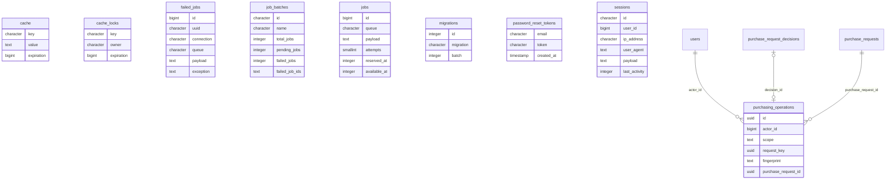

# Diccionario: Infraestructura Laravel

[Volver al capítulo de base de datos](../05-base-de-datos.md).

Este archivo describe el **esquema final**, no solo la migración inicial. `NULL` indica que una columna acepta ausencia de valor; un default es un valor generado si no se envía. Los CHECK y triggers también pueden limitar inserciones aparentemente válidas. Los ejemplos son consultas de estudio, no instrucciones para eludir servicios.

## Relaciones del dominio



El diagrama muestra FK reales y un subconjunto de columnas para que resulte legible. Las fichas siguientes contienen **todas** las columnas. Una referencia a otra tabla no duplica su entidad; consultar su ficha en el índice general.

## cache

**Propósito:** Valores de caché de Laravel cuando se selecciona el driver database.

**Responsabilidad:** Laravel / infraestructura. **Migraciones relacionadas:** [0001_01_01_000001_create_cache_table](../../../database/migrations/0001_01_01_000001_create_cache_table.php).

**Modelos identificados:** Query Builder/infraestructura, sin modelo Eloquent propio identificado.

### Columnas

| Columna | Tipo PostgreSQL | ¿Admite NULL? | Default |
| --- | --- | --- | --- |
| `key` | `character varying(255)` | No | Sin default |
| `value` | `text` | No | Sin default |
| `expiration` | `bigint` | No | Sin default |

### Claves y restricciones

- **cache_expiration_not_null**: `NOT NULL expiration`.
- **cache_key_not_null**: `NOT NULL key`.
- **cache_value_not_null**: `NOT NULL value`.
- **cache_pkey**: `PRIMARY KEY (key)`.

### Índices

- `cache_expiration_index`: `CREATE INDEX cache_expiration_index ON public.cache USING btree (expiration)`.
- `cache_pkey`: `CREATE UNIQUE INDEX cache_pkey ON public.cache USING btree (key)`.

### Relaciones y cardinalidades

No tiene FK físicas. Los vínculos solo lógicos, si existen, deben interpretarse en los servicios y no como integridad automática de PostgreSQL.

**Referencias entrantes:** ninguna FK física apunta a esta tabla.

### Escritura, conservación y ejemplo

Laravel gestiona altas, actualizaciones y limpieza según el subsistema indicado. La existencia de esta tabla no significa que haya una pantalla o un flujo público que la use. No borrar manualmente datos técnicos de una instalación activa.

Sin triggers propios. Las reglas de aplicación siguen siendo necesarias.

```sql
SELECT count(*) AS cantidad FROM cache;
```

Inspecciona existencia/cantidad sin imprimir contraseñas, tokens, IDs de sesión ni payloads.

## cache_locks

**Propósito:** Exclusión mutua temporal de la caché database; no es inventario ni autorización.

**Responsabilidad:** Laravel / infraestructura. **Migraciones relacionadas:** [0001_01_01_000001_create_cache_table](../../../database/migrations/0001_01_01_000001_create_cache_table.php).

**Modelos identificados:** Query Builder/infraestructura, sin modelo Eloquent propio identificado.

### Columnas

| Columna | Tipo PostgreSQL | ¿Admite NULL? | Default |
| --- | --- | --- | --- |
| `key` | `character varying(255)` | No | Sin default |
| `owner` | `character varying(255)` | No | Sin default |
| `expiration` | `bigint` | No | Sin default |

### Claves y restricciones

- **cache_locks_expiration_not_null**: `NOT NULL expiration`.
- **cache_locks_key_not_null**: `NOT NULL key`.
- **cache_locks_owner_not_null**: `NOT NULL owner`.
- **cache_locks_pkey**: `PRIMARY KEY (key)`.

### Índices

- `cache_locks_expiration_index`: `CREATE INDEX cache_locks_expiration_index ON public.cache_locks USING btree (expiration)`.
- `cache_locks_pkey`: `CREATE UNIQUE INDEX cache_locks_pkey ON public.cache_locks USING btree (key)`.

### Relaciones y cardinalidades

No tiene FK físicas. Los vínculos solo lógicos, si existen, deben interpretarse en los servicios y no como integridad automática de PostgreSQL.

**Referencias entrantes:** ninguna FK física apunta a esta tabla.

### Escritura, conservación y ejemplo

Laravel gestiona altas, actualizaciones y limpieza según el subsistema indicado. La existencia de esta tabla no significa que haya una pantalla o un flujo público que la use. No borrar manualmente datos técnicos de una instalación activa.

Sin triggers propios. Las reglas de aplicación siguen siendo necesarias.

```sql
SELECT count(*) AS cantidad FROM cache_locks;
```

Inspecciona existencia/cantidad sin imprimir contraseñas, tokens, IDs de sesión ni payloads.

## failed_jobs

**Propósito:** Registro técnico de trabajos fallidos.

**Responsabilidad:** Laravel / infraestructura. **Migraciones relacionadas:** [0001_01_01_000002_create_jobs_table](../../../database/migrations/0001_01_01_000002_create_jobs_table.php).

**Modelos identificados:** Query Builder/infraestructura, sin modelo Eloquent propio identificado.

### Columnas

| Columna | Tipo PostgreSQL | ¿Admite NULL? | Default |
| --- | --- | --- | --- |
| `id` | `bigint` | No | `nextval('failed_jobs_id_seq'::regclass)` |
| `uuid` | `character varying(255)` | No | Sin default |
| `connection` | `character varying(255)` | No | Sin default |
| `queue` | `character varying(255)` | No | Sin default |
| `payload` | `text` | No | Sin default |
| `exception` | `text` | No | Sin default |
| `failed_at` | `timestamp(0) without time zone` | No | `CURRENT_TIMESTAMP` |

### Claves y restricciones

- **failed_jobs_connection_not_null**: `NOT NULL connection`.
- **failed_jobs_exception_not_null**: `NOT NULL exception`.
- **failed_jobs_failed_at_not_null**: `NOT NULL failed_at`.
- **failed_jobs_id_not_null**: `NOT NULL id`.
- **failed_jobs_payload_not_null**: `NOT NULL payload`.
- **failed_jobs_queue_not_null**: `NOT NULL queue`.
- **failed_jobs_uuid_not_null**: `NOT NULL uuid`.
- **failed_jobs_pkey**: `PRIMARY KEY (id)`.
- **failed_jobs_uuid_unique**: `UNIQUE (uuid)`.

### Índices

- `failed_jobs_connection_queue_failed_at_index`: `CREATE INDEX failed_jobs_connection_queue_failed_at_index ON public.failed_jobs USING btree (connection, queue, failed_at)`.
- `failed_jobs_pkey`: `CREATE UNIQUE INDEX failed_jobs_pkey ON public.failed_jobs USING btree (id)`.
- `failed_jobs_uuid_unique`: `CREATE UNIQUE INDEX failed_jobs_uuid_unique ON public.failed_jobs USING btree (uuid)`.

### Relaciones y cardinalidades

No tiene FK físicas. Los vínculos solo lógicos, si existen, deben interpretarse en los servicios y no como integridad automática de PostgreSQL.

**Referencias entrantes:** ninguna FK física apunta a esta tabla.

### Escritura, conservación y ejemplo

Laravel gestiona altas, actualizaciones y limpieza según el subsistema indicado. La existencia de esta tabla no significa que haya una pantalla o un flujo público que la use. No borrar manualmente datos técnicos de una instalación activa.

Sin triggers propios. Las reglas de aplicación siguen siendo necesarias.

```sql
SELECT count(*) AS cantidad FROM failed_jobs;
```

Inspecciona existencia/cantidad sin imprimir contraseñas, tokens, IDs de sesión ni payloads.

## job_batches

**Propósito:** Metadatos de lotes de trabajos Laravel.

**Responsabilidad:** Laravel / infraestructura. **Migraciones relacionadas:** [0001_01_01_000002_create_jobs_table](../../../database/migrations/0001_01_01_000002_create_jobs_table.php).

**Modelos identificados:** Query Builder/infraestructura, sin modelo Eloquent propio identificado.

### Columnas

| Columna | Tipo PostgreSQL | ¿Admite NULL? | Default |
| --- | --- | --- | --- |
| `id` | `character varying(255)` | No | Sin default |
| `name` | `character varying(255)` | No | Sin default |
| `total_jobs` | `integer` | No | Sin default |
| `pending_jobs` | `integer` | No | Sin default |
| `failed_jobs` | `integer` | No | Sin default |
| `failed_job_ids` | `text` | No | Sin default |
| `options` | `text` | Sí | Sin default |
| `cancelled_at` | `integer` | Sí | Sin default |
| `created_at` | `integer` | No | Sin default |
| `finished_at` | `integer` | Sí | Sin default |

### Claves y restricciones

- **job_batches_created_at_not_null**: `NOT NULL created_at`.
- **job_batches_failed_job_ids_not_null**: `NOT NULL failed_job_ids`.
- **job_batches_failed_jobs_not_null**: `NOT NULL failed_jobs`.
- **job_batches_id_not_null**: `NOT NULL id`.
- **job_batches_name_not_null**: `NOT NULL name`.
- **job_batches_pending_jobs_not_null**: `NOT NULL pending_jobs`.
- **job_batches_total_jobs_not_null**: `NOT NULL total_jobs`.
- **job_batches_pkey**: `PRIMARY KEY (id)`.

### Índices

- `job_batches_pkey`: `CREATE UNIQUE INDEX job_batches_pkey ON public.job_batches USING btree (id)`.

### Relaciones y cardinalidades

No tiene FK físicas. Los vínculos solo lógicos, si existen, deben interpretarse en los servicios y no como integridad automática de PostgreSQL.

**Referencias entrantes:** ninguna FK física apunta a esta tabla.

### Escritura, conservación y ejemplo

Laravel gestiona altas, actualizaciones y limpieza según el subsistema indicado. La existencia de esta tabla no significa que haya una pantalla o un flujo público que la use. No borrar manualmente datos técnicos de una instalación activa.

Sin triggers propios. Las reglas de aplicación siguen siendo necesarias.

```sql
SELECT count(*) AS cantidad FROM job_batches;
```

Inspecciona existencia/cantidad sin imprimir contraseñas, tokens, IDs de sesión ni payloads.

## jobs

**Propósito:** Trabajos pendientes de una cola database de Laravel.

**Responsabilidad:** Laravel / infraestructura. **Migraciones relacionadas:** [0001_01_01_000002_create_jobs_table](../../../database/migrations/0001_01_01_000002_create_jobs_table.php).

**Modelos identificados:** Query Builder/infraestructura, sin modelo Eloquent propio identificado.

### Columnas

| Columna | Tipo PostgreSQL | ¿Admite NULL? | Default |
| --- | --- | --- | --- |
| `id` | `bigint` | No | `nextval('jobs_id_seq'::regclass)` |
| `queue` | `character varying(255)` | No | Sin default |
| `payload` | `text` | No | Sin default |
| `attempts` | `smallint` | No | Sin default |
| `reserved_at` | `integer` | Sí | Sin default |
| `available_at` | `integer` | No | Sin default |
| `created_at` | `integer` | No | Sin default |

### Claves y restricciones

- **jobs_attempts_not_null**: `NOT NULL attempts`.
- **jobs_available_at_not_null**: `NOT NULL available_at`.
- **jobs_created_at_not_null**: `NOT NULL created_at`.
- **jobs_id_not_null**: `NOT NULL id`.
- **jobs_payload_not_null**: `NOT NULL payload`.
- **jobs_queue_not_null**: `NOT NULL queue`.
- **jobs_pkey**: `PRIMARY KEY (id)`.

### Índices

- `jobs_pkey`: `CREATE UNIQUE INDEX jobs_pkey ON public.jobs USING btree (id)`.
- `jobs_queue_index`: `CREATE INDEX jobs_queue_index ON public.jobs USING btree (queue)`.

### Relaciones y cardinalidades

No tiene FK físicas. Los vínculos solo lógicos, si existen, deben interpretarse en los servicios y no como integridad automática de PostgreSQL.

**Referencias entrantes:** ninguna FK física apunta a esta tabla.

### Escritura, conservación y ejemplo

Laravel gestiona altas, actualizaciones y limpieza según el subsistema indicado. La existencia de esta tabla no significa que haya una pantalla o un flujo público que la use. No borrar manualmente datos técnicos de una instalación activa.

Sin triggers propios. Las reglas de aplicación siguen siendo necesarias.

```sql
SELECT count(*) AS cantidad FROM jobs;
```

Inspecciona existencia/cantidad sin imprimir contraseñas, tokens, IDs de sesión ni payloads.

## migrations

**Propósito:** Migraciones que Laravel considera aplicadas y su lote de ejecución.

**Responsabilidad:** Laravel / infraestructura. **Migraciones relacionadas:** [0001_01_01_000000_create_users_table](../../../database/migrations/0001_01_01_000000_create_users_table.php), [0001_01_01_000001_create_cache_table](../../../database/migrations/0001_01_01_000001_create_cache_table.php), [0001_01_01_000002_create_jobs_table](../../../database/migrations/0001_01_01_000002_create_jobs_table.php).

**Modelos identificados:** Query Builder/infraestructura, sin modelo Eloquent propio identificado.

### Columnas

| Columna | Tipo PostgreSQL | ¿Admite NULL? | Default |
| --- | --- | --- | --- |
| `id` | `integer` | No | `nextval('migrations_id_seq'::regclass)` |
| `migration` | `character varying(255)` | No | Sin default |
| `batch` | `integer` | No | Sin default |

### Claves y restricciones

- **migrations_batch_not_null**: `NOT NULL batch`.
- **migrations_id_not_null**: `NOT NULL id`.
- **migrations_migration_not_null**: `NOT NULL migration`.
- **migrations_pkey**: `PRIMARY KEY (id)`.

### Índices

- `migrations_pkey`: `CREATE UNIQUE INDEX migrations_pkey ON public.migrations USING btree (id)`.

### Relaciones y cardinalidades

No tiene FK físicas. Los vínculos solo lógicos, si existen, deben interpretarse en los servicios y no como integridad automática de PostgreSQL.

**Referencias entrantes:** ninguna FK física apunta a esta tabla.

### Escritura, conservación y ejemplo

Laravel gestiona altas, actualizaciones y limpieza según el subsistema indicado. La existencia de esta tabla no significa que haya una pantalla o un flujo público que la use. No borrar manualmente datos técnicos de una instalación activa.

Sin triggers propios. Las reglas de aplicación siguen siendo necesarias.

```sql
SELECT count(*) AS cantidad FROM migrations;
```

Inspecciona existencia/cantidad sin imprimir contraseñas, tokens, IDs de sesión ni payloads.

## password_reset_tokens

**Propósito:** Soporte del esqueleto para tokens de recuperación; no acredita una interfaz pública de recuperación implementada.

**Responsabilidad:** Laravel / infraestructura. **Migraciones relacionadas:** [0001_01_01_000000_create_users_table](../../../database/migrations/0001_01_01_000000_create_users_table.php).

**Modelos identificados:** Query Builder/infraestructura, sin modelo Eloquent propio identificado.

### Columnas

| Columna | Tipo PostgreSQL | ¿Admite NULL? | Default |
| --- | --- | --- | --- |
| `email` | `character varying(255)` | No | Sin default |
| `token` | `character varying(255)` | No | Sin default |
| `created_at` | `timestamp(0) without time zone` | Sí | Sin default |

### Claves y restricciones

- **password_reset_tokens_email_not_null**: `NOT NULL email`.
- **password_reset_tokens_token_not_null**: `NOT NULL token`.
- **password_reset_tokens_pkey**: `PRIMARY KEY (email)`.

### Índices

- `password_reset_tokens_pkey`: `CREATE UNIQUE INDEX password_reset_tokens_pkey ON public.password_reset_tokens USING btree (email)`.

### Relaciones y cardinalidades

No tiene FK físicas. Los vínculos solo lógicos, si existen, deben interpretarse en los servicios y no como integridad automática de PostgreSQL.

**Referencias entrantes:** ninguna FK física apunta a esta tabla.

### Escritura, conservación y ejemplo

Laravel gestiona altas, actualizaciones y limpieza según el subsistema indicado. La existencia de esta tabla no significa que haya una pantalla o un flujo público que la use. No borrar manualmente datos técnicos de una instalación activa.

Sin triggers propios. Las reglas de aplicación siguen siendo necesarias.

```sql
SELECT count(*) AS cantidad FROM password_reset_tokens;
```

Inspecciona existencia/cantidad sin imprimir contraseñas, tokens, IDs de sesión ni payloads.

## purchasing_operations

**Propósito:** Recibos idempotentes de solicitudes y decisiones de compra.

**Responsabilidad:** Laravel / infraestructura. **Migraciones relacionadas:** [2026_10_13_000320_create_purchase_requests](../../../database/migrations/2026_10_13_000320_create_purchase_requests.php), [2026_10_14_000345_enable_office_purchase_requests](../../../database/migrations/2026_10_14_000345_enable_office_purchase_requests.php).

**Modelos identificados:** Query Builder/infraestructura, sin modelo Eloquent propio identificado.

**Consultas directas identificadas:** [PurchaseRequestAdministration](../../../app/Modules/Purchasing/Application/PurchaseRequestAdministration.php). La lista incluye lectores de reportes/auditoría y no sustituye las relaciones Eloquent.

### Columnas

| Columna | Tipo PostgreSQL | ¿Admite NULL? | Default |
| --- | --- | --- | --- |
| `id` | `uuid` | No | Sin default |
| `actor_id` | `bigint` | No | Sin default |
| `scope` | `text` | No | Sin default |
| `request_key` | `uuid` | No | Sin default |
| `fingerprint` | `text` | No | Sin default |
| `purchase_request_id` | `uuid` | No | Sin default |
| `decision_id` | `uuid` | Sí | Sin default |
| `reason` | `text` | No | Sin default |
| `confirmed_result` | `jsonb` | No | Sin default |
| `registered_at` | `timestamp with time zone` | No | `clock_timestamp()` |

### Claves y restricciones

- **purchasing_operations_check**: `CHECK ((((scope = 'request_create'::text) AND (decision_id IS NULL)) OR ((scope = 'request_decide'::text) AND (decision_id IS NOT NULL))))`.
- **purchasing_operations_confirmed_result_check**: `CHECK ((jsonb_typeof(confirmed_result) = 'object'::text))`.
- **purchasing_operations_fingerprint_check**: `CHECK ((fingerprint ~ '^[a-f0-9]{64}$'::text))`.
- **purchasing_operations_reason_check**: `CHECK ((length(btrim(reason)) > 0))`.
- **purchasing_operations_scope_check**: `CHECK ((scope = ANY (ARRAY['request_create'::text, 'request_decide'::text])))`.
- **purchasing_operations_actor_id_fkey**: `FOREIGN KEY (actor_id) REFERENCES users(id) ON UPDATE RESTRICT ON DELETE RESTRICT`.
- **purchasing_operations_decision_id_fkey**: `FOREIGN KEY (decision_id) REFERENCES purchase_request_decisions(id) ON UPDATE RESTRICT ON DELETE RESTRICT`.
- **purchasing_operations_purchase_request_id_fkey**: `FOREIGN KEY (purchase_request_id) REFERENCES purchase_requests(id) ON UPDATE RESTRICT ON DELETE RESTRICT`.
- **purchasing_operations_actor_id_not_null**: `NOT NULL actor_id`.
- **purchasing_operations_confirmed_result_not_null**: `NOT NULL confirmed_result`.
- **purchasing_operations_fingerprint_not_null**: `NOT NULL fingerprint`.
- **purchasing_operations_id_not_null**: `NOT NULL id`.
- **purchasing_operations_purchase_request_id_not_null**: `NOT NULL purchase_request_id`.
- **purchasing_operations_reason_not_null**: `NOT NULL reason`.
- **purchasing_operations_registered_at_not_null**: `NOT NULL registered_at`.
- **purchasing_operations_request_key_not_null**: `NOT NULL request_key`.
- **purchasing_operations_scope_not_null**: `NOT NULL scope`.
- **purchasing_operations_pkey**: `PRIMARY KEY (id)`.
- **purchasing_complete**: `TRIGGER DEFERRABLE INITIALLY DEFERRED`.
- **purchasing_operations_actor_id_scope_request_key_key**: `UNIQUE (actor_id, scope, request_key)`.
- **purchasing_operations_decision_id_key**: `UNIQUE (decision_id)`.

### Índices

- `purchasing_operations_actor_id_scope_request_key_key`: `CREATE UNIQUE INDEX purchasing_operations_actor_id_scope_request_key_key ON public.purchasing_operations USING btree (actor_id, scope, request_key)`.
- `purchasing_operations_decision_id_key`: `CREATE UNIQUE INDEX purchasing_operations_decision_id_key ON public.purchasing_operations USING btree (decision_id)`.
- `purchasing_operations_pkey`: `CREATE UNIQUE INDEX purchasing_operations_pkey ON public.purchasing_operations USING btree (id)`.
- `purchasing_request_creation`: `CREATE UNIQUE INDEX purchasing_request_creation ON public.purchasing_operations USING btree (purchase_request_id) WHERE (scope = 'request_create'::text)`.

### Relaciones y cardinalidades

- `actor_id` → [`users`](acceso-y-personal.md#users) (`id`): cada fila tiene un padre; un padre admite varias filas de esta tabla, sujeto a los CHECK/índices condicionales.
- `decision_id` → [`purchase_request_decisions`](compras.md#purchase_request_decisions) (`id`): cada fila tiene cero o un padre; un padre admite como máximo una fila de esta tabla, sujeto a los CHECK/índices condicionales.
- `purchase_request_id` → [`purchase_requests`](compras.md#purchase_requests) (`id`): cada fila tiene un padre; un padre admite varias filas de esta tabla, sujeto a los CHECK/índices condicionales.

**Referencias entrantes:** ninguna FK física apunta a esta tabla.

### Escritura, conservación y ejemplo

Laravel gestiona altas, actualizaciones y limpieza según el subsistema indicado. La existencia de esta tabla no significa que haya una pantalla o un flujo público que la use. No borrar manualmente datos técnicos de una instalación activa.

**Triggers vigentes** (momento y operación exactos; funciones explicadas en [el catálogo](funciones-y-triggers.md)):

- `purchasing_complete`: `CREATE CONSTRAINT TRIGGER purchasing_complete AFTER INSERT ON public.purchasing_operations DEFERRABLE INITIALLY DEFERRED FOR EACH ROW EXECUTE FUNCTION purchasing_complete()`.
- `purchasing_immutable`: `CREATE TRIGGER purchasing_immutable BEFORE DELETE OR UPDATE ON public.purchasing_operations FOR EACH ROW EXECUTE FUNCTION purchasing_immutable()`.
- `purchasing_no_truncate`: `CREATE TRIGGER purchasing_no_truncate BEFORE TRUNCATE ON public.purchasing_operations FOR EACH STATEMENT EXECUTE FUNCTION purchasing_immutable()`.
- `purchasing_validate`: `CREATE TRIGGER purchasing_validate BEFORE INSERT ON public.purchasing_operations FOR EACH ROW EXECUTE FUNCTION purchasing_validate()`.

```sql
SELECT count(*) AS cantidad FROM purchasing_operations;
```

Inspecciona existencia/cantidad sin imprimir contraseñas, tokens, IDs de sesión ni payloads.

## sessions

**Propósito:** Sesiones persistidas cuando el driver es database; contiene información privada que no se expone en recursos JSON.

**Responsabilidad:** Laravel / infraestructura. **Migraciones relacionadas:** [0001_01_01_000000_create_users_table](../../../database/migrations/0001_01_01_000000_create_users_table.php).

**Modelos identificados:** Query Builder/infraestructura, sin modelo Eloquent propio identificado.

### Columnas

| Columna | Tipo PostgreSQL | ¿Admite NULL? | Default |
| --- | --- | --- | --- |
| `id` | `character varying(255)` | No | Sin default |
| `user_id` | `bigint` | Sí | Sin default |
| `ip_address` | `character varying(45)` | Sí | Sin default |
| `user_agent` | `text` | Sí | Sin default |
| `payload` | `text` | No | Sin default |
| `last_activity` | `integer` | No | Sin default |

### Claves y restricciones

- **sessions_id_not_null**: `NOT NULL id`.
- **sessions_last_activity_not_null**: `NOT NULL last_activity`.
- **sessions_payload_not_null**: `NOT NULL payload`.
- **sessions_pkey**: `PRIMARY KEY (id)`.

### Índices

- `sessions_last_activity_index`: `CREATE INDEX sessions_last_activity_index ON public.sessions USING btree (last_activity)`.
- `sessions_pkey`: `CREATE UNIQUE INDEX sessions_pkey ON public.sessions USING btree (id)`.
- `sessions_user_id_index`: `CREATE INDEX sessions_user_id_index ON public.sessions USING btree (user_id)`.

### Relaciones y cardinalidades

No tiene FK físicas. Los vínculos solo lógicos, si existen, deben interpretarse en los servicios y no como integridad automática de PostgreSQL.

**Referencias entrantes:** ninguna FK física apunta a esta tabla.

### Escritura, conservación y ejemplo

Laravel gestiona altas, actualizaciones y limpieza según el subsistema indicado. La existencia de esta tabla no significa que haya una pantalla o un flujo público que la use. No borrar manualmente datos técnicos de una instalación activa.

Sin triggers propios. Las reglas de aplicación siguen siendo necesarias.

```sql
SELECT count(*) AS cantidad FROM sessions;
```

Inspecciona existencia/cantidad sin imprimir contraseñas, tokens, IDs de sesión ni payloads.
