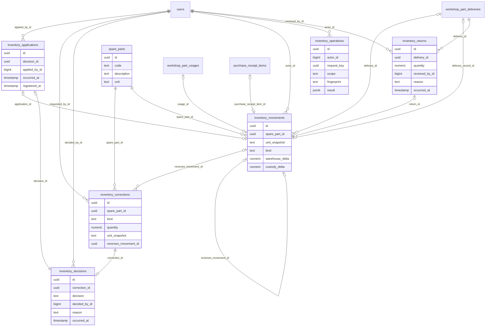

# Diccionario: Inventario

[Volver al capítulo de base de datos](../05-base-de-datos.md).

Este archivo describe el **esquema final**, no solo la migración inicial. `NULL` indica que una columna acepta ausencia de valor; un default es un valor generado si no se envía. Los CHECK y triggers también pueden limitar inserciones aparentemente válidas. Los ejemplos son consultas de estudio, no instrucciones para eludir servicios.

## Relaciones del dominio



El diagrama muestra FK reales y un subconjunto de columnas para que resulte legible. Las fichas siguientes contienen **todas** las columnas. Una referencia a otra tabla no duplica su entidad; consultar su ficha en el índice general.

## inventory_applications

**Propósito:** Aplicación de corrección aprobada que origina el movimiento.

**Responsabilidad:** Inventario. **Migraciones relacionadas:** [2026_10_14_000330_create_inventory_ledger](../../../database/migrations/2026_10_14_000330_create_inventory_ledger.php).

**Modelos identificados:** Query Builder/infraestructura, sin modelo Eloquent propio identificado.

**Consultas directas identificadas:** [InventoryLedger](../../../app/Modules/Inventory/Application/InventoryLedger.php), [InventoryController](../../../app/Modules/Inventory/Http/Controllers/InventoryController.php). La lista incluye lectores de reportes/auditoría y no sustituye las relaciones Eloquent.

### Columnas

| Columna | Tipo PostgreSQL | ¿Admite NULL? | Default |
| --- | --- | --- | --- |
| `id` | `uuid` | No | Sin default |
| `decision_id` | `uuid` | No | Sin default |
| `applied_by_id` | `bigint` | No | Sin default |
| `occurred_at` | `timestamp with time zone` | No | Sin default |
| `registered_at` | `timestamp with time zone` | No | `clock_timestamp()` |

### Claves y restricciones

- **inventory_applications_applied_by_id_fkey**: `FOREIGN KEY (applied_by_id) REFERENCES users(id)`.
- **inventory_applications_decision_id_fkey**: `FOREIGN KEY (decision_id) REFERENCES inventory_decisions(id)`.
- **inventory_applications_applied_by_id_not_null**: `NOT NULL applied_by_id`.
- **inventory_applications_decision_id_not_null**: `NOT NULL decision_id`.
- **inventory_applications_id_not_null**: `NOT NULL id`.
- **inventory_applications_occurred_at_not_null**: `NOT NULL occurred_at`.
- **inventory_applications_registered_at_not_null**: `NOT NULL registered_at`.
- **inventory_applications_pkey**: `PRIMARY KEY (id)`.
- **inventory_applications_decision_id_key**: `UNIQUE (decision_id)`.

### Índices

- `inventory_applications_decision_id_key`: `CREATE UNIQUE INDEX inventory_applications_decision_id_key ON public.inventory_applications USING btree (decision_id)`.
- `inventory_applications_pkey`: `CREATE UNIQUE INDEX inventory_applications_pkey ON public.inventory_applications USING btree (id)`.

### Relaciones y cardinalidades

- `applied_by_id` → [`users`](acceso-y-personal.md#users) (`id`): cada fila tiene un padre; un padre admite varias filas de esta tabla, sujeto a los CHECK/índices condicionales.
- `decision_id` → [`inventory_decisions`](inventario.md#inventory_decisions) (`id`): cada fila tiene un padre; un padre admite como máximo una fila de esta tabla, sujeto a los CHECK/índices condicionales.

**Referencias entrantes:**

- `inventory_movements.application_id` → `inventory_applications.id` (`inventory_movements_application_id_fkey`).

### Escritura, conservación y ejemplo

Registro histórico o recibo: la operación de aplicación inserta el hecho y conserva su trazabilidad. Las correcciones se tramitan con nuevas versiones, aplicaciones o compensaciones, no con un DELETE público. Consultar los triggers siguientes para la protección exacta de esta tabla; no inferir que cualquier UPDATE SQL está permitido.

**Triggers vigentes** (momento y operación exactos; funciones explicadas en [el catálogo](funciones-y-triggers.md)):

- `inventory_history`: `CREATE TRIGGER inventory_history BEFORE DELETE OR UPDATE ON public.inventory_applications FOR EACH ROW EXECUTE FUNCTION workshop_preserve_history()`.
- `inventory_no_truncate`: `CREATE TRIGGER inventory_no_truncate BEFORE TRUNCATE ON public.inventory_applications FOR EACH STATEMENT EXECUTE FUNCTION workshop_preserve_history()`.
- `inventory_stock`: `CREATE TRIGGER inventory_stock AFTER INSERT ON public.inventory_applications FOR EACH ROW EXECUTE FUNCTION inventory_sources()`.
- `inventory_validate`: `CREATE TRIGGER inventory_validate BEFORE INSERT ON public.inventory_applications FOR EACH ROW EXECUTE FUNCTION inventory_validate()`.

```sql
SELECT id, registered_at FROM inventory_applications LIMIT 5;
```

Permite reconocer el registro y su relación sin leer referencias privadas de archivos ni alterar el proceso. Para crearlo funcionalmente, seguir el caso del módulo en el capítulo 12.

## inventory_corrections

**Propósito:** Solicitud de conciliación inicial, ajuste o reversión compensatoria.

**Responsabilidad:** Inventario. **Migraciones relacionadas:** [2026_10_14_000330_create_inventory_ledger](../../../database/migrations/2026_10_14_000330_create_inventory_ledger.php).

**Modelos identificados:** Query Builder/infraestructura, sin modelo Eloquent propio identificado.

**Consultas directas identificadas:** [InventoryLedger](../../../app/Modules/Inventory/Application/InventoryLedger.php), [InventoryController](../../../app/Modules/Inventory/Http/Controllers/InventoryController.php). La lista incluye lectores de reportes/auditoría y no sustituye las relaciones Eloquent.

### Columnas

| Columna | Tipo PostgreSQL | ¿Admite NULL? | Default |
| --- | --- | --- | --- |
| `id` | `uuid` | No | Sin default |
| `spare_part_id` | `uuid` | No | Sin default |
| `kind` | `text` | No | Sin default |
| `quantity` | `numeric` | No | Sin default |
| `unit_snapshot` | `text` | No | Sin default |
| `reverses_movement_id` | `uuid` | Sí | Sin default |
| `requested_by_id` | `bigint` | No | Sin default |
| `reason` | `text` | No | Sin default |
| `occurred_at` | `timestamp with time zone` | No | Sin default |
| `registered_at` | `timestamp with time zone` | No | `clock_timestamp()` |

### Claves y restricciones

- **inventory_corrections_check**: `CHECK ((((kind = 'initial'::text) AND (quantity >= (0)::numeric) AND (reverses_movement_id IS NULL)) OR ((kind = 'adjustment'::text) AND (quantity <> (0)::numeric) AND (reverses_movement_id IS NULL)) OR ((kind = 'reversal'::text) AND (reverses_movement_id IS NOT NULL))))`.
- **inventory_corrections_kind_check**: `CHECK ((kind = ANY (ARRAY['initial'::text, 'adjustment'::text, 'reversal'::text])))`.
- **inventory_corrections_quantity_check**: `CHECK (((scale(quantity) <= 6) AND (abs(quantity) < ('1000000000000'::bigint)::numeric)))`.
- **inventory_corrections_reason_check**: `CHECK ((btrim(reason) <> ''::text))`.
- **inventory_corrections_requested_by_id_fkey**: `FOREIGN KEY (requested_by_id) REFERENCES users(id)`.
- **inventory_corrections_reverses_movement_id_fkey**: `FOREIGN KEY (reverses_movement_id) REFERENCES inventory_movements(id)`.
- **inventory_corrections_spare_part_id_fkey**: `FOREIGN KEY (spare_part_id) REFERENCES spare_parts(id)`.
- **inventory_corrections_id_not_null**: `NOT NULL id`.
- **inventory_corrections_kind_not_null**: `NOT NULL kind`.
- **inventory_corrections_occurred_at_not_null**: `NOT NULL occurred_at`.
- **inventory_corrections_quantity_not_null**: `NOT NULL quantity`.
- **inventory_corrections_reason_not_null**: `NOT NULL reason`.
- **inventory_corrections_registered_at_not_null**: `NOT NULL registered_at`.
- **inventory_corrections_requested_by_id_not_null**: `NOT NULL requested_by_id`.
- **inventory_corrections_spare_part_id_not_null**: `NOT NULL spare_part_id`.
- **inventory_corrections_unit_snapshot_not_null**: `NOT NULL unit_snapshot`.
- **inventory_corrections_pkey**: `PRIMARY KEY (id)`.

### Índices

- `inventory_corrections_pkey`: `CREATE UNIQUE INDEX inventory_corrections_pkey ON public.inventory_corrections USING btree (id)`.

### Relaciones y cardinalidades

- `requested_by_id` → [`users`](acceso-y-personal.md#users) (`id`): cada fila tiene un padre; un padre admite varias filas de esta tabla, sujeto a los CHECK/índices condicionales.
- `reverses_movement_id` → [`inventory_movements`](inventario.md#inventory_movements) (`id`): cada fila tiene cero o un padre; un padre admite varias filas de esta tabla, sujeto a los CHECK/índices condicionales.
- `spare_part_id` → [`spare_parts`](inventario.md#spare_parts) (`id`): cada fila tiene un padre; un padre admite varias filas de esta tabla, sujeto a los CHECK/índices condicionales.

**Referencias entrantes:**

- `inventory_decisions.correction_id` → `inventory_corrections.id` (`inventory_decisions_correction_id_fkey`).

### Escritura, conservación y ejemplo

Registro histórico o recibo: la operación de aplicación inserta el hecho y conserva su trazabilidad. Las correcciones se tramitan con nuevas versiones, aplicaciones o compensaciones, no con un DELETE público. Consultar los triggers siguientes para la protección exacta de esta tabla; no inferir que cualquier UPDATE SQL está permitido.

**Triggers vigentes** (momento y operación exactos; funciones explicadas en [el catálogo](funciones-y-triggers.md)):

- `inventory_history`: `CREATE TRIGGER inventory_history BEFORE DELETE OR UPDATE ON public.inventory_corrections FOR EACH ROW EXECUTE FUNCTION workshop_preserve_history()`.
- `inventory_no_truncate`: `CREATE TRIGGER inventory_no_truncate BEFORE TRUNCATE ON public.inventory_corrections FOR EACH STATEMENT EXECUTE FUNCTION workshop_preserve_history()`.
- `inventory_validate`: `CREATE TRIGGER inventory_validate BEFORE INSERT ON public.inventory_corrections FOR EACH ROW EXECUTE FUNCTION inventory_validate()`.

```sql
SELECT id, spare_part_id, kind, quantity FROM inventory_corrections LIMIT 5;
```

Permite reconocer el registro y su relación sin leer referencias privadas de archivos ni alterar el proceso. Para crearlo funcionalmente, seguir el caso del módulo en el capítulo 12.

## inventory_decisions

**Propósito:** Decisión del administrador sobre la corrección.

**Responsabilidad:** Inventario. **Migraciones relacionadas:** [2026_10_14_000330_create_inventory_ledger](../../../database/migrations/2026_10_14_000330_create_inventory_ledger.php).

**Modelos identificados:** Query Builder/infraestructura, sin modelo Eloquent propio identificado.

**Consultas directas identificadas:** [InventoryLedger](../../../app/Modules/Inventory/Application/InventoryLedger.php), [InventoryController](../../../app/Modules/Inventory/Http/Controllers/InventoryController.php). La lista incluye lectores de reportes/auditoría y no sustituye las relaciones Eloquent.

### Columnas

| Columna | Tipo PostgreSQL | ¿Admite NULL? | Default |
| --- | --- | --- | --- |
| `id` | `uuid` | No | Sin default |
| `correction_id` | `uuid` | No | Sin default |
| `decision` | `text` | No | Sin default |
| `decided_by_id` | `bigint` | No | Sin default |
| `reason` | `text` | No | Sin default |
| `occurred_at` | `timestamp with time zone` | No | Sin default |
| `registered_at` | `timestamp with time zone` | No | `clock_timestamp()` |

### Claves y restricciones

- **inventory_decisions_decision_check**: `CHECK ((decision = ANY (ARRAY['approved'::text, 'rejected'::text])))`.
- **inventory_decisions_reason_check**: `CHECK ((btrim(reason) <> ''::text))`.
- **inventory_decisions_correction_id_fkey**: `FOREIGN KEY (correction_id) REFERENCES inventory_corrections(id)`.
- **inventory_decisions_decided_by_id_fkey**: `FOREIGN KEY (decided_by_id) REFERENCES users(id)`.
- **inventory_decisions_correction_id_not_null**: `NOT NULL correction_id`.
- **inventory_decisions_decided_by_id_not_null**: `NOT NULL decided_by_id`.
- **inventory_decisions_decision_not_null**: `NOT NULL decision`.
- **inventory_decisions_id_not_null**: `NOT NULL id`.
- **inventory_decisions_occurred_at_not_null**: `NOT NULL occurred_at`.
- **inventory_decisions_reason_not_null**: `NOT NULL reason`.
- **inventory_decisions_registered_at_not_null**: `NOT NULL registered_at`.
- **inventory_decisions_pkey**: `PRIMARY KEY (id)`.
- **inventory_decisions_correction_id_key**: `UNIQUE (correction_id)`.

### Índices

- `inventory_decisions_correction_id_key`: `CREATE UNIQUE INDEX inventory_decisions_correction_id_key ON public.inventory_decisions USING btree (correction_id)`.
- `inventory_decisions_pkey`: `CREATE UNIQUE INDEX inventory_decisions_pkey ON public.inventory_decisions USING btree (id)`.

### Relaciones y cardinalidades

- `correction_id` → [`inventory_corrections`](inventario.md#inventory_corrections) (`id`): cada fila tiene un padre; un padre admite como máximo una fila de esta tabla, sujeto a los CHECK/índices condicionales.
- `decided_by_id` → [`users`](acceso-y-personal.md#users) (`id`): cada fila tiene un padre; un padre admite varias filas de esta tabla, sujeto a los CHECK/índices condicionales.

**Referencias entrantes:**

- `inventory_applications.decision_id` → `inventory_decisions.id` (`inventory_applications_decision_id_fkey`).

### Escritura, conservación y ejemplo

Registro histórico o recibo: la operación de aplicación inserta el hecho y conserva su trazabilidad. Las correcciones se tramitan con nuevas versiones, aplicaciones o compensaciones, no con un DELETE público. Consultar los triggers siguientes para la protección exacta de esta tabla; no inferir que cualquier UPDATE SQL está permitido.

**Triggers vigentes** (momento y operación exactos; funciones explicadas en [el catálogo](funciones-y-triggers.md)):

- `inventory_history`: `CREATE TRIGGER inventory_history BEFORE DELETE OR UPDATE ON public.inventory_decisions FOR EACH ROW EXECUTE FUNCTION workshop_preserve_history()`.
- `inventory_no_truncate`: `CREATE TRIGGER inventory_no_truncate BEFORE TRUNCATE ON public.inventory_decisions FOR EACH STATEMENT EXECUTE FUNCTION workshop_preserve_history()`.
- `inventory_validate`: `CREATE TRIGGER inventory_validate BEFORE INSERT ON public.inventory_decisions FOR EACH ROW EXECUTE FUNCTION inventory_validate()`.

```sql
SELECT id, registered_at FROM inventory_decisions LIMIT 5;
```

Permite reconocer el registro y su relación sin leer referencias privadas de archivos ni alterar el proceso. Para crearlo funcionalmente, seguir el caso del módulo en el capítulo 12.

## inventory_movements

**Propósito:** Libro inmutable de deltas de bodega, custodia y consumido, con origen único.

**Responsabilidad:** Inventario. **Migraciones relacionadas:** [2026_10_14_000330_create_inventory_ledger](../../../database/migrations/2026_10_14_000330_create_inventory_ledger.php), [2026_10_14_000340_create_purchase_orders_and_receipts](../../../database/migrations/2026_10_14_000340_create_purchase_orders_and_receipts.php).

**Modelos identificados:** Query Builder/infraestructura, sin modelo Eloquent propio identificado.

**Consultas directas identificadas:** [AdministrativeReports](../../../app/Modules/AdministrativeReports/Application/AdministrativeReports.php), [InventoryLedger](../../../app/Modules/Inventory/Application/InventoryLedger.php), [InventoryController](../../../app/Modules/Inventory/Http/Controllers/InventoryController.php). La lista incluye lectores de reportes/auditoría y no sustituye las relaciones Eloquent.

### Columnas

| Columna | Tipo PostgreSQL | ¿Admite NULL? | Default |
| --- | --- | --- | --- |
| `id` | `uuid` | No | Sin default |
| `spare_part_id` | `uuid` | No | Sin default |
| `unit_snapshot` | `text` | No | Sin default |
| `kind` | `text` | No | Sin default |
| `warehouse_delta` | `numeric` | No | Sin default |
| `custody_delta` | `numeric` | No | Sin default |
| `consumed_delta` | `numeric` | No | Sin default |
| `delivery_id` | `uuid` | Sí | Sin default |
| `delivery_record_id` | `uuid` | Sí | Sin default |
| `usage_id` | `uuid` | Sí | Sin default |
| `return_id` | `uuid` | Sí | Sin default |
| `application_id` | `uuid` | Sí | Sin default |
| `purchase_receipt_item_id` | `uuid` | Sí | Sin default |
| `reverses_movement_id` | `uuid` | Sí | Sin default |
| `actor_id` | `bigint` | No | Sin default |
| `occurred_at` | `timestamp with time zone` | No | Sin default |
| `registered_at` | `timestamp with time zone` | No | `clock_timestamp()` |

### Claves y restricciones

- **inventory_movements_check**: `CHECK ((((kind = ANY (ARRAY['initial'::text, 'adjustment'::text, 'reversal'::text])) AND (application_id IS NOT NULL) AND (num_nonnulls(usage_id, return_id, purchase_receipt_item_id, delivery_id, delivery_record_id) = 0)) OR ((kind = 'receipt'::text) AND (purchase_receipt_item_id IS NOT NULL) AND (num_nonnulls(usage_id, return_id, application_id, delivery_id, delivery_record_id, reverses_movement_id) = 0)) OR ((kind = 'delivery'::text) AND (delivery_id IS NOT NULL) AND (delivery_record_id IS NOT NULL) AND (num_nonnulls(usage_id, return_id, application_id, purchase_receipt_item_id, reverses_movement_id) = 0)) OR ((kind = 'usage'::text) AND (delivery_id IS NOT NULL) AND (usage_id IS NOT NULL) AND (num_nonnulls(delivery_record_id, return_id, application_id, purchase_receipt_item_id, reverses_movement_id) = 0)) OR ((kind = 'return'::text) AND (delivery_id IS NOT NULL) AND (return_id IS NOT NULL) AND (num_nonnulls(delivery_record_id, usage_id, application_id, purchase_receipt_item_id, reverses_movement_id) = 0))))`.
- **inventory_movements_consumed_delta_check**: `CHECK (((scale(consumed_delta) <= 6) AND (abs(consumed_delta) < ('1000000000000'::bigint)::numeric)))`.
- **inventory_movements_custody_delta_check**: `CHECK (((scale(custody_delta) <= 6) AND (abs(custody_delta) < ('1000000000000'::bigint)::numeric)))`.
- **inventory_movements_kind_check**: `CHECK ((kind = ANY (ARRAY['initial'::text, 'adjustment'::text, 'reversal'::text, 'receipt'::text, 'delivery'::text, 'usage'::text, 'return'::text])))`.
- **inventory_movements_warehouse_delta_check**: `CHECK (((scale(warehouse_delta) <= 6) AND (abs(warehouse_delta) < ('1000000000000'::bigint)::numeric)))`.
- **inventory_movements_actor_id_fkey**: `FOREIGN KEY (actor_id) REFERENCES users(id)`.
- **inventory_movements_application_id_fkey**: `FOREIGN KEY (application_id) REFERENCES inventory_applications(id)`.
- **inventory_movements_delivery_id_fkey**: `FOREIGN KEY (delivery_id) REFERENCES workshop_part_deliveries(id)`.
- **inventory_movements_delivery_record_id_fkey**: `FOREIGN KEY (delivery_record_id) REFERENCES workshop_part_deliveries(id)`.
- **inventory_movements_return_id_fkey**: `FOREIGN KEY (return_id) REFERENCES inventory_returns(id)`.
- **inventory_movements_reverses_movement_id_fkey**: `FOREIGN KEY (reverses_movement_id) REFERENCES inventory_movements(id)`.
- **inventory_movements_spare_part_id_fkey**: `FOREIGN KEY (spare_part_id) REFERENCES spare_parts(id)`.
- **inventory_movements_usage_id_fkey**: `FOREIGN KEY (usage_id) REFERENCES workshop_part_usages(id)`.
- **inventory_receipt_source**: `FOREIGN KEY (purchase_receipt_item_id) REFERENCES purchase_receipt_items(id) ON UPDATE RESTRICT ON DELETE RESTRICT`.
- **inventory_movements_actor_id_not_null**: `NOT NULL actor_id`.
- **inventory_movements_consumed_delta_not_null**: `NOT NULL consumed_delta`.
- **inventory_movements_custody_delta_not_null**: `NOT NULL custody_delta`.
- **inventory_movements_id_not_null**: `NOT NULL id`.
- **inventory_movements_kind_not_null**: `NOT NULL kind`.
- **inventory_movements_occurred_at_not_null**: `NOT NULL occurred_at`.
- **inventory_movements_registered_at_not_null**: `NOT NULL registered_at`.
- **inventory_movements_spare_part_id_not_null**: `NOT NULL spare_part_id`.
- **inventory_movements_unit_snapshot_not_null**: `NOT NULL unit_snapshot`.
- **inventory_movements_warehouse_delta_not_null**: `NOT NULL warehouse_delta`.
- **inventory_movements_pkey**: `PRIMARY KEY (id)`.
- **purchasing_receipt_stock_complete**: `TRIGGER DEFERRABLE INITIALLY DEFERRED`.
- **inventory_movements_application_id_key**: `UNIQUE (application_id)`.
- **inventory_movements_delivery_record_id_key**: `UNIQUE (delivery_record_id)`.
- **inventory_movements_purchase_receipt_item_id_key**: `UNIQUE (purchase_receipt_item_id)`.
- **inventory_movements_return_id_key**: `UNIQUE (return_id)`.
- **inventory_movements_reverses_movement_id_key**: `UNIQUE (reverses_movement_id)`.
- **inventory_movements_usage_id_key**: `UNIQUE (usage_id)`.

### Índices

- `inventory_delivery`: `CREATE UNIQUE INDEX inventory_delivery ON public.inventory_movements USING btree (delivery_id) WHERE ((kind = 'delivery'::text) AND (delivery_record_id = delivery_id))`.
- `inventory_initial_part`: `CREATE UNIQUE INDEX inventory_initial_part ON public.inventory_movements USING btree (spare_part_id) WHERE (kind = 'initial'::text)`.
- `inventory_movements_application_id_key`: `CREATE UNIQUE INDEX inventory_movements_application_id_key ON public.inventory_movements USING btree (application_id)`.
- `inventory_movements_delivery_id_idx`: `CREATE INDEX inventory_movements_delivery_id_idx ON public.inventory_movements USING btree (delivery_id)`.
- `inventory_movements_delivery_record_id_key`: `CREATE UNIQUE INDEX inventory_movements_delivery_record_id_key ON public.inventory_movements USING btree (delivery_record_id)`.
- `inventory_movements_pkey`: `CREATE UNIQUE INDEX inventory_movements_pkey ON public.inventory_movements USING btree (id)`.
- `inventory_movements_purchase_receipt_item_id_key`: `CREATE UNIQUE INDEX inventory_movements_purchase_receipt_item_id_key ON public.inventory_movements USING btree (purchase_receipt_item_id)`.
- `inventory_movements_return_id_key`: `CREATE UNIQUE INDEX inventory_movements_return_id_key ON public.inventory_movements USING btree (return_id)`.
- `inventory_movements_reverses_movement_id_key`: `CREATE UNIQUE INDEX inventory_movements_reverses_movement_id_key ON public.inventory_movements USING btree (reverses_movement_id)`.
- `inventory_movements_spare_part_id_idx`: `CREATE INDEX inventory_movements_spare_part_id_idx ON public.inventory_movements USING btree (spare_part_id)`.
- `inventory_movements_usage_id_key`: `CREATE UNIQUE INDEX inventory_movements_usage_id_key ON public.inventory_movements USING btree (usage_id)`.

### Relaciones y cardinalidades

- `actor_id` → [`users`](acceso-y-personal.md#users) (`id`): cada fila tiene un padre; un padre admite varias filas de esta tabla, sujeto a los CHECK/índices condicionales.
- `application_id` → [`inventory_applications`](inventario.md#inventory_applications) (`id`): cada fila tiene cero o un padre; un padre admite como máximo una fila de esta tabla, sujeto a los CHECK/índices condicionales.
- `delivery_id` → [`workshop_part_deliveries`](taller.md#workshop_part_deliveries) (`id`): cada fila tiene cero o un padre; un padre admite varias filas de esta tabla, sujeto a los CHECK/índices condicionales.
- `delivery_record_id` → [`workshop_part_deliveries`](taller.md#workshop_part_deliveries) (`id`): cada fila tiene cero o un padre; un padre admite como máximo una fila de esta tabla, sujeto a los CHECK/índices condicionales.
- `return_id` → [`inventory_returns`](inventario.md#inventory_returns) (`id`): cada fila tiene cero o un padre; un padre admite como máximo una fila de esta tabla, sujeto a los CHECK/índices condicionales.
- `reverses_movement_id` → [`inventory_movements`](inventario.md#inventory_movements) (`id`): cada fila tiene cero o un padre; un padre admite como máximo una fila de esta tabla, sujeto a los CHECK/índices condicionales.
- `spare_part_id` → [`spare_parts`](inventario.md#spare_parts) (`id`): cada fila tiene un padre; un padre admite varias filas de esta tabla, sujeto a los CHECK/índices condicionales.
- `usage_id` → [`workshop_part_usages`](taller.md#workshop_part_usages) (`id`): cada fila tiene cero o un padre; un padre admite como máximo una fila de esta tabla, sujeto a los CHECK/índices condicionales.
- `purchase_receipt_item_id` → [`purchase_receipt_items`](compras.md#purchase_receipt_items) (`id`): cada fila tiene cero o un padre; un padre admite como máximo una fila de esta tabla, sujeto a los CHECK/índices condicionales.

**Referencias entrantes:**

- `inventory_corrections.reverses_movement_id` → `inventory_movements.id` (`inventory_corrections_reverses_movement_id_fkey`).
- `inventory_movements.reverses_movement_id` → `inventory_movements.id` (`inventory_movements_reverses_movement_id_fkey`).

### Escritura, conservación y ejemplo

inventory_sources() registra fuentes de Taller, devoluciones y correcciones aplicadas; InventoryLedger::receive() registra entradas físicas de Compras. El origen es único. No se corrige mediante UPDATE/DELETE: requiere compensación autorizada.

**Triggers vigentes** (momento y operación exactos; funciones explicadas en [el catálogo](funciones-y-triggers.md)):

- `inventory_history`: `CREATE TRIGGER inventory_history BEFORE DELETE OR UPDATE ON public.inventory_movements FOR EACH ROW EXECUTE FUNCTION workshop_preserve_history()`.
- `inventory_no_truncate`: `CREATE TRIGGER inventory_no_truncate BEFORE TRUNCATE ON public.inventory_movements FOR EACH STATEMENT EXECUTE FUNCTION workshop_preserve_history()`.
- `inventory_validate`: `CREATE TRIGGER inventory_validate BEFORE INSERT ON public.inventory_movements FOR EACH ROW EXECUTE FUNCTION inventory_validate()`.
- `purchasing_receipt_stock_complete`: `CREATE CONSTRAINT TRIGGER purchasing_receipt_stock_complete AFTER INSERT ON public.inventory_movements DEFERRABLE INITIALLY DEFERRED FOR EACH ROW EXECUTE FUNCTION purchasing_receipt_stock_complete()`.

```sql
SELECT id, spare_part_id, kind, registered_at FROM inventory_movements LIMIT 5;
```

Permite reconocer el registro y su relación sin leer referencias privadas de archivos ni alterar el proceso. Para crearlo funcionalmente, seguir el caso del módulo en el capítulo 12.

## inventory_operations

**Propósito:** Recibo idempotente de los comandos de Inventario.

**Responsabilidad:** Inventario. **Migraciones relacionadas:** [2026_10_14_000330_create_inventory_ledger](../../../database/migrations/2026_10_14_000330_create_inventory_ledger.php).

**Modelos identificados:** Query Builder/infraestructura, sin modelo Eloquent propio identificado.

**Consultas directas identificadas:** [InventoryLedger](../../../app/Modules/Inventory/Application/InventoryLedger.php). La lista incluye lectores de reportes/auditoría y no sustituye las relaciones Eloquent.

### Columnas

| Columna | Tipo PostgreSQL | ¿Admite NULL? | Default |
| --- | --- | --- | --- |
| `id` | `uuid` | No | Sin default |
| `actor_id` | `bigint` | No | Sin default |
| `request_key` | `uuid` | No | Sin default |
| `scope` | `text` | No | Sin default |
| `fingerprint` | `text` | No | Sin default |
| `result` | `jsonb` | No | Sin default |
| `registered_at` | `timestamp with time zone` | No | `clock_timestamp()` |

### Claves y restricciones

- **inventory_operations_actor_id_fkey**: `FOREIGN KEY (actor_id) REFERENCES users(id)`.
- **inventory_operations_actor_id_not_null**: `NOT NULL actor_id`.
- **inventory_operations_fingerprint_not_null**: `NOT NULL fingerprint`.
- **inventory_operations_id_not_null**: `NOT NULL id`.
- **inventory_operations_registered_at_not_null**: `NOT NULL registered_at`.
- **inventory_operations_request_key_not_null**: `NOT NULL request_key`.
- **inventory_operations_result_not_null**: `NOT NULL result`.
- **inventory_operations_scope_not_null**: `NOT NULL scope`.
- **inventory_operations_pkey**: `PRIMARY KEY (id)`.
- **inventory_operations_actor_id_scope_request_key_key**: `UNIQUE (actor_id, scope, request_key)`.

### Índices

- `inventory_operations_actor_id_scope_request_key_key`: `CREATE UNIQUE INDEX inventory_operations_actor_id_scope_request_key_key ON public.inventory_operations USING btree (actor_id, scope, request_key)`.
- `inventory_operations_pkey`: `CREATE UNIQUE INDEX inventory_operations_pkey ON public.inventory_operations USING btree (id)`.

### Relaciones y cardinalidades

- `actor_id` → [`users`](acceso-y-personal.md#users) (`id`): cada fila tiene un padre; un padre admite varias filas de esta tabla, sujeto a los CHECK/índices condicionales.

**Referencias entrantes:** ninguna FK física apunta a esta tabla.

### Escritura, conservación y ejemplo

Registro histórico o recibo: la operación de aplicación inserta el hecho y conserva su trazabilidad. Las correcciones se tramitan con nuevas versiones, aplicaciones o compensaciones, no con un DELETE público. Consultar los triggers siguientes para la protección exacta de esta tabla; no inferir que cualquier UPDATE SQL está permitido.

**Triggers vigentes** (momento y operación exactos; funciones explicadas en [el catálogo](funciones-y-triggers.md)):

- `inventory_history`: `CREATE TRIGGER inventory_history BEFORE DELETE OR UPDATE ON public.inventory_operations FOR EACH ROW EXECUTE FUNCTION workshop_preserve_history()`.
- `inventory_no_truncate`: `CREATE TRIGGER inventory_no_truncate BEFORE TRUNCATE ON public.inventory_operations FOR EACH STATEMENT EXECUTE FUNCTION workshop_preserve_history()`.

```sql
SELECT id, registered_at FROM inventory_operations LIMIT 5;
```

Permite reconocer el registro y su relación sin leer referencias privadas de archivos ni alterar el proceso. Para crearlo funcionalmente, seguir el caso del módulo en el capítulo 12.

## inventory_returns

**Propósito:** Recepción física en bodega del sobrante de una entrega.

**Responsabilidad:** Inventario. **Migraciones relacionadas:** [2026_10_14_000330_create_inventory_ledger](../../../database/migrations/2026_10_14_000330_create_inventory_ledger.php).

**Modelos identificados:** Query Builder/infraestructura, sin modelo Eloquent propio identificado.

**Consultas directas identificadas:** [InventoryLedger](../../../app/Modules/Inventory/Application/InventoryLedger.php). La lista incluye lectores de reportes/auditoría y no sustituye las relaciones Eloquent.

### Columnas

| Columna | Tipo PostgreSQL | ¿Admite NULL? | Default |
| --- | --- | --- | --- |
| `id` | `uuid` | No | Sin default |
| `delivery_id` | `uuid` | No | Sin default |
| `quantity` | `numeric` | No | Sin default |
| `received_by_id` | `bigint` | No | Sin default |
| `reason` | `text` | No | Sin default |
| `occurred_at` | `timestamp with time zone` | No | Sin default |
| `registered_at` | `timestamp with time zone` | No | `clock_timestamp()` |

### Claves y restricciones

- **inventory_returns_quantity_check**: `CHECK (((scale(quantity) <= 6) AND (quantity > (0)::numeric) AND (quantity < ('1000000000000'::bigint)::numeric)))`.
- **inventory_returns_reason_check**: `CHECK ((btrim(reason) <> ''::text))`.
- **inventory_returns_delivery_id_fkey**: `FOREIGN KEY (delivery_id) REFERENCES workshop_part_deliveries(id)`.
- **inventory_returns_received_by_id_fkey**: `FOREIGN KEY (received_by_id) REFERENCES users(id)`.
- **inventory_returns_delivery_id_not_null**: `NOT NULL delivery_id`.
- **inventory_returns_id_not_null**: `NOT NULL id`.
- **inventory_returns_occurred_at_not_null**: `NOT NULL occurred_at`.
- **inventory_returns_quantity_not_null**: `NOT NULL quantity`.
- **inventory_returns_reason_not_null**: `NOT NULL reason`.
- **inventory_returns_received_by_id_not_null**: `NOT NULL received_by_id`.
- **inventory_returns_registered_at_not_null**: `NOT NULL registered_at`.
- **inventory_returns_pkey**: `PRIMARY KEY (id)`.

### Índices

- `inventory_returns_pkey`: `CREATE UNIQUE INDEX inventory_returns_pkey ON public.inventory_returns USING btree (id)`.

### Relaciones y cardinalidades

- `delivery_id` → [`workshop_part_deliveries`](taller.md#workshop_part_deliveries) (`id`): cada fila tiene un padre; un padre admite varias filas de esta tabla, sujeto a los CHECK/índices condicionales.
- `received_by_id` → [`users`](acceso-y-personal.md#users) (`id`): cada fila tiene un padre; un padre admite varias filas de esta tabla, sujeto a los CHECK/índices condicionales.

**Referencias entrantes:**

- `inventory_movements.return_id` → `inventory_returns.id` (`inventory_movements_return_id_fkey`).

### Escritura, conservación y ejemplo

Registro histórico o recibo: la operación de aplicación inserta el hecho y conserva su trazabilidad. Las correcciones se tramitan con nuevas versiones, aplicaciones o compensaciones, no con un DELETE público. Consultar los triggers siguientes para la protección exacta de esta tabla; no inferir que cualquier UPDATE SQL está permitido.

**Triggers vigentes** (momento y operación exactos; funciones explicadas en [el catálogo](funciones-y-triggers.md)):

- `inventory_history`: `CREATE TRIGGER inventory_history BEFORE DELETE OR UPDATE ON public.inventory_returns FOR EACH ROW EXECUTE FUNCTION workshop_preserve_history()`.
- `inventory_no_truncate`: `CREATE TRIGGER inventory_no_truncate BEFORE TRUNCATE ON public.inventory_returns FOR EACH STATEMENT EXECUTE FUNCTION workshop_preserve_history()`.
- `inventory_stock`: `CREATE TRIGGER inventory_stock AFTER INSERT ON public.inventory_returns FOR EACH ROW EXECUTE FUNCTION inventory_sources()`.
- `inventory_validate`: `CREATE TRIGGER inventory_validate BEFORE INSERT ON public.inventory_returns FOR EACH ROW EXECUTE FUNCTION inventory_validate()`.

```sql
SELECT id, quantity, registered_at FROM inventory_returns LIMIT 5;
```

Permite reconocer el registro y su relación sin leer referencias privadas de archivos ni alterar el proceso. Para crearlo funcionalmente, seguir el caso del módulo en el capítulo 12.

## spare_parts

**Propósito:** Catálogo de repuestos y unidad; no contiene una existencia ficticia.

**Responsabilidad:** Inventario. **Migraciones relacionadas:** [2026_10_10_000010_create_base_catalogs](../../../database/migrations/2026_10_10_000010_create_base_catalogs.php), [2026_10_12_000200_create_workshop_authorizations](../../../database/migrations/2026_10_12_000200_create_workshop_authorizations.php), [2026_10_12_000210_protect_workshop_authorizations](../../../database/migrations/2026_10_12_000210_protect_workshop_authorizations.php), [2026_10_12_000260_create_workshop_materials](../../../database/migrations/2026_10_12_000260_create_workshop_materials.php), [2026_10_13_000320_create_purchase_requests](../../../database/migrations/2026_10_13_000320_create_purchase_requests.php), [2026_10_14_000330_create_inventory_ledger](../../../database/migrations/2026_10_14_000330_create_inventory_ledger.php), [2026_10_14_000350_protect_approved_purchase_units](../../../database/migrations/2026_10_14_000350_protect_approved_purchase_units.php).

**Modelos identificados:** [SparePart](../../../app/Modules/Inventory/Models/SparePart.php).

**Consultas directas identificadas:** [AdministrativeReports](../../../app/Modules/AdministrativeReports/Application/AdministrativeReports.php), [InventoryController](../../../app/Modules/Inventory/Http/Controllers/InventoryController.php). La lista incluye lectores de reportes/auditoría y no sustituye las relaciones Eloquent.

### Columnas

| Columna | Tipo PostgreSQL | ¿Admite NULL? | Default |
| --- | --- | --- | --- |
| `id` | `uuid` | No | Sin default |
| `code` | `text` | No | Sin default |
| `description` | `text` | No | Sin default |
| `unit` | `text` | No | Sin default |

### Claves y restricciones

- **spare_parts_code_not_null**: `NOT NULL code`.
- **spare_parts_description_not_null**: `NOT NULL description`.
- **spare_parts_id_not_null**: `NOT NULL id`.
- **spare_parts_unit_not_null**: `NOT NULL unit`.
- **spare_parts_pkey**: `PRIMARY KEY (id)`.

### Índices

- `spare_parts_pkey`: `CREATE UNIQUE INDEX spare_parts_pkey ON public.spare_parts USING btree (id)`.

### Relaciones y cardinalidades

No tiene FK físicas. Los vínculos solo lógicos, si existen, deben interpretarse en los servicios y no como integridad automática de PostgreSQL.

**Referencias entrantes:**

- `inventory_corrections.spare_part_id` → `spare_parts.id` (`inventory_corrections_spare_part_id_fkey`).
- `inventory_movements.spare_part_id` → `spare_parts.id` (`inventory_movements_spare_part_id_fkey`).
- `purchase_request_items.spare_part_id` → `spare_parts.id` (`purchase_request_items_spare_part_id_fkey`).
- `workshop_material_needs.spare_part_id` → `spare_parts.id` (`workshop_material_needs_spare_part_id_fkey`).
- `workshop_scope_parts.spare_part_id` → `spare_parts.id` (`workshop_scope_parts_spare_part_id_fkey`).

### Escritura, conservación y ejemplo

Catálogo o entidad administrable: altas y actualizaciones mediante los controladores/servicios del módulo. No hay eliminación física pública. Las restricciones de uso histórico y autorización siguen aplicando; activar/desactivar no equivale a borrar.

**Triggers vigentes** (momento y operación exactos; funciones explicadas en [el catálogo](funciones-y-triggers.md)):

- `inventory_unit_history`: `CREATE TRIGGER inventory_unit_history BEFORE UPDATE ON public.spare_parts FOR EACH ROW EXECUTE FUNCTION inventory_unit_history()`.
- `purchasing_unit_compatibility`: `CREATE TRIGGER purchasing_unit_compatibility BEFORE UPDATE OF unit ON public.spare_parts FOR EACH ROW EXECUTE FUNCTION purchasing_unit_compatibility()`.

```sql
SELECT id, code FROM spare_parts LIMIT 5;
```

Permite reconocer el registro y su relación sin leer referencias privadas de archivos ni alterar el proceso. Para crearlo funcionalmente, seguir el caso del módulo en el capítulo 12.
