# Diccionario: Taller Mecánico

[Volver al capítulo de base de datos](../05-base-de-datos.md).

Este archivo describe el **esquema final**, no solo la migración inicial. `NULL` indica que una columna acepta ausencia de valor; un default es un valor generado si no se envía. Los CHECK y triggers también pueden limitar inserciones aparentemente válidas. Los ejemplos son consultas de estudio, no instrucciones para eludir servicios.

## Relaciones del dominio

```mermaid
erDiagram
    fleet_impediment_resolutions {
        uuid id
        uuid impediment_id
        uuid operation_id
        bigint resolved_by_id
        timestamp resolved_at
        timestamp registered_at
    }
    fleet_operating_impediments {
        uuid id
        uuid fleet_asset_id
        text kind
        uuid admission_id
        uuid work_order_id
        text effect
    }
    workshop_activities {
        uuid id
        uuid task_id
        uuid mechanic_assignment_id
        text description
        text observations
        bigint actor_id
    }
    workshop_admission_exits {
        uuid id
        uuid admission_id
        uuid authorization_application_id
        timestamp exited_at
        bigint recorded_by_id
        timestamp registered_at
    }
    workshop_admissions {
        uuid id
        uuid fleet_asset_id
        text kind
        timestamp admitted_at
        bigint admitted_by_id
        text reason
    }
    workshop_attachments {
        uuid id
        uuid work_order_id
        text category
        uuid external_repair_id
        text storage_key
        text mime
    }
    workshop_authorization_applications {
        uuid id
        uuid decision_id
        uuid operation_id
        bigint applied_by_id
        timestamp registered_at
    }
    workshop_authorization_decisions {
        uuid id
        uuid request_id
        text decision
        bigint decided_by_id
        text reason
        timestamp registered_at
    }
    workshop_authorization_requests {
        uuid id
        uuid work_order_id
        uuid admission_id
        uuid scope_id
        text type
        uuid previous_request_id
    }
    workshop_cost_records {
        uuid id
        uuid work_order_id
        uuid scope_task_id
        uuid scope_part_id
        uuid usage_id
        uuid external_repair_id
    }
    workshop_diagnoses {
        uuid id
        uuid work_order_id
        uuid mechanic_assignment_id
        text problem
        text probable_cause
        text proposed_repair
    }
    workshop_external_repairs {
        uuid id
        uuid work_order_id
        uuid scope_task_id
        uuid supplier_id
        text description
        timestamp performed_at
    }
    workshop_material_needs {
        uuid id
        uuid work_order_id
        uuid scope_part_id
        uuid spare_part_id
        numeric quantity
        text description
    }
    workshop_mechanic_assignments {
        uuid id
        uuid work_order_id
        uuid employee_id
        timestamp starts_at
        timestamp registered_at
        bigint assigned_by_id
    }
    workshop_mechanic_releases {
        uuid id
        uuid assignment_id
        timestamp ends_at
        bigint recorded_by_id
        text reason
        timestamp registered_at
    }
    workshop_operations {
        uuid id
        uuid work_order_id
        uuid admission_id
        uuid report_id
        uuid fleet_asset_id
        text operation_type
    }
    workshop_order_admission_links {
        uuid id
        uuid work_order_id
        uuid admission_id
        uuid fleet_asset_id
        bigint linked_by_id
        timestamp registered_at
    }
    workshop_part_deliveries {
        uuid id
        uuid scope_part_id
        numeric quantity
        uuid delivered_to_assignment_id
        bigint recorded_by_id
        timestamp occurred_at
    }
    workshop_part_usages {
        uuid id
        uuid delivery_id
        numeric quantity
        bigint confirmed_by_id
        uuid mechanic_assignment_id
        timestamp occurred_at
    }
    workshop_report_links {
        uuid id
        uuid report_id
        uuid work_order_id
        bigint linked_by_id
        timestamp registered_at
        text reason
    }
    workshop_reports {
        uuid id
        uuid fleet_asset_id
        uuid trip_event_id
        text description
        bigint reporter_id
        bigint recorded_by_id
    }
    workshop_scope_parts {
        uuid id
        uuid scope_id
        uuid task_id
        uuid spare_part_id
        integer line_number
        numeric quantity
    }
    workshop_scope_tasks {
        uuid id
        uuid scope_id
        text description
        integer line_number
        uuid supplier_id
    }
    workshop_scopes {
        uuid id
        uuid work_order_id
        uuid diagnosis_id
        text scope_kind
        bigint proposed_by_id
        text description
    }
    workshop_time_events {
        uuid id
        uuid work_order_id
        uuid mechanic_assignment_id
        text event_type
        bigint actor_id
        timestamp occurred_at
    }
    workshop_warnings {
        uuid id
        uuid admission_id
        uuid trip_asset_assignment_id
        uuid work_order_id
        text code
        jsonb context
    }
    workshop_work_orders {
        uuid id
        uuid fleet_asset_id
        text kind
        text description
        text priority
        text status
    }
    fleet_operating_impediments ||--o| fleet_impediment_resolutions : "impediment_id"
    workshop_operations ||--o{ fleet_impediment_resolutions : "operation_id"
    users ||--o{ fleet_impediment_resolutions : "resolved_by_id"
    users ||--o{ fleet_operating_impediments : "actor_id"
    workshop_admissions |o--o{ fleet_operating_impediments : "admission_id, fleet_asset_id"
    fleet_assets ||--o{ fleet_operating_impediments : "fleet_asset_id"
    workshop_work_orders |o--o{ fleet_operating_impediments : "work_order_id, fleet_asset_id"
    users ||--o{ workshop_activities : "actor_id"
    workshop_mechanic_assignments |o--o{ workshop_activities : "mechanic_assignment_id"
    workshop_activities |o--o| workshop_activities : "previous_activity_id"
    workshop_activities ||--o{ workshop_activities : "root_record_id"
    workshop_scope_tasks ||--o{ workshop_activities : "task_id"
    workshop_admissions ||--o| workshop_admission_exits : "admission_id"
    workshop_authorization_applications ||--o| workshop_admission_exits : "authorization_application_id"
    users ||--o{ workshop_admission_exits : "recorded_by_id"
    users ||--o{ workshop_admissions : "admitted_by_id"
    fleet_assets ||--o{ workshop_admissions : "fleet_asset_id"
    workshop_external_repairs |o--o{ workshop_attachments : "external_repair_id, work_order_id"
    workshop_attachments |o--o| workshop_attachments : "previous_attachment_id"
    workshop_operations ||--o| workshop_attachments : "reservation_operation_id"
    workshop_attachments ||--o{ workshop_attachments : "root_record_id"
    users ||--o{ workshop_attachments : "uploaded_by_id"
    workshop_work_orders ||--o{ workshop_attachments : "work_order_id"
    users ||--o{ workshop_authorization_applications : "applied_by_id"
    workshop_authorization_decisions ||--o| workshop_authorization_applications : "decision_id"
    workshop_operations ||--o{ workshop_authorization_applications : "operation_id"
    users ||--o{ workshop_authorization_decisions : "decided_by_id"
    workshop_authorization_requests ||--o| workshop_authorization_decisions : "request_id"
    workshop_admissions |o--o{ workshop_authorization_requests : "admission_id"
    workshop_authorization_requests |o--o| workshop_authorization_requests : "previous_request_id"
    users ||--o{ workshop_authorization_requests : "requested_by_id"
    workshop_scopes |o--o{ workshop_authorization_requests : "scope_id, work_order_id"
    workshop_work_orders |o--o{ workshop_authorization_requests : "work_order_id"
    users ||--o{ workshop_cost_records : "actor_id"
    workshop_cost_records |o--o{ workshop_cost_records : "covered_by_cost_id, work_order_id"
    workshop_external_repairs |o--o{ workshop_cost_records : "external_repair_id, work_order_id"
    workshop_cost_records |o--o| workshop_cost_records : "previous_cost_id"
    workshop_cost_records ||--o{ workshop_cost_records : "root_record_id"
    workshop_scope_parts |o--o{ workshop_cost_records : "scope_part_id"
    workshop_scope_tasks |o--o{ workshop_cost_records : "scope_task_id"
    workshop_attachments |o--o{ workshop_cost_records : "source_attachment_id, work_order_id"
    workshop_part_usages |o--o{ workshop_cost_records : "usage_id"
    workshop_work_orders ||--o{ workshop_cost_records : "work_order_id"
    users ||--o{ workshop_diagnoses : "actor_id"
    workshop_mechanic_assignments |o--o{ workshop_diagnoses : "mechanic_assignment_id"
    workshop_mechanic_assignments |o--o{ workshop_diagnoses : "mechanic_assignment_id, work_order_id"
    workshop_diagnoses |o--o| workshop_diagnoses : "previous_diagnosis_id"
    workshop_diagnoses ||--o{ workshop_diagnoses : "root_record_id"
    workshop_work_orders ||--o{ workshop_diagnoses : "work_order_id"
    workshop_external_repairs |o--o| workshop_external_repairs : "previous_record_id"
    users ||--o{ workshop_external_repairs : "recorded_by_id"
    workshop_external_repairs ||--o{ workshop_external_repairs : "root_record_id"
    workshop_scope_tasks ||--o{ workshop_external_repairs : "scope_task_id"
    suppliers ||--o{ workshop_external_repairs : "supplier_id"
    workshop_work_orders ||--o{ workshop_external_repairs : "work_order_id"
    workshop_material_needs |o--o| workshop_material_needs : "previous_need_id"
    users ||--o{ workshop_material_needs : "requested_by_id"
    workshop_material_needs ||--o{ workshop_material_needs : "root_record_id"
    workshop_scope_parts |o--o{ workshop_material_needs : "scope_part_id"
    spare_parts ||--o{ workshop_material_needs : "spare_part_id"
    workshop_work_orders ||--o{ workshop_material_needs : "work_order_id"
    users ||--o{ workshop_mechanic_assignments : "assigned_by_id"
    employees ||--o{ workshop_mechanic_assignments : "employee_id"
    workshop_work_orders ||--o{ workshop_mechanic_assignments : "work_order_id"
    workshop_mechanic_assignments ||--o| workshop_mechanic_releases : "assignment_id"
    users ||--o{ workshop_mechanic_releases : "recorded_by_id"
    workshop_activities |o--o{ workshop_operations : "activity_id"
    users ||--o{ workshop_operations : "actor_id"
    workshop_admissions |o--o{ workshop_operations : "admission_id"
    workshop_attachments |o--o{ workshop_operations : "attachment_id"
    workshop_authorization_decisions |o--o{ workshop_operations : "authorization_decision_id"
    workshop_authorization_requests |o--o{ workshop_operations : "authorization_request_id"
    workshop_cost_records |o--o{ workshop_operations : "cost_record_id"
    workshop_part_deliveries |o--o{ workshop_operations : "delivery_id"
    workshop_diagnoses |o--o{ workshop_operations : "diagnosis_id"
    workshop_external_repairs |o--o{ workshop_operations : "external_repair_id"
    fleet_assets |o--o{ workshop_operations : "fleet_asset_id"
    fleet_operating_impediments |o--o{ workshop_operations : "impediment_id"
    workshop_material_needs |o--o{ workshop_operations : "material_need_id"
    workshop_mechanic_assignments |o--o{ workshop_operations : "mechanic_assignment_id"
    workshop_mechanic_releases |o--o{ workshop_operations : "mechanic_release_id"
    workshop_order_admission_links |o--o{ workshop_operations : "order_admission_link_id"
    workshop_reports |o--o{ workshop_operations : "report_id"
    workshop_report_links |o--o{ workshop_operations : "report_link_id"
    workshop_operations |o--o{ workshop_operations : "reservation_operation_id"
    workshop_scopes |o--o{ workshop_operations : "scope_id"
    workshop_time_events |o--o{ workshop_operations : "time_event_id"
    workshop_part_usages |o--o{ workshop_operations : "usage_id"
    workshop_warnings |o--o{ workshop_operations : "warning_id"
    workshop_work_orders |o--o{ workshop_operations : "work_order_id"
    workshop_work_orders ||--o{ workshop_order_admission_links : "work_order_id, fleet_asset_id"
    workshop_admissions ||--o{ workshop_order_admission_links : "admission_id, fleet_asset_id"
    fleet_assets ||--o{ workshop_order_admission_links : "fleet_asset_id"
    users ||--o{ workshop_order_admission_links : "linked_by_id"
    workshop_operations ||--o{ workshop_order_admission_links : "operation_id"
    workshop_mechanic_assignments ||--o{ workshop_part_deliveries : "delivered_to_assignment_id"
    workshop_part_deliveries |o--o| workshop_part_deliveries : "previous_delivery_id"
    users ||--o{ workshop_part_deliveries : "recorded_by_id"
    workshop_part_deliveries ||--o{ workshop_part_deliveries : "root_record_id"
    workshop_scope_parts ||--o{ workshop_part_deliveries : "scope_part_id"
    users ||--o{ workshop_part_usages : "confirmed_by_id"
    workshop_part_deliveries ||--o{ workshop_part_usages : "delivery_id"
    workshop_mechanic_assignments ||--o{ workshop_part_usages : "mechanic_assignment_id"
    workshop_part_usages |o--o| workshop_part_usages : "previous_usage_id"
    workshop_part_usages ||--o{ workshop_part_usages : "root_record_id"
    users ||--o{ workshop_report_links : "linked_by_id"
    workshop_reports ||--o{ workshop_report_links : "report_id"
    workshop_work_orders ||--o{ workshop_report_links : "work_order_id"
    fleet_assets ||--o{ workshop_reports : "fleet_asset_id"
    workshop_reports |o--o| workshop_reports : "previous_report_id"
    users ||--o{ workshop_reports : "recorded_by_id"
    users |o--o{ workshop_reports : "reporter_id"
    workshop_reports ||--o{ workshop_reports : "root_record_id"
    trip_events |o--o{ workshop_reports : "trip_event_id"
    workshop_scopes ||--o{ workshop_scope_parts : "scope_id"
    spare_parts ||--o{ workshop_scope_parts : "spare_part_id"
    workshop_scope_tasks |o--o{ workshop_scope_parts : "task_id, scope_id"
    workshop_scopes ||--o{ workshop_scope_tasks : "scope_id"
    suppliers |o--o{ workshop_scope_tasks : "supplier_id"
    workshop_diagnoses ||--o{ workshop_scopes : "diagnosis_id, work_order_id"
    workshop_scopes |o--o| workshop_scopes : "previous_scope_id"
    users ||--o{ workshop_scopes : "proposed_by_id"
    workshop_scopes ||--o{ workshop_scopes : "root_record_id"
    workshop_work_orders ||--o{ workshop_scopes : "work_order_id"
    users ||--o{ workshop_time_events : "actor_id"
    workshop_mechanic_assignments ||--o{ workshop_time_events : "mechanic_assignment_id, work_order_id"
    workshop_time_events |o--o| workshop_time_events : "previous_event_id"
    workshop_time_events ||--o{ workshop_time_events : "root_record_id"
    workshop_work_orders ||--o{ workshop_time_events : "work_order_id"
    workshop_admissions ||--o{ workshop_warnings : "admission_id"
    users ||--o{ workshop_warnings : "captured_by_id"
    trip_asset_assignments |o--o{ workshop_warnings : "trip_asset_assignment_id"
    workshop_work_orders |o--o{ workshop_warnings : "work_order_id"
    users ||--o{ workshop_work_orders : "created_by_id"
    fleet_assets ||--o{ workshop_work_orders : "fleet_asset_id"
```



El diagrama muestra FK reales y un subconjunto de columnas para que resulte legible. Las fichas siguientes contienen **todas** las columnas. Una referencia a otra tabla no duplica su entidad; consultar su ficha en el índice general.

## fleet_impediment_resolutions

**Propósito:** Resolución trazable de un impedimento, conservando su causa y autorización aplicable.

**Responsabilidad:** Taller Mecánico. **Migraciones relacionadas:** [2026_10_12_000220_create_workshop_availability](../../../database/migrations/2026_10_12_000220_create_workshop_availability.php), [2026_10_12_000230_protect_workshop_availability](../../../database/migrations/2026_10_12_000230_protect_workshop_availability.php).

**Modelos identificados:** [FleetImpedimentResolution](../../../app/Modules/FleetAndDocuments/Models/FleetImpedimentResolution.php).

**Consultas directas identificadas:** [WorkshopAvailability](../../../app/Modules/Workshop/Application/WorkshopAvailability.php). La lista incluye lectores de reportes/auditoría y no sustituye las relaciones Eloquent.

**Relaciones Eloquent declaradas:**

- `FleetImpedimentResolution::impediment()` usa `belongsTo(FleetOperatingImpediment::class, 'impediment_id')`.
- `FleetImpedimentResolution::operation()` usa `belongsTo(WorkshopOperation::class, 'operation_id')`.
- `FleetImpedimentResolution::resolvedBy()` usa `belongsTo(User::class, 'resolved_by_id')`.

### Columnas

| Columna | Tipo PostgreSQL | ¿Admite NULL? | Default |
| --- | --- | --- | --- |
| `id` | `uuid` | No | Sin default |
| `impediment_id` | `uuid` | No | Sin default |
| `operation_id` | `uuid` | No | Sin default |
| `resolved_by_id` | `bigint` | No | Sin default |
| `resolved_at` | `timestamp(6) with time zone` | No | Sin default |
| `registered_at` | `timestamp(6) with time zone` | No | `clock_timestamp()` |
| `reason` | `text` | No | Sin default |
| `evidence` | `jsonb` | No | Sin default |

### Claves y restricciones

- **fleet_impediment_resolutions_evidence_check**: `CHECK ((jsonb_typeof(evidence) = 'object'::text))`.
- **fleet_impediment_resolutions_reason_check**: `CHECK ((btrim(reason) <> ''::text))`.
- **fleet_impediment_resolutions_impediment_id_fkey**: `FOREIGN KEY (impediment_id) REFERENCES fleet_operating_impediments(id) ON UPDATE RESTRICT ON DELETE RESTRICT`.
- **fleet_impediment_resolutions_operation_id_fkey**: `FOREIGN KEY (operation_id) REFERENCES workshop_operations(id) ON UPDATE RESTRICT ON DELETE RESTRICT DEFERRABLE INITIALLY DEFERRED`.
- **fleet_impediment_resolutions_resolved_by_id_fkey**: `FOREIGN KEY (resolved_by_id) REFERENCES users(id) ON UPDATE RESTRICT ON DELETE RESTRICT`.
- **fleet_impediment_resolutions_evidence_not_null**: `NOT NULL evidence`.
- **fleet_impediment_resolutions_id_not_null**: `NOT NULL id`.
- **fleet_impediment_resolutions_impediment_id_not_null**: `NOT NULL impediment_id`.
- **fleet_impediment_resolutions_operation_id_not_null**: `NOT NULL operation_id`.
- **fleet_impediment_resolutions_reason_not_null**: `NOT NULL reason`.
- **fleet_impediment_resolutions_registered_at_not_null**: `NOT NULL registered_at`.
- **fleet_impediment_resolutions_resolved_at_not_null**: `NOT NULL resolved_at`.
- **fleet_impediment_resolutions_resolved_by_id_not_null**: `NOT NULL resolved_by_id`.
- **fleet_impediment_resolutions_pkey**: `PRIMARY KEY (id)`.
- **workshop_availability_audit**: `TRIGGER DEFERRABLE INITIALLY DEFERRED`.
- **fleet_impediment_resolutions_impediment_id_key**: `UNIQUE (impediment_id)`.

### Índices

- `fleet_impediment_resolutions_impediment_id_key`: `CREATE UNIQUE INDEX fleet_impediment_resolutions_impediment_id_key ON public.fleet_impediment_resolutions USING btree (impediment_id)`.
- `fleet_impediment_resolutions_operation_id_idx`: `CREATE INDEX fleet_impediment_resolutions_operation_id_idx ON public.fleet_impediment_resolutions USING btree (operation_id)`.
- `fleet_impediment_resolutions_pkey`: `CREATE UNIQUE INDEX fleet_impediment_resolutions_pkey ON public.fleet_impediment_resolutions USING btree (id)`.
- `fleet_impediment_resolutions_resolved_at_id_idx`: `CREATE INDEX fleet_impediment_resolutions_resolved_at_id_idx ON public.fleet_impediment_resolutions USING btree (resolved_at, id)`.
- `fleet_impediment_resolutions_resolved_by_id_idx`: `CREATE INDEX fleet_impediment_resolutions_resolved_by_id_idx ON public.fleet_impediment_resolutions USING btree (resolved_by_id)`.

### Relaciones y cardinalidades

- `impediment_id` → [`fleet_operating_impediments`](taller.md#fleet_operating_impediments) (`id`): cada fila tiene un padre; un padre admite como máximo una fila de esta tabla, sujeto a los CHECK/índices condicionales.
- `operation_id` → [`workshop_operations`](taller.md#workshop_operations) (`id`): cada fila tiene un padre; un padre admite varias filas de esta tabla, sujeto a los CHECK/índices condicionales.
- `resolved_by_id` → [`users`](acceso-y-personal.md#users) (`id`): cada fila tiene un padre; un padre admite varias filas de esta tabla, sujeto a los CHECK/índices condicionales.

**Referencias entrantes:** ninguna FK física apunta a esta tabla.

### Escritura, conservación y ejemplo

Registro histórico o recibo: la operación de aplicación inserta el hecho y conserva su trazabilidad. Las correcciones se tramitan con nuevas versiones, aplicaciones o compensaciones, no con un DELETE público. Consultar los triggers siguientes para la protección exacta de esta tabla; no inferir que cualquier UPDATE SQL está permitido.

**Triggers vigentes** (momento y operación exactos; funciones explicadas en [el catálogo](funciones-y-triggers.md)):

- `workshop_availability_audit`: `CREATE CONSTRAINT TRIGGER workshop_availability_audit AFTER INSERT ON public.fleet_impediment_resolutions DEFERRABLE INITIALLY DEFERRED FOR EACH ROW EXECUTE FUNCTION workshop_availability_audit()`.
- `workshop_history`: `CREATE TRIGGER workshop_history BEFORE DELETE OR UPDATE ON public.fleet_impediment_resolutions FOR EACH ROW EXECUTE FUNCTION workshop_preserve_history()`.
- `workshop_lock`: `CREATE TRIGGER workshop_lock BEFORE INSERT OR DELETE OR UPDATE ON public.fleet_impediment_resolutions FOR EACH STATEMENT EXECUTE FUNCTION transport_assignment_lock()`.
- `workshop_no_truncate`: `CREATE TRIGGER workshop_no_truncate BEFORE TRUNCATE ON public.fleet_impediment_resolutions FOR EACH STATEMENT EXECUTE FUNCTION workshop_preserve_history()`.
- `workshop_record`: `CREATE TRIGGER workshop_record BEFORE INSERT ON public.fleet_impediment_resolutions FOR EACH ROW EXECUTE FUNCTION workshop_availability_record()`.

```sql
SELECT id, registered_at FROM fleet_impediment_resolutions LIMIT 5;
```

Permite reconocer el registro y su relación sin leer referencias privadas de archivos ni alterar el proceso. Para crearlo funcionalmente, seguir el caso del módulo en el capítulo 12.

## fleet_operating_impediments

**Propósito:** Impedimentos de operación de un activo compartidos con disponibilidad de Transporte.

**Responsabilidad:** Taller Mecánico. **Migraciones relacionadas:** [2026_10_12_000220_create_workshop_availability](../../../database/migrations/2026_10_12_000220_create_workshop_availability.php), [2026_10_12_000230_protect_workshop_availability](../../../database/migrations/2026_10_12_000230_protect_workshop_availability.php).

**Modelos identificados:** [FleetOperatingImpediment](../../../app/Modules/FleetAndDocuments/Models/FleetOperatingImpediment.php).

**Consultas directas identificadas:** [WorkshopAvailability](../../../app/Modules/Workshop/Application/WorkshopAvailability.php), [WorkshopProcessController](../../../app/Modules/Workshop/Http/Controllers/WorkshopProcessController.php), [WorkshopQueryController](../../../app/Modules/Workshop/Http/Controllers/WorkshopQueryController.php). La lista incluye lectores de reportes/auditoría y no sustituye las relaciones Eloquent.

**Relaciones Eloquent declaradas:**

- `FleetOperatingImpediment::fleetAsset()` usa `belongsTo(FleetAsset::class, 'fleet_asset_id')`.
- `FleetOperatingImpediment::admission()` usa `belongsTo(WorkshopAdmission::class, 'admission_id')`.
- `FleetOperatingImpediment::workOrder()` usa `belongsTo(WorkshopWorkOrder::class, 'work_order_id')`.
- `FleetOperatingImpediment::actor()` usa `belongsTo(User::class, 'actor_id')`.
- `FleetOperatingImpediment::resolution()` usa `hasOne(FleetImpedimentResolution::class, 'impediment_id')`.

### Columnas

| Columna | Tipo PostgreSQL | ¿Admite NULL? | Default |
| --- | --- | --- | --- |
| `id` | `uuid` | No | Sin default |
| `fleet_asset_id` | `uuid` | No | Sin default |
| `kind` | `text` | No | Sin default |
| `admission_id` | `uuid` | Sí | Sin default |
| `work_order_id` | `uuid` | Sí | Sin default |
| `effect` | `text` | No | Sin default |
| `description` | `text` | No | Sin default |
| `actor_id` | `bigint` | No | Sin default |
| `occurred_at` | `timestamp(6) with time zone` | No | Sin default |
| `registered_at` | `timestamp(6) with time zone` | No | `clock_timestamp()` |
| `reason` | `text` | No | Sin default |

### Claves y restricciones

- **fleet_operating_impediments_check**: `CHECK ((((kind = 'workshop'::text) AND (num_nonnulls(admission_id, work_order_id) > 0)) OR ((kind = ANY (ARRAY['reviewed_other_cause'::text, 'historical_observation'::text])) AND (num_nonnulls(admission_id, work_order_id) = 0))))`.
- **fleet_operating_impediments_check1**: `CHECK (((NOT ((kind = 'workshop'::text) AND (admission_id IS NOT NULL) AND (work_order_id IS NULL))) OR (effect = 'maintenance'::text)))`.
- **fleet_operating_impediments_description_check**: `CHECK ((btrim(description) <> ''::text))`.
- **fleet_operating_impediments_effect_check**: `CHECK ((effect = ANY (ARRAY['maintenance'::text, 'out_of_service'::text])))`.
- **fleet_operating_impediments_kind_check**: `CHECK ((kind = ANY (ARRAY['workshop'::text, 'reviewed_other_cause'::text, 'historical_observation'::text])))`.
- **fleet_operating_impediments_reason_check**: `CHECK ((btrim(reason) <> ''::text))`.
- **fleet_operating_impediments_actor_id_fkey**: `FOREIGN KEY (actor_id) REFERENCES users(id) ON UPDATE RESTRICT ON DELETE RESTRICT`.
- **fleet_operating_impediments_admission_id_fleet_asset_id_fkey**: `FOREIGN KEY (admission_id, fleet_asset_id) REFERENCES workshop_admissions(id, fleet_asset_id) ON UPDATE RESTRICT ON DELETE RESTRICT`.
- **fleet_operating_impediments_fleet_asset_id_fkey**: `FOREIGN KEY (fleet_asset_id) REFERENCES fleet_assets(id) ON UPDATE RESTRICT ON DELETE RESTRICT`.
- **fleet_operating_impediments_work_order_id_fleet_asset_id_fkey**: `FOREIGN KEY (work_order_id, fleet_asset_id) REFERENCES workshop_work_orders(id, fleet_asset_id) ON UPDATE RESTRICT ON DELETE RESTRICT`.
- **fleet_operating_impediments_actor_id_not_null**: `NOT NULL actor_id`.
- **fleet_operating_impediments_description_not_null**: `NOT NULL description`.
- **fleet_operating_impediments_effect_not_null**: `NOT NULL effect`.
- **fleet_operating_impediments_fleet_asset_id_not_null**: `NOT NULL fleet_asset_id`.
- **fleet_operating_impediments_id_not_null**: `NOT NULL id`.
- **fleet_operating_impediments_kind_not_null**: `NOT NULL kind`.
- **fleet_operating_impediments_occurred_at_not_null**: `NOT NULL occurred_at`.
- **fleet_operating_impediments_reason_not_null**: `NOT NULL reason`.
- **fleet_operating_impediments_registered_at_not_null**: `NOT NULL registered_at`.
- **fleet_operating_impediments_pkey**: `PRIMARY KEY (id)`.
- **workshop_availability_audit**: `TRIGGER DEFERRABLE INITIALLY DEFERRED`.

### Índices

- `fleet_operating_impediments_actor_id_idx`: `CREATE INDEX fleet_operating_impediments_actor_id_idx ON public.fleet_operating_impediments USING btree (actor_id)`.
- `fleet_operating_impediments_admission_id_idx`: `CREATE INDEX fleet_operating_impediments_admission_id_idx ON public.fleet_operating_impediments USING btree (admission_id)`.
- `fleet_operating_impediments_fleet_asset_id_effect_registere_idx`: `CREATE INDEX fleet_operating_impediments_fleet_asset_id_effect_registere_idx ON public.fleet_operating_impediments USING btree (fleet_asset_id, effect, registered_at, id)`.
- `fleet_operating_impediments_pkey`: `CREATE UNIQUE INDEX fleet_operating_impediments_pkey ON public.fleet_operating_impediments USING btree (id)`.
- `fleet_operating_impediments_work_order_id_idx`: `CREATE INDEX fleet_operating_impediments_work_order_id_idx ON public.fleet_operating_impediments USING btree (work_order_id)`.
- `workshop_admission_cause`: `CREATE UNIQUE INDEX workshop_admission_cause ON public.fleet_operating_impediments USING btree (admission_id) WHERE ((kind = 'workshop'::text) AND (admission_id IS NOT NULL) AND (work_order_id IS NULL))`.

### Relaciones y cardinalidades

- `actor_id` → [`users`](acceso-y-personal.md#users) (`id`): cada fila tiene un padre; un padre admite varias filas de esta tabla, sujeto a los CHECK/índices condicionales.
- `admission_id, fleet_asset_id` → [`workshop_admissions`](taller.md#workshop_admissions) (`id, fleet_asset_id`): cada fila tiene cero o un padre; un padre admite varias filas de esta tabla, sujeto a los CHECK/índices condicionales.
- `fleet_asset_id` → [`fleet_assets`](flota-y-documentacion.md#fleet_assets) (`id`): cada fila tiene un padre; un padre admite varias filas de esta tabla, sujeto a los CHECK/índices condicionales.
- `work_order_id, fleet_asset_id` → [`workshop_work_orders`](taller.md#workshop_work_orders) (`id, fleet_asset_id`): cada fila tiene cero o un padre; un padre admite varias filas de esta tabla, sujeto a los CHECK/índices condicionales.

**Referencias entrantes:**

- `fleet_impediment_resolutions.impediment_id` → `fleet_operating_impediments.id` (`fleet_impediment_resolutions_impediment_id_fkey`).
- `workshop_operations.impediment_id` → `fleet_operating_impediments.id` (`workshop_operations_impediment_id_fkey`).

### Escritura, conservación y ejemplo

Registro histórico o recibo: la operación de aplicación inserta el hecho y conserva su trazabilidad. Las correcciones se tramitan con nuevas versiones, aplicaciones o compensaciones, no con un DELETE público. Consultar los triggers siguientes para la protección exacta de esta tabla; no inferir que cualquier UPDATE SQL está permitido.

**Triggers vigentes** (momento y operación exactos; funciones explicadas en [el catálogo](funciones-y-triggers.md)):

- `workshop_availability_audit`: `CREATE CONSTRAINT TRIGGER workshop_availability_audit AFTER INSERT ON public.fleet_operating_impediments DEFERRABLE INITIALLY DEFERRED FOR EACH ROW EXECUTE FUNCTION workshop_availability_audit()`.
- `workshop_history`: `CREATE TRIGGER workshop_history BEFORE DELETE OR UPDATE ON public.fleet_operating_impediments FOR EACH ROW EXECUTE FUNCTION workshop_preserve_history()`.
- `workshop_lock`: `CREATE TRIGGER workshop_lock BEFORE INSERT OR DELETE OR UPDATE ON public.fleet_operating_impediments FOR EACH STATEMENT EXECUTE FUNCTION transport_assignment_lock()`.
- `workshop_no_truncate`: `CREATE TRIGGER workshop_no_truncate BEFORE TRUNCATE ON public.fleet_operating_impediments FOR EACH STATEMENT EXECUTE FUNCTION workshop_preserve_history()`.
- `workshop_record`: `CREATE TRIGGER workshop_record BEFORE INSERT ON public.fleet_operating_impediments FOR EACH ROW EXECUTE FUNCTION workshop_availability_record()`.

```sql
SELECT id, fleet_asset_id, kind, work_order_id FROM fleet_operating_impediments LIMIT 5;
```

Permite reconocer el registro y su relación sin leer referencias privadas de archivos ni alterar el proceso. Para crearlo funcionalmente, seguir el caso del módulo en el capítulo 12.

## workshop_activities

**Propósito:** Actividades realizadas y sus revisiones técnicas.

**Responsabilidad:** Taller Mecánico. **Migraciones relacionadas:** [2026_10_12_000240_create_workshop_execution](../../../database/migrations/2026_10_12_000240_create_workshop_execution.php), [2026_10_12_000250_protect_workshop_execution](../../../database/migrations/2026_10_12_000250_protect_workshop_execution.php), [2026_10_12_000310_enable_workshop_fact_rectifications](../../../database/migrations/2026_10_12_000310_enable_workshop_fact_rectifications.php).

**Modelos identificados:** [WorkshopActivity](../../../app/Modules/Workshop/Models/WorkshopActivity.php).

**Consultas directas identificadas:** [AdministrativeReports](../../../app/Modules/AdministrativeReports/Application/AdministrativeReports.php). La lista incluye lectores de reportes/auditoría y no sustituye las relaciones Eloquent.

### Columnas

| Columna | Tipo PostgreSQL | ¿Admite NULL? | Default |
| --- | --- | --- | --- |
| `id` | `uuid` | No | Sin default |
| `task_id` | `uuid` | No | Sin default |
| `mechanic_assignment_id` | `uuid` | Sí | Sin default |
| `description` | `text` | No | Sin default |
| `observations` | `text` | Sí | Sin default |
| `actor_id` | `bigint` | No | Sin default |
| `occurred_at` | `timestamp(6) with time zone` | No | Sin default |
| `registered_at` | `timestamp(6) with time zone` | No | `clock_timestamp()` |
| `reason` | `text` | No | Sin default |
| `root_record_id` | `uuid` | No | Sin default |
| `previous_activity_id` | `uuid` | Sí | Sin default |
| `revision` | `integer` | No | Sin default |

### Claves y restricciones

- **workshop_activities_check**: `CHECK ((((previous_activity_id IS NULL) AND (root_record_id = id) AND (revision = 1)) OR ((previous_activity_id IS NOT NULL) AND (previous_activity_id <> id) AND (root_record_id <> id) AND (revision > 1))))`.
- **workshop_activities_description_check**: `CHECK ((btrim(description) <> ''::text))`.
- **workshop_activities_reason_check**: `CHECK ((btrim(reason) <> ''::text))`.
- **workshop_activities_revision_check**: `CHECK ((revision > 0))`.
- **workshop_activities_actor_id_fkey**: `FOREIGN KEY (actor_id) REFERENCES users(id) ON UPDATE RESTRICT ON DELETE RESTRICT`.
- **workshop_activities_mechanic_assignment_id_fkey**: `FOREIGN KEY (mechanic_assignment_id) REFERENCES workshop_mechanic_assignments(id) ON UPDATE RESTRICT ON DELETE RESTRICT`.
- **workshop_activities_previous_activity_id_fkey**: `FOREIGN KEY (previous_activity_id) REFERENCES workshop_activities(id) ON UPDATE RESTRICT ON DELETE RESTRICT`.
- **workshop_activities_root_record_id_fkey**: `FOREIGN KEY (root_record_id) REFERENCES workshop_activities(id) ON UPDATE RESTRICT ON DELETE RESTRICT DEFERRABLE INITIALLY DEFERRED`.
- **workshop_activities_task_id_fkey**: `FOREIGN KEY (task_id) REFERENCES workshop_scope_tasks(id) ON UPDATE RESTRICT ON DELETE RESTRICT`.
- **workshop_activities_actor_id_not_null**: `NOT NULL actor_id`.
- **workshop_activities_description_not_null**: `NOT NULL description`.
- **workshop_activities_id_not_null**: `NOT NULL id`.
- **workshop_activities_occurred_at_not_null**: `NOT NULL occurred_at`.
- **workshop_activities_reason_not_null**: `NOT NULL reason`.
- **workshop_activities_registered_at_not_null**: `NOT NULL registered_at`.
- **workshop_activities_revision_not_null**: `NOT NULL revision`.
- **workshop_activities_root_record_id_not_null**: `NOT NULL root_record_id`.
- **workshop_activities_task_id_not_null**: `NOT NULL task_id`.
- **workshop_activities_pkey**: `PRIMARY KEY (id)`.
- **workshop_execution_audit**: `TRIGGER DEFERRABLE INITIALLY DEFERRED`.
- **workshop_sensitive_revision**: `TRIGGER DEFERRABLE INITIALLY DEFERRED`.
- **workshop_activities_previous_activity_id_key**: `UNIQUE (previous_activity_id)`.
- **workshop_activities_root_record_id_revision_key**: `UNIQUE (root_record_id, revision)`.

### Índices

- `workshop_activities_actor_id_idx`: `CREATE INDEX workshop_activities_actor_id_idx ON public.workshop_activities USING btree (actor_id)`.
- `workshop_activities_mechanic_assignment_id_idx`: `CREATE INDEX workshop_activities_mechanic_assignment_id_idx ON public.workshop_activities USING btree (mechanic_assignment_id)`.
- `workshop_activities_pkey`: `CREATE UNIQUE INDEX workshop_activities_pkey ON public.workshop_activities USING btree (id)`.
- `workshop_activities_previous_activity_id_key`: `CREATE UNIQUE INDEX workshop_activities_previous_activity_id_key ON public.workshop_activities USING btree (previous_activity_id)`.
- `workshop_activities_root_record_id_revision_key`: `CREATE UNIQUE INDEX workshop_activities_root_record_id_revision_key ON public.workshop_activities USING btree (root_record_id, revision)`.
- `workshop_activities_task_id_occurred_at_id_idx`: `CREATE INDEX workshop_activities_task_id_occurred_at_id_idx ON public.workshop_activities USING btree (task_id, occurred_at, id)`.

### Relaciones y cardinalidades

- `actor_id` → [`users`](acceso-y-personal.md#users) (`id`): cada fila tiene un padre; un padre admite varias filas de esta tabla, sujeto a los CHECK/índices condicionales.
- `mechanic_assignment_id` → [`workshop_mechanic_assignments`](taller.md#workshop_mechanic_assignments) (`id`): cada fila tiene cero o un padre; un padre admite varias filas de esta tabla, sujeto a los CHECK/índices condicionales.
- `previous_activity_id` → [`workshop_activities`](taller.md#workshop_activities) (`id`): cada fila tiene cero o un padre; un padre admite como máximo una fila de esta tabla, sujeto a los CHECK/índices condicionales.
- `root_record_id` → [`workshop_activities`](taller.md#workshop_activities) (`id`): cada fila tiene un padre; un padre admite varias filas de esta tabla, sujeto a los CHECK/índices condicionales.
- `task_id` → [`workshop_scope_tasks`](taller.md#workshop_scope_tasks) (`id`): cada fila tiene un padre; un padre admite varias filas de esta tabla, sujeto a los CHECK/índices condicionales.

**Referencias entrantes:**

- `workshop_activities.previous_activity_id` → `workshop_activities.id` (`workshop_activities_previous_activity_id_fkey`).
- `workshop_activities.root_record_id` → `workshop_activities.id` (`workshop_activities_root_record_id_fkey`).
- `workshop_operations.activity_id` → `workshop_activities.id` (`workshop_operations_activity_id_fkey`).

### Escritura, conservación y ejemplo

Registro histórico o recibo: la operación de aplicación inserta el hecho y conserva su trazabilidad. Las correcciones se tramitan con nuevas versiones, aplicaciones o compensaciones, no con un DELETE público. Consultar los triggers siguientes para la protección exacta de esta tabla; no inferir que cualquier UPDATE SQL está permitido.

**Triggers vigentes** (momento y operación exactos; funciones explicadas en [el catálogo](funciones-y-triggers.md)):

- `workshop_execution_audit`: `CREATE CONSTRAINT TRIGGER workshop_execution_audit AFTER INSERT ON public.workshop_activities DEFERRABLE INITIALLY DEFERRED FOR EACH ROW EXECUTE FUNCTION workshop_execution_audit()`.
- `workshop_execution_record`: `CREATE TRIGGER workshop_execution_record BEFORE INSERT ON public.workshop_activities FOR EACH ROW EXECUTE FUNCTION workshop_execution_record()`.
- `workshop_history`: `CREATE TRIGGER workshop_history BEFORE DELETE OR UPDATE ON public.workshop_activities FOR EACH ROW EXECUTE FUNCTION workshop_preserve_history()`.
- `workshop_lock`: `CREATE TRIGGER workshop_lock BEFORE INSERT OR DELETE OR UPDATE ON public.workshop_activities FOR EACH STATEMENT EXECUTE FUNCTION transport_assignment_lock()`.
- `workshop_sensitive_revision`: `CREATE CONSTRAINT TRIGGER workshop_sensitive_revision AFTER INSERT ON public.workshop_activities DEFERRABLE INITIALLY DEFERRED FOR EACH ROW EXECUTE FUNCTION workshop_sensitive_fact_audit()`.
- `workshop_truncate`: `CREATE TRIGGER workshop_truncate BEFORE TRUNCATE ON public.workshop_activities FOR EACH STATEMENT EXECUTE FUNCTION workshop_preserve_history()`.

```sql
SELECT id, registered_at FROM workshop_activities LIMIT 5;
```

Permite reconocer el registro y su relación sin leer referencias privadas de archivos ni alterar el proceso. Para crearlo funcionalmente, seguir el caso del módulo en el capítulo 12.

## workshop_admission_exits

**Propósito:** Salida de un ingreso mediante el proceso autorizado; no se deriva de cerrar una orden.

**Responsabilidad:** Taller Mecánico. **Migraciones relacionadas:** [2026_10_12_000220_create_workshop_availability](../../../database/migrations/2026_10_12_000220_create_workshop_availability.php), [2026_10_12_000230_protect_workshop_availability](../../../database/migrations/2026_10_12_000230_protect_workshop_availability.php).

**Modelos identificados:** [WorkshopAdmissionExit](../../../app/Modules/Workshop/Models/WorkshopAdmissionExit.php).

**Consultas directas identificadas:** [WorkshopAvailability](../../../app/Modules/Workshop/Application/WorkshopAvailability.php). La lista incluye lectores de reportes/auditoría y no sustituye las relaciones Eloquent.

**Relaciones Eloquent declaradas:**

- `WorkshopAdmissionExit::admission()` usa `belongsTo(WorkshopAdmission::class, 'admission_id')`.
- `WorkshopAdmissionExit::authorizationApplication()` usa `belongsTo(WorkshopAuthorizationApplication::class, 'authorization_application_id')`.
- `WorkshopAdmissionExit::recordedBy()` usa `belongsTo(User::class, 'recorded_by_id')`.

### Columnas

| Columna | Tipo PostgreSQL | ¿Admite NULL? | Default |
| --- | --- | --- | --- |
| `id` | `uuid` | No | Sin default |
| `admission_id` | `uuid` | No | Sin default |
| `authorization_application_id` | `uuid` | No | Sin default |
| `exited_at` | `timestamp(6) with time zone` | No | Sin default |
| `recorded_by_id` | `bigint` | No | Sin default |
| `registered_at` | `timestamp(6) with time zone` | No | `clock_timestamp()` |
| `reason` | `text` | No | Sin default |
| `reviewed_content` | `jsonb` | No | Sin default |

### Claves y restricciones

- **workshop_admission_exits_reason_check**: `CHECK ((btrim(reason) <> ''::text))`.
- **workshop_admission_exits_reviewed_content_check**: `CHECK ((jsonb_typeof(reviewed_content) = 'object'::text))`.
- **workshop_admission_exits_admission_id_fkey**: `FOREIGN KEY (admission_id) REFERENCES workshop_admissions(id) ON UPDATE RESTRICT ON DELETE RESTRICT`.
- **workshop_admission_exits_authorization_application_id_fkey**: `FOREIGN KEY (authorization_application_id) REFERENCES workshop_authorization_applications(id) ON UPDATE RESTRICT ON DELETE RESTRICT`.
- **workshop_admission_exits_recorded_by_id_fkey**: `FOREIGN KEY (recorded_by_id) REFERENCES users(id) ON UPDATE RESTRICT ON DELETE RESTRICT`.
- **workshop_admission_exits_admission_id_not_null**: `NOT NULL admission_id`.
- **workshop_admission_exits_authorization_application_id_not_null**: `NOT NULL authorization_application_id`.
- **workshop_admission_exits_exited_at_not_null**: `NOT NULL exited_at`.
- **workshop_admission_exits_id_not_null**: `NOT NULL id`.
- **workshop_admission_exits_reason_not_null**: `NOT NULL reason`.
- **workshop_admission_exits_recorded_by_id_not_null**: `NOT NULL recorded_by_id`.
- **workshop_admission_exits_registered_at_not_null**: `NOT NULL registered_at`.
- **workshop_admission_exits_reviewed_content_not_null**: `NOT NULL reviewed_content`.
- **workshop_admission_exits_pkey**: `PRIMARY KEY (id)`.
- **workshop_availability_audit**: `TRIGGER DEFERRABLE INITIALLY DEFERRED`.
- **workshop_admission_exits_admission_id_key**: `UNIQUE (admission_id)`.
- **workshop_admission_exits_authorization_application_id_key**: `UNIQUE (authorization_application_id)`.

### Índices

- `workshop_admission_exits_admission_id_key`: `CREATE UNIQUE INDEX workshop_admission_exits_admission_id_key ON public.workshop_admission_exits USING btree (admission_id)`.
- `workshop_admission_exits_authorization_application_id_key`: `CREATE UNIQUE INDEX workshop_admission_exits_authorization_application_id_key ON public.workshop_admission_exits USING btree (authorization_application_id)`.
- `workshop_admission_exits_exited_at_id_idx`: `CREATE INDEX workshop_admission_exits_exited_at_id_idx ON public.workshop_admission_exits USING btree (exited_at, id)`.
- `workshop_admission_exits_pkey`: `CREATE UNIQUE INDEX workshop_admission_exits_pkey ON public.workshop_admission_exits USING btree (id)`.
- `workshop_admission_exits_recorded_by_id_idx`: `CREATE INDEX workshop_admission_exits_recorded_by_id_idx ON public.workshop_admission_exits USING btree (recorded_by_id)`.

### Relaciones y cardinalidades

- `admission_id` → [`workshop_admissions`](taller.md#workshop_admissions) (`id`): cada fila tiene un padre; un padre admite como máximo una fila de esta tabla, sujeto a los CHECK/índices condicionales.
- `authorization_application_id` → [`workshop_authorization_applications`](taller.md#workshop_authorization_applications) (`id`): cada fila tiene un padre; un padre admite como máximo una fila de esta tabla, sujeto a los CHECK/índices condicionales.
- `recorded_by_id` → [`users`](acceso-y-personal.md#users) (`id`): cada fila tiene un padre; un padre admite varias filas de esta tabla, sujeto a los CHECK/índices condicionales.

**Referencias entrantes:** ninguna FK física apunta a esta tabla.

### Escritura, conservación y ejemplo

Registro histórico o recibo: la operación de aplicación inserta el hecho y conserva su trazabilidad. Las correcciones se tramitan con nuevas versiones, aplicaciones o compensaciones, no con un DELETE público. Consultar los triggers siguientes para la protección exacta de esta tabla; no inferir que cualquier UPDATE SQL está permitido.

**Triggers vigentes** (momento y operación exactos; funciones explicadas en [el catálogo](funciones-y-triggers.md)):

- `workshop_availability_audit`: `CREATE CONSTRAINT TRIGGER workshop_availability_audit AFTER INSERT ON public.workshop_admission_exits DEFERRABLE INITIALLY DEFERRED FOR EACH ROW EXECUTE FUNCTION workshop_availability_audit()`.
- `workshop_history`: `CREATE TRIGGER workshop_history BEFORE DELETE OR UPDATE ON public.workshop_admission_exits FOR EACH ROW EXECUTE FUNCTION workshop_preserve_history()`.
- `workshop_lock`: `CREATE TRIGGER workshop_lock BEFORE INSERT OR DELETE OR UPDATE ON public.workshop_admission_exits FOR EACH STATEMENT EXECUTE FUNCTION transport_assignment_lock()`.
- `workshop_no_truncate`: `CREATE TRIGGER workshop_no_truncate BEFORE TRUNCATE ON public.workshop_admission_exits FOR EACH STATEMENT EXECUTE FUNCTION workshop_preserve_history()`.
- `workshop_record`: `CREATE TRIGGER workshop_record BEFORE INSERT ON public.workshop_admission_exits FOR EACH ROW EXECUTE FUNCTION workshop_availability_record()`.

```sql
SELECT id, registered_at FROM workshop_admission_exits LIMIT 5;
```

Permite reconocer el registro y su relación sin leer referencias privadas de archivos ni alterar el proceso. Para crearlo funcionalmente, seguir el caso del módulo en el capítulo 12.

## workshop_admissions

**Propósito:** Ingreso físico oficial de un activo al taller, independiente del estado de sus órdenes.

**Responsabilidad:** Taller Mecánico. **Migraciones relacionadas:** [2026_10_12_000180_create_workshop_core](../../../database/migrations/2026_10_12_000180_create_workshop_core.php), [2026_10_12_000190_protect_workshop_core](../../../database/migrations/2026_10_12_000190_protect_workshop_core.php), [2026_10_12_000200_create_workshop_authorizations](../../../database/migrations/2026_10_12_000200_create_workshop_authorizations.php), [2026_10_12_000210_protect_workshop_authorizations](../../../database/migrations/2026_10_12_000210_protect_workshop_authorizations.php), [2026_10_12_000220_create_workshop_availability](../../../database/migrations/2026_10_12_000220_create_workshop_availability.php), [2026_10_12_000230_protect_workshop_availability](../../../database/migrations/2026_10_12_000230_protect_workshop_availability.php).

**Modelos identificados:** [WorkshopAdmission](../../../app/Modules/Workshop/Models/WorkshopAdmission.php).

**Consultas directas identificadas:** [WorkshopAccess](../../../app/Modules/Workshop/Application/WorkshopAccess.php), [WorkshopAvailability](../../../app/Modules/Workshop/Application/WorkshopAvailability.php), [WorkshopProcessController](../../../app/Modules/Workshop/Http/Controllers/WorkshopProcessController.php), [WorkshopQueryController](../../../app/Modules/Workshop/Http/Controllers/WorkshopQueryController.php). La lista incluye lectores de reportes/auditoría y no sustituye las relaciones Eloquent.

**Relaciones Eloquent declaradas:**

- `WorkshopAdmission::fleetAsset()` usa `belongsTo(FleetAsset::class, 'fleet_asset_id')`.
- `WorkshopAdmission::admittedBy()` usa `belongsTo(User::class, 'admitted_by_id')`.
- `WorkshopAdmission::orderLinks()` usa `hasMany(WorkshopOrderAdmissionLink::class, 'admission_id')`.
- `WorkshopAdmission::operations()` usa `hasMany(WorkshopOperation::class, 'admission_id')`.
- `WorkshopAdmission::exit()` usa `hasOne(WorkshopAdmissionExit::class, 'admission_id')`.
- `WorkshopAdmission::warnings()` usa `hasMany(WorkshopWarning::class, 'admission_id')`.

### Columnas

| Columna | Tipo PostgreSQL | ¿Admite NULL? | Default |
| --- | --- | --- | --- |
| `id` | `uuid` | No | Sin default |
| `fleet_asset_id` | `uuid` | No | Sin default |
| `kind` | `text` | No | Sin default |
| `admitted_at` | `timestamp(6) with time zone` | No | Sin default |
| `admitted_by_id` | `bigint` | No | Sin default |
| `reason` | `text` | No | Sin default |
| `registered_at` | `timestamp(6) with time zone` | No | `clock_timestamp()` |
| `version` | `bigint` | No | `1` |

### Claves y restricciones

- **workshop_admissions_kind_check**: `CHECK ((kind = ANY (ARRAY['corrective'::text, 'preventive'::text])))`.
- **workshop_admissions_reason_check**: `CHECK ((btrim(reason) <> ''::text))`.
- **workshop_admissions_version_check**: `CHECK ((version > 0))`.
- **workshop_admissions_admitted_by_id_fkey**: `FOREIGN KEY (admitted_by_id) REFERENCES users(id) ON UPDATE RESTRICT ON DELETE RESTRICT`.
- **workshop_admissions_fleet_asset_id_fkey**: `FOREIGN KEY (fleet_asset_id) REFERENCES fleet_assets(id) ON UPDATE RESTRICT ON DELETE RESTRICT`.
- **workshop_admissions_admitted_at_not_null**: `NOT NULL admitted_at`.
- **workshop_admissions_admitted_by_id_not_null**: `NOT NULL admitted_by_id`.
- **workshop_admissions_fleet_asset_id_not_null**: `NOT NULL fleet_asset_id`.
- **workshop_admissions_id_not_null**: `NOT NULL id`.
- **workshop_admissions_kind_not_null**: `NOT NULL kind`.
- **workshop_admissions_reason_not_null**: `NOT NULL reason`.
- **workshop_admissions_registered_at_not_null**: `NOT NULL registered_at`.
- **workshop_admissions_version_not_null**: `NOT NULL version`.
- **workshop_admissions_pkey**: `PRIMARY KEY (id)`.
- **workshop_availability_audit**: `TRIGGER DEFERRABLE INITIALLY DEFERRED`.
- **workshop_admissions_id_fleet_asset_id_key**: `UNIQUE (id, fleet_asset_id)`.

### Índices

- `workshop_admissions_admitted_by_id_idx`: `CREATE INDEX workshop_admissions_admitted_by_id_idx ON public.workshop_admissions USING btree (admitted_by_id)`.
- `workshop_admissions_fleet_asset_id_admitted_at_id_idx`: `CREATE INDEX workshop_admissions_fleet_asset_id_admitted_at_id_idx ON public.workshop_admissions USING btree (fleet_asset_id, admitted_at, id)`.
- `workshop_admissions_id_fleet_asset_id_key`: `CREATE UNIQUE INDEX workshop_admissions_id_fleet_asset_id_key ON public.workshop_admissions USING btree (id, fleet_asset_id)`.
- `workshop_admissions_pkey`: `CREATE UNIQUE INDEX workshop_admissions_pkey ON public.workshop_admissions USING btree (id)`.

### Relaciones y cardinalidades

- `admitted_by_id` → [`users`](acceso-y-personal.md#users) (`id`): cada fila tiene un padre; un padre admite varias filas de esta tabla, sujeto a los CHECK/índices condicionales.
- `fleet_asset_id` → [`fleet_assets`](flota-y-documentacion.md#fleet_assets) (`id`): cada fila tiene un padre; un padre admite varias filas de esta tabla, sujeto a los CHECK/índices condicionales.

**Referencias entrantes:**

- `fleet_operating_impediments.admission_id, fleet_asset_id` → `workshop_admissions.id, fleet_asset_id` (`fleet_operating_impediments_admission_id_fleet_asset_id_fkey`).
- `workshop_admission_exits.admission_id` → `workshop_admissions.id` (`workshop_admission_exits_admission_id_fkey`).
- `workshop_authorization_requests.admission_id` → `workshop_admissions.id` (`workshop_authorization_requests_admission_id_fkey`).
- `workshop_operations.admission_id` → `workshop_admissions.id` (`workshop_operations_admission_id_fkey`).
- `workshop_order_admission_links.admission_id, fleet_asset_id` → `workshop_admissions.id, fleet_asset_id` (`workshop_order_admission_links_admission_id_fleet_asset_id_fkey`).
- `workshop_warnings.admission_id` → `workshop_admissions.id` (`workshop_warnings_admission_id_fkey`).

### Escritura, conservación y ejemplo

WorkshopAvailability::admit() crea ingreso, impedimento y auditoría. La salida inserta workshop_admission_exits mediante autorización; el ingreso conserva sus datos y avanza su versión. Cerrar una orden no produce salida ni borra el ingreso.

**Triggers vigentes** (momento y operación exactos; funciones explicadas en [el catálogo](funciones-y-triggers.md)):

- `workshop_availability_audit`: `CREATE CONSTRAINT TRIGGER workshop_availability_audit AFTER INSERT OR UPDATE ON public.workshop_admissions DEFERRABLE INITIALLY DEFERRED FOR EACH ROW EXECUTE FUNCTION workshop_availability_audit()`.
- `workshop_history`: `CREATE TRIGGER workshop_history BEFORE DELETE ON public.workshop_admissions FOR EACH ROW EXECUTE FUNCTION workshop_preserve_history()`.
- `workshop_lock`: `CREATE TRIGGER workshop_lock BEFORE INSERT OR DELETE OR UPDATE ON public.workshop_admissions FOR EACH STATEMENT EXECUTE FUNCTION transport_assignment_lock()`.
- `workshop_no_truncate`: `CREATE TRIGGER workshop_no_truncate BEFORE TRUNCATE ON public.workshop_admissions FOR EACH STATEMENT EXECUTE FUNCTION workshop_preserve_history()`.
- `workshop_record`: `CREATE TRIGGER workshop_record BEFORE INSERT OR UPDATE ON public.workshop_admissions FOR EACH ROW EXECUTE FUNCTION workshop_availability_record()`.

```sql
SELECT id, fleet_asset_id, kind, registered_at FROM workshop_admissions LIMIT 5;
```

Permite reconocer el registro y su relación sin leer referencias privadas de archivos ni alterar el proceso. Para crearlo funcionalmente, seguir el caso del módulo en el capítulo 12.

## workshop_attachments

**Propósito:** Metadatos de fotografías/documentos/facturas privados confirmados; el archivo está fuera de PostgreSQL.

**Responsabilidad:** Taller Mecánico. **Migraciones relacionadas:** [2026_10_12_000280_create_workshop_attachments](../../../database/migrations/2026_10_12_000280_create_workshop_attachments.php), [2026_10_12_000290_protect_workshop_attachments](../../../database/migrations/2026_10_12_000290_protect_workshop_attachments.php), [2026_10_12_000310_enable_workshop_fact_rectifications](../../../database/migrations/2026_10_12_000310_enable_workshop_fact_rectifications.php).

**Modelos identificados:** [WorkshopAttachment](../../../app/Modules/Workshop/Models/WorkshopAttachment.php).

**Consultas directas identificadas:** [WorkshopAttachments](../../../app/Modules/Workshop/Application/WorkshopAttachments.php). La lista incluye lectores de reportes/auditoría y no sustituye las relaciones Eloquent.

### Columnas

| Columna | Tipo PostgreSQL | ¿Admite NULL? | Default |
| --- | --- | --- | --- |
| `id` | `uuid` | No | Sin default |
| `work_order_id` | `uuid` | No | Sin default |
| `category` | `text` | No | Sin default |
| `external_repair_id` | `uuid` | Sí | Sin default |
| `storage_key` | `text` | No | Sin default |
| `mime` | `text` | No | Sin default |
| `extension` | `text` | No | Sin default |
| `size_bytes` | `bigint` | No | Sin default |
| `checksum` | `text` | No | Sin default |
| `uploaded_by_id` | `bigint` | No | Sin default |
| `registered_at` | `timestamp(6) with time zone` | No | `clock_timestamp()` |
| `root_record_id` | `uuid` | No | Sin default |
| `previous_attachment_id` | `uuid` | Sí | Sin default |
| `revision` | `integer` | No | Sin default |
| `reservation_operation_id` | `uuid` | No | Sin default |

### Claves y restricciones

- **workshop_attachments_category_check**: `CHECK ((category = ANY (ARRAY['photo'::text, 'document'::text, 'invoice'::text])))`.
- **workshop_attachments_check**: `CHECK ((((previous_attachment_id IS NULL) AND (root_record_id = id) AND (revision = 1)) OR ((previous_attachment_id IS NOT NULL) AND (previous_attachment_id <> id) AND (root_record_id <> id) AND (revision > 1))))`.
- **workshop_attachments_check1**: `CHECK ((((extension = ANY (ARRAY['jpg'::text, 'jpeg'::text])) AND (mime = 'image/jpeg'::text)) OR ((extension = 'png'::text) AND (mime = 'image/png'::text)) OR ((extension = 'pdf'::text) AND (mime = 'application/pdf'::text))))`.
- **workshop_attachments_checksum_check**: `CHECK ((checksum ~ '^[0-9a-f]{64}$'::text))`.
- **workshop_attachments_revision_check**: `CHECK ((revision > 0))`.
- **workshop_attachments_size_bytes_check**: `CHECK (((size_bytes >= 1) AND (size_bytes <= 10000000)))`.
- **workshop_attachments_external_repair_id_work_order_id_fkey**: `FOREIGN KEY (external_repair_id, work_order_id) REFERENCES workshop_external_repairs(id, work_order_id) ON UPDATE RESTRICT ON DELETE RESTRICT`.
- **workshop_attachments_previous_attachment_id_fkey**: `FOREIGN KEY (previous_attachment_id) REFERENCES workshop_attachments(id) ON UPDATE RESTRICT ON DELETE RESTRICT DEFERRABLE INITIALLY DEFERRED`.
- **workshop_attachments_reservation_operation_id_fkey**: `FOREIGN KEY (reservation_operation_id) REFERENCES workshop_operations(id) ON UPDATE RESTRICT ON DELETE RESTRICT DEFERRABLE INITIALLY DEFERRED`.
- **workshop_attachments_root_record_id_fkey**: `FOREIGN KEY (root_record_id) REFERENCES workshop_attachments(id) ON UPDATE RESTRICT ON DELETE RESTRICT DEFERRABLE INITIALLY DEFERRED`.
- **workshop_attachments_uploaded_by_id_fkey**: `FOREIGN KEY (uploaded_by_id) REFERENCES users(id) ON UPDATE RESTRICT ON DELETE RESTRICT`.
- **workshop_attachments_work_order_id_fkey**: `FOREIGN KEY (work_order_id) REFERENCES workshop_work_orders(id) ON UPDATE RESTRICT ON DELETE RESTRICT`.
- **workshop_attachments_category_not_null**: `NOT NULL category`.
- **workshop_attachments_checksum_not_null**: `NOT NULL checksum`.
- **workshop_attachments_extension_not_null**: `NOT NULL extension`.
- **workshop_attachments_id_not_null**: `NOT NULL id`.
- **workshop_attachments_mime_not_null**: `NOT NULL mime`.
- **workshop_attachments_registered_at_not_null**: `NOT NULL registered_at`.
- **workshop_attachments_reservation_operation_id_not_null**: `NOT NULL reservation_operation_id`.
- **workshop_attachments_revision_not_null**: `NOT NULL revision`.
- **workshop_attachments_root_record_id_not_null**: `NOT NULL root_record_id`.
- **workshop_attachments_size_bytes_not_null**: `NOT NULL size_bytes`.
- **workshop_attachments_storage_key_not_null**: `NOT NULL storage_key`.
- **workshop_attachments_uploaded_by_id_not_null**: `NOT NULL uploaded_by_id`.
- **workshop_attachments_work_order_id_not_null**: `NOT NULL work_order_id`.
- **workshop_attachments_pkey**: `PRIMARY KEY (id)`.
- **workshop_attachment_check**: `TRIGGER DEFERRABLE INITIALLY DEFERRED`.
- **workshop_sensitive_revision**: `TRIGGER DEFERRABLE INITIALLY DEFERRED`.
- **workshop_attachments_id_work_order_id_key**: `UNIQUE (id, work_order_id)`.
- **workshop_attachments_previous_attachment_id_key**: `UNIQUE (previous_attachment_id)`.
- **workshop_attachments_reservation_operation_id_key**: `UNIQUE (reservation_operation_id)`.
- **workshop_attachments_root_record_id_revision_key**: `UNIQUE (root_record_id, revision)`.
- **workshop_attachments_storage_key_key**: `UNIQUE (storage_key)`.

### Índices

- `workshop_attachments_external_repair_id_idx`: `CREATE INDEX workshop_attachments_external_repair_id_idx ON public.workshop_attachments USING btree (external_repair_id)`.
- `workshop_attachments_id_work_order_id_key`: `CREATE UNIQUE INDEX workshop_attachments_id_work_order_id_key ON public.workshop_attachments USING btree (id, work_order_id)`.
- `workshop_attachments_pkey`: `CREATE UNIQUE INDEX workshop_attachments_pkey ON public.workshop_attachments USING btree (id)`.
- `workshop_attachments_previous_attachment_id_key`: `CREATE UNIQUE INDEX workshop_attachments_previous_attachment_id_key ON public.workshop_attachments USING btree (previous_attachment_id)`.
- `workshop_attachments_reservation_operation_id_key`: `CREATE UNIQUE INDEX workshop_attachments_reservation_operation_id_key ON public.workshop_attachments USING btree (reservation_operation_id)`.
- `workshop_attachments_root_record_id_revision_key`: `CREATE UNIQUE INDEX workshop_attachments_root_record_id_revision_key ON public.workshop_attachments USING btree (root_record_id, revision)`.
- `workshop_attachments_storage_key_key`: `CREATE UNIQUE INDEX workshop_attachments_storage_key_key ON public.workshop_attachments USING btree (storage_key)`.
- `workshop_attachments_uploaded_by_id_idx`: `CREATE INDEX workshop_attachments_uploaded_by_id_idx ON public.workshop_attachments USING btree (uploaded_by_id)`.
- `workshop_attachments_work_order_id_registered_at_id_idx`: `CREATE INDEX workshop_attachments_work_order_id_registered_at_id_idx ON public.workshop_attachments USING btree (work_order_id, registered_at, id)`.

### Relaciones y cardinalidades

- `external_repair_id, work_order_id` → [`workshop_external_repairs`](taller.md#workshop_external_repairs) (`id, work_order_id`): cada fila tiene cero o un padre; un padre admite varias filas de esta tabla, sujeto a los CHECK/índices condicionales.
- `previous_attachment_id` → [`workshop_attachments`](taller.md#workshop_attachments) (`id`): cada fila tiene cero o un padre; un padre admite como máximo una fila de esta tabla, sujeto a los CHECK/índices condicionales.
- `reservation_operation_id` → [`workshop_operations`](taller.md#workshop_operations) (`id`): cada fila tiene un padre; un padre admite como máximo una fila de esta tabla, sujeto a los CHECK/índices condicionales.
- `root_record_id` → [`workshop_attachments`](taller.md#workshop_attachments) (`id`): cada fila tiene un padre; un padre admite varias filas de esta tabla, sujeto a los CHECK/índices condicionales.
- `uploaded_by_id` → [`users`](acceso-y-personal.md#users) (`id`): cada fila tiene un padre; un padre admite varias filas de esta tabla, sujeto a los CHECK/índices condicionales.
- `work_order_id` → [`workshop_work_orders`](taller.md#workshop_work_orders) (`id`): cada fila tiene un padre; un padre admite varias filas de esta tabla, sujeto a los CHECK/índices condicionales.

**Referencias entrantes:**

- `workshop_attachments.previous_attachment_id` → `workshop_attachments.id` (`workshop_attachments_previous_attachment_id_fkey`).
- `workshop_attachments.root_record_id` → `workshop_attachments.id` (`workshop_attachments_root_record_id_fkey`).
- `workshop_cost_records.source_attachment_id, work_order_id` → `workshop_attachments.id, work_order_id` (`workshop_cost_records_source_attachment_id_work_order_id_fkey`).
- `workshop_operations.attachment_id` → `workshop_attachments.id` (`workshop_operations_attachment_id_fkey`).

### Escritura, conservación y ejemplo

Registro histórico o recibo: la operación de aplicación inserta el hecho y conserva su trazabilidad. Las correcciones se tramitan con nuevas versiones, aplicaciones o compensaciones, no con un DELETE público. Consultar los triggers siguientes para la protección exacta de esta tabla; no inferir que cualquier UPDATE SQL está permitido.

**Triggers vigentes** (momento y operación exactos; funciones explicadas en [el catálogo](funciones-y-triggers.md)):

- `workshop_attachment_check`: `CREATE CONSTRAINT TRIGGER workshop_attachment_check AFTER INSERT ON public.workshop_attachments DEFERRABLE INITIALLY DEFERRED FOR EACH ROW EXECUTE FUNCTION workshop_attachment_integrity()`.
- `workshop_history`: `CREATE TRIGGER workshop_history BEFORE DELETE OR UPDATE ON public.workshop_attachments FOR EACH ROW EXECUTE FUNCTION workshop_preserve_history()`.
- `workshop_lock`: `CREATE TRIGGER workshop_lock BEFORE INSERT ON public.workshop_attachments FOR EACH STATEMENT EXECUTE FUNCTION transport_assignment_lock()`.
- `workshop_no_truncate`: `CREATE TRIGGER workshop_no_truncate BEFORE TRUNCATE ON public.workshop_attachments FOR EACH STATEMENT EXECUTE FUNCTION workshop_preserve_history()`.
- `workshop_sensitive_revision`: `CREATE CONSTRAINT TRIGGER workshop_sensitive_revision AFTER INSERT ON public.workshop_attachments DEFERRABLE INITIALLY DEFERRED FOR EACH ROW EXECUTE FUNCTION workshop_sensitive_fact_audit()`.

```sql
SELECT id, work_order_id, registered_at FROM workshop_attachments LIMIT 5;
```

Permite reconocer el registro y su relación sin leer referencias privadas de archivos ni alterar el proceso. Para crearlo funcionalmente, seguir el caso del módulo en el capítulo 12.

## workshop_authorization_applications

**Propósito:** Aplicación auditable de una decisión, separada de pedirla y aprobarla.

**Responsabilidad:** Taller Mecánico. **Migraciones relacionadas:** [2026_10_12_000200_create_workshop_authorizations](../../../database/migrations/2026_10_12_000200_create_workshop_authorizations.php), [2026_10_12_000210_protect_workshop_authorizations](../../../database/migrations/2026_10_12_000210_protect_workshop_authorizations.php), [2026_10_12_000220_create_workshop_availability](../../../database/migrations/2026_10_12_000220_create_workshop_availability.php), [2026_10_12_000230_protect_workshop_availability](../../../database/migrations/2026_10_12_000230_protect_workshop_availability.php), [2026_10_12_000250_protect_workshop_execution](../../../database/migrations/2026_10_12_000250_protect_workshop_execution.php), [2026_10_12_000260_create_workshop_materials](../../../database/migrations/2026_10_12_000260_create_workshop_materials.php), [2026_10_12_000290_protect_workshop_attachments](../../../database/migrations/2026_10_12_000290_protect_workshop_attachments.php), [2026_10_12_000310_enable_workshop_fact_rectifications](../../../database/migrations/2026_10_12_000310_enable_workshop_fact_rectifications.php).

**Modelos identificados:** [WorkshopAuthorizationApplication](../../../app/Modules/Workshop/Models/WorkshopAuthorizationApplication.php).

**Consultas directas identificadas:** [WorkshopAttachments](../../../app/Modules/Workshop/Application/WorkshopAttachments.php), [WorkshopAuthorizations](../../../app/Modules/Workshop/Application/WorkshopAuthorizations.php), [WorkshopMaterialCorrections](../../../app/Modules/Workshop/Application/WorkshopMaterialCorrections.php), [WorkshopOrderRequests](../../../app/Modules/Workshop/Application/WorkshopOrderRequests.php). La lista incluye lectores de reportes/auditoría y no sustituye las relaciones Eloquent.

**Relaciones Eloquent declaradas:**

- `WorkshopAuthorizationApplication::decision()` usa `belongsTo(WorkshopAuthorizationDecision::class, 'decision_id')`.
- `WorkshopAuthorizationApplication::operation()` usa `belongsTo(WorkshopOperation::class, 'operation_id')`.
- `WorkshopAuthorizationApplication::appliedBy()` usa `belongsTo(User::class, 'applied_by_id')`.

### Columnas

| Columna | Tipo PostgreSQL | ¿Admite NULL? | Default |
| --- | --- | --- | --- |
| `id` | `uuid` | No | Sin default |
| `decision_id` | `uuid` | No | Sin default |
| `operation_id` | `uuid` | No | Sin default |
| `applied_by_id` | `bigint` | No | Sin default |
| `registered_at` | `timestamp(6) with time zone` | No | `clock_timestamp()` |

### Claves y restricciones

- **workshop_authorization_applications_applied_by_id_fkey**: `FOREIGN KEY (applied_by_id) REFERENCES users(id) ON UPDATE RESTRICT ON DELETE RESTRICT`.
- **workshop_authorization_applications_decision_id_fkey**: `FOREIGN KEY (decision_id) REFERENCES workshop_authorization_decisions(id) ON UPDATE RESTRICT ON DELETE RESTRICT`.
- **workshop_authorization_applications_operation_id_fkey**: `FOREIGN KEY (operation_id) REFERENCES workshop_operations(id) ON UPDATE RESTRICT ON DELETE RESTRICT DEFERRABLE INITIALLY DEFERRED`.
- **workshop_authorization_applications_applied_by_id_not_null**: `NOT NULL applied_by_id`.
- **workshop_authorization_applications_decision_id_not_null**: `NOT NULL decision_id`.
- **workshop_authorization_applications_id_not_null**: `NOT NULL id`.
- **workshop_authorization_applications_operation_id_not_null**: `NOT NULL operation_id`.
- **workshop_authorization_applications_registered_at_not_null**: `NOT NULL registered_at`.
- **workshop_authorization_applications_pkey**: `PRIMARY KEY (id)`.
- **workshop_applied_scope_quota**: `TRIGGER DEFERRABLE INITIALLY DEFERRED`.
- **workshop_audit**: `TRIGGER DEFERRABLE INITIALLY DEFERRED`.
- **workshop_phase2_application**: `TRIGGER DEFERRABLE INITIALLY DEFERRED`.
- **workshop_authorization_applications_decision_id_key**: `UNIQUE (decision_id)`.

### Índices

- `workshop_authorization_applications_applied_by_id_idx`: `CREATE INDEX workshop_authorization_applications_applied_by_id_idx ON public.workshop_authorization_applications USING btree (applied_by_id)`.
- `workshop_authorization_applications_decision_id_key`: `CREATE UNIQUE INDEX workshop_authorization_applications_decision_id_key ON public.workshop_authorization_applications USING btree (decision_id)`.
- `workshop_authorization_applications_operation_id_idx`: `CREATE INDEX workshop_authorization_applications_operation_id_idx ON public.workshop_authorization_applications USING btree (operation_id)`.
- `workshop_authorization_applications_pkey`: `CREATE UNIQUE INDEX workshop_authorization_applications_pkey ON public.workshop_authorization_applications USING btree (id)`.

### Relaciones y cardinalidades

- `applied_by_id` → [`users`](acceso-y-personal.md#users) (`id`): cada fila tiene un padre; un padre admite varias filas de esta tabla, sujeto a los CHECK/índices condicionales.
- `decision_id` → [`workshop_authorization_decisions`](taller.md#workshop_authorization_decisions) (`id`): cada fila tiene un padre; un padre admite como máximo una fila de esta tabla, sujeto a los CHECK/índices condicionales.
- `operation_id` → [`workshop_operations`](taller.md#workshop_operations) (`id`): cada fila tiene un padre; un padre admite varias filas de esta tabla, sujeto a los CHECK/índices condicionales.

**Referencias entrantes:**

- `workshop_admission_exits.authorization_application_id` → `workshop_authorization_applications.id` (`workshop_admission_exits_authorization_application_id_fkey`).

### Escritura, conservación y ejemplo

Registro histórico o recibo: la operación de aplicación inserta el hecho y conserva su trazabilidad. Las correcciones se tramitan con nuevas versiones, aplicaciones o compensaciones, no con un DELETE público. Consultar los triggers siguientes para la protección exacta de esta tabla; no inferir que cualquier UPDATE SQL está permitido.

**Triggers vigentes** (momento y operación exactos; funciones explicadas en [el catálogo](funciones-y-triggers.md)):

- `workshop_applied_scope_quota`: `CREATE CONSTRAINT TRIGGER workshop_applied_scope_quota AFTER INSERT ON public.workshop_authorization_applications DEFERRABLE INITIALLY DEFERRED FOR EACH ROW EXECUTE FUNCTION workshop_applied_scope_quota()`.
- `workshop_audit`: `CREATE CONSTRAINT TRIGGER workshop_audit AFTER INSERT ON public.workshop_authorization_applications DEFERRABLE INITIALLY DEFERRED FOR EACH ROW EXECUTE FUNCTION workshop_exit_application()`.
- `workshop_history`: `CREATE TRIGGER workshop_history BEFORE DELETE OR UPDATE ON public.workshop_authorization_applications FOR EACH ROW EXECUTE FUNCTION workshop_preserve_history()`.
- `workshop_lock`: `CREATE TRIGGER workshop_lock BEFORE INSERT OR DELETE OR UPDATE ON public.workshop_authorization_applications FOR EACH STATEMENT EXECUTE FUNCTION transport_assignment_lock()`.
- `workshop_no_truncate`: `CREATE TRIGGER workshop_no_truncate BEFORE TRUNCATE ON public.workshop_authorization_applications FOR EACH STATEMENT EXECUTE FUNCTION workshop_preserve_history()`.
- `workshop_phase2_application`: `CREATE CONSTRAINT TRIGGER workshop_phase2_application AFTER INSERT ON public.workshop_authorization_applications DEFERRABLE INITIALLY DEFERRED FOR EACH ROW WHEN ((NOT workshop_application_is_exit(new.decision_id))) EXECUTE FUNCTION workshop_authorization_audit_phase2()`.
- `workshop_record`: `CREATE TRIGGER workshop_record BEFORE INSERT ON public.workshop_authorization_applications FOR EACH ROW EXECUTE FUNCTION workshop_authorization_record()`.

```sql
SELECT id, registered_at FROM workshop_authorization_applications LIMIT 5;
```

Permite reconocer el registro y su relación sin leer referencias privadas de archivos ni alterar el proceso. Para crearlo funcionalmente, seguir el caso del módulo en el capítulo 12.

## workshop_authorization_decisions

**Propósito:** Aprobación o rechazo exclusivo del administrador.

**Responsabilidad:** Taller Mecánico. **Migraciones relacionadas:** [2026_10_12_000200_create_workshop_authorizations](../../../database/migrations/2026_10_12_000200_create_workshop_authorizations.php), [2026_10_12_000210_protect_workshop_authorizations](../../../database/migrations/2026_10_12_000210_protect_workshop_authorizations.php), [2026_10_12_000230_protect_workshop_availability](../../../database/migrations/2026_10_12_000230_protect_workshop_availability.php), [2026_10_12_000250_protect_workshop_execution](../../../database/migrations/2026_10_12_000250_protect_workshop_execution.php), [2026_10_12_000260_create_workshop_materials](../../../database/migrations/2026_10_12_000260_create_workshop_materials.php), [2026_10_12_000310_enable_workshop_fact_rectifications](../../../database/migrations/2026_10_12_000310_enable_workshop_fact_rectifications.php).

**Modelos identificados:** [WorkshopAuthorizationDecision](../../../app/Modules/Workshop/Models/WorkshopAuthorizationDecision.php).

**Consultas directas identificadas:** [WorkshopAttachments](../../../app/Modules/Workshop/Application/WorkshopAttachments.php), [WorkshopAuthorizations](../../../app/Modules/Workshop/Application/WorkshopAuthorizations.php), [WorkshopAvailability](../../../app/Modules/Workshop/Application/WorkshopAvailability.php), [WorkshopMaterialCorrections](../../../app/Modules/Workshop/Application/WorkshopMaterialCorrections.php), [WorkshopOrderRequests](../../../app/Modules/Workshop/Application/WorkshopOrderRequests.php), [WorkshopMaterialController](../../../app/Modules/Workshop/Http/Controllers/WorkshopMaterialController.php), [WorkshopProcessController](../../../app/Modules/Workshop/Http/Controllers/WorkshopProcessController.php), [WorkshopQueryController](../../../app/Modules/Workshop/Http/Controllers/WorkshopQueryController.php). La lista incluye lectores de reportes/auditoría y no sustituye las relaciones Eloquent.

**Relaciones Eloquent declaradas:**

- `WorkshopAuthorizationDecision::request()` usa `belongsTo(WorkshopAuthorizationRequest::class, 'request_id')`.
- `WorkshopAuthorizationDecision::decidedBy()` usa `belongsTo(User::class, 'decided_by_id')`.
- `WorkshopAuthorizationDecision::application()` usa `hasOne(WorkshopAuthorizationApplication::class, 'decision_id')`.

### Columnas

| Columna | Tipo PostgreSQL | ¿Admite NULL? | Default |
| --- | --- | --- | --- |
| `id` | `uuid` | No | Sin default |
| `request_id` | `uuid` | No | Sin default |
| `decision` | `text` | No | Sin default |
| `decided_by_id` | `bigint` | No | Sin default |
| `reason` | `text` | No | Sin default |
| `registered_at` | `timestamp(6) with time zone` | No | `clock_timestamp()` |

### Claves y restricciones

- **workshop_authorization_decisions_decision_check**: `CHECK ((decision = ANY (ARRAY['approved'::text, 'rejected'::text])))`.
- **workshop_authorization_decisions_reason_check**: `CHECK ((btrim(reason) <> ''::text))`.
- **workshop_authorization_decisions_decided_by_id_fkey**: `FOREIGN KEY (decided_by_id) REFERENCES users(id) ON UPDATE RESTRICT ON DELETE RESTRICT`.
- **workshop_authorization_decisions_request_id_fkey**: `FOREIGN KEY (request_id) REFERENCES workshop_authorization_requests(id) ON UPDATE RESTRICT ON DELETE RESTRICT`.
- **workshop_authorization_decisions_decided_by_id_not_null**: `NOT NULL decided_by_id`.
- **workshop_authorization_decisions_decision_not_null**: `NOT NULL decision`.
- **workshop_authorization_decisions_id_not_null**: `NOT NULL id`.
- **workshop_authorization_decisions_reason_not_null**: `NOT NULL reason`.
- **workshop_authorization_decisions_registered_at_not_null**: `NOT NULL registered_at`.
- **workshop_authorization_decisions_request_id_not_null**: `NOT NULL request_id`.
- **workshop_authorization_decisions_pkey**: `PRIMARY KEY (id)`.
- **workshop_audit**: `TRIGGER DEFERRABLE INITIALLY DEFERRED`.
- **workshop_authorization_decisions_request_id_key**: `UNIQUE (request_id)`.

### Índices

- `workshop_authorization_decisions_decided_by_id_idx`: `CREATE INDEX workshop_authorization_decisions_decided_by_id_idx ON public.workshop_authorization_decisions USING btree (decided_by_id)`.
- `workshop_authorization_decisions_decision_registered_at_id_idx`: `CREATE INDEX workshop_authorization_decisions_decision_registered_at_id_idx ON public.workshop_authorization_decisions USING btree (decision, registered_at, id)`.
- `workshop_authorization_decisions_pkey`: `CREATE UNIQUE INDEX workshop_authorization_decisions_pkey ON public.workshop_authorization_decisions USING btree (id)`.
- `workshop_authorization_decisions_request_id_key`: `CREATE UNIQUE INDEX workshop_authorization_decisions_request_id_key ON public.workshop_authorization_decisions USING btree (request_id)`.

### Relaciones y cardinalidades

- `decided_by_id` → [`users`](acceso-y-personal.md#users) (`id`): cada fila tiene un padre; un padre admite varias filas de esta tabla, sujeto a los CHECK/índices condicionales.
- `request_id` → [`workshop_authorization_requests`](taller.md#workshop_authorization_requests) (`id`): cada fila tiene un padre; un padre admite como máximo una fila de esta tabla, sujeto a los CHECK/índices condicionales.

**Referencias entrantes:**

- `workshop_authorization_applications.decision_id` → `workshop_authorization_decisions.id` (`workshop_authorization_applications_decision_id_fkey`).
- `workshop_operations.authorization_decision_id` → `workshop_authorization_decisions.id` (`workshop_operations_authorization_decision_id_fkey`).

### Escritura, conservación y ejemplo

Registro histórico o recibo: la operación de aplicación inserta el hecho y conserva su trazabilidad. Las correcciones se tramitan con nuevas versiones, aplicaciones o compensaciones, no con un DELETE público. Consultar los triggers siguientes para la protección exacta de esta tabla; no inferir que cualquier UPDATE SQL está permitido.

**Triggers vigentes** (momento y operación exactos; funciones explicadas en [el catálogo](funciones-y-triggers.md)):

- `workshop_audit`: `CREATE CONSTRAINT TRIGGER workshop_audit AFTER INSERT ON public.workshop_authorization_decisions DEFERRABLE INITIALLY DEFERRED FOR EACH ROW EXECUTE FUNCTION workshop_authorization_audit_phase2()`.
- `workshop_history`: `CREATE TRIGGER workshop_history BEFORE DELETE OR UPDATE ON public.workshop_authorization_decisions FOR EACH ROW EXECUTE FUNCTION workshop_preserve_history()`.
- `workshop_lock`: `CREATE TRIGGER workshop_lock BEFORE INSERT OR DELETE OR UPDATE ON public.workshop_authorization_decisions FOR EACH STATEMENT EXECUTE FUNCTION transport_assignment_lock()`.
- `workshop_no_truncate`: `CREATE TRIGGER workshop_no_truncate BEFORE TRUNCATE ON public.workshop_authorization_decisions FOR EACH STATEMENT EXECUTE FUNCTION workshop_preserve_history()`.
- `workshop_record`: `CREATE TRIGGER workshop_record BEFORE INSERT ON public.workshop_authorization_decisions FOR EACH ROW EXECUTE FUNCTION workshop_authorization_record()`.

```sql
SELECT id, registered_at FROM workshop_authorization_decisions LIMIT 5;
```

Permite reconocer el registro y su relación sin leer referencias privadas de archivos ni alterar el proceso. Para crearlo funcionalmente, seguir el caso del módulo en el capítulo 12.

## workshop_authorization_requests

**Propósito:** Petición administrativa de alcance, salida, rectificación u otra acción soportada, ligada a contenido exacto.

**Responsabilidad:** Taller Mecánico. **Migraciones relacionadas:** [2026_10_12_000200_create_workshop_authorizations](../../../database/migrations/2026_10_12_000200_create_workshop_authorizations.php), [2026_10_12_000210_protect_workshop_authorizations](../../../database/migrations/2026_10_12_000210_protect_workshop_authorizations.php), [2026_10_12_000230_protect_workshop_availability](../../../database/migrations/2026_10_12_000230_protect_workshop_availability.php), [2026_10_12_000250_protect_workshop_execution](../../../database/migrations/2026_10_12_000250_protect_workshop_execution.php), [2026_10_12_000260_create_workshop_materials](../../../database/migrations/2026_10_12_000260_create_workshop_materials.php), [2026_10_12_000310_enable_workshop_fact_rectifications](../../../database/migrations/2026_10_12_000310_enable_workshop_fact_rectifications.php).

**Modelos identificados:** [WorkshopAuthorizationRequest](../../../app/Modules/Workshop/Models/WorkshopAuthorizationRequest.php).

**Consultas directas identificadas:** [WorkshopAccess](../../../app/Modules/Workshop/Application/WorkshopAccess.php), [WorkshopAttachments](../../../app/Modules/Workshop/Application/WorkshopAttachments.php), [WorkshopAuthorizations](../../../app/Modules/Workshop/Application/WorkshopAuthorizations.php), [WorkshopAvailability](../../../app/Modules/Workshop/Application/WorkshopAvailability.php), [WorkshopMaterialCorrections](../../../app/Modules/Workshop/Application/WorkshopMaterialCorrections.php), [WorkshopOrderRequests](../../../app/Modules/Workshop/Application/WorkshopOrderRequests.php), [WorkshopRectifications](../../../app/Modules/Workshop/Application/WorkshopRectifications.php), [WorkshopMaterialController](../../../app/Modules/Workshop/Http/Controllers/WorkshopMaterialController.php), [WorkshopProcessController](../../../app/Modules/Workshop/Http/Controllers/WorkshopProcessController.php), [WorkshopQueryController](../../../app/Modules/Workshop/Http/Controllers/WorkshopQueryController.php). La lista incluye lectores de reportes/auditoría y no sustituye las relaciones Eloquent.

**Relaciones Eloquent declaradas:**

- `WorkshopAuthorizationRequest::workOrder()` usa `belongsTo(WorkshopWorkOrder::class, 'work_order_id')`.
- `WorkshopAuthorizationRequest::admission()` usa `belongsTo(WorkshopAdmission::class, 'admission_id')`.
- `WorkshopAuthorizationRequest::scope()` usa `belongsTo(WorkshopScope::class, 'scope_id')`.
- `WorkshopAuthorizationRequest::previousRequest()` usa `belongsTo(WorkshopAuthorizationRequest::class, 'previous_request_id')`.
- `WorkshopAuthorizationRequest::requestedBy()` usa `belongsTo(User::class, 'requested_by_id')`.
- `WorkshopAuthorizationRequest::decision()` usa `hasOne(WorkshopAuthorizationDecision::class, 'request_id')`.

### Columnas

| Columna | Tipo PostgreSQL | ¿Admite NULL? | Default |
| --- | --- | --- | --- |
| `id` | `uuid` | No | Sin default |
| `work_order_id` | `uuid` | Sí | Sin default |
| `admission_id` | `uuid` | Sí | Sin default |
| `scope_id` | `uuid` | Sí | Sin default |
| `type` | `text` | No | Sin default |
| `previous_request_id` | `uuid` | Sí | Sin default |
| `content` | `jsonb` | No | Sin default |
| `target_version` | `bigint` | Sí | Sin default |
| `requested_by_id` | `bigint` | No | Sin default |
| `reason` | `text` | No | Sin default |
| `registered_at` | `timestamp(6) with time zone` | No | `clock_timestamp()` |

### Claves y restricciones

- **workshop_authorization_requests_check**: `CHECK ((previous_request_id IS DISTINCT FROM id))`.
- **workshop_authorization_requests_check1**: `CHECK ((((type = ANY (ARRAY['repair'::text, 'extension'::text])) AND (work_order_id IS NOT NULL) AND (scope_id IS NOT NULL) AND (admission_id IS NULL) AND (target_version IS NULL)) OR ((type = 'exit'::text) AND (admission_id IS NOT NULL) AND (work_order_id IS NULL) AND (scope_id IS NULL) AND (target_version IS NOT NULL)) OR ((type = ANY (ARRAY['reopening'::text, 'cancellation'::text])) AND (work_order_id IS NOT NULL) AND (admission_id IS NULL) AND (scope_id IS NULL) AND (target_version IS NOT NULL)) OR ((type = 'rectification'::text) AND (num_nonnulls(work_order_id, admission_id) = 1) AND ((scope_id IS NULL) OR (work_order_id IS NOT NULL)) AND (target_version IS NOT NULL))))`.
- **workshop_authorization_requests_content_check**: `CHECK ((jsonb_typeof(content) = 'object'::text))`.
- **workshop_authorization_requests_reason_check**: `CHECK ((btrim(reason) <> ''::text))`.
- **workshop_authorization_requests_target_version_check**: `CHECK ((target_version > 0))`.
- **workshop_authorization_requests_type_check**: `CHECK ((type = ANY (ARRAY['repair'::text, 'extension'::text, 'rectification'::text, 'reopening'::text, 'cancellation'::text, 'exit'::text])))`.
- **workshop_authorization_requests_admission_id_fkey**: `FOREIGN KEY (admission_id) REFERENCES workshop_admissions(id) ON UPDATE RESTRICT ON DELETE RESTRICT`.
- **workshop_authorization_requests_previous_request_id_fkey**: `FOREIGN KEY (previous_request_id) REFERENCES workshop_authorization_requests(id) ON UPDATE RESTRICT ON DELETE RESTRICT DEFERRABLE INITIALLY DEFERRED`.
- **workshop_authorization_requests_requested_by_id_fkey**: `FOREIGN KEY (requested_by_id) REFERENCES users(id) ON UPDATE RESTRICT ON DELETE RESTRICT`.
- **workshop_authorization_requests_scope_id_work_order_id_fkey**: `FOREIGN KEY (scope_id, work_order_id) REFERENCES workshop_scopes(id, work_order_id) ON UPDATE RESTRICT ON DELETE RESTRICT`.
- **workshop_authorization_requests_work_order_id_fkey**: `FOREIGN KEY (work_order_id) REFERENCES workshop_work_orders(id) ON UPDATE RESTRICT ON DELETE RESTRICT`.
- **workshop_authorization_requests_content_not_null**: `NOT NULL content`.
- **workshop_authorization_requests_id_not_null**: `NOT NULL id`.
- **workshop_authorization_requests_reason_not_null**: `NOT NULL reason`.
- **workshop_authorization_requests_registered_at_not_null**: `NOT NULL registered_at`.
- **workshop_authorization_requests_requested_by_id_not_null**: `NOT NULL requested_by_id`.
- **workshop_authorization_requests_type_not_null**: `NOT NULL type`.
- **workshop_authorization_requests_pkey**: `PRIMARY KEY (id)`.
- **workshop_audit**: `TRIGGER DEFERRABLE INITIALLY DEFERRED`.
- **workshop_authorization_requests_previous_request_id_key**: `UNIQUE (previous_request_id)`.

### Índices

- `workshop_authorization_reques_admission_id_registered_at_id_idx`: `CREATE INDEX workshop_authorization_reques_admission_id_registered_at_id_idx ON public.workshop_authorization_requests USING btree (admission_id, registered_at, id)`.
- `workshop_authorization_reques_work_order_id_registered_at_i_idx`: `CREATE INDEX workshop_authorization_reques_work_order_id_registered_at_i_idx ON public.workshop_authorization_requests USING btree (work_order_id, registered_at, id)`.
- `workshop_authorization_requests_pkey`: `CREATE UNIQUE INDEX workshop_authorization_requests_pkey ON public.workshop_authorization_requests USING btree (id)`.
- `workshop_authorization_requests_previous_request_id_key`: `CREATE UNIQUE INDEX workshop_authorization_requests_previous_request_id_key ON public.workshop_authorization_requests USING btree (previous_request_id)`.
- `workshop_authorization_requests_requested_by_id_idx`: `CREATE INDEX workshop_authorization_requests_requested_by_id_idx ON public.workshop_authorization_requests USING btree (requested_by_id)`.
- `workshop_authorization_requests_scope_id_idx`: `CREATE INDEX workshop_authorization_requests_scope_id_idx ON public.workshop_authorization_requests USING btree (scope_id)`.
- `workshop_authorization_requests_type_registered_at_id_idx`: `CREATE INDEX workshop_authorization_requests_type_registered_at_id_idx ON public.workshop_authorization_requests USING btree (type, registered_at, id)`.

### Relaciones y cardinalidades

- `admission_id` → [`workshop_admissions`](taller.md#workshop_admissions) (`id`): cada fila tiene cero o un padre; un padre admite varias filas de esta tabla, sujeto a los CHECK/índices condicionales.
- `previous_request_id` → [`workshop_authorization_requests`](taller.md#workshop_authorization_requests) (`id`): cada fila tiene cero o un padre; un padre admite como máximo una fila de esta tabla, sujeto a los CHECK/índices condicionales.
- `requested_by_id` → [`users`](acceso-y-personal.md#users) (`id`): cada fila tiene un padre; un padre admite varias filas de esta tabla, sujeto a los CHECK/índices condicionales.
- `scope_id, work_order_id` → [`workshop_scopes`](taller.md#workshop_scopes) (`id, work_order_id`): cada fila tiene cero o un padre; un padre admite varias filas de esta tabla, sujeto a los CHECK/índices condicionales.
- `work_order_id` → [`workshop_work_orders`](taller.md#workshop_work_orders) (`id`): cada fila tiene cero o un padre; un padre admite varias filas de esta tabla, sujeto a los CHECK/índices condicionales.

**Referencias entrantes:**

- `workshop_authorization_decisions.request_id` → `workshop_authorization_requests.id` (`workshop_authorization_decisions_request_id_fkey`).
- `workshop_authorization_requests.previous_request_id` → `workshop_authorization_requests.id` (`workshop_authorization_requests_previous_request_id_fkey`).
- `workshop_operations.authorization_request_id` → `workshop_authorization_requests.id` (`workshop_operations_authorization_request_id_fkey`).

### Escritura, conservación y ejemplo

Registro histórico o recibo: la operación de aplicación inserta el hecho y conserva su trazabilidad. Las correcciones se tramitan con nuevas versiones, aplicaciones o compensaciones, no con un DELETE público. Consultar los triggers siguientes para la protección exacta de esta tabla; no inferir que cualquier UPDATE SQL está permitido.

**Triggers vigentes** (momento y operación exactos; funciones explicadas en [el catálogo](funciones-y-triggers.md)):

- `workshop_audit`: `CREATE CONSTRAINT TRIGGER workshop_audit AFTER INSERT ON public.workshop_authorization_requests DEFERRABLE INITIALLY DEFERRED FOR EACH ROW EXECUTE FUNCTION workshop_authorization_audit_phase2()`.
- `workshop_exit_request`: `CREATE TRIGGER workshop_exit_request BEFORE INSERT ON public.workshop_authorization_requests FOR EACH ROW WHEN ((new.type = 'exit'::text)) EXECUTE FUNCTION workshop_exit_request()`.
- `workshop_history`: `CREATE TRIGGER workshop_history BEFORE DELETE OR UPDATE ON public.workshop_authorization_requests FOR EACH ROW EXECUTE FUNCTION workshop_preserve_history()`.
- `workshop_lock`: `CREATE TRIGGER workshop_lock BEFORE INSERT OR DELETE OR UPDATE ON public.workshop_authorization_requests FOR EACH STATEMENT EXECUTE FUNCTION transport_assignment_lock()`.
- `workshop_no_truncate`: `CREATE TRIGGER workshop_no_truncate BEFORE TRUNCATE ON public.workshop_authorization_requests FOR EACH STATEMENT EXECUTE FUNCTION workshop_preserve_history()`.
- `workshop_record`: `CREATE TRIGGER workshop_record BEFORE INSERT ON public.workshop_authorization_requests FOR EACH ROW EXECUTE FUNCTION workshop_authorization_record()`.

```sql
SELECT id, work_order_id, registered_at FROM workshop_authorization_requests LIMIT 5;
```

Permite reconocer el registro y su relación sin leer referencias privadas de archivos ni alterar el proceso. Para crearlo funcionalmente, seguir el caso del módulo en el capítulo 12.

## workshop_cost_records

**Propósito:** Costos estimados/reales y sus revisiones, sin inventar conversiones.

**Responsabilidad:** Taller Mecánico. **Migraciones relacionadas:** [2026_10_12_000270_create_workshop_costs](../../../database/migrations/2026_10_12_000270_create_workshop_costs.php), [2026_10_12_000280_create_workshop_attachments](../../../database/migrations/2026_10_12_000280_create_workshop_attachments.php), [2026_10_12_000310_enable_workshop_fact_rectifications](../../../database/migrations/2026_10_12_000310_enable_workshop_fact_rectifications.php).

**Modelos identificados:** [WorkshopCostRecord](../../../app/Modules/Workshop/Models/WorkshopCostRecord.php).

**Consultas directas identificadas:** [WorkshopAttachments](../../../app/Modules/Workshop/Application/WorkshopAttachments.php), [WorkshopMaterialController](../../../app/Modules/Workshop/Http/Controllers/WorkshopMaterialController.php). La lista incluye lectores de reportes/auditoría y no sustituye las relaciones Eloquent.

### Columnas

| Columna | Tipo PostgreSQL | ¿Admite NULL? | Default |
| --- | --- | --- | --- |
| `id` | `uuid` | No | Sin default |
| `work_order_id` | `uuid` | No | Sin default |
| `scope_task_id` | `uuid` | Sí | Sin default |
| `scope_part_id` | `uuid` | Sí | Sin default |
| `usage_id` | `uuid` | Sí | Sin default |
| `external_repair_id` | `uuid` | Sí | Sin default |
| `cost_kind` | `text` | Sí | Sin default |
| `basis` | `text` | No | Sin default |
| `amount` | `numeric(20,6)` | Sí | Sin default |
| `currency` | `character(3)` | Sí | Sin default |
| `source_attachment_id` | `uuid` | Sí | Sin default |
| `covered_by_cost_id` | `uuid` | Sí | Sin default |
| `description` | `text` | No | Sin default |
| `actor_id` | `bigint` | No | Sin default |
| `occurred_at` | `timestamp(6) with time zone` | No | Sin default |
| `registered_at` | `timestamp(6) with time zone` | No | `clock_timestamp()` |
| `reason` | `text` | No | Sin default |
| `root_record_id` | `uuid` | No | Sin default |
| `previous_cost_id` | `uuid` | Sí | Sin default |
| `revision` | `integer` | No | Sin default |

### Claves y restricciones

- **workshop_cost_records_amount_check**: `CHECK (((amount >= (0)::numeric) AND (amount < ('100000000000000'::bigint)::numeric)))`.
- **workshop_cost_records_basis_check**: `CHECK ((basis = ANY (ARRAY['estimated'::text, 'actual'::text])))`.
- **workshop_cost_records_check**: `CHECK ((covered_by_cost_id IS DISTINCT FROM id))`.
- **workshop_cost_records_check1**: `CHECK (((amount IS NULL) OR (currency IS NOT NULL)))`.
- **workshop_cost_records_check2**: `CHECK ((((previous_cost_id IS NULL) AND (root_record_id = id) AND (revision = 1)) OR ((previous_cost_id IS NOT NULL) AND (previous_cost_id <> id) AND (root_record_id <> id) AND (revision > 1))))`.
- **workshop_cost_records_check3**: `CHECK ((((cost_kind IS NULL) AND (source_attachment_id IS NOT NULL) AND (num_nonnulls(scope_task_id, scope_part_id, usage_id, external_repair_id, covered_by_cost_id) = 0)) OR ((cost_kind = 'labor'::text) AND (scope_task_id IS NOT NULL) AND (num_nonnulls(scope_part_id, usage_id, external_repair_id) = 0)) OR ((cost_kind = 'part'::text) AND (num_nonnulls(scope_part_id, usage_id) = 1) AND (num_nonnulls(scope_task_id, external_repair_id) = 0)) OR ((cost_kind = 'external'::text) AND (num_nonnulls(scope_task_id, external_repair_id) = 1) AND (num_nonnulls(scope_part_id, usage_id) = 0))))`.
- **workshop_cost_records_cost_kind_check**: `CHECK ((cost_kind = ANY (ARRAY['labor'::text, 'part'::text, 'external'::text])))`.
- **workshop_cost_records_currency_check**: `CHECK ((currency ~ '^[A-Z]{3}$'::text))`.
- **workshop_cost_records_description_check**: `CHECK ((btrim(description) <> ''::text))`.
- **workshop_cost_records_reason_check**: `CHECK ((btrim(reason) <> ''::text))`.
- **workshop_cost_records_revision_check**: `CHECK ((revision > 0))`.
- **workshop_cost_records_actor_id_fkey**: `FOREIGN KEY (actor_id) REFERENCES users(id) ON UPDATE RESTRICT ON DELETE RESTRICT`.
- **workshop_cost_records_covered_by_cost_id_work_order_id_fkey**: `FOREIGN KEY (covered_by_cost_id, work_order_id) REFERENCES workshop_cost_records(id, work_order_id) ON UPDATE RESTRICT ON DELETE RESTRICT`.
- **workshop_cost_records_external_repair_id_work_order_id_fkey**: `FOREIGN KEY (external_repair_id, work_order_id) REFERENCES workshop_external_repairs(id, work_order_id) ON UPDATE RESTRICT ON DELETE RESTRICT`.
- **workshop_cost_records_previous_cost_id_fkey**: `FOREIGN KEY (previous_cost_id) REFERENCES workshop_cost_records(id) ON UPDATE RESTRICT ON DELETE RESTRICT DEFERRABLE INITIALLY DEFERRED`.
- **workshop_cost_records_root_record_id_fkey**: `FOREIGN KEY (root_record_id) REFERENCES workshop_cost_records(id) ON UPDATE RESTRICT ON DELETE RESTRICT DEFERRABLE INITIALLY DEFERRED`.
- **workshop_cost_records_scope_part_id_fkey**: `FOREIGN KEY (scope_part_id) REFERENCES workshop_scope_parts(id) ON UPDATE RESTRICT ON DELETE RESTRICT`.
- **workshop_cost_records_scope_task_id_fkey**: `FOREIGN KEY (scope_task_id) REFERENCES workshop_scope_tasks(id) ON UPDATE RESTRICT ON DELETE RESTRICT`.
- **workshop_cost_records_source_attachment_id_work_order_id_fkey**: `FOREIGN KEY (source_attachment_id, work_order_id) REFERENCES workshop_attachments(id, work_order_id) ON UPDATE RESTRICT ON DELETE RESTRICT`.
- **workshop_cost_records_usage_id_fkey**: `FOREIGN KEY (usage_id) REFERENCES workshop_part_usages(id) ON UPDATE RESTRICT ON DELETE RESTRICT`.
- **workshop_cost_records_work_order_id_fkey**: `FOREIGN KEY (work_order_id) REFERENCES workshop_work_orders(id) ON UPDATE RESTRICT ON DELETE RESTRICT`.
- **workshop_cost_records_actor_id_not_null**: `NOT NULL actor_id`.
- **workshop_cost_records_basis_not_null**: `NOT NULL basis`.
- **workshop_cost_records_description_not_null**: `NOT NULL description`.
- **workshop_cost_records_id_not_null**: `NOT NULL id`.
- **workshop_cost_records_occurred_at_not_null**: `NOT NULL occurred_at`.
- **workshop_cost_records_reason_not_null**: `NOT NULL reason`.
- **workshop_cost_records_registered_at_not_null**: `NOT NULL registered_at`.
- **workshop_cost_records_revision_not_null**: `NOT NULL revision`.
- **workshop_cost_records_root_record_id_not_null**: `NOT NULL root_record_id`.
- **workshop_cost_records_work_order_id_not_null**: `NOT NULL work_order_id`.
- **workshop_cost_records_pkey**: `PRIMARY KEY (id)`.
- **workshop_audit**: `TRIGGER DEFERRABLE INITIALLY DEFERRED`.
- **workshop_coverage_effective**: `TRIGGER DEFERRABLE INITIALLY DEFERRED`.
- **workshop_sensitive_revision**: `TRIGGER DEFERRABLE INITIALLY DEFERRED`.
- **workshop_cost_records_id_work_order_id_key**: `UNIQUE (id, work_order_id)`.
- **workshop_cost_records_previous_cost_id_key**: `UNIQUE (previous_cost_id)`.
- **workshop_cost_records_root_record_id_revision_key**: `UNIQUE (root_record_id, revision)`.

### Índices

- `workshop_cost_records_actor_id_idx`: `CREATE INDEX workshop_cost_records_actor_id_idx ON public.workshop_cost_records USING btree (actor_id)`.
- `workshop_cost_records_covered_by_cost_id_idx`: `CREATE INDEX workshop_cost_records_covered_by_cost_id_idx ON public.workshop_cost_records USING btree (covered_by_cost_id)`.
- `workshop_cost_records_external_repair_id_idx`: `CREATE INDEX workshop_cost_records_external_repair_id_idx ON public.workshop_cost_records USING btree (external_repair_id)`.
- `workshop_cost_records_id_work_order_id_key`: `CREATE UNIQUE INDEX workshop_cost_records_id_work_order_id_key ON public.workshop_cost_records USING btree (id, work_order_id)`.
- `workshop_cost_records_pkey`: `CREATE UNIQUE INDEX workshop_cost_records_pkey ON public.workshop_cost_records USING btree (id)`.
- `workshop_cost_records_previous_cost_id_key`: `CREATE UNIQUE INDEX workshop_cost_records_previous_cost_id_key ON public.workshop_cost_records USING btree (previous_cost_id)`.
- `workshop_cost_records_root_record_id_idx`: `CREATE INDEX workshop_cost_records_root_record_id_idx ON public.workshop_cost_records USING btree (root_record_id)`.
- `workshop_cost_records_root_record_id_revision_key`: `CREATE UNIQUE INDEX workshop_cost_records_root_record_id_revision_key ON public.workshop_cost_records USING btree (root_record_id, revision)`.
- `workshop_cost_records_scope_part_id_idx`: `CREATE INDEX workshop_cost_records_scope_part_id_idx ON public.workshop_cost_records USING btree (scope_part_id)`.
- `workshop_cost_records_scope_task_id_idx`: `CREATE INDEX workshop_cost_records_scope_task_id_idx ON public.workshop_cost_records USING btree (scope_task_id)`.
- `workshop_cost_records_source_attachment_id_idx`: `CREATE INDEX workshop_cost_records_source_attachment_id_idx ON public.workshop_cost_records USING btree (source_attachment_id)`.
- `workshop_cost_records_usage_id_idx`: `CREATE INDEX workshop_cost_records_usage_id_idx ON public.workshop_cost_records USING btree (usage_id)`.
- `workshop_cost_records_work_order_id_basis_currency_register_idx`: `CREATE INDEX workshop_cost_records_work_order_id_basis_currency_register_idx ON public.workshop_cost_records USING btree (work_order_id, basis, currency, registered_at, id)`.

### Relaciones y cardinalidades

- `actor_id` → [`users`](acceso-y-personal.md#users) (`id`): cada fila tiene un padre; un padre admite varias filas de esta tabla, sujeto a los CHECK/índices condicionales.
- `covered_by_cost_id, work_order_id` → [`workshop_cost_records`](taller.md#workshop_cost_records) (`id, work_order_id`): cada fila tiene cero o un padre; un padre admite varias filas de esta tabla, sujeto a los CHECK/índices condicionales.
- `external_repair_id, work_order_id` → [`workshop_external_repairs`](taller.md#workshop_external_repairs) (`id, work_order_id`): cada fila tiene cero o un padre; un padre admite varias filas de esta tabla, sujeto a los CHECK/índices condicionales.
- `previous_cost_id` → [`workshop_cost_records`](taller.md#workshop_cost_records) (`id`): cada fila tiene cero o un padre; un padre admite como máximo una fila de esta tabla, sujeto a los CHECK/índices condicionales.
- `root_record_id` → [`workshop_cost_records`](taller.md#workshop_cost_records) (`id`): cada fila tiene un padre; un padre admite varias filas de esta tabla, sujeto a los CHECK/índices condicionales.
- `scope_part_id` → [`workshop_scope_parts`](taller.md#workshop_scope_parts) (`id`): cada fila tiene cero o un padre; un padre admite varias filas de esta tabla, sujeto a los CHECK/índices condicionales.
- `scope_task_id` → [`workshop_scope_tasks`](taller.md#workshop_scope_tasks) (`id`): cada fila tiene cero o un padre; un padre admite varias filas de esta tabla, sujeto a los CHECK/índices condicionales.
- `source_attachment_id, work_order_id` → [`workshop_attachments`](taller.md#workshop_attachments) (`id, work_order_id`): cada fila tiene cero o un padre; un padre admite varias filas de esta tabla, sujeto a los CHECK/índices condicionales.
- `usage_id` → [`workshop_part_usages`](taller.md#workshop_part_usages) (`id`): cada fila tiene cero o un padre; un padre admite varias filas de esta tabla, sujeto a los CHECK/índices condicionales.
- `work_order_id` → [`workshop_work_orders`](taller.md#workshop_work_orders) (`id`): cada fila tiene un padre; un padre admite varias filas de esta tabla, sujeto a los CHECK/índices condicionales.

**Referencias entrantes:**

- `workshop_cost_records.covered_by_cost_id, work_order_id` → `workshop_cost_records.id, work_order_id` (`workshop_cost_records_covered_by_cost_id_work_order_id_fkey`).
- `workshop_cost_records.previous_cost_id` → `workshop_cost_records.id` (`workshop_cost_records_previous_cost_id_fkey`).
- `workshop_cost_records.root_record_id` → `workshop_cost_records.id` (`workshop_cost_records_root_record_id_fkey`).
- `workshop_operations.cost_record_id` → `workshop_cost_records.id` (`workshop_operations_cost_record_id_fkey`).

### Escritura, conservación y ejemplo

Registro histórico o recibo: la operación de aplicación inserta el hecho y conserva su trazabilidad. Las correcciones se tramitan con nuevas versiones, aplicaciones o compensaciones, no con un DELETE público. Consultar los triggers siguientes para la protección exacta de esta tabla; no inferir que cualquier UPDATE SQL está permitido.

**Triggers vigentes** (momento y operación exactos; funciones explicadas en [el catálogo](funciones-y-triggers.md)):

- `workshop_audit`: `CREATE CONSTRAINT TRIGGER workshop_audit AFTER INSERT ON public.workshop_cost_records DEFERRABLE INITIALLY DEFERRED FOR EACH ROW EXECUTE FUNCTION workshop_material_audit()`.
- `workshop_coverage_effective`: `CREATE CONSTRAINT TRIGGER workshop_coverage_effective AFTER INSERT ON public.workshop_cost_records DEFERRABLE INITIALLY DEFERRED FOR EACH ROW EXECUTE FUNCTION workshop_cost_coverage_effective()`.
- `workshop_history`: `CREATE TRIGGER workshop_history BEFORE DELETE OR UPDATE ON public.workshop_cost_records FOR EACH ROW EXECUTE FUNCTION workshop_preserve_history()`.
- `workshop_no_truncate`: `CREATE TRIGGER workshop_no_truncate BEFORE TRUNCATE ON public.workshop_cost_records FOR EACH STATEMENT EXECUTE FUNCTION workshop_preserve_history()`.
- `workshop_record`: `CREATE TRIGGER workshop_record BEFORE INSERT ON public.workshop_cost_records FOR EACH ROW EXECUTE FUNCTION workshop_cost_record()`.
- `workshop_sensitive_revision`: `CREATE CONSTRAINT TRIGGER workshop_sensitive_revision AFTER INSERT ON public.workshop_cost_records DEFERRABLE INITIALLY DEFERRED FOR EACH ROW EXECUTE FUNCTION workshop_sensitive_fact_audit()`.

```sql
SELECT id, work_order_id, registered_at FROM workshop_cost_records LIMIT 5;
```

Permite reconocer el registro y su relación sin leer referencias privadas de archivos ni alterar el proceso. Para crearlo funcionalmente, seguir el caso del módulo en el capítulo 12.

## workshop_diagnoses

**Propósito:** Diagnóstico técnico versionado previo al alcance/autorización.

**Responsabilidad:** Taller Mecánico. **Migraciones relacionadas:** [2026_10_12_000180_create_workshop_core](../../../database/migrations/2026_10_12_000180_create_workshop_core.php), [2026_10_12_000190_protect_workshop_core](../../../database/migrations/2026_10_12_000190_protect_workshop_core.php), [2026_10_12_000200_create_workshop_authorizations](../../../database/migrations/2026_10_12_000200_create_workshop_authorizations.php), [2026_10_12_000210_protect_workshop_authorizations](../../../database/migrations/2026_10_12_000210_protect_workshop_authorizations.php).

**Modelos identificados:** [WorkshopDiagnosis](../../../app/Modules/Workshop/Models/WorkshopDiagnosis.php).

**Consultas directas identificadas:** [WorkshopAuthorizations](../../../app/Modules/Workshop/Application/WorkshopAuthorizations.php), [WorkshopOrderRequests](../../../app/Modules/Workshop/Application/WorkshopOrderRequests.php). La lista incluye lectores de reportes/auditoría y no sustituye las relaciones Eloquent.

**Relaciones Eloquent declaradas:**

- `WorkshopDiagnosis::workOrder()` usa `belongsTo(WorkshopWorkOrder::class, 'work_order_id')`.
- `WorkshopDiagnosis::mechanicAssignment()` usa `belongsTo(WorkshopMechanicAssignment::class, 'mechanic_assignment_id')`.
- `WorkshopDiagnosis::actor()` usa `belongsTo(User::class, 'actor_id')`.
- `WorkshopDiagnosis::rootRecord()` usa `belongsTo(WorkshopDiagnosis::class, 'root_record_id')`.
- `WorkshopDiagnosis::previousDiagnosis()` usa `belongsTo(WorkshopDiagnosis::class, 'previous_diagnosis_id')`.
- `WorkshopDiagnosis::revisions()` usa `hasMany(WorkshopDiagnosis::class, 'root_record_id')`.

### Columnas

| Columna | Tipo PostgreSQL | ¿Admite NULL? | Default |
| --- | --- | --- | --- |
| `id` | `uuid` | No | Sin default |
| `work_order_id` | `uuid` | No | Sin default |
| `mechanic_assignment_id` | `uuid` | Sí | Sin default |
| `problem` | `text` | No | Sin default |
| `probable_cause` | `text` | No | Sin default |
| `proposed_repair` | `text` | No | Sin default |
| `actor_id` | `bigint` | No | Sin default |
| `occurred_at` | `timestamp(6) with time zone` | No | Sin default |
| `registered_at` | `timestamp(6) with time zone` | No | `clock_timestamp()` |
| `reason` | `text` | No | Sin default |
| `root_record_id` | `uuid` | No | Sin default |
| `previous_diagnosis_id` | `uuid` | Sí | Sin default |
| `revision` | `integer` | No | Sin default |

### Claves y restricciones

- **workshop_diagnoses_check**: `CHECK ((((previous_diagnosis_id IS NULL) AND (root_record_id = id) AND (revision = 1)) OR ((previous_diagnosis_id IS NOT NULL) AND (previous_diagnosis_id <> id) AND (root_record_id <> id) AND (revision > 1))))`.
- **workshop_diagnoses_probable_cause_check**: `CHECK ((btrim(probable_cause) <> ''::text))`.
- **workshop_diagnoses_problem_check**: `CHECK ((btrim(problem) <> ''::text))`.
- **workshop_diagnoses_proposed_repair_check**: `CHECK ((btrim(proposed_repair) <> ''::text))`.
- **workshop_diagnoses_reason_check**: `CHECK ((btrim(reason) <> ''::text))`.
- **workshop_diagnoses_revision_check**: `CHECK ((revision > 0))`.
- **workshop_diagnoses_actor_id_fkey**: `FOREIGN KEY (actor_id) REFERENCES users(id) ON UPDATE RESTRICT ON DELETE RESTRICT`.
- **workshop_diagnoses_mechanic_assignment_id_fkey**: `FOREIGN KEY (mechanic_assignment_id) REFERENCES workshop_mechanic_assignments(id) ON UPDATE RESTRICT ON DELETE RESTRICT`.
- **workshop_diagnoses_mechanic_assignment_id_work_order_id_fkey**: `FOREIGN KEY (mechanic_assignment_id, work_order_id) REFERENCES workshop_mechanic_assignments(id, work_order_id) ON UPDATE RESTRICT ON DELETE RESTRICT`.
- **workshop_diagnoses_previous_diagnosis_id_fkey**: `FOREIGN KEY (previous_diagnosis_id) REFERENCES workshop_diagnoses(id) ON UPDATE RESTRICT ON DELETE RESTRICT DEFERRABLE INITIALLY DEFERRED`.
- **workshop_diagnoses_root_record_id_fkey**: `FOREIGN KEY (root_record_id) REFERENCES workshop_diagnoses(id) ON UPDATE RESTRICT ON DELETE RESTRICT DEFERRABLE INITIALLY DEFERRED`.
- **workshop_diagnoses_work_order_id_fkey**: `FOREIGN KEY (work_order_id) REFERENCES workshop_work_orders(id) ON UPDATE RESTRICT ON DELETE RESTRICT`.
- **workshop_diagnoses_actor_id_not_null**: `NOT NULL actor_id`.
- **workshop_diagnoses_id_not_null**: `NOT NULL id`.
- **workshop_diagnoses_occurred_at_not_null**: `NOT NULL occurred_at`.
- **workshop_diagnoses_probable_cause_not_null**: `NOT NULL probable_cause`.
- **workshop_diagnoses_problem_not_null**: `NOT NULL problem`.
- **workshop_diagnoses_proposed_repair_not_null**: `NOT NULL proposed_repair`.
- **workshop_diagnoses_reason_not_null**: `NOT NULL reason`.
- **workshop_diagnoses_registered_at_not_null**: `NOT NULL registered_at`.
- **workshop_diagnoses_revision_not_null**: `NOT NULL revision`.
- **workshop_diagnoses_root_record_id_not_null**: `NOT NULL root_record_id`.
- **workshop_diagnoses_work_order_id_not_null**: `NOT NULL work_order_id`.
- **workshop_diagnoses_pkey**: `PRIMARY KEY (id)`.
- **workshop_audit**: `TRIGGER DEFERRABLE INITIALLY DEFERRED`.
- **workshop_diagnoses_id_work_order_id_key**: `UNIQUE (id, work_order_id)`.
- **workshop_diagnoses_previous_diagnosis_id_key**: `UNIQUE (previous_diagnosis_id)`.
- **workshop_diagnoses_root_record_id_revision_key**: `UNIQUE (root_record_id, revision)`.

### Índices

- `workshop_diagnoses_actor_id_idx`: `CREATE INDEX workshop_diagnoses_actor_id_idx ON public.workshop_diagnoses USING btree (actor_id)`.
- `workshop_diagnoses_id_work_order_id_key`: `CREATE UNIQUE INDEX workshop_diagnoses_id_work_order_id_key ON public.workshop_diagnoses USING btree (id, work_order_id)`.
- `workshop_diagnoses_mechanic_assignment_id_idx`: `CREATE INDEX workshop_diagnoses_mechanic_assignment_id_idx ON public.workshop_diagnoses USING btree (mechanic_assignment_id)`.
- `workshop_diagnoses_pkey`: `CREATE UNIQUE INDEX workshop_diagnoses_pkey ON public.workshop_diagnoses USING btree (id)`.
- `workshop_diagnoses_previous_diagnosis_id_key`: `CREATE UNIQUE INDEX workshop_diagnoses_previous_diagnosis_id_key ON public.workshop_diagnoses USING btree (previous_diagnosis_id)`.
- `workshop_diagnoses_root_record_id_revision_key`: `CREATE UNIQUE INDEX workshop_diagnoses_root_record_id_revision_key ON public.workshop_diagnoses USING btree (root_record_id, revision)`.
- `workshop_diagnoses_work_order_id_registered_at_id_idx`: `CREATE INDEX workshop_diagnoses_work_order_id_registered_at_id_idx ON public.workshop_diagnoses USING btree (work_order_id, registered_at, id)`.

### Relaciones y cardinalidades

- `actor_id` → [`users`](acceso-y-personal.md#users) (`id`): cada fila tiene un padre; un padre admite varias filas de esta tabla, sujeto a los CHECK/índices condicionales.
- `mechanic_assignment_id` → [`workshop_mechanic_assignments`](taller.md#workshop_mechanic_assignments) (`id`): cada fila tiene cero o un padre; un padre admite varias filas de esta tabla, sujeto a los CHECK/índices condicionales.
- `mechanic_assignment_id, work_order_id` → [`workshop_mechanic_assignments`](taller.md#workshop_mechanic_assignments) (`id, work_order_id`): cada fila tiene cero o un padre; un padre admite varias filas de esta tabla, sujeto a los CHECK/índices condicionales.
- `previous_diagnosis_id` → [`workshop_diagnoses`](taller.md#workshop_diagnoses) (`id`): cada fila tiene cero o un padre; un padre admite como máximo una fila de esta tabla, sujeto a los CHECK/índices condicionales.
- `root_record_id` → [`workshop_diagnoses`](taller.md#workshop_diagnoses) (`id`): cada fila tiene un padre; un padre admite varias filas de esta tabla, sujeto a los CHECK/índices condicionales.
- `work_order_id` → [`workshop_work_orders`](taller.md#workshop_work_orders) (`id`): cada fila tiene un padre; un padre admite varias filas de esta tabla, sujeto a los CHECK/índices condicionales.

**Referencias entrantes:**

- `workshop_diagnoses.previous_diagnosis_id` → `workshop_diagnoses.id` (`workshop_diagnoses_previous_diagnosis_id_fkey`).
- `workshop_diagnoses.root_record_id` → `workshop_diagnoses.id` (`workshop_diagnoses_root_record_id_fkey`).
- `workshop_operations.diagnosis_id` → `workshop_diagnoses.id` (`workshop_operations_diagnosis_id_fkey`).
- `workshop_scopes.diagnosis_id, work_order_id` → `workshop_diagnoses.id, work_order_id` (`workshop_scopes_diagnosis_id_work_order_id_fkey`).

### Escritura, conservación y ejemplo

Registro histórico o recibo: la operación de aplicación inserta el hecho y conserva su trazabilidad. Las correcciones se tramitan con nuevas versiones, aplicaciones o compensaciones, no con un DELETE público. Consultar los triggers siguientes para la protección exacta de esta tabla; no inferir que cualquier UPDATE SQL está permitido.

**Triggers vigentes** (momento y operación exactos; funciones explicadas en [el catálogo](funciones-y-triggers.md)):

- `workshop_audit`: `CREATE CONSTRAINT TRIGGER workshop_audit AFTER INSERT ON public.workshop_diagnoses DEFERRABLE INITIALLY DEFERRED FOR EACH ROW EXECUTE FUNCTION workshop_fact_audit()`.
- `workshop_history`: `CREATE TRIGGER workshop_history BEFORE DELETE OR UPDATE ON public.workshop_diagnoses FOR EACH ROW EXECUTE FUNCTION workshop_preserve_history()`.
- `workshop_lock`: `CREATE TRIGGER workshop_lock BEFORE INSERT OR DELETE OR UPDATE ON public.workshop_diagnoses FOR EACH STATEMENT EXECUTE FUNCTION transport_assignment_lock()`.
- `workshop_no_truncate`: `CREATE TRIGGER workshop_no_truncate BEFORE TRUNCATE ON public.workshop_diagnoses FOR EACH STATEMENT EXECUTE FUNCTION workshop_preserve_history()`.
- `workshop_record`: `CREATE TRIGGER workshop_record BEFORE INSERT ON public.workshop_diagnoses FOR EACH ROW EXECUTE FUNCTION workshop_core_record()`.

```sql
SELECT id, work_order_id, registered_at FROM workshop_diagnoses LIMIT 5;
```

Permite reconocer el registro y su relación sin leer referencias privadas de archivos ni alterar el proceso. Para crearlo funcionalmente, seguir el caso del módulo en el capítulo 12.

## workshop_external_repairs

**Propósito:** Reparación externa con proveedor, datos económicos y autorización correspondiente.

**Responsabilidad:** Taller Mecánico. **Migraciones relacionadas:** [2026_10_12_000260_create_workshop_materials](../../../database/migrations/2026_10_12_000260_create_workshop_materials.php), [2026_10_12_000270_create_workshop_costs](../../../database/migrations/2026_10_12_000270_create_workshop_costs.php), [2026_10_12_000280_create_workshop_attachments](../../../database/migrations/2026_10_12_000280_create_workshop_attachments.php), [2026_10_12_000310_enable_workshop_fact_rectifications](../../../database/migrations/2026_10_12_000310_enable_workshop_fact_rectifications.php).

**Modelos identificados:** [WorkshopExternalRepair](../../../app/Modules/Workshop/Models/WorkshopExternalRepair.php).

**Consultas directas identificadas:** [WorkshopAttachments](../../../app/Modules/Workshop/Application/WorkshopAttachments.php). La lista incluye lectores de reportes/auditoría y no sustituye las relaciones Eloquent.

### Columnas

| Columna | Tipo PostgreSQL | ¿Admite NULL? | Default |
| --- | --- | --- | --- |
| `id` | `uuid` | No | Sin default |
| `work_order_id` | `uuid` | No | Sin default |
| `scope_task_id` | `uuid` | No | Sin default |
| `supplier_id` | `uuid` | No | Sin default |
| `description` | `text` | No | Sin default |
| `performed_at` | `timestamp(6) with time zone` | No | Sin default |
| `recorded_by_id` | `bigint` | No | Sin default |
| `reason` | `text` | No | Sin default |
| `registered_at` | `timestamp(6) with time zone` | No | `clock_timestamp()` |
| `root_record_id` | `uuid` | No | Sin default |
| `previous_record_id` | `uuid` | Sí | Sin default |
| `revision` | `integer` | No | Sin default |

### Claves y restricciones

- **workshop_external_repairs_check**: `CHECK ((((previous_record_id IS NULL) AND (root_record_id = id) AND (revision = 1)) OR ((previous_record_id IS NOT NULL) AND (previous_record_id <> id) AND (root_record_id <> id) AND (revision > 1))))`.
- **workshop_external_repairs_description_check**: `CHECK ((btrim(description) <> ''::text))`.
- **workshop_external_repairs_reason_check**: `CHECK ((btrim(reason) <> ''::text))`.
- **workshop_external_repairs_revision_check**: `CHECK ((revision > 0))`.
- **workshop_external_repairs_previous_record_id_fkey**: `FOREIGN KEY (previous_record_id) REFERENCES workshop_external_repairs(id) ON UPDATE RESTRICT ON DELETE RESTRICT DEFERRABLE INITIALLY DEFERRED`.
- **workshop_external_repairs_recorded_by_id_fkey**: `FOREIGN KEY (recorded_by_id) REFERENCES users(id) ON UPDATE RESTRICT ON DELETE RESTRICT`.
- **workshop_external_repairs_root_record_id_fkey**: `FOREIGN KEY (root_record_id) REFERENCES workshop_external_repairs(id) ON UPDATE RESTRICT ON DELETE RESTRICT DEFERRABLE INITIALLY DEFERRED`.
- **workshop_external_repairs_scope_task_id_fkey**: `FOREIGN KEY (scope_task_id) REFERENCES workshop_scope_tasks(id) ON UPDATE RESTRICT ON DELETE RESTRICT`.
- **workshop_external_repairs_supplier_id_fkey**: `FOREIGN KEY (supplier_id) REFERENCES suppliers(id) ON UPDATE RESTRICT ON DELETE RESTRICT`.
- **workshop_external_repairs_work_order_id_fkey**: `FOREIGN KEY (work_order_id) REFERENCES workshop_work_orders(id) ON UPDATE RESTRICT ON DELETE RESTRICT`.
- **workshop_external_repairs_description_not_null**: `NOT NULL description`.
- **workshop_external_repairs_id_not_null**: `NOT NULL id`.
- **workshop_external_repairs_performed_at_not_null**: `NOT NULL performed_at`.
- **workshop_external_repairs_reason_not_null**: `NOT NULL reason`.
- **workshop_external_repairs_recorded_by_id_not_null**: `NOT NULL recorded_by_id`.
- **workshop_external_repairs_registered_at_not_null**: `NOT NULL registered_at`.
- **workshop_external_repairs_revision_not_null**: `NOT NULL revision`.
- **workshop_external_repairs_root_record_id_not_null**: `NOT NULL root_record_id`.
- **workshop_external_repairs_scope_task_id_not_null**: `NOT NULL scope_task_id`.
- **workshop_external_repairs_supplier_id_not_null**: `NOT NULL supplier_id`.
- **workshop_external_repairs_work_order_id_not_null**: `NOT NULL work_order_id`.
- **workshop_external_repairs_pkey**: `PRIMARY KEY (id)`.
- **workshop_audit**: `TRIGGER DEFERRABLE INITIALLY DEFERRED`.
- **workshop_sensitive_revision**: `TRIGGER DEFERRABLE INITIALLY DEFERRED`.
- **workshop_external_repairs_id_work_order_id_key**: `UNIQUE (id, work_order_id)`.
- **workshop_external_repairs_previous_record_id_key**: `UNIQUE (previous_record_id)`.
- **workshop_external_repairs_root_record_id_revision_key**: `UNIQUE (root_record_id, revision)`.

### Índices

- `workshop_external_repairs_id_work_order_id_key`: `CREATE UNIQUE INDEX workshop_external_repairs_id_work_order_id_key ON public.workshop_external_repairs USING btree (id, work_order_id)`.
- `workshop_external_repairs_pkey`: `CREATE UNIQUE INDEX workshop_external_repairs_pkey ON public.workshop_external_repairs USING btree (id)`.
- `workshop_external_repairs_previous_record_id_key`: `CREATE UNIQUE INDEX workshop_external_repairs_previous_record_id_key ON public.workshop_external_repairs USING btree (previous_record_id)`.
- `workshop_external_repairs_recorded_by_id_idx`: `CREATE INDEX workshop_external_repairs_recorded_by_id_idx ON public.workshop_external_repairs USING btree (recorded_by_id)`.
- `workshop_external_repairs_root_record_id_idx`: `CREATE INDEX workshop_external_repairs_root_record_id_idx ON public.workshop_external_repairs USING btree (root_record_id)`.
- `workshop_external_repairs_root_record_id_revision_key`: `CREATE UNIQUE INDEX workshop_external_repairs_root_record_id_revision_key ON public.workshop_external_repairs USING btree (root_record_id, revision)`.
- `workshop_external_repairs_scope_task_id_idx`: `CREATE INDEX workshop_external_repairs_scope_task_id_idx ON public.workshop_external_repairs USING btree (scope_task_id)`.
- `workshop_external_repairs_supplier_id_idx`: `CREATE INDEX workshop_external_repairs_supplier_id_idx ON public.workshop_external_repairs USING btree (supplier_id)`.
- `workshop_external_repairs_work_order_id_idx`: `CREATE INDEX workshop_external_repairs_work_order_id_idx ON public.workshop_external_repairs USING btree (work_order_id)`.

### Relaciones y cardinalidades

- `previous_record_id` → [`workshop_external_repairs`](taller.md#workshop_external_repairs) (`id`): cada fila tiene cero o un padre; un padre admite como máximo una fila de esta tabla, sujeto a los CHECK/índices condicionales.
- `recorded_by_id` → [`users`](acceso-y-personal.md#users) (`id`): cada fila tiene un padre; un padre admite varias filas de esta tabla, sujeto a los CHECK/índices condicionales.
- `root_record_id` → [`workshop_external_repairs`](taller.md#workshop_external_repairs) (`id`): cada fila tiene un padre; un padre admite varias filas de esta tabla, sujeto a los CHECK/índices condicionales.
- `scope_task_id` → [`workshop_scope_tasks`](taller.md#workshop_scope_tasks) (`id`): cada fila tiene un padre; un padre admite varias filas de esta tabla, sujeto a los CHECK/índices condicionales.
- `supplier_id` → [`suppliers`](compras.md#suppliers) (`id`): cada fila tiene un padre; un padre admite varias filas de esta tabla, sujeto a los CHECK/índices condicionales.
- `work_order_id` → [`workshop_work_orders`](taller.md#workshop_work_orders) (`id`): cada fila tiene un padre; un padre admite varias filas de esta tabla, sujeto a los CHECK/índices condicionales.

**Referencias entrantes:**

- `workshop_attachments.external_repair_id, work_order_id` → `workshop_external_repairs.id, work_order_id` (`workshop_attachments_external_repair_id_work_order_id_fkey`).
- `workshop_cost_records.external_repair_id, work_order_id` → `workshop_external_repairs.id, work_order_id` (`workshop_cost_records_external_repair_id_work_order_id_fkey`).
- `workshop_external_repairs.previous_record_id` → `workshop_external_repairs.id` (`workshop_external_repairs_previous_record_id_fkey`).
- `workshop_external_repairs.root_record_id` → `workshop_external_repairs.id` (`workshop_external_repairs_root_record_id_fkey`).
- `workshop_operations.external_repair_id` → `workshop_external_repairs.id` (`workshop_operations_external_repair_id_fkey`).

### Escritura, conservación y ejemplo

Registro histórico o recibo: la operación de aplicación inserta el hecho y conserva su trazabilidad. Las correcciones se tramitan con nuevas versiones, aplicaciones o compensaciones, no con un DELETE público. Consultar los triggers siguientes para la protección exacta de esta tabla; no inferir que cualquier UPDATE SQL está permitido.

**Triggers vigentes** (momento y operación exactos; funciones explicadas en [el catálogo](funciones-y-triggers.md)):

- `workshop_audit`: `CREATE CONSTRAINT TRIGGER workshop_audit AFTER INSERT ON public.workshop_external_repairs DEFERRABLE INITIALLY DEFERRED FOR EACH ROW EXECUTE FUNCTION workshop_material_audit()`.
- `workshop_history`: `CREATE TRIGGER workshop_history BEFORE DELETE OR UPDATE ON public.workshop_external_repairs FOR EACH ROW EXECUTE FUNCTION workshop_preserve_history()`.
- `workshop_no_truncate`: `CREATE TRIGGER workshop_no_truncate BEFORE TRUNCATE ON public.workshop_external_repairs FOR EACH STATEMENT EXECUTE FUNCTION workshop_preserve_history()`.
- `workshop_record`: `CREATE TRIGGER workshop_record BEFORE INSERT ON public.workshop_external_repairs FOR EACH ROW EXECUTE FUNCTION workshop_material_record()`.
- `workshop_sensitive_revision`: `CREATE CONSTRAINT TRIGGER workshop_sensitive_revision AFTER INSERT ON public.workshop_external_repairs DEFERRABLE INITIALLY DEFERRED FOR EACH ROW EXECUTE FUNCTION workshop_sensitive_fact_audit()`.

```sql
SELECT id, work_order_id, registered_at FROM workshop_external_repairs LIMIT 5;
```

Permite reconocer el registro y su relación sin leer referencias privadas de archivos ni alterar el proceso. Para crearlo funcionalmente, seguir el caso del módulo en el capítulo 12.

## workshop_material_needs

**Propósito:** Necesidades de repuestos comunicadas por Taller, reutilizadas en Compras.

**Responsabilidad:** Taller Mecánico. **Migraciones relacionadas:** [2026_10_12_000260_create_workshop_materials](../../../database/migrations/2026_10_12_000260_create_workshop_materials.php), [2026_10_12_000270_create_workshop_costs](../../../database/migrations/2026_10_12_000270_create_workshop_costs.php), [2026_10_12_000310_enable_workshop_fact_rectifications](../../../database/migrations/2026_10_12_000310_enable_workshop_fact_rectifications.php), [2026_10_13_000320_create_purchase_requests](../../../database/migrations/2026_10_13_000320_create_purchase_requests.php).

**Modelos identificados:** [WorkshopMaterialNeed](../../../app/Modules/Workshop/Models/WorkshopMaterialNeed.php).

### Columnas

| Columna | Tipo PostgreSQL | ¿Admite NULL? | Default |
| --- | --- | --- | --- |
| `id` | `uuid` | No | Sin default |
| `work_order_id` | `uuid` | No | Sin default |
| `scope_part_id` | `uuid` | Sí | Sin default |
| `spare_part_id` | `uuid` | No | Sin default |
| `quantity` | `numeric(18,6)` | No | Sin default |
| `description` | `text` | No | Sin default |
| `requested_by_id` | `bigint` | No | Sin default |
| `occurred_at` | `timestamp(6) with time zone` | No | Sin default |
| `reason` | `text` | No | Sin default |
| `registered_at` | `timestamp(6) with time zone` | No | `clock_timestamp()` |
| `root_record_id` | `uuid` | No | Sin default |
| `previous_need_id` | `uuid` | Sí | Sin default |
| `revision` | `integer` | No | Sin default |

### Claves y restricciones

- **workshop_material_needs_check**: `CHECK ((((previous_need_id IS NULL) AND (root_record_id = id) AND (revision = 1)) OR ((previous_need_id IS NOT NULL) AND (previous_need_id <> id) AND (root_record_id <> id) AND (revision > 1))))`.
- **workshop_material_needs_description_check**: `CHECK ((btrim(description) <> ''::text))`.
- **workshop_material_needs_quantity_check**: `CHECK (((quantity > (0)::numeric) AND (quantity < ('1000000000000'::bigint)::numeric)))`.
- **workshop_material_needs_reason_check**: `CHECK ((btrim(reason) <> ''::text))`.
- **workshop_material_needs_revision_check**: `CHECK ((revision > 0))`.
- **workshop_material_needs_previous_need_id_fkey**: `FOREIGN KEY (previous_need_id) REFERENCES workshop_material_needs(id) ON UPDATE RESTRICT ON DELETE RESTRICT DEFERRABLE INITIALLY DEFERRED`.
- **workshop_material_needs_requested_by_id_fkey**: `FOREIGN KEY (requested_by_id) REFERENCES users(id) ON UPDATE RESTRICT ON DELETE RESTRICT`.
- **workshop_material_needs_root_record_id_fkey**: `FOREIGN KEY (root_record_id) REFERENCES workshop_material_needs(id) ON UPDATE RESTRICT ON DELETE RESTRICT DEFERRABLE INITIALLY DEFERRED`.
- **workshop_material_needs_scope_part_id_fkey**: `FOREIGN KEY (scope_part_id) REFERENCES workshop_scope_parts(id) ON UPDATE RESTRICT ON DELETE RESTRICT`.
- **workshop_material_needs_spare_part_id_fkey**: `FOREIGN KEY (spare_part_id) REFERENCES spare_parts(id) ON UPDATE RESTRICT ON DELETE RESTRICT`.
- **workshop_material_needs_work_order_id_fkey**: `FOREIGN KEY (work_order_id) REFERENCES workshop_work_orders(id) ON UPDATE RESTRICT ON DELETE RESTRICT`.
- **workshop_material_needs_description_not_null**: `NOT NULL description`.
- **workshop_material_needs_id_not_null**: `NOT NULL id`.
- **workshop_material_needs_occurred_at_not_null**: `NOT NULL occurred_at`.
- **workshop_material_needs_quantity_not_null**: `NOT NULL quantity`.
- **workshop_material_needs_reason_not_null**: `NOT NULL reason`.
- **workshop_material_needs_registered_at_not_null**: `NOT NULL registered_at`.
- **workshop_material_needs_requested_by_id_not_null**: `NOT NULL requested_by_id`.
- **workshop_material_needs_revision_not_null**: `NOT NULL revision`.
- **workshop_material_needs_root_record_id_not_null**: `NOT NULL root_record_id`.
- **workshop_material_needs_spare_part_id_not_null**: `NOT NULL spare_part_id`.
- **workshop_material_needs_work_order_id_not_null**: `NOT NULL work_order_id`.
- **workshop_material_needs_pkey**: `PRIMARY KEY (id)`.
- **workshop_audit**: `TRIGGER DEFERRABLE INITIALLY DEFERRED`.
- **workshop_sensitive_revision**: `TRIGGER DEFERRABLE INITIALLY DEFERRED`.
- **workshop_material_needs_id_work_order_id_key**: `UNIQUE (id, work_order_id)`.
- **workshop_material_needs_previous_need_id_key**: `UNIQUE (previous_need_id)`.
- **workshop_material_needs_root_record_id_revision_key**: `UNIQUE (root_record_id, revision)`.

### Índices

- `workshop_material_needs_id_work_order_id_key`: `CREATE UNIQUE INDEX workshop_material_needs_id_work_order_id_key ON public.workshop_material_needs USING btree (id, work_order_id)`.
- `workshop_material_needs_pkey`: `CREATE UNIQUE INDEX workshop_material_needs_pkey ON public.workshop_material_needs USING btree (id)`.
- `workshop_material_needs_previous_need_id_key`: `CREATE UNIQUE INDEX workshop_material_needs_previous_need_id_key ON public.workshop_material_needs USING btree (previous_need_id)`.
- `workshop_material_needs_requested_by_id_idx`: `CREATE INDEX workshop_material_needs_requested_by_id_idx ON public.workshop_material_needs USING btree (requested_by_id)`.
- `workshop_material_needs_root_record_id_idx`: `CREATE INDEX workshop_material_needs_root_record_id_idx ON public.workshop_material_needs USING btree (root_record_id)`.
- `workshop_material_needs_root_record_id_revision_key`: `CREATE UNIQUE INDEX workshop_material_needs_root_record_id_revision_key ON public.workshop_material_needs USING btree (root_record_id, revision)`.
- `workshop_material_needs_scope_part_id_idx`: `CREATE INDEX workshop_material_needs_scope_part_id_idx ON public.workshop_material_needs USING btree (scope_part_id)`.
- `workshop_material_needs_spare_part_id_idx`: `CREATE INDEX workshop_material_needs_spare_part_id_idx ON public.workshop_material_needs USING btree (spare_part_id)`.
- `workshop_material_needs_work_order_id_idx`: `CREATE INDEX workshop_material_needs_work_order_id_idx ON public.workshop_material_needs USING btree (work_order_id)`.

### Relaciones y cardinalidades

- `previous_need_id` → [`workshop_material_needs`](taller.md#workshop_material_needs) (`id`): cada fila tiene cero o un padre; un padre admite como máximo una fila de esta tabla, sujeto a los CHECK/índices condicionales.
- `requested_by_id` → [`users`](acceso-y-personal.md#users) (`id`): cada fila tiene un padre; un padre admite varias filas de esta tabla, sujeto a los CHECK/índices condicionales.
- `root_record_id` → [`workshop_material_needs`](taller.md#workshop_material_needs) (`id`): cada fila tiene un padre; un padre admite varias filas de esta tabla, sujeto a los CHECK/índices condicionales.
- `scope_part_id` → [`workshop_scope_parts`](taller.md#workshop_scope_parts) (`id`): cada fila tiene cero o un padre; un padre admite varias filas de esta tabla, sujeto a los CHECK/índices condicionales.
- `spare_part_id` → [`spare_parts`](inventario.md#spare_parts) (`id`): cada fila tiene un padre; un padre admite varias filas de esta tabla, sujeto a los CHECK/índices condicionales.
- `work_order_id` → [`workshop_work_orders`](taller.md#workshop_work_orders) (`id`): cada fila tiene un padre; un padre admite varias filas de esta tabla, sujeto a los CHECK/índices condicionales.

**Referencias entrantes:**

- `purchase_request_items.workshop_material_need_id` → `workshop_material_needs.id` (`purchase_request_items_workshop_material_need_id_fkey`).
- `workshop_material_needs.previous_need_id` → `workshop_material_needs.id` (`workshop_material_needs_previous_need_id_fkey`).
- `workshop_material_needs.root_record_id` → `workshop_material_needs.id` (`workshop_material_needs_root_record_id_fkey`).
- `workshop_operations.material_need_id` → `workshop_material_needs.id` (`workshop_operations_material_need_id_fkey`).

### Escritura, conservación y ejemplo

Registro histórico o recibo: la operación de aplicación inserta el hecho y conserva su trazabilidad. Las correcciones se tramitan con nuevas versiones, aplicaciones o compensaciones, no con un DELETE público. Consultar los triggers siguientes para la protección exacta de esta tabla; no inferir que cualquier UPDATE SQL está permitido.

**Triggers vigentes** (momento y operación exactos; funciones explicadas en [el catálogo](funciones-y-triggers.md)):

- `workshop_audit`: `CREATE CONSTRAINT TRIGGER workshop_audit AFTER INSERT ON public.workshop_material_needs DEFERRABLE INITIALLY DEFERRED FOR EACH ROW EXECUTE FUNCTION workshop_material_audit()`.
- `workshop_history`: `CREATE TRIGGER workshop_history BEFORE DELETE OR UPDATE ON public.workshop_material_needs FOR EACH ROW EXECUTE FUNCTION workshop_preserve_history()`.
- `workshop_no_truncate`: `CREATE TRIGGER workshop_no_truncate BEFORE TRUNCATE ON public.workshop_material_needs FOR EACH STATEMENT EXECUTE FUNCTION workshop_preserve_history()`.
- `workshop_record`: `CREATE TRIGGER workshop_record BEFORE INSERT ON public.workshop_material_needs FOR EACH ROW EXECUTE FUNCTION workshop_material_record()`.
- `workshop_sensitive_revision`: `CREATE CONSTRAINT TRIGGER workshop_sensitive_revision AFTER INSERT ON public.workshop_material_needs DEFERRABLE INITIALLY DEFERRED FOR EACH ROW EXECUTE FUNCTION workshop_sensitive_fact_audit()`.

```sql
SELECT id, work_order_id, spare_part_id, quantity FROM workshop_material_needs LIMIT 5;
```

Permite reconocer el registro y su relación sin leer referencias privadas de archivos ni alterar el proceso. Para crearlo funcionalmente, seguir el caso del módulo en el capítulo 12.

## workshop_mechanic_assignments

**Propósito:** Participación asignada de un empleado mecánico en una orden.

**Responsabilidad:** Taller Mecánico. **Migraciones relacionadas:** [2026_10_12_000180_create_workshop_core](../../../database/migrations/2026_10_12_000180_create_workshop_core.php), [2026_10_12_000190_protect_workshop_core](../../../database/migrations/2026_10_12_000190_protect_workshop_core.php), [2026_10_12_000210_protect_workshop_authorizations](../../../database/migrations/2026_10_12_000210_protect_workshop_authorizations.php), [2026_10_12_000240_create_workshop_execution](../../../database/migrations/2026_10_12_000240_create_workshop_execution.php), [2026_10_12_000250_protect_workshop_execution](../../../database/migrations/2026_10_12_000250_protect_workshop_execution.php), [2026_10_12_000260_create_workshop_materials](../../../database/migrations/2026_10_12_000260_create_workshop_materials.php), [2026_10_12_000290_protect_workshop_attachments](../../../database/migrations/2026_10_12_000290_protect_workshop_attachments.php), [2026_10_14_000330_create_inventory_ledger](../../../database/migrations/2026_10_14_000330_create_inventory_ledger.php).

**Modelos identificados:** [WorkshopMechanicAssignment](../../../app/Modules/Workshop/Models/WorkshopMechanicAssignment.php).

**Consultas directas identificadas:** [InventoryController](../../../app/Modules/Inventory/Http/Controllers/InventoryController.php), [WorkshopAccess](../../../app/Modules/Workshop/Application/WorkshopAccess.php), [WorkshopAttachments](../../../app/Modules/Workshop/Application/WorkshopAttachments.php), [WorkshopAuthorizations](../../../app/Modules/Workshop/Application/WorkshopAuthorizations.php), [WorkshopExecution](../../../app/Modules/Workshop/Application/WorkshopExecution.php), [WorkshopMaterialCorrections](../../../app/Modules/Workshop/Application/WorkshopMaterialCorrections.php), [WorkshopMaterials](../../../app/Modules/Workshop/Application/WorkshopMaterials.php), [WorkshopMaterialController](../../../app/Modules/Workshop/Http/Controllers/WorkshopMaterialController.php), [WorkshopQueryController](../../../app/Modules/Workshop/Http/Controllers/WorkshopQueryController.php). La lista incluye lectores de reportes/auditoría y no sustituye las relaciones Eloquent.

**Relaciones Eloquent declaradas:**

- `WorkshopMechanicAssignment::workOrder()` usa `belongsTo(WorkshopWorkOrder::class, 'work_order_id')`.
- `WorkshopMechanicAssignment::employee()` usa `belongsTo(Employee::class, 'employee_id')`.
- `WorkshopMechanicAssignment::assignedBy()` usa `belongsTo(User::class, 'assigned_by_id')`.
- `WorkshopMechanicAssignment::release()` usa `hasOne(WorkshopMechanicRelease::class, 'assignment_id')`.
- `WorkshopMechanicAssignment::diagnoses()` usa `hasMany(WorkshopDiagnosis::class, 'mechanic_assignment_id')`.

### Columnas

| Columna | Tipo PostgreSQL | ¿Admite NULL? | Default |
| --- | --- | --- | --- |
| `id` | `uuid` | No | Sin default |
| `work_order_id` | `uuid` | No | Sin default |
| `employee_id` | `uuid` | No | Sin default |
| `starts_at` | `timestamp(6) with time zone` | No | Sin default |
| `registered_at` | `timestamp(6) with time zone` | No | `clock_timestamp()` |
| `assigned_by_id` | `bigint` | No | Sin default |
| `reason` | `text` | No | Sin default |

### Claves y restricciones

- **workshop_mechanic_assignments_reason_check**: `CHECK ((btrim(reason) <> ''::text))`.
- **workshop_mechanic_assignments_assigned_by_id_fkey**: `FOREIGN KEY (assigned_by_id) REFERENCES users(id) ON UPDATE RESTRICT ON DELETE RESTRICT`.
- **workshop_mechanic_assignments_employee_id_fkey**: `FOREIGN KEY (employee_id) REFERENCES employees(id) ON UPDATE RESTRICT ON DELETE RESTRICT`.
- **workshop_mechanic_assignments_work_order_id_fkey**: `FOREIGN KEY (work_order_id) REFERENCES workshop_work_orders(id) ON UPDATE RESTRICT ON DELETE RESTRICT`.
- **workshop_mechanic_assignments_assigned_by_id_not_null**: `NOT NULL assigned_by_id`.
- **workshop_mechanic_assignments_employee_id_not_null**: `NOT NULL employee_id`.
- **workshop_mechanic_assignments_id_not_null**: `NOT NULL id`.
- **workshop_mechanic_assignments_reason_not_null**: `NOT NULL reason`.
- **workshop_mechanic_assignments_registered_at_not_null**: `NOT NULL registered_at`.
- **workshop_mechanic_assignments_starts_at_not_null**: `NOT NULL starts_at`.
- **workshop_mechanic_assignments_work_order_id_not_null**: `NOT NULL work_order_id`.
- **workshop_mechanic_assignments_pkey**: `PRIMARY KEY (id)`.
- **workshop_audit**: `TRIGGER DEFERRABLE INITIALLY DEFERRED`.
- **workshop_participation**: `TRIGGER DEFERRABLE INITIALLY DEFERRED`.
- **workshop_mechanic_assignments_id_work_order_id_key**: `UNIQUE (id, work_order_id)`.

### Índices

- `workshop_mechanic_assignments_assigned_by_id_idx`: `CREATE INDEX workshop_mechanic_assignments_assigned_by_id_idx ON public.workshop_mechanic_assignments USING btree (assigned_by_id)`.
- `workshop_mechanic_assignments_employee_id_starts_at_id_idx`: `CREATE INDEX workshop_mechanic_assignments_employee_id_starts_at_id_idx ON public.workshop_mechanic_assignments USING btree (employee_id, starts_at, id)`.
- `workshop_mechanic_assignments_id_work_order_id_key`: `CREATE UNIQUE INDEX workshop_mechanic_assignments_id_work_order_id_key ON public.workshop_mechanic_assignments USING btree (id, work_order_id)`.
- `workshop_mechanic_assignments_pkey`: `CREATE UNIQUE INDEX workshop_mechanic_assignments_pkey ON public.workshop_mechanic_assignments USING btree (id)`.
- `workshop_mechanic_assignments_work_order_id_employee_id_sta_idx`: `CREATE INDEX workshop_mechanic_assignments_work_order_id_employee_id_sta_idx ON public.workshop_mechanic_assignments USING btree (work_order_id, employee_id, starts_at, id)`.

### Relaciones y cardinalidades

- `assigned_by_id` → [`users`](acceso-y-personal.md#users) (`id`): cada fila tiene un padre; un padre admite varias filas de esta tabla, sujeto a los CHECK/índices condicionales.
- `employee_id` → [`employees`](acceso-y-personal.md#employees) (`id`): cada fila tiene un padre; un padre admite varias filas de esta tabla, sujeto a los CHECK/índices condicionales.
- `work_order_id` → [`workshop_work_orders`](taller.md#workshop_work_orders) (`id`): cada fila tiene un padre; un padre admite varias filas de esta tabla, sujeto a los CHECK/índices condicionales.

**Referencias entrantes:**

- `workshop_activities.mechanic_assignment_id` → `workshop_mechanic_assignments.id` (`workshop_activities_mechanic_assignment_id_fkey`).
- `workshop_diagnoses.mechanic_assignment_id` → `workshop_mechanic_assignments.id` (`workshop_diagnoses_mechanic_assignment_id_fkey`).
- `workshop_diagnoses.mechanic_assignment_id, work_order_id` → `workshop_mechanic_assignments.id, work_order_id` (`workshop_diagnoses_mechanic_assignment_id_work_order_id_fkey`).
- `workshop_mechanic_releases.assignment_id` → `workshop_mechanic_assignments.id` (`workshop_mechanic_releases_assignment_id_fkey`).
- `workshop_operations.mechanic_assignment_id` → `workshop_mechanic_assignments.id` (`workshop_operations_mechanic_assignment_id_fkey`).
- `workshop_part_deliveries.delivered_to_assignment_id` → `workshop_mechanic_assignments.id` (`workshop_part_deliveries_delivered_to_assignment_id_fkey`).
- `workshop_part_usages.mechanic_assignment_id` → `workshop_mechanic_assignments.id` (`workshop_part_usages_mechanic_assignment_id_fkey`).
- `workshop_time_events.mechanic_assignment_id, work_order_id` → `workshop_mechanic_assignments.id, work_order_id` (`workshop_time_events_mechanic_assignment_id_work_order_id_fkey`).

### Escritura, conservación y ejemplo

Registro histórico o recibo: la operación de aplicación inserta el hecho y conserva su trazabilidad. Las correcciones se tramitan con nuevas versiones, aplicaciones o compensaciones, no con un DELETE público. Consultar los triggers siguientes para la protección exacta de esta tabla; no inferir que cualquier UPDATE SQL está permitido.

**Triggers vigentes** (momento y operación exactos; funciones explicadas en [el catálogo](funciones-y-triggers.md)):

- `workshop_audit`: `CREATE CONSTRAINT TRIGGER workshop_audit AFTER INSERT ON public.workshop_mechanic_assignments DEFERRABLE INITIALLY DEFERRED FOR EACH ROW EXECUTE FUNCTION workshop_fact_audit()`.
- `workshop_history`: `CREATE TRIGGER workshop_history BEFORE DELETE OR UPDATE ON public.workshop_mechanic_assignments FOR EACH ROW EXECUTE FUNCTION workshop_preserve_history()`.
- `workshop_lock`: `CREATE TRIGGER workshop_lock BEFORE INSERT OR DELETE OR UPDATE ON public.workshop_mechanic_assignments FOR EACH STATEMENT EXECUTE FUNCTION transport_assignment_lock()`.
- `workshop_no_truncate`: `CREATE TRIGGER workshop_no_truncate BEFORE TRUNCATE ON public.workshop_mechanic_assignments FOR EACH STATEMENT EXECUTE FUNCTION workshop_preserve_history()`.
- `workshop_participation`: `CREATE CONSTRAINT TRIGGER workshop_participation AFTER INSERT ON public.workshop_mechanic_assignments DEFERRABLE INITIALLY DEFERRED FOR EACH ROW EXECUTE FUNCTION workshop_participation_integrity()`.
- `workshop_record`: `CREATE TRIGGER workshop_record BEFORE INSERT ON public.workshop_mechanic_assignments FOR EACH ROW EXECUTE FUNCTION workshop_core_record()`.

```sql
SELECT id, work_order_id, registered_at FROM workshop_mechanic_assignments LIMIT 5;
```

Permite reconocer el registro y su relación sin leer referencias privadas de archivos ni alterar el proceso. Para crearlo funcionalmente, seguir el caso del módulo en el capítulo 12.

## workshop_mechanic_releases

**Propósito:** Liberación manual de esa participación, sin borrar su historia.

**Responsabilidad:** Taller Mecánico. **Migraciones relacionadas:** [2026_10_12_000180_create_workshop_core](../../../database/migrations/2026_10_12_000180_create_workshop_core.php), [2026_10_12_000190_protect_workshop_core](../../../database/migrations/2026_10_12_000190_protect_workshop_core.php), [2026_10_12_000210_protect_workshop_authorizations](../../../database/migrations/2026_10_12_000210_protect_workshop_authorizations.php), [2026_10_12_000250_protect_workshop_execution](../../../database/migrations/2026_10_12_000250_protect_workshop_execution.php), [2026_10_12_000260_create_workshop_materials](../../../database/migrations/2026_10_12_000260_create_workshop_materials.php), [2026_10_12_000290_protect_workshop_attachments](../../../database/migrations/2026_10_12_000290_protect_workshop_attachments.php).

**Modelos identificados:** [WorkshopMechanicRelease](../../../app/Modules/Workshop/Models/WorkshopMechanicRelease.php).

**Consultas directas identificadas:** [WorkshopAccess](../../../app/Modules/Workshop/Application/WorkshopAccess.php), [WorkshopAttachments](../../../app/Modules/Workshop/Application/WorkshopAttachments.php), [WorkshopAuthorizations](../../../app/Modules/Workshop/Application/WorkshopAuthorizations.php), [WorkshopExecution](../../../app/Modules/Workshop/Application/WorkshopExecution.php), [WorkshopMaterialCorrections](../../../app/Modules/Workshop/Application/WorkshopMaterialCorrections.php), [WorkshopMaterials](../../../app/Modules/Workshop/Application/WorkshopMaterials.php). La lista incluye lectores de reportes/auditoría y no sustituye las relaciones Eloquent.

**Relaciones Eloquent declaradas:**

- `WorkshopMechanicRelease::assignment()` usa `belongsTo(WorkshopMechanicAssignment::class, 'assignment_id')`.
- `WorkshopMechanicRelease::recordedBy()` usa `belongsTo(User::class, 'recorded_by_id')`.

### Columnas

| Columna | Tipo PostgreSQL | ¿Admite NULL? | Default |
| --- | --- | --- | --- |
| `id` | `uuid` | No | Sin default |
| `assignment_id` | `uuid` | No | Sin default |
| `ends_at` | `timestamp(6) with time zone` | No | Sin default |
| `recorded_by_id` | `bigint` | No | Sin default |
| `reason` | `text` | No | Sin default |
| `registered_at` | `timestamp(6) with time zone` | No | `clock_timestamp()` |

### Claves y restricciones

- **workshop_mechanic_releases_reason_check**: `CHECK ((btrim(reason) <> ''::text))`.
- **workshop_mechanic_releases_assignment_id_fkey**: `FOREIGN KEY (assignment_id) REFERENCES workshop_mechanic_assignments(id) ON UPDATE RESTRICT ON DELETE RESTRICT`.
- **workshop_mechanic_releases_recorded_by_id_fkey**: `FOREIGN KEY (recorded_by_id) REFERENCES users(id) ON UPDATE RESTRICT ON DELETE RESTRICT`.
- **workshop_mechanic_releases_assignment_id_not_null**: `NOT NULL assignment_id`.
- **workshop_mechanic_releases_ends_at_not_null**: `NOT NULL ends_at`.
- **workshop_mechanic_releases_id_not_null**: `NOT NULL id`.
- **workshop_mechanic_releases_reason_not_null**: `NOT NULL reason`.
- **workshop_mechanic_releases_recorded_by_id_not_null**: `NOT NULL recorded_by_id`.
- **workshop_mechanic_releases_registered_at_not_null**: `NOT NULL registered_at`.
- **workshop_mechanic_releases_pkey**: `PRIMARY KEY (id)`.
- **workshop_audit**: `TRIGGER DEFERRABLE INITIALLY DEFERRED`.
- **workshop_participation**: `TRIGGER DEFERRABLE INITIALLY DEFERRED`.
- **workshop_mechanic_releases_assignment_id_key**: `UNIQUE (assignment_id)`.

### Índices

- `workshop_mechanic_releases_assignment_id_key`: `CREATE UNIQUE INDEX workshop_mechanic_releases_assignment_id_key ON public.workshop_mechanic_releases USING btree (assignment_id)`.
- `workshop_mechanic_releases_ends_at_id_idx`: `CREATE INDEX workshop_mechanic_releases_ends_at_id_idx ON public.workshop_mechanic_releases USING btree (ends_at, id)`.
- `workshop_mechanic_releases_pkey`: `CREATE UNIQUE INDEX workshop_mechanic_releases_pkey ON public.workshop_mechanic_releases USING btree (id)`.
- `workshop_mechanic_releases_recorded_by_id_idx`: `CREATE INDEX workshop_mechanic_releases_recorded_by_id_idx ON public.workshop_mechanic_releases USING btree (recorded_by_id)`.

### Relaciones y cardinalidades

- `assignment_id` → [`workshop_mechanic_assignments`](taller.md#workshop_mechanic_assignments) (`id`): cada fila tiene un padre; un padre admite como máximo una fila de esta tabla, sujeto a los CHECK/índices condicionales.
- `recorded_by_id` → [`users`](acceso-y-personal.md#users) (`id`): cada fila tiene un padre; un padre admite varias filas de esta tabla, sujeto a los CHECK/índices condicionales.

**Referencias entrantes:**

- `workshop_operations.mechanic_release_id` → `workshop_mechanic_releases.id` (`workshop_operations_mechanic_release_id_fkey`).

### Escritura, conservación y ejemplo

Registro histórico o recibo: la operación de aplicación inserta el hecho y conserva su trazabilidad. Las correcciones se tramitan con nuevas versiones, aplicaciones o compensaciones, no con un DELETE público. Consultar los triggers siguientes para la protección exacta de esta tabla; no inferir que cualquier UPDATE SQL está permitido.

**Triggers vigentes** (momento y operación exactos; funciones explicadas en [el catálogo](funciones-y-triggers.md)):

- `workshop_audit`: `CREATE CONSTRAINT TRIGGER workshop_audit AFTER INSERT ON public.workshop_mechanic_releases DEFERRABLE INITIALLY DEFERRED FOR EACH ROW EXECUTE FUNCTION workshop_fact_audit()`.
- `workshop_history`: `CREATE TRIGGER workshop_history BEFORE DELETE OR UPDATE ON public.workshop_mechanic_releases FOR EACH ROW EXECUTE FUNCTION workshop_preserve_history()`.
- `workshop_lock`: `CREATE TRIGGER workshop_lock BEFORE INSERT OR DELETE OR UPDATE ON public.workshop_mechanic_releases FOR EACH STATEMENT EXECUTE FUNCTION transport_assignment_lock()`.
- `workshop_no_truncate`: `CREATE TRIGGER workshop_no_truncate BEFORE TRUNCATE ON public.workshop_mechanic_releases FOR EACH STATEMENT EXECUTE FUNCTION workshop_preserve_history()`.
- `workshop_participation`: `CREATE CONSTRAINT TRIGGER workshop_participation AFTER INSERT ON public.workshop_mechanic_releases DEFERRABLE INITIALLY DEFERRED FOR EACH ROW EXECUTE FUNCTION workshop_participation_integrity()`.
- `workshop_record`: `CREATE TRIGGER workshop_record BEFORE INSERT ON public.workshop_mechanic_releases FOR EACH ROW EXECUTE FUNCTION workshop_core_record()`.

```sql
SELECT id, registered_at FROM workshop_mechanic_releases LIMIT 5;
```

Permite reconocer el registro y su relación sin leer referencias privadas de archivos ni alterar el proceso. Para crearlo funcionalmente, seguir el caso del módulo en el capítulo 12.

## workshop_operations

**Propósito:** Recibos, resultados y auditoría de comandos de Taller; también coordina reservas técnicas de adjuntos.

**Responsabilidad:** Taller Mecánico. **Migraciones relacionadas:** [2026_10_12_000180_create_workshop_core](../../../database/migrations/2026_10_12_000180_create_workshop_core.php), [2026_10_12_000190_protect_workshop_core](../../../database/migrations/2026_10_12_000190_protect_workshop_core.php), [2026_10_12_000200_create_workshop_authorizations](../../../database/migrations/2026_10_12_000200_create_workshop_authorizations.php), [2026_10_12_000210_protect_workshop_authorizations](../../../database/migrations/2026_10_12_000210_protect_workshop_authorizations.php), [2026_10_12_000220_create_workshop_availability](../../../database/migrations/2026_10_12_000220_create_workshop_availability.php), [2026_10_12_000230_protect_workshop_availability](../../../database/migrations/2026_10_12_000230_protect_workshop_availability.php), [2026_10_12_000240_create_workshop_execution](../../../database/migrations/2026_10_12_000240_create_workshop_execution.php), [2026_10_12_000250_protect_workshop_execution](../../../database/migrations/2026_10_12_000250_protect_workshop_execution.php), [2026_10_12_000260_create_workshop_materials](../../../database/migrations/2026_10_12_000260_create_workshop_materials.php), [2026_10_12_000270_create_workshop_costs](../../../database/migrations/2026_10_12_000270_create_workshop_costs.php), [2026_10_12_000280_create_workshop_attachments](../../../database/migrations/2026_10_12_000280_create_workshop_attachments.php), [2026_10_12_000290_protect_workshop_attachments](../../../database/migrations/2026_10_12_000290_protect_workshop_attachments.php), [2026_10_12_000300_require_workshop_operation_destinations](../../../database/migrations/2026_10_12_000300_require_workshop_operation_destinations.php), [2026_10_12_000310_enable_workshop_fact_rectifications](../../../database/migrations/2026_10_12_000310_enable_workshop_fact_rectifications.php).

**Modelos identificados:** [WorkshopOperation](../../../app/Modules/Workshop/Models/WorkshopOperation.php).

**Consultas directas identificadas:** [WorkshopAttachments](../../../app/Modules/Workshop/Application/WorkshopAttachments.php), [WorkshopCommands](../../../app/Modules/Workshop/Application/WorkshopCommands.php). La lista incluye lectores de reportes/auditoría y no sustituye las relaciones Eloquent.

**Relaciones Eloquent declaradas:**

- `WorkshopOperation::workOrder()` usa `belongsTo(WorkshopWorkOrder::class, 'work_order_id')`.
- `WorkshopOperation::admission()` usa `belongsTo(WorkshopAdmission::class, 'admission_id')`.
- `WorkshopOperation::report()` usa `belongsTo(WorkshopReport::class, 'report_id')`.
- `WorkshopOperation::fleetAsset()` usa `belongsTo(FleetAsset::class, 'fleet_asset_id')`.
- `WorkshopOperation::actor()` usa `belongsTo(User::class, 'actor_id')`.
- `WorkshopOperation::reportLink()` usa `belongsTo(WorkshopReportLink::class, 'report_link_id')`.
- `WorkshopOperation::mechanicAssignment()` usa `belongsTo(WorkshopMechanicAssignment::class, 'mechanic_assignment_id')`.
- `WorkshopOperation::mechanicRelease()` usa `belongsTo(WorkshopMechanicRelease::class, 'mechanic_release_id')`.
- `WorkshopOperation::diagnosis()` usa `belongsTo(WorkshopDiagnosis::class, 'diagnosis_id')`.
- `WorkshopOperation::orderAdmissionLink()` usa `belongsTo(WorkshopOrderAdmissionLink::class, 'order_admission_link_id')`.
- `WorkshopOperation::reservationOperation()` usa `belongsTo(WorkshopOperation::class, 'reservation_operation_id')`.
- `WorkshopOperation::scope()` usa `belongsTo(WorkshopScope::class, 'scope_id')`.
- `WorkshopOperation::authorizationRequest()` usa `belongsTo(WorkshopAuthorizationRequest::class, 'authorization_request_id')`.
- `WorkshopOperation::authorizationDecision()` usa `belongsTo(WorkshopAuthorizationDecision::class, 'authorization_decision_id')`.
- `WorkshopOperation::impediment()` usa `belongsTo(FleetOperatingImpediment::class, 'impediment_id')`.
- `WorkshopOperation::warning()` usa `belongsTo(WorkshopWarning::class, 'warning_id')`.
- `WorkshopOperation::activity()` usa `belongsTo(WorkshopActivity::class, 'activity_id')`.
- `WorkshopOperation::timeEvent()` usa `belongsTo(WorkshopTimeEvent::class, 'time_event_id')`.
- `WorkshopOperation::delivery()` usa `belongsTo(WorkshopPartDelivery::class, 'delivery_id')`.
- `WorkshopOperation::usage()` usa `belongsTo(WorkshopPartUsage::class, 'usage_id')`.
- `WorkshopOperation::externalRepair()` usa `belongsTo(WorkshopExternalRepair::class, 'external_repair_id')`.
- `WorkshopOperation::attachment()` usa `belongsTo(WorkshopAttachment::class, 'attachment_id')`.
- `WorkshopOperation::costRecord()` usa `belongsTo(WorkshopCostRecord::class, 'cost_record_id')`.
- `WorkshopOperation::materialNeed()` usa `belongsTo(WorkshopMaterialNeed::class, 'material_need_id')`.

### Columnas

| Columna | Tipo PostgreSQL | ¿Admite NULL? | Default |
| --- | --- | --- | --- |
| `id` | `uuid` | No | Sin default |
| `work_order_id` | `uuid` | Sí | Sin default |
| `admission_id` | `uuid` | Sí | Sin default |
| `report_id` | `uuid` | Sí | Sin default |
| `fleet_asset_id` | `uuid` | Sí | Sin default |
| `operation_type` | `text` | No | Sin default |
| `before_values` | `jsonb` | Sí | Sin default |
| `after_values` | `jsonb` | No | Sin default |
| `from_version` | `bigint` | Sí | Sin default |
| `to_version` | `bigint` | Sí | Sin default |
| `actor_id` | `bigint` | No | Sin default |
| `reason` | `text` | No | Sin default |
| `occurred_at` | `timestamp(6) with time zone` | No | Sin default |
| `registered_at` | `timestamp(6) with time zone` | No | `clock_timestamp()` |
| `request_key` | `uuid` | No | Sin default |
| `request_fingerprint` | `text` | No | Sin default |
| `idempotency_scope` | `text` | No | Sin default |
| `confirmed_result` | `jsonb` | No | Sin default |
| `report_link_id` | `uuid` | Sí | Sin default |
| `mechanic_assignment_id` | `uuid` | Sí | Sin default |
| `mechanic_release_id` | `uuid` | Sí | Sin default |
| `diagnosis_id` | `uuid` | Sí | Sin default |
| `order_admission_link_id` | `uuid` | Sí | Sin default |
| `reservation_operation_id` | `uuid` | Sí | Sin default |
| `scope_id` | `uuid` | Sí | Sin default |
| `authorization_request_id` | `uuid` | Sí | Sin default |
| `authorization_decision_id` | `uuid` | Sí | Sin default |
| `impediment_id` | `uuid` | Sí | Sin default |
| `warning_id` | `uuid` | Sí | Sin default |
| `activity_id` | `uuid` | Sí | Sin default |
| `time_event_id` | `uuid` | Sí | Sin default |
| `delivery_id` | `uuid` | Sí | Sin default |
| `usage_id` | `uuid` | Sí | Sin default |
| `external_repair_id` | `uuid` | Sí | Sin default |
| `material_need_id` | `uuid` | Sí | Sin default |
| `cost_record_id` | `uuid` | Sí | Sin default |
| `attachment_id` | `uuid` | Sí | Sin default |

### Claves y restricciones

- **workshop_operation_versions**: `CHECK ((((from_version IS NULL) AND (to_version IS NULL)) OR ((from_version IS NOT NULL) AND (to_version IS NOT NULL) AND (from_version > 0) AND (to_version = (from_version + 1)) AND (num_nonnulls(work_order_id, admission_id) = 1))))`.
- **workshop_operations_after_values_check**: `CHECK ((jsonb_typeof(after_values) = 'object'::text))`.
- **workshop_operations_before_values_check**: `CHECK (((before_values IS NULL) OR (jsonb_typeof(before_values) = 'object'::text)))`.
- **workshop_operations_check**: `CHECK ((num_nonnulls(work_order_id, admission_id, report_id, fleet_asset_id) = 1))`.
- **workshop_operations_check1**: `CHECK (((reservation_operation_id IS NOT NULL) = (operation_type = ANY (ARRAY['attachment_confirm'::text, 'attachment_release'::text]))))`.
- **workshop_operations_check2**: `CHECK (((attachment_id IS NOT NULL) = (operation_type = 'attachment_confirm'::text)))`.
- **workshop_operations_confirmed_result_check**: `CHECK ((jsonb_typeof(confirmed_result) = 'object'::text))`.
- **workshop_operations_idempotency_scope_check**: `CHECK ((btrim(idempotency_scope) <> ''::text))`.
- **workshop_operations_operation_type_check**: `CHECK (((operation_type = ANY (ARRAY['activity_record'::text, 'activity_revise'::text, 'time_record'::text, 'time_revise'::text, 'order_finish'::text, 'order_close'::text, 'report_create'::text, 'report_revise'::text, 'order_create'::text, 'order_update'::text, 'report_link_create'::text, 'report_link_invalidate'::text, 'mechanic_assign'::text, 'mechanic_release'::text, 'diagnosis_record'::text, 'diagnosis_revise'::text, 'order_admission_link_create'::text, 'order_admission_link_invalidate'::text, 'scope_request'::text, 'authorization_request'::text, 'authorization_decide'::text, 'scope_apply'::text, 'order_cancel'::text, 'order_reopen'::text, 'admission_create'::text, 'admission_exit'::text, 'admission_rectify'::text, 'impediment_record'::text, 'impediment_resolve'::text, 'historical_observe'::text, 'historical_resolve'::text, 'warning_note'::text])) OR (operation_type = ANY (ARRAY['delivery_record'::text, 'delivery_revise'::text, 'usage_record'::text, 'usage_revise'::text, 'external_record'::text, 'external_revise'::text, 'material_need_record'::text, 'material_need_revise'::text, 'cost_record'::text, 'cost_revise'::text, 'cost_classify'::text, 'attachment_reserve'::text, 'attachment_confirm'::text, 'attachment_release'::text]))))`.
- **workshop_operations_reason_check**: `CHECK ((btrim(reason) <> ''::text))`.
- **workshop_operations_request_fingerprint_check**: `CHECK ((request_fingerprint ~ '^[0-9a-f]{64}$'::text))`.
- **workshop_operations_activity_id_fkey**: `FOREIGN KEY (activity_id) REFERENCES workshop_activities(id) ON UPDATE RESTRICT ON DELETE RESTRICT DEFERRABLE INITIALLY DEFERRED`.
- **workshop_operations_actor_id_fkey**: `FOREIGN KEY (actor_id) REFERENCES users(id) ON UPDATE RESTRICT ON DELETE RESTRICT`.
- **workshop_operations_admission_id_fkey**: `FOREIGN KEY (admission_id) REFERENCES workshop_admissions(id) ON UPDATE RESTRICT ON DELETE RESTRICT`.
- **workshop_operations_attachment_id_fkey**: `FOREIGN KEY (attachment_id) REFERENCES workshop_attachments(id) ON UPDATE RESTRICT ON DELETE RESTRICT DEFERRABLE INITIALLY DEFERRED`.
- **workshop_operations_authorization_decision_id_fkey**: `FOREIGN KEY (authorization_decision_id) REFERENCES workshop_authorization_decisions(id) ON UPDATE RESTRICT ON DELETE RESTRICT DEFERRABLE INITIALLY DEFERRED`.
- **workshop_operations_authorization_request_id_fkey**: `FOREIGN KEY (authorization_request_id) REFERENCES workshop_authorization_requests(id) ON UPDATE RESTRICT ON DELETE RESTRICT DEFERRABLE INITIALLY DEFERRED`.
- **workshop_operations_cost_record_id_fkey**: `FOREIGN KEY (cost_record_id) REFERENCES workshop_cost_records(id) ON UPDATE RESTRICT ON DELETE RESTRICT DEFERRABLE INITIALLY DEFERRED`.
- **workshop_operations_delivery_id_fkey**: `FOREIGN KEY (delivery_id) REFERENCES workshop_part_deliveries(id) ON UPDATE RESTRICT ON DELETE RESTRICT DEFERRABLE INITIALLY DEFERRED`.
- **workshop_operations_diagnosis_id_fkey**: `FOREIGN KEY (diagnosis_id) REFERENCES workshop_diagnoses(id) ON UPDATE RESTRICT ON DELETE RESTRICT DEFERRABLE INITIALLY DEFERRED`.
- **workshop_operations_external_repair_id_fkey**: `FOREIGN KEY (external_repair_id) REFERENCES workshop_external_repairs(id) ON UPDATE RESTRICT ON DELETE RESTRICT DEFERRABLE INITIALLY DEFERRED`.
- **workshop_operations_fleet_asset_id_fkey**: `FOREIGN KEY (fleet_asset_id) REFERENCES fleet_assets(id) ON UPDATE RESTRICT ON DELETE RESTRICT`.
- **workshop_operations_impediment_id_fkey**: `FOREIGN KEY (impediment_id) REFERENCES fleet_operating_impediments(id) ON UPDATE RESTRICT ON DELETE RESTRICT DEFERRABLE INITIALLY DEFERRED`.
- **workshop_operations_material_need_id_fkey**: `FOREIGN KEY (material_need_id) REFERENCES workshop_material_needs(id) ON UPDATE RESTRICT ON DELETE RESTRICT DEFERRABLE INITIALLY DEFERRED`.
- **workshop_operations_mechanic_assignment_id_fkey**: `FOREIGN KEY (mechanic_assignment_id) REFERENCES workshop_mechanic_assignments(id) ON UPDATE RESTRICT ON DELETE RESTRICT DEFERRABLE INITIALLY DEFERRED`.
- **workshop_operations_mechanic_release_id_fkey**: `FOREIGN KEY (mechanic_release_id) REFERENCES workshop_mechanic_releases(id) ON UPDATE RESTRICT ON DELETE RESTRICT DEFERRABLE INITIALLY DEFERRED`.
- **workshop_operations_order_admission_link_id_fkey**: `FOREIGN KEY (order_admission_link_id) REFERENCES workshop_order_admission_links(id) ON UPDATE RESTRICT ON DELETE RESTRICT DEFERRABLE INITIALLY DEFERRED`.
- **workshop_operations_report_id_fkey**: `FOREIGN KEY (report_id) REFERENCES workshop_reports(id) ON UPDATE RESTRICT ON DELETE RESTRICT`.
- **workshop_operations_report_link_id_fkey**: `FOREIGN KEY (report_link_id) REFERENCES workshop_report_links(id) ON UPDATE RESTRICT ON DELETE RESTRICT DEFERRABLE INITIALLY DEFERRED`.
- **workshop_operations_reservation_operation_id_fkey**: `FOREIGN KEY (reservation_operation_id) REFERENCES workshop_operations(id) ON UPDATE RESTRICT ON DELETE RESTRICT DEFERRABLE INITIALLY DEFERRED`.
- **workshop_operations_scope_id_fkey**: `FOREIGN KEY (scope_id) REFERENCES workshop_scopes(id) ON UPDATE RESTRICT ON DELETE RESTRICT DEFERRABLE INITIALLY DEFERRED`.
- **workshop_operations_time_event_id_fkey**: `FOREIGN KEY (time_event_id) REFERENCES workshop_time_events(id) ON UPDATE RESTRICT ON DELETE RESTRICT DEFERRABLE INITIALLY DEFERRED`.
- **workshop_operations_usage_id_fkey**: `FOREIGN KEY (usage_id) REFERENCES workshop_part_usages(id) ON UPDATE RESTRICT ON DELETE RESTRICT DEFERRABLE INITIALLY DEFERRED`.
- **workshop_operations_warning_id_fkey**: `FOREIGN KEY (warning_id) REFERENCES workshop_warnings(id) ON UPDATE RESTRICT ON DELETE RESTRICT DEFERRABLE INITIALLY DEFERRED`.
- **workshop_operations_work_order_id_fkey**: `FOREIGN KEY (work_order_id) REFERENCES workshop_work_orders(id) ON UPDATE RESTRICT ON DELETE RESTRICT`.
- **workshop_operations_actor_id_not_null**: `NOT NULL actor_id`.
- **workshop_operations_after_values_not_null**: `NOT NULL after_values`.
- **workshop_operations_confirmed_result_not_null**: `NOT NULL confirmed_result`.
- **workshop_operations_id_not_null**: `NOT NULL id`.
- **workshop_operations_idempotency_scope_not_null**: `NOT NULL idempotency_scope`.
- **workshop_operations_occurred_at_not_null**: `NOT NULL occurred_at`.
- **workshop_operations_operation_type_not_null**: `NOT NULL operation_type`.
- **workshop_operations_reason_not_null**: `NOT NULL reason`.
- **workshop_operations_registered_at_not_null**: `NOT NULL registered_at`.
- **workshop_operations_request_fingerprint_not_null**: `NOT NULL request_fingerprint`.
- **workshop_operations_request_key_not_null**: `NOT NULL request_key`.
- **workshop_operations_pkey**: `PRIMARY KEY (id)`.
- **workshop_attachment_operation_check**: `TRIGGER DEFERRABLE INITIALLY DEFERRED`.
- **workshop_material_operation**: `TRIGGER DEFERRABLE INITIALLY DEFERRED`.
- **workshop_operation**: `TRIGGER DEFERRABLE INITIALLY DEFERRED`.
- **workshop_phase2_operation**: `TRIGGER DEFERRABLE INITIALLY DEFERRED`.
- **workshop_phase3_operation**: `TRIGGER DEFERRABLE INITIALLY DEFERRED`.
- **workshop_phase4_operation**: `TRIGGER DEFERRABLE INITIALLY DEFERRED`.
- **workshop_operations_actor_id_idempotency_scope_request_key_key**: `UNIQUE (actor_id, idempotency_scope, request_key)`.

### Índices

- `workshop_admission_link_invalidation`: `CREATE UNIQUE INDEX workshop_admission_link_invalidation ON public.workshop_operations USING btree (order_admission_link_id) WHERE (operation_type = 'order_admission_link_invalidate'::text)`.
- `workshop_admission_version`: `CREATE UNIQUE INDEX workshop_admission_version ON public.workshop_operations USING btree (admission_id, to_version) WHERE (to_version IS NOT NULL)`.
- `workshop_assignment_record`: `CREATE UNIQUE INDEX workshop_assignment_record ON public.workshop_operations USING btree (mechanic_assignment_id) WHERE (operation_type = 'mechanic_assign'::text)`.
- `workshop_attachment_terminal`: `CREATE UNIQUE INDEX workshop_attachment_terminal ON public.workshop_operations USING btree (reservation_operation_id) WHERE (operation_type = ANY (ARRAY['attachment_confirm'::text, 'attachment_release'::text]))`.
- `workshop_decision_record`: `CREATE UNIQUE INDEX workshop_decision_record ON public.workshop_operations USING btree (authorization_decision_id) WHERE (operation_type = 'authorization_decide'::text)`.
- `workshop_diagnosis_record`: `CREATE UNIQUE INDEX workshop_diagnosis_record ON public.workshop_operations USING btree (diagnosis_id) WHERE (operation_type = ANY (ARRAY['diagnosis_record'::text, 'diagnosis_revise'::text]))`.
- `workshop_link_record`: `CREATE UNIQUE INDEX workshop_link_record ON public.workshop_operations USING btree (report_link_id) WHERE (operation_type = 'report_link_create'::text)`.
- `workshop_operations_activity_id_idx`: `CREATE UNIQUE INDEX workshop_operations_activity_id_idx ON public.workshop_operations USING btree (activity_id) WHERE (activity_id IS NOT NULL)`.
- `workshop_operations_actor_id_idempotency_scope_request_key_key`: `CREATE UNIQUE INDEX workshop_operations_actor_id_idempotency_scope_request_key_key ON public.workshop_operations USING btree (actor_id, idempotency_scope, request_key)`.
- `workshop_operations_admission_id_registered_at_id_idx`: `CREATE INDEX workshop_operations_admission_id_registered_at_id_idx ON public.workshop_operations USING btree (admission_id, registered_at, id)`.
- `workshop_operations_attachment_id_idx`: `CREATE INDEX workshop_operations_attachment_id_idx ON public.workshop_operations USING btree (attachment_id)`.
- `workshop_operations_authorization_decision_id_idx`: `CREATE INDEX workshop_operations_authorization_decision_id_idx ON public.workshop_operations USING btree (authorization_decision_id)`.
- `workshop_operations_authorization_request_id_idx`: `CREATE INDEX workshop_operations_authorization_request_id_idx ON public.workshop_operations USING btree (authorization_request_id)`.
- `workshop_operations_diagnosis_id_idx`: `CREATE INDEX workshop_operations_diagnosis_id_idx ON public.workshop_operations USING btree (diagnosis_id)`.
- `workshop_operations_fleet_asset_id_registered_at_id_idx`: `CREATE INDEX workshop_operations_fleet_asset_id_registered_at_id_idx ON public.workshop_operations USING btree (fleet_asset_id, registered_at, id)`.
- `workshop_operations_impediment_id_idx`: `CREATE INDEX workshop_operations_impediment_id_idx ON public.workshop_operations USING btree (impediment_id)`.
- `workshop_operations_mechanic_assignment_id_idx`: `CREATE INDEX workshop_operations_mechanic_assignment_id_idx ON public.workshop_operations USING btree (mechanic_assignment_id)`.
- `workshop_operations_mechanic_release_id_idx`: `CREATE INDEX workshop_operations_mechanic_release_id_idx ON public.workshop_operations USING btree (mechanic_release_id)`.
- `workshop_operations_order_admission_link_id_idx`: `CREATE INDEX workshop_operations_order_admission_link_id_idx ON public.workshop_operations USING btree (order_admission_link_id)`.
- `workshop_operations_pkey`: `CREATE UNIQUE INDEX workshop_operations_pkey ON public.workshop_operations USING btree (id)`.
- `workshop_operations_report_id_registered_at_id_idx`: `CREATE INDEX workshop_operations_report_id_registered_at_id_idx ON public.workshop_operations USING btree (report_id, registered_at, id)`.
- `workshop_operations_report_link_id_idx`: `CREATE INDEX workshop_operations_report_link_id_idx ON public.workshop_operations USING btree (report_link_id)`.
- `workshop_operations_reservation_operation_id_idx`: `CREATE INDEX workshop_operations_reservation_operation_id_idx ON public.workshop_operations USING btree (reservation_operation_id)`.
- `workshop_operations_scope_id_idx`: `CREATE INDEX workshop_operations_scope_id_idx ON public.workshop_operations USING btree (scope_id)`.
- `workshop_operations_time_event_id_idx`: `CREATE UNIQUE INDEX workshop_operations_time_event_id_idx ON public.workshop_operations USING btree (time_event_id) WHERE (time_event_id IS NOT NULL)`.
- `workshop_operations_warning_id_idx`: `CREATE INDEX workshop_operations_warning_id_idx ON public.workshop_operations USING btree (warning_id)`.
- `workshop_operations_work_order_id_registered_at_id_idx`: `CREATE INDEX workshop_operations_work_order_id_registered_at_id_idx ON public.workshop_operations USING btree (work_order_id, registered_at, id)`.
- `workshop_order_creation`: `CREATE UNIQUE INDEX workshop_order_creation ON public.workshop_operations USING btree (work_order_id) WHERE (operation_type = 'order_create'::text)`.
- `workshop_order_version`: `CREATE UNIQUE INDEX workshop_order_version ON public.workshop_operations USING btree (work_order_id, to_version) WHERE (to_version IS NOT NULL)`.
- `workshop_release_record`: `CREATE UNIQUE INDEX workshop_release_record ON public.workshop_operations USING btree (mechanic_release_id) WHERE (operation_type = 'mechanic_release'::text)`.
- `workshop_report_invalidation`: `CREATE UNIQUE INDEX workshop_report_invalidation ON public.workshop_operations USING btree (report_link_id) WHERE (operation_type = 'report_link_invalidate'::text)`.
- `workshop_report_record`: `CREATE UNIQUE INDEX workshop_report_record ON public.workshop_operations USING btree (report_id) WHERE (operation_type = ANY (ARRAY['report_create'::text, 'report_revise'::text]))`.
- `workshop_request_record`: `CREATE UNIQUE INDEX workshop_request_record ON public.workshop_operations USING btree (authorization_request_id) WHERE (operation_type = ANY (ARRAY['scope_request'::text, 'authorization_request'::text]))`.

### Relaciones y cardinalidades

- `activity_id` → [`workshop_activities`](taller.md#workshop_activities) (`id`): cada fila tiene cero o un padre; un padre admite varias filas de esta tabla, sujeto a los CHECK/índices condicionales.
- `actor_id` → [`users`](acceso-y-personal.md#users) (`id`): cada fila tiene un padre; un padre admite varias filas de esta tabla, sujeto a los CHECK/índices condicionales.
- `admission_id` → [`workshop_admissions`](taller.md#workshop_admissions) (`id`): cada fila tiene cero o un padre; un padre admite varias filas de esta tabla, sujeto a los CHECK/índices condicionales.
- `attachment_id` → [`workshop_attachments`](taller.md#workshop_attachments) (`id`): cada fila tiene cero o un padre; un padre admite varias filas de esta tabla, sujeto a los CHECK/índices condicionales.
- `authorization_decision_id` → [`workshop_authorization_decisions`](taller.md#workshop_authorization_decisions) (`id`): cada fila tiene cero o un padre; un padre admite varias filas de esta tabla, sujeto a los CHECK/índices condicionales.
- `authorization_request_id` → [`workshop_authorization_requests`](taller.md#workshop_authorization_requests) (`id`): cada fila tiene cero o un padre; un padre admite varias filas de esta tabla, sujeto a los CHECK/índices condicionales.
- `cost_record_id` → [`workshop_cost_records`](taller.md#workshop_cost_records) (`id`): cada fila tiene cero o un padre; un padre admite varias filas de esta tabla, sujeto a los CHECK/índices condicionales.
- `delivery_id` → [`workshop_part_deliveries`](taller.md#workshop_part_deliveries) (`id`): cada fila tiene cero o un padre; un padre admite varias filas de esta tabla, sujeto a los CHECK/índices condicionales.
- `diagnosis_id` → [`workshop_diagnoses`](taller.md#workshop_diagnoses) (`id`): cada fila tiene cero o un padre; un padre admite varias filas de esta tabla, sujeto a los CHECK/índices condicionales.
- `external_repair_id` → [`workshop_external_repairs`](taller.md#workshop_external_repairs) (`id`): cada fila tiene cero o un padre; un padre admite varias filas de esta tabla, sujeto a los CHECK/índices condicionales.
- `fleet_asset_id` → [`fleet_assets`](flota-y-documentacion.md#fleet_assets) (`id`): cada fila tiene cero o un padre; un padre admite varias filas de esta tabla, sujeto a los CHECK/índices condicionales.
- `impediment_id` → [`fleet_operating_impediments`](taller.md#fleet_operating_impediments) (`id`): cada fila tiene cero o un padre; un padre admite varias filas de esta tabla, sujeto a los CHECK/índices condicionales.
- `material_need_id` → [`workshop_material_needs`](taller.md#workshop_material_needs) (`id`): cada fila tiene cero o un padre; un padre admite varias filas de esta tabla, sujeto a los CHECK/índices condicionales.
- `mechanic_assignment_id` → [`workshop_mechanic_assignments`](taller.md#workshop_mechanic_assignments) (`id`): cada fila tiene cero o un padre; un padre admite varias filas de esta tabla, sujeto a los CHECK/índices condicionales.
- `mechanic_release_id` → [`workshop_mechanic_releases`](taller.md#workshop_mechanic_releases) (`id`): cada fila tiene cero o un padre; un padre admite varias filas de esta tabla, sujeto a los CHECK/índices condicionales.
- `order_admission_link_id` → [`workshop_order_admission_links`](taller.md#workshop_order_admission_links) (`id`): cada fila tiene cero o un padre; un padre admite varias filas de esta tabla, sujeto a los CHECK/índices condicionales.
- `report_id` → [`workshop_reports`](taller.md#workshop_reports) (`id`): cada fila tiene cero o un padre; un padre admite varias filas de esta tabla, sujeto a los CHECK/índices condicionales.
- `report_link_id` → [`workshop_report_links`](taller.md#workshop_report_links) (`id`): cada fila tiene cero o un padre; un padre admite varias filas de esta tabla, sujeto a los CHECK/índices condicionales.
- `reservation_operation_id` → [`workshop_operations`](taller.md#workshop_operations) (`id`): cada fila tiene cero o un padre; un padre admite varias filas de esta tabla, sujeto a los CHECK/índices condicionales.
- `scope_id` → [`workshop_scopes`](taller.md#workshop_scopes) (`id`): cada fila tiene cero o un padre; un padre admite varias filas de esta tabla, sujeto a los CHECK/índices condicionales.
- `time_event_id` → [`workshop_time_events`](taller.md#workshop_time_events) (`id`): cada fila tiene cero o un padre; un padre admite varias filas de esta tabla, sujeto a los CHECK/índices condicionales.
- `usage_id` → [`workshop_part_usages`](taller.md#workshop_part_usages) (`id`): cada fila tiene cero o un padre; un padre admite varias filas de esta tabla, sujeto a los CHECK/índices condicionales.
- `warning_id` → [`workshop_warnings`](taller.md#workshop_warnings) (`id`): cada fila tiene cero o un padre; un padre admite varias filas de esta tabla, sujeto a los CHECK/índices condicionales.
- `work_order_id` → [`workshop_work_orders`](taller.md#workshop_work_orders) (`id`): cada fila tiene cero o un padre; un padre admite varias filas de esta tabla, sujeto a los CHECK/índices condicionales.

**Referencias entrantes:**

- `fleet_impediment_resolutions.operation_id` → `workshop_operations.id` (`fleet_impediment_resolutions_operation_id_fkey`).
- `workshop_attachments.reservation_operation_id` → `workshop_operations.id` (`workshop_attachments_reservation_operation_id_fkey`).
- `workshop_authorization_applications.operation_id` → `workshop_operations.id` (`workshop_authorization_applications_operation_id_fkey`).
- `workshop_operations.reservation_operation_id` → `workshop_operations.id` (`workshop_operations_reservation_operation_id_fkey`).
- `workshop_order_admission_links.operation_id` → `workshop_operations.id` (`workshop_order_admission_links_operation_id_fkey`).

### Escritura, conservación y ejemplo

Recibo y coordinador de comandos: conserva el resultado/auditoría confirmados. Las reservas de adjuntos tienen un ciclo técnico explícito (reserva, confirmación o liberación); no interpretar su uso como una edición pública de hechos históricos. Las correcciones se tramitan con nuevas versiones, aplicaciones o compensaciones, no con un DELETE público. Consultar los triggers siguientes para la protección exacta de esta tabla; no inferir que cualquier UPDATE SQL está permitido.

**Triggers vigentes** (momento y operación exactos; funciones explicadas en [el catálogo](funciones-y-triggers.md)):

- `workshop_actor`: `CREATE TRIGGER workshop_actor BEFORE INSERT ON public.workshop_operations FOR EACH ROW WHEN (((new.operation_type <> ALL (ARRAY['delivery_record'::text, 'delivery_revise'::text, 'usage_record'::text, 'usage_revise'::text, 'external_record'::text, 'external_revise'::text, 'material_need_record'::text, 'material_need_revise'::text, 'cost_record'::text, 'cost_revise'::text, 'cost_classify'::text, 'attachment_reserve'::text, 'attachment_confirm'::text, 'attachment_release'::text])) AND ((new.operation_type <> ALL (ARRAY['scope_request'::text, 'authorization_request'::text, 'authorization_decide'::text, 'scope_apply'::text, 'order_cancel'::text, 'order_reopen'::text, 'admission_create'::text, 'admission_exit'::text, 'historical_observe'::text, 'historical_resolve'::text, 'impediment_record'::text, 'impediment_resolve'::text, 'order_admission_link_create'::text, 'order_admission_link_invalidate'::text, 'warning_note'::text])) AND (new.operation_type <> ALL (ARRAY['activity_record'::text, 'activity_revise'::text, 'time_record'::text, 'time_revise'::text, 'order_finish'::text, 'order_close'::text]))))) EXECUTE FUNCTION workshop_operation_actor()`.
- `workshop_attachment_actor`: `CREATE TRIGGER workshop_attachment_actor BEFORE INSERT ON public.workshop_operations FOR EACH ROW WHEN ((new.operation_type = ANY (ARRAY['attachment_reserve'::text, 'attachment_confirm'::text, 'attachment_release'::text]))) EXECUTE FUNCTION workshop_attachment_actor()`.
- `workshop_attachment_operation_check`: `CREATE CONSTRAINT TRIGGER workshop_attachment_operation_check AFTER INSERT ON public.workshop_operations DEFERRABLE INITIALLY DEFERRED FOR EACH ROW EXECUTE FUNCTION workshop_attachment_integrity()`.
- `workshop_history`: `CREATE TRIGGER workshop_history BEFORE DELETE OR UPDATE ON public.workshop_operations FOR EACH ROW EXECUTE FUNCTION workshop_preserve_history()`.
- `workshop_lock`: `CREATE TRIGGER workshop_lock BEFORE INSERT OR DELETE OR UPDATE ON public.workshop_operations FOR EACH STATEMENT EXECUTE FUNCTION transport_assignment_lock()`.
- `workshop_material_operation`: `CREATE CONSTRAINT TRIGGER workshop_material_operation AFTER INSERT ON public.workshop_operations DEFERRABLE INITIALLY DEFERRED FOR EACH ROW WHEN ((new.operation_type = ANY (ARRAY['delivery_record'::text, 'delivery_revise'::text, 'usage_record'::text, 'usage_revise'::text, 'external_record'::text, 'external_revise'::text, 'material_need_record'::text, 'material_need_revise'::text, 'cost_record'::text, 'cost_revise'::text, 'cost_classify'::text]))) EXECUTE FUNCTION workshop_material_audit()`.
- `workshop_no_truncate`: `CREATE TRIGGER workshop_no_truncate BEFORE TRUNCATE ON public.workshop_operations FOR EACH STATEMENT EXECUTE FUNCTION workshop_preserve_history()`.
- `workshop_operation`: `CREATE CONSTRAINT TRIGGER workshop_operation AFTER INSERT ON public.workshop_operations DEFERRABLE INITIALLY DEFERRED FOR EACH ROW WHEN (((new.operation_type <> ALL (ARRAY['delivery_record'::text, 'delivery_revise'::text, 'usage_record'::text, 'usage_revise'::text, 'external_record'::text, 'external_revise'::text, 'material_need_record'::text, 'material_need_revise'::text, 'cost_record'::text, 'cost_revise'::text, 'cost_classify'::text, 'attachment_reserve'::text, 'attachment_confirm'::text, 'attachment_release'::text])) AND ((new.operation_type <> ALL (ARRAY['scope_request'::text, 'authorization_request'::text, 'authorization_decide'::text, 'scope_apply'::text, 'order_cancel'::text, 'order_reopen'::text, 'admission_create'::text, 'admission_exit'::text, 'historical_observe'::text, 'historical_resolve'::text, 'impediment_record'::text, 'impediment_resolve'::text, 'order_admission_link_create'::text, 'order_admission_link_invalidate'::text, 'warning_note'::text])) AND (new.operation_type <> ALL (ARRAY['activity_record'::text, 'activity_revise'::text, 'time_record'::text, 'time_revise'::text, 'order_finish'::text, 'order_close'::text]))))) EXECUTE FUNCTION workshop_operation_integrity_core()`.
- `workshop_operation_destinations`: `CREATE TRIGGER workshop_operation_destinations BEFORE INSERT ON public.workshop_operations FOR EACH ROW EXECUTE FUNCTION workshop_operation_destinations()`.
- `workshop_phase2_actor`: `CREATE TRIGGER workshop_phase2_actor BEFORE INSERT ON public.workshop_operations FOR EACH ROW WHEN ((new.operation_type <> ALL (ARRAY['delivery_record'::text, 'delivery_revise'::text, 'usage_record'::text, 'usage_revise'::text, 'external_record'::text, 'external_revise'::text, 'material_need_record'::text, 'material_need_revise'::text, 'cost_record'::text, 'cost_revise'::text, 'cost_classify'::text, 'attachment_reserve'::text, 'attachment_confirm'::text, 'attachment_release'::text]))) EXECUTE FUNCTION workshop_phase2_actor()`.
- `workshop_phase2_operation`: `CREATE CONSTRAINT TRIGGER workshop_phase2_operation AFTER INSERT ON public.workshop_operations DEFERRABLE INITIALLY DEFERRED FOR EACH ROW WHEN (((new.operation_type <> ALL (ARRAY['delivery_record'::text, 'delivery_revise'::text, 'usage_record'::text, 'usage_revise'::text, 'external_record'::text, 'external_revise'::text, 'material_need_record'::text, 'material_need_revise'::text, 'cost_record'::text, 'cost_revise'::text, 'cost_classify'::text, 'attachment_reserve'::text, 'attachment_confirm'::text, 'attachment_release'::text])) AND (new.operation_type <> ALL (ARRAY['activity_record'::text, 'activity_revise'::text, 'time_record'::text, 'time_revise'::text, 'order_finish'::text, 'order_close'::text])))) EXECUTE FUNCTION workshop_operation_integrity()`.
- `workshop_phase3_actor`: `CREATE TRIGGER workshop_phase3_actor BEFORE INSERT ON public.workshop_operations FOR EACH ROW WHEN (((new.operation_type <> ALL (ARRAY['delivery_record'::text, 'delivery_revise'::text, 'usage_record'::text, 'usage_revise'::text, 'external_record'::text, 'external_revise'::text, 'material_need_record'::text, 'material_need_revise'::text, 'cost_record'::text, 'cost_revise'::text, 'cost_classify'::text, 'attachment_reserve'::text, 'attachment_confirm'::text, 'attachment_release'::text])) AND (new.operation_type = ANY (ARRAY['admission_create'::text, 'admission_exit'::text, 'historical_observe'::text, 'historical_resolve'::text, 'impediment_record'::text, 'impediment_resolve'::text, 'order_admission_link_create'::text, 'order_admission_link_invalidate'::text, 'warning_note'::text])))) EXECUTE FUNCTION workshop_availability_actor()`.
- `workshop_phase3_destinations`: `CREATE TRIGGER workshop_phase3_destinations BEFORE INSERT ON public.workshop_operations FOR EACH ROW WHEN (((new.operation_type <> ALL (ARRAY['delivery_record'::text, 'delivery_revise'::text, 'usage_record'::text, 'usage_revise'::text, 'external_record'::text, 'external_revise'::text, 'material_need_record'::text, 'material_need_revise'::text, 'cost_record'::text, 'cost_revise'::text, 'cost_classify'::text, 'attachment_reserve'::text, 'attachment_confirm'::text, 'attachment_release'::text])) AND (new.operation_type <> ALL (ARRAY['admission_create'::text, 'admission_exit'::text, 'historical_observe'::text, 'historical_resolve'::text, 'impediment_record'::text, 'impediment_resolve'::text, 'order_admission_link_create'::text, 'order_admission_link_invalidate'::text, 'warning_note'::text])))) EXECUTE FUNCTION workshop_availability_destinations()`.
- `workshop_phase3_operation`: `CREATE CONSTRAINT TRIGGER workshop_phase3_operation AFTER INSERT ON public.workshop_operations DEFERRABLE INITIALLY DEFERRED FOR EACH ROW WHEN (((new.operation_type <> ALL (ARRAY['delivery_record'::text, 'delivery_revise'::text, 'usage_record'::text, 'usage_revise'::text, 'external_record'::text, 'external_revise'::text, 'material_need_record'::text, 'material_need_revise'::text, 'cost_record'::text, 'cost_revise'::text, 'cost_classify'::text, 'attachment_reserve'::text, 'attachment_confirm'::text, 'attachment_release'::text])) AND (new.operation_type = ANY (ARRAY['admission_create'::text, 'admission_exit'::text, 'historical_observe'::text, 'historical_resolve'::text, 'impediment_record'::text, 'impediment_resolve'::text, 'order_admission_link_create'::text, 'order_admission_link_invalidate'::text, 'warning_note'::text])))) EXECUTE FUNCTION workshop_availability_operation()`.
- `workshop_phase4_operation`: `CREATE CONSTRAINT TRIGGER workshop_phase4_operation AFTER INSERT ON public.workshop_operations DEFERRABLE INITIALLY DEFERRED FOR EACH ROW WHEN ((new.operation_type <> ALL (ARRAY['delivery_record'::text, 'delivery_revise'::text, 'usage_record'::text, 'usage_revise'::text, 'external_record'::text, 'external_revise'::text, 'material_need_record'::text, 'material_need_revise'::text, 'cost_record'::text, 'cost_revise'::text, 'cost_classify'::text, 'attachment_reserve'::text, 'attachment_confirm'::text, 'attachment_release'::text]))) EXECUTE FUNCTION workshop_execution_operation()`.

```sql
SELECT id, work_order_id, fleet_asset_id, registered_at FROM workshop_operations LIMIT 5;
```

Permite reconocer el registro y su relación sin leer referencias privadas de archivos ni alterar el proceso. Para crearlo funcionalmente, seguir el caso del módulo en el capítulo 12.

## workshop_order_admission_links

**Propósito:** Vinculación de órdenes independientes con un ingreso.

**Responsabilidad:** Taller Mecánico. **Migraciones relacionadas:** [2026_10_12_000180_create_workshop_core](../../../database/migrations/2026_10_12_000180_create_workshop_core.php), [2026_10_12_000190_protect_workshop_core](../../../database/migrations/2026_10_12_000190_protect_workshop_core.php), [2026_10_12_000230_protect_workshop_availability](../../../database/migrations/2026_10_12_000230_protect_workshop_availability.php).

**Modelos identificados:** [WorkshopOrderAdmissionLink](../../../app/Modules/Workshop/Models/WorkshopOrderAdmissionLink.php).

**Consultas directas identificadas:** [WorkshopAvailability](../../../app/Modules/Workshop/Application/WorkshopAvailability.php), [WorkshopQueryController](../../../app/Modules/Workshop/Http/Controllers/WorkshopQueryController.php). La lista incluye lectores de reportes/auditoría y no sustituye las relaciones Eloquent.

**Relaciones Eloquent declaradas:**

- `WorkshopOrderAdmissionLink::workOrder()` usa `belongsTo(WorkshopWorkOrder::class, 'work_order_id')`.
- `WorkshopOrderAdmissionLink::admission()` usa `belongsTo(WorkshopAdmission::class, 'admission_id')`.
- `WorkshopOrderAdmissionLink::fleetAsset()` usa `belongsTo(FleetAsset::class, 'fleet_asset_id')`.
- `WorkshopOrderAdmissionLink::linkedBy()` usa `belongsTo(User::class, 'linked_by_id')`.
- `WorkshopOrderAdmissionLink::operation()` usa `belongsTo(WorkshopOperation::class, 'operation_id')`.

### Columnas

| Columna | Tipo PostgreSQL | ¿Admite NULL? | Default |
| --- | --- | --- | --- |
| `id` | `uuid` | No | Sin default |
| `work_order_id` | `uuid` | No | Sin default |
| `admission_id` | `uuid` | No | Sin default |
| `fleet_asset_id` | `uuid` | No | Sin default |
| `linked_by_id` | `bigint` | No | Sin default |
| `registered_at` | `timestamp(6) with time zone` | No | `clock_timestamp()` |
| `reason` | `text` | No | Sin default |
| `operation_id` | `uuid` | No | Sin default |

### Claves y restricciones

- **workshop_order_admission_links_reason_check**: `CHECK ((btrim(reason) <> ''::text))`.
- **workshop_order_admission_link_work_order_id_fleet_asset_id_fkey**: `FOREIGN KEY (work_order_id, fleet_asset_id) REFERENCES workshop_work_orders(id, fleet_asset_id) ON UPDATE RESTRICT ON DELETE RESTRICT`.
- **workshop_order_admission_links_admission_id_fleet_asset_id_fkey**: `FOREIGN KEY (admission_id, fleet_asset_id) REFERENCES workshop_admissions(id, fleet_asset_id) ON UPDATE RESTRICT ON DELETE RESTRICT`.
- **workshop_order_admission_links_fleet_asset_id_fkey**: `FOREIGN KEY (fleet_asset_id) REFERENCES fleet_assets(id) ON UPDATE RESTRICT ON DELETE RESTRICT`.
- **workshop_order_admission_links_linked_by_id_fkey**: `FOREIGN KEY (linked_by_id) REFERENCES users(id) ON UPDATE RESTRICT ON DELETE RESTRICT`.
- **workshop_order_admission_links_operation_id_fkey**: `FOREIGN KEY (operation_id) REFERENCES workshop_operations(id) ON UPDATE RESTRICT ON DELETE RESTRICT DEFERRABLE INITIALLY DEFERRED`.
- **workshop_order_admission_links_admission_id_not_null**: `NOT NULL admission_id`.
- **workshop_order_admission_links_fleet_asset_id_not_null**: `NOT NULL fleet_asset_id`.
- **workshop_order_admission_links_id_not_null**: `NOT NULL id`.
- **workshop_order_admission_links_linked_by_id_not_null**: `NOT NULL linked_by_id`.
- **workshop_order_admission_links_operation_id_not_null**: `NOT NULL operation_id`.
- **workshop_order_admission_links_reason_not_null**: `NOT NULL reason`.
- **workshop_order_admission_links_registered_at_not_null**: `NOT NULL registered_at`.
- **workshop_order_admission_links_work_order_id_not_null**: `NOT NULL work_order_id`.
- **workshop_order_admission_links_pkey**: `PRIMARY KEY (id)`.
- **workshop_availability_audit**: `TRIGGER DEFERRABLE INITIALLY DEFERRED`.
- **workshop_order_admission_links_work_order_id_admission_id_key**: `UNIQUE (work_order_id, admission_id)`.

### Índices

- `workshop_order_admission_link_admission_id_registered_at_id_idx`: `CREATE INDEX workshop_order_admission_link_admission_id_registered_at_id_idx ON public.workshop_order_admission_links USING btree (admission_id, registered_at, id)`.
- `workshop_order_admission_link_fleet_asset_id_registered_at__idx`: `CREATE INDEX workshop_order_admission_link_fleet_asset_id_registered_at__idx ON public.workshop_order_admission_links USING btree (fleet_asset_id, registered_at, id)`.
- `workshop_order_admission_links_linked_by_id_idx`: `CREATE INDEX workshop_order_admission_links_linked_by_id_idx ON public.workshop_order_admission_links USING btree (linked_by_id)`.
- `workshop_order_admission_links_operation_id_idx`: `CREATE INDEX workshop_order_admission_links_operation_id_idx ON public.workshop_order_admission_links USING btree (operation_id)`.
- `workshop_order_admission_links_pkey`: `CREATE UNIQUE INDEX workshop_order_admission_links_pkey ON public.workshop_order_admission_links USING btree (id)`.
- `workshop_order_admission_links_work_order_id_admission_id_key`: `CREATE UNIQUE INDEX workshop_order_admission_links_work_order_id_admission_id_key ON public.workshop_order_admission_links USING btree (work_order_id, admission_id)`.

### Relaciones y cardinalidades

- `work_order_id, fleet_asset_id` → [`workshop_work_orders`](taller.md#workshop_work_orders) (`id, fleet_asset_id`): cada fila tiene un padre; un padre admite varias filas de esta tabla, sujeto a los CHECK/índices condicionales.
- `admission_id, fleet_asset_id` → [`workshop_admissions`](taller.md#workshop_admissions) (`id, fleet_asset_id`): cada fila tiene un padre; un padre admite varias filas de esta tabla, sujeto a los CHECK/índices condicionales.
- `fleet_asset_id` → [`fleet_assets`](flota-y-documentacion.md#fleet_assets) (`id`): cada fila tiene un padre; un padre admite varias filas de esta tabla, sujeto a los CHECK/índices condicionales.
- `linked_by_id` → [`users`](acceso-y-personal.md#users) (`id`): cada fila tiene un padre; un padre admite varias filas de esta tabla, sujeto a los CHECK/índices condicionales.
- `operation_id` → [`workshop_operations`](taller.md#workshop_operations) (`id`): cada fila tiene un padre; un padre admite varias filas de esta tabla, sujeto a los CHECK/índices condicionales.

**Referencias entrantes:**

- `workshop_operations.order_admission_link_id` → `workshop_order_admission_links.id` (`workshop_operations_order_admission_link_id_fkey`).

### Escritura, conservación y ejemplo

WorkshopAvailability::linkOrder() crea vínculo consistente entre orden, ingreso y activo. Invalidarlo agrega evidencia a workshop_operations; no borra historia ni agrupa averías distintas dentro de una reparación.

**Triggers vigentes** (momento y operación exactos; funciones explicadas en [el catálogo](funciones-y-triggers.md)):

- `workshop_availability_audit`: `CREATE CONSTRAINT TRIGGER workshop_availability_audit AFTER INSERT ON public.workshop_order_admission_links DEFERRABLE INITIALLY DEFERRED FOR EACH ROW EXECUTE FUNCTION workshop_availability_audit()`.
- `workshop_history`: `CREATE TRIGGER workshop_history BEFORE DELETE OR UPDATE ON public.workshop_order_admission_links FOR EACH ROW EXECUTE FUNCTION workshop_preserve_history()`.
- `workshop_lock`: `CREATE TRIGGER workshop_lock BEFORE INSERT OR DELETE OR UPDATE ON public.workshop_order_admission_links FOR EACH STATEMENT EXECUTE FUNCTION transport_assignment_lock()`.
- `workshop_no_truncate`: `CREATE TRIGGER workshop_no_truncate BEFORE TRUNCATE ON public.workshop_order_admission_links FOR EACH STATEMENT EXECUTE FUNCTION workshop_preserve_history()`.
- `workshop_record`: `CREATE TRIGGER workshop_record BEFORE INSERT ON public.workshop_order_admission_links FOR EACH ROW EXECUTE FUNCTION workshop_availability_record()`.

```sql
SELECT id, work_order_id, fleet_asset_id, registered_at FROM workshop_order_admission_links LIMIT 5;
```

Permite reconocer el registro y su relación sin leer referencias privadas de archivos ni alterar el proceso. Para crearlo funcionalmente, seguir el caso del módulo en el capítulo 12.

## workshop_part_deliveries

**Propósito:** Entrega física autorizada a una asignación de mecánico/orden; pasa de bodega a custodia, no a consumo.

**Responsabilidad:** Taller Mecánico. **Migraciones relacionadas:** [2026_10_12_000260_create_workshop_materials](../../../database/migrations/2026_10_12_000260_create_workshop_materials.php), [2026_10_12_000270_create_workshop_costs](../../../database/migrations/2026_10_12_000270_create_workshop_costs.php), [2026_10_12_000310_enable_workshop_fact_rectifications](../../../database/migrations/2026_10_12_000310_enable_workshop_fact_rectifications.php), [2026_10_14_000330_create_inventory_ledger](../../../database/migrations/2026_10_14_000330_create_inventory_ledger.php).

**Modelos identificados:** [WorkshopPartDelivery](../../../app/Modules/Workshop/Models/WorkshopPartDelivery.php).

**Consultas directas identificadas:** [InventoryController](../../../app/Modules/Inventory/Http/Controllers/InventoryController.php), [WorkshopMaterialController](../../../app/Modules/Workshop/Http/Controllers/WorkshopMaterialController.php), [WorkshopQueryController](../../../app/Modules/Workshop/Http/Controllers/WorkshopQueryController.php). La lista incluye lectores de reportes/auditoría y no sustituye las relaciones Eloquent.

### Columnas

| Columna | Tipo PostgreSQL | ¿Admite NULL? | Default |
| --- | --- | --- | --- |
| `id` | `uuid` | No | Sin default |
| `scope_part_id` | `uuid` | No | Sin default |
| `quantity` | `numeric(18,6)` | No | Sin default |
| `delivered_to_assignment_id` | `uuid` | No | Sin default |
| `recorded_by_id` | `bigint` | No | Sin default |
| `occurred_at` | `timestamp(6) with time zone` | No | Sin default |
| `reason` | `text` | No | Sin default |
| `registered_at` | `timestamp(6) with time zone` | No | `clock_timestamp()` |
| `root_record_id` | `uuid` | No | Sin default |
| `previous_delivery_id` | `uuid` | Sí | Sin default |
| `revision` | `integer` | No | Sin default |

### Claves y restricciones

- **workshop_part_deliveries_check**: `CHECK ((((previous_delivery_id IS NULL) AND (root_record_id = id) AND (revision = 1)) OR ((previous_delivery_id IS NOT NULL) AND (previous_delivery_id <> id) AND (root_record_id <> id) AND (revision > 1))))`.
- **workshop_part_deliveries_quantity_check**: `CHECK (((quantity > (0)::numeric) AND (quantity < ('1000000000000'::bigint)::numeric)))`.
- **workshop_part_deliveries_reason_check**: `CHECK ((btrim(reason) <> ''::text))`.
- **workshop_part_deliveries_revision_check**: `CHECK ((revision > 0))`.
- **workshop_part_deliveries_delivered_to_assignment_id_fkey**: `FOREIGN KEY (delivered_to_assignment_id) REFERENCES workshop_mechanic_assignments(id) ON UPDATE RESTRICT ON DELETE RESTRICT`.
- **workshop_part_deliveries_previous_delivery_id_fkey**: `FOREIGN KEY (previous_delivery_id) REFERENCES workshop_part_deliveries(id) ON UPDATE RESTRICT ON DELETE RESTRICT DEFERRABLE INITIALLY DEFERRED`.
- **workshop_part_deliveries_recorded_by_id_fkey**: `FOREIGN KEY (recorded_by_id) REFERENCES users(id) ON UPDATE RESTRICT ON DELETE RESTRICT`.
- **workshop_part_deliveries_root_record_id_fkey**: `FOREIGN KEY (root_record_id) REFERENCES workshop_part_deliveries(id) ON UPDATE RESTRICT ON DELETE RESTRICT DEFERRABLE INITIALLY DEFERRED`.
- **workshop_part_deliveries_scope_part_id_fkey**: `FOREIGN KEY (scope_part_id) REFERENCES workshop_scope_parts(id) ON UPDATE RESTRICT ON DELETE RESTRICT`.
- **workshop_part_deliveries_delivered_to_assignment_id_not_null**: `NOT NULL delivered_to_assignment_id`.
- **workshop_part_deliveries_id_not_null**: `NOT NULL id`.
- **workshop_part_deliveries_occurred_at_not_null**: `NOT NULL occurred_at`.
- **workshop_part_deliveries_quantity_not_null**: `NOT NULL quantity`.
- **workshop_part_deliveries_reason_not_null**: `NOT NULL reason`.
- **workshop_part_deliveries_recorded_by_id_not_null**: `NOT NULL recorded_by_id`.
- **workshop_part_deliveries_registered_at_not_null**: `NOT NULL registered_at`.
- **workshop_part_deliveries_revision_not_null**: `NOT NULL revision`.
- **workshop_part_deliveries_root_record_id_not_null**: `NOT NULL root_record_id`.
- **workshop_part_deliveries_scope_part_id_not_null**: `NOT NULL scope_part_id`.
- **workshop_part_deliveries_pkey**: `PRIMARY KEY (id)`.
- **workshop_audit**: `TRIGGER DEFERRABLE INITIALLY DEFERRED`.
- **workshop_sensitive_revision**: `TRIGGER DEFERRABLE INITIALLY DEFERRED`.
- **workshop_part_deliveries_previous_delivery_id_key**: `UNIQUE (previous_delivery_id)`.
- **workshop_part_deliveries_root_record_id_revision_key**: `UNIQUE (root_record_id, revision)`.

### Índices

- `workshop_part_deliveries_delivered_to_assignment_id_idx`: `CREATE INDEX workshop_part_deliveries_delivered_to_assignment_id_idx ON public.workshop_part_deliveries USING btree (delivered_to_assignment_id)`.
- `workshop_part_deliveries_pkey`: `CREATE UNIQUE INDEX workshop_part_deliveries_pkey ON public.workshop_part_deliveries USING btree (id)`.
- `workshop_part_deliveries_previous_delivery_id_key`: `CREATE UNIQUE INDEX workshop_part_deliveries_previous_delivery_id_key ON public.workshop_part_deliveries USING btree (previous_delivery_id)`.
- `workshop_part_deliveries_recorded_by_id_idx`: `CREATE INDEX workshop_part_deliveries_recorded_by_id_idx ON public.workshop_part_deliveries USING btree (recorded_by_id)`.
- `workshop_part_deliveries_root_record_id_idx`: `CREATE INDEX workshop_part_deliveries_root_record_id_idx ON public.workshop_part_deliveries USING btree (root_record_id)`.
- `workshop_part_deliveries_root_record_id_revision_key`: `CREATE UNIQUE INDEX workshop_part_deliveries_root_record_id_revision_key ON public.workshop_part_deliveries USING btree (root_record_id, revision)`.
- `workshop_part_deliveries_scope_part_id_idx`: `CREATE INDEX workshop_part_deliveries_scope_part_id_idx ON public.workshop_part_deliveries USING btree (scope_part_id)`.

### Relaciones y cardinalidades

- `delivered_to_assignment_id` → [`workshop_mechanic_assignments`](taller.md#workshop_mechanic_assignments) (`id`): cada fila tiene un padre; un padre admite varias filas de esta tabla, sujeto a los CHECK/índices condicionales.
- `previous_delivery_id` → [`workshop_part_deliveries`](taller.md#workshop_part_deliveries) (`id`): cada fila tiene cero o un padre; un padre admite como máximo una fila de esta tabla, sujeto a los CHECK/índices condicionales.
- `recorded_by_id` → [`users`](acceso-y-personal.md#users) (`id`): cada fila tiene un padre; un padre admite varias filas de esta tabla, sujeto a los CHECK/índices condicionales.
- `root_record_id` → [`workshop_part_deliveries`](taller.md#workshop_part_deliveries) (`id`): cada fila tiene un padre; un padre admite varias filas de esta tabla, sujeto a los CHECK/índices condicionales.
- `scope_part_id` → [`workshop_scope_parts`](taller.md#workshop_scope_parts) (`id`): cada fila tiene un padre; un padre admite varias filas de esta tabla, sujeto a los CHECK/índices condicionales.

**Referencias entrantes:**

- `inventory_movements.delivery_id` → `workshop_part_deliveries.id` (`inventory_movements_delivery_id_fkey`).
- `inventory_movements.delivery_record_id` → `workshop_part_deliveries.id` (`inventory_movements_delivery_record_id_fkey`).
- `inventory_returns.delivery_id` → `workshop_part_deliveries.id` (`inventory_returns_delivery_id_fkey`).
- `workshop_operations.delivery_id` → `workshop_part_deliveries.id` (`workshop_operations_delivery_id_fkey`).
- `workshop_part_deliveries.previous_delivery_id` → `workshop_part_deliveries.id` (`workshop_part_deliveries_previous_delivery_id_fkey`).
- `workshop_part_deliveries.root_record_id` → `workshop_part_deliveries.id` (`workshop_part_deliveries_root_record_id_fkey`).
- `workshop_part_usages.delivery_id` → `workshop_part_deliveries.id` (`workshop_part_usages_delivery_id_fkey`).

### Escritura, conservación y ejemplo

Registro histórico o recibo: la operación de aplicación inserta el hecho y conserva su trazabilidad. Las correcciones se tramitan con nuevas versiones, aplicaciones o compensaciones, no con un DELETE público. Consultar los triggers siguientes para la protección exacta de esta tabla; no inferir que cualquier UPDATE SQL está permitido.

**Triggers vigentes** (momento y operación exactos; funciones explicadas en [el catálogo](funciones-y-triggers.md)):

- `inventory_stock`: `CREATE TRIGGER inventory_stock AFTER INSERT ON public.workshop_part_deliveries FOR EACH ROW EXECUTE FUNCTION inventory_sources()`.
- `workshop_audit`: `CREATE CONSTRAINT TRIGGER workshop_audit AFTER INSERT ON public.workshop_part_deliveries DEFERRABLE INITIALLY DEFERRED FOR EACH ROW EXECUTE FUNCTION workshop_material_audit()`.
- `workshop_history`: `CREATE TRIGGER workshop_history BEFORE DELETE OR UPDATE ON public.workshop_part_deliveries FOR EACH ROW EXECUTE FUNCTION workshop_preserve_history()`.
- `workshop_no_truncate`: `CREATE TRIGGER workshop_no_truncate BEFORE TRUNCATE ON public.workshop_part_deliveries FOR EACH STATEMENT EXECUTE FUNCTION workshop_preserve_history()`.
- `workshop_record`: `CREATE TRIGGER workshop_record BEFORE INSERT ON public.workshop_part_deliveries FOR EACH ROW EXECUTE FUNCTION workshop_material_record()`.
- `workshop_sensitive_revision`: `CREATE CONSTRAINT TRIGGER workshop_sensitive_revision AFTER INSERT ON public.workshop_part_deliveries DEFERRABLE INITIALLY DEFERRED FOR EACH ROW EXECUTE FUNCTION workshop_sensitive_fact_audit()`.

```sql
SELECT id, quantity, registered_at FROM workshop_part_deliveries LIMIT 5;
```

Permite reconocer el registro y su relación sin leer referencias privadas de archivos ni alterar el proceso. Para crearlo funcionalmente, seguir el caso del módulo en el capítulo 12.

## workshop_part_usages

**Propósito:** Uso real confirmado del material entregado; reduce custodia e incrementa consumido.

**Responsabilidad:** Taller Mecánico. **Migraciones relacionadas:** [2026_10_12_000260_create_workshop_materials](../../../database/migrations/2026_10_12_000260_create_workshop_materials.php), [2026_10_12_000270_create_workshop_costs](../../../database/migrations/2026_10_12_000270_create_workshop_costs.php), [2026_10_12_000310_enable_workshop_fact_rectifications](../../../database/migrations/2026_10_12_000310_enable_workshop_fact_rectifications.php), [2026_10_14_000330_create_inventory_ledger](../../../database/migrations/2026_10_14_000330_create_inventory_ledger.php).

**Modelos identificados:** [WorkshopPartUsage](../../../app/Modules/Workshop/Models/WorkshopPartUsage.php).

### Columnas

| Columna | Tipo PostgreSQL | ¿Admite NULL? | Default |
| --- | --- | --- | --- |
| `id` | `uuid` | No | Sin default |
| `delivery_id` | `uuid` | No | Sin default |
| `quantity` | `numeric(18,6)` | No | Sin default |
| `confirmed_by_id` | `bigint` | No | Sin default |
| `mechanic_assignment_id` | `uuid` | No | Sin default |
| `occurred_at` | `timestamp(6) with time zone` | No | Sin default |
| `reason` | `text` | No | Sin default |
| `registered_at` | `timestamp(6) with time zone` | No | `clock_timestamp()` |
| `root_record_id` | `uuid` | No | Sin default |
| `previous_usage_id` | `uuid` | Sí | Sin default |
| `revision` | `integer` | No | Sin default |

### Claves y restricciones

- **workshop_part_usages_check**: `CHECK ((((previous_usage_id IS NULL) AND (root_record_id = id) AND (revision = 1)) OR ((previous_usage_id IS NOT NULL) AND (previous_usage_id <> id) AND (root_record_id <> id) AND (revision > 1))))`.
- **workshop_part_usages_quantity_check**: `CHECK (((quantity > (0)::numeric) AND (quantity < ('1000000000000'::bigint)::numeric)))`.
- **workshop_part_usages_reason_check**: `CHECK ((btrim(reason) <> ''::text))`.
- **workshop_part_usages_revision_check**: `CHECK ((revision > 0))`.
- **workshop_part_usages_confirmed_by_id_fkey**: `FOREIGN KEY (confirmed_by_id) REFERENCES users(id) ON UPDATE RESTRICT ON DELETE RESTRICT`.
- **workshop_part_usages_delivery_id_fkey**: `FOREIGN KEY (delivery_id) REFERENCES workshop_part_deliveries(id) ON UPDATE RESTRICT ON DELETE RESTRICT`.
- **workshop_part_usages_mechanic_assignment_id_fkey**: `FOREIGN KEY (mechanic_assignment_id) REFERENCES workshop_mechanic_assignments(id) ON UPDATE RESTRICT ON DELETE RESTRICT`.
- **workshop_part_usages_previous_usage_id_fkey**: `FOREIGN KEY (previous_usage_id) REFERENCES workshop_part_usages(id) ON UPDATE RESTRICT ON DELETE RESTRICT DEFERRABLE INITIALLY DEFERRED`.
- **workshop_part_usages_root_record_id_fkey**: `FOREIGN KEY (root_record_id) REFERENCES workshop_part_usages(id) ON UPDATE RESTRICT ON DELETE RESTRICT DEFERRABLE INITIALLY DEFERRED`.
- **workshop_part_usages_confirmed_by_id_not_null**: `NOT NULL confirmed_by_id`.
- **workshop_part_usages_delivery_id_not_null**: `NOT NULL delivery_id`.
- **workshop_part_usages_id_not_null**: `NOT NULL id`.
- **workshop_part_usages_mechanic_assignment_id_not_null**: `NOT NULL mechanic_assignment_id`.
- **workshop_part_usages_occurred_at_not_null**: `NOT NULL occurred_at`.
- **workshop_part_usages_quantity_not_null**: `NOT NULL quantity`.
- **workshop_part_usages_reason_not_null**: `NOT NULL reason`.
- **workshop_part_usages_registered_at_not_null**: `NOT NULL registered_at`.
- **workshop_part_usages_revision_not_null**: `NOT NULL revision`.
- **workshop_part_usages_root_record_id_not_null**: `NOT NULL root_record_id`.
- **workshop_part_usages_pkey**: `PRIMARY KEY (id)`.
- **workshop_audit**: `TRIGGER DEFERRABLE INITIALLY DEFERRED`.
- **workshop_sensitive_revision**: `TRIGGER DEFERRABLE INITIALLY DEFERRED`.
- **workshop_part_usages_previous_usage_id_key**: `UNIQUE (previous_usage_id)`.
- **workshop_part_usages_root_record_id_revision_key**: `UNIQUE (root_record_id, revision)`.

### Índices

- `workshop_part_usages_confirmed_by_id_idx`: `CREATE INDEX workshop_part_usages_confirmed_by_id_idx ON public.workshop_part_usages USING btree (confirmed_by_id)`.
- `workshop_part_usages_delivery_id_idx`: `CREATE INDEX workshop_part_usages_delivery_id_idx ON public.workshop_part_usages USING btree (delivery_id)`.
- `workshop_part_usages_mechanic_assignment_id_idx`: `CREATE INDEX workshop_part_usages_mechanic_assignment_id_idx ON public.workshop_part_usages USING btree (mechanic_assignment_id)`.
- `workshop_part_usages_pkey`: `CREATE UNIQUE INDEX workshop_part_usages_pkey ON public.workshop_part_usages USING btree (id)`.
- `workshop_part_usages_previous_usage_id_key`: `CREATE UNIQUE INDEX workshop_part_usages_previous_usage_id_key ON public.workshop_part_usages USING btree (previous_usage_id)`.
- `workshop_part_usages_root_record_id_idx`: `CREATE INDEX workshop_part_usages_root_record_id_idx ON public.workshop_part_usages USING btree (root_record_id)`.
- `workshop_part_usages_root_record_id_revision_key`: `CREATE UNIQUE INDEX workshop_part_usages_root_record_id_revision_key ON public.workshop_part_usages USING btree (root_record_id, revision)`.

### Relaciones y cardinalidades

- `confirmed_by_id` → [`users`](acceso-y-personal.md#users) (`id`): cada fila tiene un padre; un padre admite varias filas de esta tabla, sujeto a los CHECK/índices condicionales.
- `delivery_id` → [`workshop_part_deliveries`](taller.md#workshop_part_deliveries) (`id`): cada fila tiene un padre; un padre admite varias filas de esta tabla, sujeto a los CHECK/índices condicionales.
- `mechanic_assignment_id` → [`workshop_mechanic_assignments`](taller.md#workshop_mechanic_assignments) (`id`): cada fila tiene un padre; un padre admite varias filas de esta tabla, sujeto a los CHECK/índices condicionales.
- `previous_usage_id` → [`workshop_part_usages`](taller.md#workshop_part_usages) (`id`): cada fila tiene cero o un padre; un padre admite como máximo una fila de esta tabla, sujeto a los CHECK/índices condicionales.
- `root_record_id` → [`workshop_part_usages`](taller.md#workshop_part_usages) (`id`): cada fila tiene un padre; un padre admite varias filas de esta tabla, sujeto a los CHECK/índices condicionales.

**Referencias entrantes:**

- `inventory_movements.usage_id` → `workshop_part_usages.id` (`inventory_movements_usage_id_fkey`).
- `workshop_cost_records.usage_id` → `workshop_part_usages.id` (`workshop_cost_records_usage_id_fkey`).
- `workshop_operations.usage_id` → `workshop_part_usages.id` (`workshop_operations_usage_id_fkey`).
- `workshop_part_usages.previous_usage_id` → `workshop_part_usages.id` (`workshop_part_usages_previous_usage_id_fkey`).
- `workshop_part_usages.root_record_id` → `workshop_part_usages.id` (`workshop_part_usages_root_record_id_fkey`).

### Escritura, conservación y ejemplo

Registro histórico o recibo: la operación de aplicación inserta el hecho y conserva su trazabilidad. Las correcciones se tramitan con nuevas versiones, aplicaciones o compensaciones, no con un DELETE público. Consultar los triggers siguientes para la protección exacta de esta tabla; no inferir que cualquier UPDATE SQL está permitido.

**Triggers vigentes** (momento y operación exactos; funciones explicadas en [el catálogo](funciones-y-triggers.md)):

- `inventory_stock`: `CREATE TRIGGER inventory_stock AFTER INSERT ON public.workshop_part_usages FOR EACH ROW EXECUTE FUNCTION inventory_sources()`.
- `workshop_audit`: `CREATE CONSTRAINT TRIGGER workshop_audit AFTER INSERT ON public.workshop_part_usages DEFERRABLE INITIALLY DEFERRED FOR EACH ROW EXECUTE FUNCTION workshop_material_audit()`.
- `workshop_history`: `CREATE TRIGGER workshop_history BEFORE DELETE OR UPDATE ON public.workshop_part_usages FOR EACH ROW EXECUTE FUNCTION workshop_preserve_history()`.
- `workshop_no_truncate`: `CREATE TRIGGER workshop_no_truncate BEFORE TRUNCATE ON public.workshop_part_usages FOR EACH STATEMENT EXECUTE FUNCTION workshop_preserve_history()`.
- `workshop_record`: `CREATE TRIGGER workshop_record BEFORE INSERT ON public.workshop_part_usages FOR EACH ROW EXECUTE FUNCTION workshop_material_record()`.
- `workshop_sensitive_revision`: `CREATE CONSTRAINT TRIGGER workshop_sensitive_revision AFTER INSERT ON public.workshop_part_usages DEFERRABLE INITIALLY DEFERRED FOR EACH ROW EXECUTE FUNCTION workshop_sensitive_fact_audit()`.

```sql
SELECT id, quantity, registered_at FROM workshop_part_usages LIMIT 5;
```

Permite reconocer el registro y su relación sin leer referencias privadas de archivos ni alterar el proceso. Para crearlo funcionalmente, seguir el caso del módulo en el capítulo 12.

## workshop_report_links

**Propósito:** Vínculo trazable entre reporte y orden.

**Responsabilidad:** Taller Mecánico. **Migraciones relacionadas:** [2026_10_12_000180_create_workshop_core](../../../database/migrations/2026_10_12_000180_create_workshop_core.php), [2026_10_12_000190_protect_workshop_core](../../../database/migrations/2026_10_12_000190_protect_workshop_core.php).

**Modelos identificados:** [WorkshopReportLink](../../../app/Modules/Workshop/Models/WorkshopReportLink.php).

**Consultas directas identificadas:** [WorkshopAccess](../../../app/Modules/Workshop/Application/WorkshopAccess.php), [WorkshopQueryController](../../../app/Modules/Workshop/Http/Controllers/WorkshopQueryController.php). La lista incluye lectores de reportes/auditoría y no sustituye las relaciones Eloquent.

**Relaciones Eloquent declaradas:**

- `WorkshopReportLink::report()` usa `belongsTo(WorkshopReport::class, 'report_id')`.
- `WorkshopReportLink::workOrder()` usa `belongsTo(WorkshopWorkOrder::class, 'work_order_id')`.
- `WorkshopReportLink::linkedBy()` usa `belongsTo(User::class, 'linked_by_id')`.

### Columnas

| Columna | Tipo PostgreSQL | ¿Admite NULL? | Default |
| --- | --- | --- | --- |
| `id` | `uuid` | No | Sin default |
| `report_id` | `uuid` | No | Sin default |
| `work_order_id` | `uuid` | No | Sin default |
| `linked_by_id` | `bigint` | No | Sin default |
| `registered_at` | `timestamp(6) with time zone` | No | `clock_timestamp()` |
| `reason` | `text` | No | Sin default |

### Claves y restricciones

- **workshop_report_links_reason_check**: `CHECK ((btrim(reason) <> ''::text))`.
- **workshop_report_links_linked_by_id_fkey**: `FOREIGN KEY (linked_by_id) REFERENCES users(id) ON UPDATE RESTRICT ON DELETE RESTRICT`.
- **workshop_report_links_report_id_fkey**: `FOREIGN KEY (report_id) REFERENCES workshop_reports(id) ON UPDATE RESTRICT ON DELETE RESTRICT`.
- **workshop_report_links_work_order_id_fkey**: `FOREIGN KEY (work_order_id) REFERENCES workshop_work_orders(id) ON UPDATE RESTRICT ON DELETE RESTRICT`.
- **workshop_report_links_id_not_null**: `NOT NULL id`.
- **workshop_report_links_linked_by_id_not_null**: `NOT NULL linked_by_id`.
- **workshop_report_links_reason_not_null**: `NOT NULL reason`.
- **workshop_report_links_registered_at_not_null**: `NOT NULL registered_at`.
- **workshop_report_links_report_id_not_null**: `NOT NULL report_id`.
- **workshop_report_links_work_order_id_not_null**: `NOT NULL work_order_id`.
- **workshop_report_links_pkey**: `PRIMARY KEY (id)`.
- **workshop_audit**: `TRIGGER DEFERRABLE INITIALLY DEFERRED`.
- **workshop_report_links_report_id_work_order_id_key**: `UNIQUE (report_id, work_order_id)`.

### Índices

- `workshop_report_links_linked_by_id_idx`: `CREATE INDEX workshop_report_links_linked_by_id_idx ON public.workshop_report_links USING btree (linked_by_id)`.
- `workshop_report_links_pkey`: `CREATE UNIQUE INDEX workshop_report_links_pkey ON public.workshop_report_links USING btree (id)`.
- `workshop_report_links_report_id_work_order_id_key`: `CREATE UNIQUE INDEX workshop_report_links_report_id_work_order_id_key ON public.workshop_report_links USING btree (report_id, work_order_id)`.
- `workshop_report_links_work_order_id_registered_at_id_idx`: `CREATE INDEX workshop_report_links_work_order_id_registered_at_id_idx ON public.workshop_report_links USING btree (work_order_id, registered_at, id)`.

### Relaciones y cardinalidades

- `linked_by_id` → [`users`](acceso-y-personal.md#users) (`id`): cada fila tiene un padre; un padre admite varias filas de esta tabla, sujeto a los CHECK/índices condicionales.
- `report_id` → [`workshop_reports`](taller.md#workshop_reports) (`id`): cada fila tiene un padre; un padre admite varias filas de esta tabla, sujeto a los CHECK/índices condicionales.
- `work_order_id` → [`workshop_work_orders`](taller.md#workshop_work_orders) (`id`): cada fila tiene un padre; un padre admite varias filas de esta tabla, sujeto a los CHECK/índices condicionales.

**Referencias entrantes:**

- `workshop_operations.report_link_id` → `workshop_report_links.id` (`workshop_operations_report_link_id_fkey`).

### Escritura, conservación y ejemplo

WorkshopCore crea el vínculo. Invalidar registra operación de invalidación en workshop_operations, sin borrar la fila original. Las consultas distinguen vigencia de historia.

**Triggers vigentes** (momento y operación exactos; funciones explicadas en [el catálogo](funciones-y-triggers.md)):

- `workshop_audit`: `CREATE CONSTRAINT TRIGGER workshop_audit AFTER INSERT ON public.workshop_report_links DEFERRABLE INITIALLY DEFERRED FOR EACH ROW EXECUTE FUNCTION workshop_fact_audit()`.
- `workshop_history`: `CREATE TRIGGER workshop_history BEFORE DELETE OR UPDATE ON public.workshop_report_links FOR EACH ROW EXECUTE FUNCTION workshop_preserve_history()`.
- `workshop_lock`: `CREATE TRIGGER workshop_lock BEFORE INSERT OR DELETE OR UPDATE ON public.workshop_report_links FOR EACH STATEMENT EXECUTE FUNCTION transport_assignment_lock()`.
- `workshop_no_truncate`: `CREATE TRIGGER workshop_no_truncate BEFORE TRUNCATE ON public.workshop_report_links FOR EACH STATEMENT EXECUTE FUNCTION workshop_preserve_history()`.
- `workshop_record`: `CREATE TRIGGER workshop_record BEFORE INSERT ON public.workshop_report_links FOR EACH ROW EXECUTE FUNCTION workshop_core_record()`.

```sql
SELECT id, work_order_id, registered_at FROM workshop_report_links LIMIT 5;
```

Permite reconocer el registro y su relación sin leer referencias privadas de archivos ni alterar el proceso. Para crearlo funcionalmente, seguir el caso del módulo en el capítulo 12.

## workshop_reports

**Propósito:** Reportes de avería versionados; varios pueden vincularse a una sola reparación.

**Responsabilidad:** Taller Mecánico. **Migraciones relacionadas:** [2026_10_12_000180_create_workshop_core](../../../database/migrations/2026_10_12_000180_create_workshop_core.php), [2026_10_12_000190_protect_workshop_core](../../../database/migrations/2026_10_12_000190_protect_workshop_core.php).

**Modelos identificados:** [WorkshopReport](../../../app/Modules/Workshop/Models/WorkshopReport.php).

**Consultas directas identificadas:** [WorkshopAccess](../../../app/Modules/Workshop/Application/WorkshopAccess.php). La lista incluye lectores de reportes/auditoría y no sustituye las relaciones Eloquent.

**Relaciones Eloquent declaradas:**

- `WorkshopReport::fleetAsset()` usa `belongsTo(FleetAsset::class, 'fleet_asset_id')`.
- `WorkshopReport::tripEvent()` usa `belongsTo(TripEvent::class, 'trip_event_id')`.
- `WorkshopReport::reporter()` usa `belongsTo(User::class, 'reporter_id')`.
- `WorkshopReport::recordedBy()` usa `belongsTo(User::class, 'recorded_by_id')`.
- `WorkshopReport::rootRecord()` usa `belongsTo(WorkshopReport::class, 'root_record_id')`.
- `WorkshopReport::previousReport()` usa `belongsTo(WorkshopReport::class, 'previous_report_id')`.
- `WorkshopReport::revisions()` usa `hasMany(WorkshopReport::class, 'root_record_id')`.
- `WorkshopReport::links()` usa `hasMany(WorkshopReportLink::class, 'report_id')`.

### Columnas

| Columna | Tipo PostgreSQL | ¿Admite NULL? | Default |
| --- | --- | --- | --- |
| `id` | `uuid` | No | Sin default |
| `fleet_asset_id` | `uuid` | No | Sin default |
| `trip_event_id` | `uuid` | Sí | Sin default |
| `description` | `text` | No | Sin default |
| `reporter_id` | `bigint` | Sí | Sin default |
| `recorded_by_id` | `bigint` | No | Sin default |
| `occurred_at` | `timestamp(6) with time zone` | No | Sin default |
| `registered_at` | `timestamp(6) with time zone` | No | `clock_timestamp()` |
| `reason` | `text` | No | Sin default |
| `root_record_id` | `uuid` | No | Sin default |
| `previous_report_id` | `uuid` | Sí | Sin default |
| `revision` | `integer` | No | Sin default |

### Claves y restricciones

- **workshop_reports_check**: `CHECK ((((previous_report_id IS NULL) AND (root_record_id = id) AND (revision = 1)) OR ((previous_report_id IS NOT NULL) AND (previous_report_id <> id) AND (root_record_id <> id) AND (revision > 1))))`.
- **workshop_reports_description_check**: `CHECK ((btrim(description) <> ''::text))`.
- **workshop_reports_reason_check**: `CHECK ((btrim(reason) <> ''::text))`.
- **workshop_reports_revision_check**: `CHECK ((revision > 0))`.
- **workshop_reports_fleet_asset_id_fkey**: `FOREIGN KEY (fleet_asset_id) REFERENCES fleet_assets(id) ON UPDATE RESTRICT ON DELETE RESTRICT`.
- **workshop_reports_previous_report_id_fkey**: `FOREIGN KEY (previous_report_id) REFERENCES workshop_reports(id) ON UPDATE RESTRICT ON DELETE RESTRICT DEFERRABLE INITIALLY DEFERRED`.
- **workshop_reports_recorded_by_id_fkey**: `FOREIGN KEY (recorded_by_id) REFERENCES users(id) ON UPDATE RESTRICT ON DELETE RESTRICT`.
- **workshop_reports_reporter_id_fkey**: `FOREIGN KEY (reporter_id) REFERENCES users(id) ON UPDATE RESTRICT ON DELETE RESTRICT`.
- **workshop_reports_root_record_id_fkey**: `FOREIGN KEY (root_record_id) REFERENCES workshop_reports(id) ON UPDATE RESTRICT ON DELETE RESTRICT DEFERRABLE INITIALLY DEFERRED`.
- **workshop_reports_trip_event_id_fkey**: `FOREIGN KEY (trip_event_id) REFERENCES trip_events(id) ON UPDATE RESTRICT ON DELETE RESTRICT`.
- **workshop_reports_description_not_null**: `NOT NULL description`.
- **workshop_reports_fleet_asset_id_not_null**: `NOT NULL fleet_asset_id`.
- **workshop_reports_id_not_null**: `NOT NULL id`.
- **workshop_reports_occurred_at_not_null**: `NOT NULL occurred_at`.
- **workshop_reports_reason_not_null**: `NOT NULL reason`.
- **workshop_reports_recorded_by_id_not_null**: `NOT NULL recorded_by_id`.
- **workshop_reports_registered_at_not_null**: `NOT NULL registered_at`.
- **workshop_reports_revision_not_null**: `NOT NULL revision`.
- **workshop_reports_root_record_id_not_null**: `NOT NULL root_record_id`.
- **workshop_reports_pkey**: `PRIMARY KEY (id)`.
- **workshop_audit**: `TRIGGER DEFERRABLE INITIALLY DEFERRED`.
- **workshop_reports_id_fleet_asset_id_key**: `UNIQUE (id, fleet_asset_id)`.
- **workshop_reports_previous_report_id_key**: `UNIQUE (previous_report_id)`.
- **workshop_reports_root_record_id_revision_key**: `UNIQUE (root_record_id, revision)`.

### Índices

- `workshop_reports_fleet_asset_id_occurred_at_id_idx`: `CREATE INDEX workshop_reports_fleet_asset_id_occurred_at_id_idx ON public.workshop_reports USING btree (fleet_asset_id, occurred_at, id)`.
- `workshop_reports_id_fleet_asset_id_key`: `CREATE UNIQUE INDEX workshop_reports_id_fleet_asset_id_key ON public.workshop_reports USING btree (id, fleet_asset_id)`.
- `workshop_reports_pkey`: `CREATE UNIQUE INDEX workshop_reports_pkey ON public.workshop_reports USING btree (id)`.
- `workshop_reports_previous_report_id_key`: `CREATE UNIQUE INDEX workshop_reports_previous_report_id_key ON public.workshop_reports USING btree (previous_report_id)`.
- `workshop_reports_recorded_by_id_idx`: `CREATE INDEX workshop_reports_recorded_by_id_idx ON public.workshop_reports USING btree (recorded_by_id)`.
- `workshop_reports_reporter_id_idx`: `CREATE INDEX workshop_reports_reporter_id_idx ON public.workshop_reports USING btree (reporter_id)`.
- `workshop_reports_root_record_id_revision_key`: `CREATE UNIQUE INDEX workshop_reports_root_record_id_revision_key ON public.workshop_reports USING btree (root_record_id, revision)`.
- `workshop_reports_trip_event_id_idx`: `CREATE INDEX workshop_reports_trip_event_id_idx ON public.workshop_reports USING btree (trip_event_id)`.

### Relaciones y cardinalidades

- `fleet_asset_id` → [`fleet_assets`](flota-y-documentacion.md#fleet_assets) (`id`): cada fila tiene un padre; un padre admite varias filas de esta tabla, sujeto a los CHECK/índices condicionales.
- `previous_report_id` → [`workshop_reports`](taller.md#workshop_reports) (`id`): cada fila tiene cero o un padre; un padre admite como máximo una fila de esta tabla, sujeto a los CHECK/índices condicionales.
- `recorded_by_id` → [`users`](acceso-y-personal.md#users) (`id`): cada fila tiene un padre; un padre admite varias filas de esta tabla, sujeto a los CHECK/índices condicionales.
- `reporter_id` → [`users`](acceso-y-personal.md#users) (`id`): cada fila tiene cero o un padre; un padre admite varias filas de esta tabla, sujeto a los CHECK/índices condicionales.
- `root_record_id` → [`workshop_reports`](taller.md#workshop_reports) (`id`): cada fila tiene un padre; un padre admite varias filas de esta tabla, sujeto a los CHECK/índices condicionales.
- `trip_event_id` → [`trip_events`](transporte.md#trip_events) (`id`): cada fila tiene cero o un padre; un padre admite varias filas de esta tabla, sujeto a los CHECK/índices condicionales.

**Referencias entrantes:**

- `workshop_operations.report_id` → `workshop_reports.id` (`workshop_operations_report_id_fkey`).
- `workshop_report_links.report_id` → `workshop_reports.id` (`workshop_report_links_report_id_fkey`).
- `workshop_reports.previous_report_id` → `workshop_reports.id` (`workshop_reports_previous_report_id_fkey`).
- `workshop_reports.root_record_id` → `workshop_reports.id` (`workshop_reports_root_record_id_fkey`).

### Escritura, conservación y ejemplo

Registro histórico o recibo: la operación de aplicación inserta el hecho y conserva su trazabilidad. Las correcciones se tramitan con nuevas versiones, aplicaciones o compensaciones, no con un DELETE público. Consultar los triggers siguientes para la protección exacta de esta tabla; no inferir que cualquier UPDATE SQL está permitido.

**Triggers vigentes** (momento y operación exactos; funciones explicadas en [el catálogo](funciones-y-triggers.md)):

- `workshop_audit`: `CREATE CONSTRAINT TRIGGER workshop_audit AFTER INSERT ON public.workshop_reports DEFERRABLE INITIALLY DEFERRED FOR EACH ROW EXECUTE FUNCTION workshop_fact_audit()`.
- `workshop_history`: `CREATE TRIGGER workshop_history BEFORE DELETE OR UPDATE ON public.workshop_reports FOR EACH ROW EXECUTE FUNCTION workshop_preserve_history()`.
- `workshop_lock`: `CREATE TRIGGER workshop_lock BEFORE INSERT OR DELETE OR UPDATE ON public.workshop_reports FOR EACH STATEMENT EXECUTE FUNCTION transport_assignment_lock()`.
- `workshop_no_truncate`: `CREATE TRIGGER workshop_no_truncate BEFORE TRUNCATE ON public.workshop_reports FOR EACH STATEMENT EXECUTE FUNCTION workshop_preserve_history()`.
- `workshop_record`: `CREATE TRIGGER workshop_record BEFORE INSERT ON public.workshop_reports FOR EACH ROW EXECUTE FUNCTION workshop_core_record()`.

```sql
SELECT id, fleet_asset_id, registered_at FROM workshop_reports LIMIT 5;
```

Permite reconocer el registro y su relación sin leer referencias privadas de archivos ni alterar el proceso. Para crearlo funcionalmente, seguir el caso del módulo en el capítulo 12.

## workshop_scope_parts

**Propósito:** Repuestos y cantidades concretas propuestos para el alcance.

**Responsabilidad:** Taller Mecánico. **Migraciones relacionadas:** [2026_10_12_000200_create_workshop_authorizations](../../../database/migrations/2026_10_12_000200_create_workshop_authorizations.php), [2026_10_12_000210_protect_workshop_authorizations](../../../database/migrations/2026_10_12_000210_protect_workshop_authorizations.php), [2026_10_12_000260_create_workshop_materials](../../../database/migrations/2026_10_12_000260_create_workshop_materials.php), [2026_10_12_000270_create_workshop_costs](../../../database/migrations/2026_10_12_000270_create_workshop_costs.php), [2026_10_12_000310_enable_workshop_fact_rectifications](../../../database/migrations/2026_10_12_000310_enable_workshop_fact_rectifications.php), [2026_10_13_000320_create_purchase_requests](../../../database/migrations/2026_10_13_000320_create_purchase_requests.php), [2026_10_14_000330_create_inventory_ledger](../../../database/migrations/2026_10_14_000330_create_inventory_ledger.php).

**Modelos identificados:** [WorkshopScopePart](../../../app/Modules/Workshop/Models/WorkshopScopePart.php).

**Consultas directas identificadas:** [InventoryController](../../../app/Modules/Inventory/Http/Controllers/InventoryController.php), [WorkshopMaterialController](../../../app/Modules/Workshop/Http/Controllers/WorkshopMaterialController.php), [WorkshopQueryController](../../../app/Modules/Workshop/Http/Controllers/WorkshopQueryController.php). La lista incluye lectores de reportes/auditoría y no sustituye las relaciones Eloquent.

**Relaciones Eloquent declaradas:**

- `WorkshopScopePart::scope()` usa `belongsTo(WorkshopScope::class, 'scope_id')`.
- `WorkshopScopePart::task()` usa `belongsTo(WorkshopScopeTask::class, 'task_id')`.
- `WorkshopScopePart::sparePart()` usa `belongsTo(SparePart::class, 'spare_part_id')`.

### Columnas

| Columna | Tipo PostgreSQL | ¿Admite NULL? | Default |
| --- | --- | --- | --- |
| `id` | `uuid` | No | Sin default |
| `scope_id` | `uuid` | No | Sin default |
| `task_id` | `uuid` | Sí | Sin default |
| `spare_part_id` | `uuid` | No | Sin default |
| `line_number` | `integer` | No | Sin default |
| `quantity` | `numeric(18,6)` | No | Sin default |
| `unit_snapshot` | `text` | No | Sin default |
| `description_snapshot` | `text` | No | Sin default |

### Claves y restricciones

- **workshop_scope_parts_description_snapshot_check**: `CHECK ((btrim(description_snapshot) <> ''::text))`.
- **workshop_scope_parts_line_number_check**: `CHECK ((line_number > 0))`.
- **workshop_scope_parts_quantity_check**: `CHECK (((quantity > (0)::numeric) AND (quantity < ('1000000000000'::bigint)::numeric) AND (quantity <> ALL (ARRAY['NaN'::numeric, 'Infinity'::numeric, '-Infinity'::numeric]))))`.
- **workshop_scope_parts_unit_snapshot_check**: `CHECK ((btrim(unit_snapshot) <> ''::text))`.
- **workshop_scope_parts_scope_id_fkey**: `FOREIGN KEY (scope_id) REFERENCES workshop_scopes(id) ON UPDATE RESTRICT ON DELETE RESTRICT`.
- **workshop_scope_parts_spare_part_id_fkey**: `FOREIGN KEY (spare_part_id) REFERENCES spare_parts(id) ON UPDATE RESTRICT ON DELETE RESTRICT`.
- **workshop_scope_parts_task_id_scope_id_fkey**: `FOREIGN KEY (task_id, scope_id) REFERENCES workshop_scope_tasks(id, scope_id) ON UPDATE RESTRICT ON DELETE RESTRICT`.
- **workshop_scope_parts_description_snapshot_not_null**: `NOT NULL description_snapshot`.
- **workshop_scope_parts_id_not_null**: `NOT NULL id`.
- **workshop_scope_parts_line_number_not_null**: `NOT NULL line_number`.
- **workshop_scope_parts_quantity_not_null**: `NOT NULL quantity`.
- **workshop_scope_parts_scope_id_not_null**: `NOT NULL scope_id`.
- **workshop_scope_parts_spare_part_id_not_null**: `NOT NULL spare_part_id`.
- **workshop_scope_parts_unit_snapshot_not_null**: `NOT NULL unit_snapshot`.
- **workshop_scope_parts_pkey**: `PRIMARY KEY (id)`.
- **workshop_scope_parts_id_scope_id_key**: `UNIQUE (id, scope_id)`.
- **workshop_scope_parts_scope_id_line_number_key**: `UNIQUE (scope_id, line_number)`.

### Índices

- `workshop_scope_parts_id_scope_id_key`: `CREATE UNIQUE INDEX workshop_scope_parts_id_scope_id_key ON public.workshop_scope_parts USING btree (id, scope_id)`.
- `workshop_scope_parts_pkey`: `CREATE UNIQUE INDEX workshop_scope_parts_pkey ON public.workshop_scope_parts USING btree (id)`.
- `workshop_scope_parts_scope_id_line_number_key`: `CREATE UNIQUE INDEX workshop_scope_parts_scope_id_line_number_key ON public.workshop_scope_parts USING btree (scope_id, line_number)`.
- `workshop_scope_parts_spare_part_id_idx`: `CREATE INDEX workshop_scope_parts_spare_part_id_idx ON public.workshop_scope_parts USING btree (spare_part_id)`.
- `workshop_scope_parts_task_id_idx`: `CREATE INDEX workshop_scope_parts_task_id_idx ON public.workshop_scope_parts USING btree (task_id)`.

### Relaciones y cardinalidades

- `scope_id` → [`workshop_scopes`](taller.md#workshop_scopes) (`id`): cada fila tiene un padre; un padre admite varias filas de esta tabla, sujeto a los CHECK/índices condicionales.
- `spare_part_id` → [`spare_parts`](inventario.md#spare_parts) (`id`): cada fila tiene un padre; un padre admite varias filas de esta tabla, sujeto a los CHECK/índices condicionales.
- `task_id, scope_id` → [`workshop_scope_tasks`](taller.md#workshop_scope_tasks) (`id, scope_id`): cada fila tiene cero o un padre; un padre admite varias filas de esta tabla, sujeto a los CHECK/índices condicionales.

**Referencias entrantes:**

- `workshop_cost_records.scope_part_id` → `workshop_scope_parts.id` (`workshop_cost_records_scope_part_id_fkey`).
- `workshop_material_needs.scope_part_id` → `workshop_scope_parts.id` (`workshop_material_needs_scope_part_id_fkey`).
- `workshop_part_deliveries.scope_part_id` → `workshop_scope_parts.id` (`workshop_part_deliveries_scope_part_id_fkey`).

### Escritura, conservación y ejemplo

Registro histórico o recibo: la operación de aplicación inserta el hecho y conserva su trazabilidad. Las correcciones se tramitan con nuevas versiones, aplicaciones o compensaciones, no con un DELETE público. Consultar los triggers siguientes para la protección exacta de esta tabla; no inferir que cualquier UPDATE SQL está permitido.

**Triggers vigentes** (momento y operación exactos; funciones explicadas en [el catálogo](funciones-y-triggers.md)):

- `workshop_history`: `CREATE TRIGGER workshop_history BEFORE DELETE OR UPDATE ON public.workshop_scope_parts FOR EACH ROW EXECUTE FUNCTION workshop_preserve_history()`.
- `workshop_lock`: `CREATE TRIGGER workshop_lock BEFORE INSERT OR DELETE OR UPDATE ON public.workshop_scope_parts FOR EACH STATEMENT EXECUTE FUNCTION transport_assignment_lock()`.
- `workshop_no_truncate`: `CREATE TRIGGER workshop_no_truncate BEFORE TRUNCATE ON public.workshop_scope_parts FOR EACH STATEMENT EXECUTE FUNCTION workshop_preserve_history()`.
- `workshop_record`: `CREATE TRIGGER workshop_record BEFORE INSERT ON public.workshop_scope_parts FOR EACH ROW EXECUTE FUNCTION workshop_authorization_record()`.

```sql
SELECT id, spare_part_id, quantity FROM workshop_scope_parts LIMIT 5;
```

Permite reconocer el registro y su relación sin leer referencias privadas de archivos ni alterar el proceso. Para crearlo funcionalmente, seguir el caso del módulo en el capítulo 12.

## workshop_scope_tasks

**Propósito:** Trabajos concretos propuestos dentro de un alcance.

**Responsabilidad:** Taller Mecánico. **Migraciones relacionadas:** [2026_10_12_000200_create_workshop_authorizations](../../../database/migrations/2026_10_12_000200_create_workshop_authorizations.php), [2026_10_12_000210_protect_workshop_authorizations](../../../database/migrations/2026_10_12_000210_protect_workshop_authorizations.php), [2026_10_12_000240_create_workshop_execution](../../../database/migrations/2026_10_12_000240_create_workshop_execution.php), [2026_10_12_000250_protect_workshop_execution](../../../database/migrations/2026_10_12_000250_protect_workshop_execution.php), [2026_10_12_000260_create_workshop_materials](../../../database/migrations/2026_10_12_000260_create_workshop_materials.php), [2026_10_12_000270_create_workshop_costs](../../../database/migrations/2026_10_12_000270_create_workshop_costs.php), [2026_10_12_000310_enable_workshop_fact_rectifications](../../../database/migrations/2026_10_12_000310_enable_workshop_fact_rectifications.php).

**Modelos identificados:** [WorkshopScopeTask](../../../app/Modules/Workshop/Models/WorkshopScopeTask.php).

**Consultas directas identificadas:** [AdministrativeReports](../../../app/Modules/AdministrativeReports/Application/AdministrativeReports.php), [WorkshopExecution](../../../app/Modules/Workshop/Application/WorkshopExecution.php), [WorkshopProcessController](../../../app/Modules/Workshop/Http/Controllers/WorkshopProcessController.php), [WorkshopQueryController](../../../app/Modules/Workshop/Http/Controllers/WorkshopQueryController.php). La lista incluye lectores de reportes/auditoría y no sustituye las relaciones Eloquent.

**Relaciones Eloquent declaradas:**

- `WorkshopScopeTask::scope()` usa `belongsTo(WorkshopScope::class, 'scope_id')`.
- `WorkshopScopeTask::supplier()` usa `belongsTo(Supplier::class, 'supplier_id')`.
- `WorkshopScopeTask::parts()` usa `hasMany(WorkshopScopePart::class, 'task_id')`.

### Columnas

| Columna | Tipo PostgreSQL | ¿Admite NULL? | Default |
| --- | --- | --- | --- |
| `id` | `uuid` | No | Sin default |
| `scope_id` | `uuid` | No | Sin default |
| `description` | `text` | No | Sin default |
| `line_number` | `integer` | No | Sin default |
| `supplier_id` | `uuid` | Sí | Sin default |

### Claves y restricciones

- **workshop_scope_tasks_description_check**: `CHECK ((btrim(description) <> ''::text))`.
- **workshop_scope_tasks_line_number_check**: `CHECK ((line_number > 0))`.
- **workshop_scope_tasks_scope_id_fkey**: `FOREIGN KEY (scope_id) REFERENCES workshop_scopes(id) ON UPDATE RESTRICT ON DELETE RESTRICT`.
- **workshop_scope_tasks_supplier_id_fkey**: `FOREIGN KEY (supplier_id) REFERENCES suppliers(id) ON UPDATE RESTRICT ON DELETE RESTRICT`.
- **workshop_scope_tasks_description_not_null**: `NOT NULL description`.
- **workshop_scope_tasks_id_not_null**: `NOT NULL id`.
- **workshop_scope_tasks_line_number_not_null**: `NOT NULL line_number`.
- **workshop_scope_tasks_scope_id_not_null**: `NOT NULL scope_id`.
- **workshop_scope_tasks_pkey**: `PRIMARY KEY (id)`.
- **workshop_scope_tasks_id_scope_id_key**: `UNIQUE (id, scope_id)`.
- **workshop_scope_tasks_scope_id_line_number_key**: `UNIQUE (scope_id, line_number)`.

### Índices

- `workshop_scope_tasks_id_scope_id_key`: `CREATE UNIQUE INDEX workshop_scope_tasks_id_scope_id_key ON public.workshop_scope_tasks USING btree (id, scope_id)`.
- `workshop_scope_tasks_pkey`: `CREATE UNIQUE INDEX workshop_scope_tasks_pkey ON public.workshop_scope_tasks USING btree (id)`.
- `workshop_scope_tasks_scope_id_line_number_key`: `CREATE UNIQUE INDEX workshop_scope_tasks_scope_id_line_number_key ON public.workshop_scope_tasks USING btree (scope_id, line_number)`.
- `workshop_scope_tasks_supplier_id_idx`: `CREATE INDEX workshop_scope_tasks_supplier_id_idx ON public.workshop_scope_tasks USING btree (supplier_id)`.

### Relaciones y cardinalidades

- `scope_id` → [`workshop_scopes`](taller.md#workshop_scopes) (`id`): cada fila tiene un padre; un padre admite varias filas de esta tabla, sujeto a los CHECK/índices condicionales.
- `supplier_id` → [`suppliers`](compras.md#suppliers) (`id`): cada fila tiene cero o un padre; un padre admite varias filas de esta tabla, sujeto a los CHECK/índices condicionales.

**Referencias entrantes:**

- `workshop_activities.task_id` → `workshop_scope_tasks.id` (`workshop_activities_task_id_fkey`).
- `workshop_cost_records.scope_task_id` → `workshop_scope_tasks.id` (`workshop_cost_records_scope_task_id_fkey`).
- `workshop_external_repairs.scope_task_id` → `workshop_scope_tasks.id` (`workshop_external_repairs_scope_task_id_fkey`).
- `workshop_scope_parts.task_id, scope_id` → `workshop_scope_tasks.id, scope_id` (`workshop_scope_parts_task_id_scope_id_fkey`).

### Escritura, conservación y ejemplo

Registro histórico o recibo: la operación de aplicación inserta el hecho y conserva su trazabilidad. Las correcciones se tramitan con nuevas versiones, aplicaciones o compensaciones, no con un DELETE público. Consultar los triggers siguientes para la protección exacta de esta tabla; no inferir que cualquier UPDATE SQL está permitido.

**Triggers vigentes** (momento y operación exactos; funciones explicadas en [el catálogo](funciones-y-triggers.md)):

- `workshop_history`: `CREATE TRIGGER workshop_history BEFORE DELETE OR UPDATE ON public.workshop_scope_tasks FOR EACH ROW EXECUTE FUNCTION workshop_preserve_history()`.
- `workshop_lock`: `CREATE TRIGGER workshop_lock BEFORE INSERT OR DELETE OR UPDATE ON public.workshop_scope_tasks FOR EACH STATEMENT EXECUTE FUNCTION transport_assignment_lock()`.
- `workshop_no_truncate`: `CREATE TRIGGER workshop_no_truncate BEFORE TRUNCATE ON public.workshop_scope_tasks FOR EACH STATEMENT EXECUTE FUNCTION workshop_preserve_history()`.
- `workshop_record`: `CREATE TRIGGER workshop_record BEFORE INSERT ON public.workshop_scope_tasks FOR EACH ROW EXECUTE FUNCTION workshop_authorization_record()`.

```sql
SELECT id FROM workshop_scope_tasks LIMIT 5;
```

Permite reconocer el registro y su relación sin leer referencias privadas de archivos ni alterar el proceso. Para crearlo funcionalmente, seguir el caso del módulo en el capítulo 12.

## workshop_scopes

**Propósito:** Versión del alcance inicial, ampliación o revisión de una misma reparación.

**Responsabilidad:** Taller Mecánico. **Migraciones relacionadas:** [2026_10_12_000200_create_workshop_authorizations](../../../database/migrations/2026_10_12_000200_create_workshop_authorizations.php), [2026_10_12_000210_protect_workshop_authorizations](../../../database/migrations/2026_10_12_000210_protect_workshop_authorizations.php), [2026_10_12_000250_protect_workshop_execution](../../../database/migrations/2026_10_12_000250_protect_workshop_execution.php), [2026_10_12_000260_create_workshop_materials](../../../database/migrations/2026_10_12_000260_create_workshop_materials.php), [2026_10_12_000270_create_workshop_costs](../../../database/migrations/2026_10_12_000270_create_workshop_costs.php), [2026_10_12_000310_enable_workshop_fact_rectifications](../../../database/migrations/2026_10_12_000310_enable_workshop_fact_rectifications.php).

**Modelos identificados:** [WorkshopScope](../../../app/Modules/Workshop/Models/WorkshopScope.php).

**Consultas directas identificadas:** [AdministrativeReports](../../../app/Modules/AdministrativeReports/Application/AdministrativeReports.php), [InventoryController](../../../app/Modules/Inventory/Http/Controllers/InventoryController.php), [WorkshopExecution](../../../app/Modules/Workshop/Application/WorkshopExecution.php), [WorkshopMaterialController](../../../app/Modules/Workshop/Http/Controllers/WorkshopMaterialController.php), [WorkshopProcessController](../../../app/Modules/Workshop/Http/Controllers/WorkshopProcessController.php), [WorkshopQueryController](../../../app/Modules/Workshop/Http/Controllers/WorkshopQueryController.php). La lista incluye lectores de reportes/auditoría y no sustituye las relaciones Eloquent.

**Relaciones Eloquent declaradas:**

- `WorkshopScope::workOrder()` usa `belongsTo(WorkshopWorkOrder::class, 'work_order_id')`.
- `WorkshopScope::diagnosis()` usa `belongsTo(WorkshopDiagnosis::class, 'diagnosis_id')`.
- `WorkshopScope::proposedBy()` usa `belongsTo(User::class, 'proposed_by_id')`.
- `WorkshopScope::rootRecord()` usa `belongsTo(WorkshopScope::class, 'root_record_id')`.
- `WorkshopScope::previousScope()` usa `belongsTo(WorkshopScope::class, 'previous_scope_id')`.
- `WorkshopScope::tasks()` usa `hasMany(WorkshopScopeTask::class, 'scope_id')`.
- `WorkshopScope::parts()` usa `hasMany(WorkshopScopePart::class, 'scope_id')`.
- `WorkshopScope::requests()` usa `hasMany(WorkshopAuthorizationRequest::class, 'scope_id')`.
- `WorkshopScope::revisions()` usa `hasMany(WorkshopScope::class, 'root_record_id')`.

### Columnas

| Columna | Tipo PostgreSQL | ¿Admite NULL? | Default |
| --- | --- | --- | --- |
| `id` | `uuid` | No | Sin default |
| `work_order_id` | `uuid` | No | Sin default |
| `diagnosis_id` | `uuid` | No | Sin default |
| `scope_kind` | `text` | No | Sin default |
| `proposed_by_id` | `bigint` | No | Sin default |
| `description` | `text` | No | Sin default |
| `registered_at` | `timestamp(6) with time zone` | No | `clock_timestamp()` |
| `root_record_id` | `uuid` | No | Sin default |
| `previous_scope_id` | `uuid` | Sí | Sin default |
| `revision` | `integer` | No | Sin default |

### Claves y restricciones

- **workshop_scopes_check**: `CHECK ((((scope_kind = ANY (ARRAY['initial'::text, 'extension'::text])) AND (previous_scope_id IS NULL) AND (root_record_id = id) AND (revision = 1)) OR ((scope_kind = 'revision'::text) AND (previous_scope_id IS NOT NULL) AND (previous_scope_id <> id) AND (root_record_id <> id) AND (revision > 1))))`.
- **workshop_scopes_description_check**: `CHECK ((btrim(description) <> ''::text))`.
- **workshop_scopes_revision_check**: `CHECK ((revision > 0))`.
- **workshop_scopes_scope_kind_check**: `CHECK ((scope_kind = ANY (ARRAY['initial'::text, 'extension'::text, 'revision'::text])))`.
- **workshop_scopes_diagnosis_id_work_order_id_fkey**: `FOREIGN KEY (diagnosis_id, work_order_id) REFERENCES workshop_diagnoses(id, work_order_id) ON UPDATE RESTRICT ON DELETE RESTRICT`.
- **workshop_scopes_previous_scope_id_fkey**: `FOREIGN KEY (previous_scope_id) REFERENCES workshop_scopes(id) ON UPDATE RESTRICT ON DELETE RESTRICT DEFERRABLE INITIALLY DEFERRED`.
- **workshop_scopes_proposed_by_id_fkey**: `FOREIGN KEY (proposed_by_id) REFERENCES users(id) ON UPDATE RESTRICT ON DELETE RESTRICT`.
- **workshop_scopes_root_record_id_fkey**: `FOREIGN KEY (root_record_id) REFERENCES workshop_scopes(id) ON UPDATE RESTRICT ON DELETE RESTRICT DEFERRABLE INITIALLY DEFERRED`.
- **workshop_scopes_work_order_id_fkey**: `FOREIGN KEY (work_order_id) REFERENCES workshop_work_orders(id) ON UPDATE RESTRICT ON DELETE RESTRICT`.
- **workshop_scopes_description_not_null**: `NOT NULL description`.
- **workshop_scopes_diagnosis_id_not_null**: `NOT NULL diagnosis_id`.
- **workshop_scopes_id_not_null**: `NOT NULL id`.
- **workshop_scopes_proposed_by_id_not_null**: `NOT NULL proposed_by_id`.
- **workshop_scopes_registered_at_not_null**: `NOT NULL registered_at`.
- **workshop_scopes_revision_not_null**: `NOT NULL revision`.
- **workshop_scopes_root_record_id_not_null**: `NOT NULL root_record_id`.
- **workshop_scopes_scope_kind_not_null**: `NOT NULL scope_kind`.
- **workshop_scopes_work_order_id_not_null**: `NOT NULL work_order_id`.
- **workshop_scopes_pkey**: `PRIMARY KEY (id)`.
- **workshop_audit**: `TRIGGER DEFERRABLE INITIALLY DEFERRED`.
- **workshop_scopes_id_work_order_id_key**: `UNIQUE (id, work_order_id)`.
- **workshop_scopes_previous_scope_id_key**: `UNIQUE (previous_scope_id)`.
- **workshop_scopes_root_record_id_revision_key**: `UNIQUE (root_record_id, revision)`.

### Índices

- `workshop_scopes_diagnosis_id_idx`: `CREATE INDEX workshop_scopes_diagnosis_id_idx ON public.workshop_scopes USING btree (diagnosis_id)`.
- `workshop_scopes_id_work_order_id_key`: `CREATE UNIQUE INDEX workshop_scopes_id_work_order_id_key ON public.workshop_scopes USING btree (id, work_order_id)`.
- `workshop_scopes_pkey`: `CREATE UNIQUE INDEX workshop_scopes_pkey ON public.workshop_scopes USING btree (id)`.
- `workshop_scopes_previous_scope_id_key`: `CREATE UNIQUE INDEX workshop_scopes_previous_scope_id_key ON public.workshop_scopes USING btree (previous_scope_id)`.
- `workshop_scopes_proposed_by_id_idx`: `CREATE INDEX workshop_scopes_proposed_by_id_idx ON public.workshop_scopes USING btree (proposed_by_id)`.
- `workshop_scopes_root_record_id_revision_key`: `CREATE UNIQUE INDEX workshop_scopes_root_record_id_revision_key ON public.workshop_scopes USING btree (root_record_id, revision)`.
- `workshop_scopes_work_order_id_registered_at_id_idx`: `CREATE INDEX workshop_scopes_work_order_id_registered_at_id_idx ON public.workshop_scopes USING btree (work_order_id, registered_at, id)`.

### Relaciones y cardinalidades

- `diagnosis_id, work_order_id` → [`workshop_diagnoses`](taller.md#workshop_diagnoses) (`id, work_order_id`): cada fila tiene un padre; un padre admite varias filas de esta tabla, sujeto a los CHECK/índices condicionales.
- `previous_scope_id` → [`workshop_scopes`](taller.md#workshop_scopes) (`id`): cada fila tiene cero o un padre; un padre admite como máximo una fila de esta tabla, sujeto a los CHECK/índices condicionales.
- `proposed_by_id` → [`users`](acceso-y-personal.md#users) (`id`): cada fila tiene un padre; un padre admite varias filas de esta tabla, sujeto a los CHECK/índices condicionales.
- `root_record_id` → [`workshop_scopes`](taller.md#workshop_scopes) (`id`): cada fila tiene un padre; un padre admite varias filas de esta tabla, sujeto a los CHECK/índices condicionales.
- `work_order_id` → [`workshop_work_orders`](taller.md#workshop_work_orders) (`id`): cada fila tiene un padre; un padre admite varias filas de esta tabla, sujeto a los CHECK/índices condicionales.

**Referencias entrantes:**

- `workshop_authorization_requests.scope_id, work_order_id` → `workshop_scopes.id, work_order_id` (`workshop_authorization_requests_scope_id_work_order_id_fkey`).
- `workshop_operations.scope_id` → `workshop_scopes.id` (`workshop_operations_scope_id_fkey`).
- `workshop_scope_parts.scope_id` → `workshop_scopes.id` (`workshop_scope_parts_scope_id_fkey`).
- `workshop_scope_tasks.scope_id` → `workshop_scopes.id` (`workshop_scope_tasks_scope_id_fkey`).
- `workshop_scopes.previous_scope_id` → `workshop_scopes.id` (`workshop_scopes_previous_scope_id_fkey`).
- `workshop_scopes.root_record_id` → `workshop_scopes.id` (`workshop_scopes_root_record_id_fkey`).

### Escritura, conservación y ejemplo

Registro histórico o recibo: la operación de aplicación inserta el hecho y conserva su trazabilidad. Las correcciones se tramitan con nuevas versiones, aplicaciones o compensaciones, no con un DELETE público. Consultar los triggers siguientes para la protección exacta de esta tabla; no inferir que cualquier UPDATE SQL está permitido.

**Triggers vigentes** (momento y operación exactos; funciones explicadas en [el catálogo](funciones-y-triggers.md)):

- `workshop_audit`: `CREATE CONSTRAINT TRIGGER workshop_audit AFTER INSERT ON public.workshop_scopes DEFERRABLE INITIALLY DEFERRED FOR EACH ROW EXECUTE FUNCTION workshop_authorization_audit_phase2()`.
- `workshop_history`: `CREATE TRIGGER workshop_history BEFORE DELETE OR UPDATE ON public.workshop_scopes FOR EACH ROW EXECUTE FUNCTION workshop_preserve_history()`.
- `workshop_lock`: `CREATE TRIGGER workshop_lock BEFORE INSERT OR DELETE OR UPDATE ON public.workshop_scopes FOR EACH STATEMENT EXECUTE FUNCTION transport_assignment_lock()`.
- `workshop_no_truncate`: `CREATE TRIGGER workshop_no_truncate BEFORE TRUNCATE ON public.workshop_scopes FOR EACH STATEMENT EXECUTE FUNCTION workshop_preserve_history()`.
- `workshop_record`: `CREATE TRIGGER workshop_record BEFORE INSERT ON public.workshop_scopes FOR EACH ROW EXECUTE FUNCTION workshop_authorization_record()`.

```sql
SELECT id, work_order_id, registered_at FROM workshop_scopes LIMIT 5;
```

Permite reconocer el registro y su relación sin leer referencias privadas de archivos ni alterar el proceso. Para crearlo funcionalmente, seguir el caso del módulo en el capítulo 12.

## workshop_time_events

**Propósito:** Inicio, pausa, reanudación y finalización para calcular tiempo efectivo.

**Responsabilidad:** Taller Mecánico. **Migraciones relacionadas:** [2026_10_12_000240_create_workshop_execution](../../../database/migrations/2026_10_12_000240_create_workshop_execution.php), [2026_10_12_000250_protect_workshop_execution](../../../database/migrations/2026_10_12_000250_protect_workshop_execution.php), [2026_10_12_000310_enable_workshop_fact_rectifications](../../../database/migrations/2026_10_12_000310_enable_workshop_fact_rectifications.php).

**Modelos identificados:** [WorkshopTimeEvent](../../../app/Modules/Workshop/Models/WorkshopTimeEvent.php).

**Consultas directas identificadas:** [WorkshopExecution](../../../app/Modules/Workshop/Application/WorkshopExecution.php). La lista incluye lectores de reportes/auditoría y no sustituye las relaciones Eloquent.

### Columnas

| Columna | Tipo PostgreSQL | ¿Admite NULL? | Default |
| --- | --- | --- | --- |
| `id` | `uuid` | No | Sin default |
| `work_order_id` | `uuid` | No | Sin default |
| `mechanic_assignment_id` | `uuid` | No | Sin default |
| `event_type` | `text` | No | Sin default |
| `actor_id` | `bigint` | No | Sin default |
| `occurred_at` | `timestamp(6) with time zone` | No | Sin default |
| `registered_at` | `timestamp(6) with time zone` | No | `clock_timestamp()` |
| `reason` | `text` | No | Sin default |
| `root_record_id` | `uuid` | No | Sin default |
| `previous_event_id` | `uuid` | Sí | Sin default |
| `revision` | `integer` | No | Sin default |

### Claves y restricciones

- **workshop_time_events_check**: `CHECK ((((previous_event_id IS NULL) AND (root_record_id = id) AND (revision = 1)) OR ((previous_event_id IS NOT NULL) AND (previous_event_id <> id) AND (root_record_id <> id) AND (revision > 1))))`.
- **workshop_time_events_event_type_check**: `CHECK ((event_type = ANY (ARRAY['start'::text, 'pause'::text, 'resume'::text, 'finish'::text])))`.
- **workshop_time_events_reason_check**: `CHECK ((btrim(reason) <> ''::text))`.
- **workshop_time_events_revision_check**: `CHECK ((revision > 0))`.
- **workshop_time_events_actor_id_fkey**: `FOREIGN KEY (actor_id) REFERENCES users(id) ON UPDATE RESTRICT ON DELETE RESTRICT`.
- **workshop_time_events_mechanic_assignment_id_work_order_id_fkey**: `FOREIGN KEY (mechanic_assignment_id, work_order_id) REFERENCES workshop_mechanic_assignments(id, work_order_id) ON UPDATE RESTRICT ON DELETE RESTRICT`.
- **workshop_time_events_previous_event_id_fkey**: `FOREIGN KEY (previous_event_id) REFERENCES workshop_time_events(id) ON UPDATE RESTRICT ON DELETE RESTRICT`.
- **workshop_time_events_root_record_id_fkey**: `FOREIGN KEY (root_record_id) REFERENCES workshop_time_events(id) ON UPDATE RESTRICT ON DELETE RESTRICT DEFERRABLE INITIALLY DEFERRED`.
- **workshop_time_events_work_order_id_fkey**: `FOREIGN KEY (work_order_id) REFERENCES workshop_work_orders(id) ON UPDATE RESTRICT ON DELETE RESTRICT`.
- **workshop_time_events_actor_id_not_null**: `NOT NULL actor_id`.
- **workshop_time_events_event_type_not_null**: `NOT NULL event_type`.
- **workshop_time_events_id_not_null**: `NOT NULL id`.
- **workshop_time_events_mechanic_assignment_id_not_null**: `NOT NULL mechanic_assignment_id`.
- **workshop_time_events_occurred_at_not_null**: `NOT NULL occurred_at`.
- **workshop_time_events_reason_not_null**: `NOT NULL reason`.
- **workshop_time_events_registered_at_not_null**: `NOT NULL registered_at`.
- **workshop_time_events_revision_not_null**: `NOT NULL revision`.
- **workshop_time_events_root_record_id_not_null**: `NOT NULL root_record_id`.
- **workshop_time_events_work_order_id_not_null**: `NOT NULL work_order_id`.
- **workshop_time_events_pkey**: `PRIMARY KEY (id)`.
- **workshop_execution_audit**: `TRIGGER DEFERRABLE INITIALLY DEFERRED`.
- **workshop_sensitive_revision**: `TRIGGER DEFERRABLE INITIALLY DEFERRED`.
- **workshop_time_events_previous_event_id_key**: `UNIQUE (previous_event_id)`.
- **workshop_time_events_root_record_id_revision_key**: `UNIQUE (root_record_id, revision)`.

### Índices

- `workshop_time_events_actor_id_idx`: `CREATE INDEX workshop_time_events_actor_id_idx ON public.workshop_time_events USING btree (actor_id)`.
- `workshop_time_events_mechanic_assignment_id_idx`: `CREATE INDEX workshop_time_events_mechanic_assignment_id_idx ON public.workshop_time_events USING btree (mechanic_assignment_id)`.
- `workshop_time_events_mechanic_assignment_id_occurred_at_id_idx`: `CREATE INDEX workshop_time_events_mechanic_assignment_id_occurred_at_id_idx ON public.workshop_time_events USING btree (mechanic_assignment_id, occurred_at, id)`.
- `workshop_time_events_pkey`: `CREATE UNIQUE INDEX workshop_time_events_pkey ON public.workshop_time_events USING btree (id)`.
- `workshop_time_events_previous_event_id_key`: `CREATE UNIQUE INDEX workshop_time_events_previous_event_id_key ON public.workshop_time_events USING btree (previous_event_id)`.
- `workshop_time_events_root_record_id_revision_key`: `CREATE UNIQUE INDEX workshop_time_events_root_record_id_revision_key ON public.workshop_time_events USING btree (root_record_id, revision)`.
- `workshop_time_events_work_order_id_idx`: `CREATE INDEX workshop_time_events_work_order_id_idx ON public.workshop_time_events USING btree (work_order_id)`.

### Relaciones y cardinalidades

- `actor_id` → [`users`](acceso-y-personal.md#users) (`id`): cada fila tiene un padre; un padre admite varias filas de esta tabla, sujeto a los CHECK/índices condicionales.
- `mechanic_assignment_id, work_order_id` → [`workshop_mechanic_assignments`](taller.md#workshop_mechanic_assignments) (`id, work_order_id`): cada fila tiene un padre; un padre admite varias filas de esta tabla, sujeto a los CHECK/índices condicionales.
- `previous_event_id` → [`workshop_time_events`](taller.md#workshop_time_events) (`id`): cada fila tiene cero o un padre; un padre admite como máximo una fila de esta tabla, sujeto a los CHECK/índices condicionales.
- `root_record_id` → [`workshop_time_events`](taller.md#workshop_time_events) (`id`): cada fila tiene un padre; un padre admite varias filas de esta tabla, sujeto a los CHECK/índices condicionales.
- `work_order_id` → [`workshop_work_orders`](taller.md#workshop_work_orders) (`id`): cada fila tiene un padre; un padre admite varias filas de esta tabla, sujeto a los CHECK/índices condicionales.

**Referencias entrantes:**

- `workshop_operations.time_event_id` → `workshop_time_events.id` (`workshop_operations_time_event_id_fkey`).
- `workshop_time_events.previous_event_id` → `workshop_time_events.id` (`workshop_time_events_previous_event_id_fkey`).
- `workshop_time_events.root_record_id` → `workshop_time_events.id` (`workshop_time_events_root_record_id_fkey`).

### Escritura, conservación y ejemplo

Registro histórico o recibo: la operación de aplicación inserta el hecho y conserva su trazabilidad. Las correcciones se tramitan con nuevas versiones, aplicaciones o compensaciones, no con un DELETE público. Consultar los triggers siguientes para la protección exacta de esta tabla; no inferir que cualquier UPDATE SQL está permitido.

**Triggers vigentes** (momento y operación exactos; funciones explicadas en [el catálogo](funciones-y-triggers.md)):

- `workshop_execution_audit`: `CREATE CONSTRAINT TRIGGER workshop_execution_audit AFTER INSERT ON public.workshop_time_events DEFERRABLE INITIALLY DEFERRED FOR EACH ROW EXECUTE FUNCTION workshop_execution_audit()`.
- `workshop_execution_record`: `CREATE TRIGGER workshop_execution_record BEFORE INSERT ON public.workshop_time_events FOR EACH ROW EXECUTE FUNCTION workshop_execution_record()`.
- `workshop_history`: `CREATE TRIGGER workshop_history BEFORE DELETE OR UPDATE ON public.workshop_time_events FOR EACH ROW EXECUTE FUNCTION workshop_preserve_history()`.
- `workshop_lock`: `CREATE TRIGGER workshop_lock BEFORE INSERT OR DELETE OR UPDATE ON public.workshop_time_events FOR EACH STATEMENT EXECUTE FUNCTION transport_assignment_lock()`.
- `workshop_sensitive_revision`: `CREATE CONSTRAINT TRIGGER workshop_sensitive_revision AFTER INSERT ON public.workshop_time_events DEFERRABLE INITIALLY DEFERRED FOR EACH ROW EXECUTE FUNCTION workshop_sensitive_fact_audit()`.
- `workshop_truncate`: `CREATE TRIGGER workshop_truncate BEFORE TRUNCATE ON public.workshop_time_events FOR EACH STATEMENT EXECUTE FUNCTION workshop_preserve_history()`.

```sql
SELECT id, work_order_id, registered_at FROM workshop_time_events LIMIT 5;
```

Permite reconocer el registro y su relación sin leer referencias privadas de archivos ni alterar el proceso. Para crearlo funcionalmente, seguir el caso del módulo en el capítulo 12.

## workshop_warnings

**Propósito:** Advertencias del taller, por ejemplo sobre asignaciones/viajes preexistentes.

**Responsabilidad:** Taller Mecánico. **Migraciones relacionadas:** [2026_10_12_000220_create_workshop_availability](../../../database/migrations/2026_10_12_000220_create_workshop_availability.php), [2026_10_12_000230_protect_workshop_availability](../../../database/migrations/2026_10_12_000230_protect_workshop_availability.php).

**Modelos identificados:** [WorkshopWarning](../../../app/Modules/Workshop/Models/WorkshopWarning.php).

**Consultas directas identificadas:** [WorkshopAvailability](../../../app/Modules/Workshop/Application/WorkshopAvailability.php). La lista incluye lectores de reportes/auditoría y no sustituye las relaciones Eloquent.

**Relaciones Eloquent declaradas:**

- `WorkshopWarning::admission()` usa `belongsTo(WorkshopAdmission::class, 'admission_id')`.
- `WorkshopWarning::assignment()` usa `belongsTo(TripAssetAssignment::class, 'trip_asset_assignment_id')`.
- `WorkshopWarning::workOrder()` usa `belongsTo(WorkshopWorkOrder::class, 'work_order_id')`.
- `WorkshopWarning::capturedBy()` usa `belongsTo(User::class, 'captured_by_id')`.

### Columnas

| Columna | Tipo PostgreSQL | ¿Admite NULL? | Default |
| --- | --- | --- | --- |
| `id` | `uuid` | No | Sin default |
| `admission_id` | `uuid` | No | Sin default |
| `trip_asset_assignment_id` | `uuid` | Sí | Sin default |
| `work_order_id` | `uuid` | Sí | Sin default |
| `code` | `text` | No | Sin default |
| `context` | `jsonb` | No | Sin default |
| `captured_by_id` | `bigint` | No | Sin default |
| `registered_at` | `timestamp(6) with time zone` | No | `clock_timestamp()` |

### Claves y restricciones

- **workshop_warnings_code_check**: `CHECK ((code = 'assigned_trip'::text))`.
- **workshop_warnings_context_check**: `CHECK ((jsonb_typeof(context) = 'object'::text))`.
- **workshop_warnings_admission_id_fkey**: `FOREIGN KEY (admission_id) REFERENCES workshop_admissions(id) ON UPDATE RESTRICT ON DELETE RESTRICT`.
- **workshop_warnings_captured_by_id_fkey**: `FOREIGN KEY (captured_by_id) REFERENCES users(id) ON UPDATE RESTRICT ON DELETE RESTRICT`.
- **workshop_warnings_trip_asset_assignment_id_fkey**: `FOREIGN KEY (trip_asset_assignment_id) REFERENCES trip_asset_assignments(id) ON UPDATE RESTRICT ON DELETE RESTRICT`.
- **workshop_warnings_work_order_id_fkey**: `FOREIGN KEY (work_order_id) REFERENCES workshop_work_orders(id) ON UPDATE RESTRICT ON DELETE RESTRICT`.
- **workshop_warnings_admission_id_not_null**: `NOT NULL admission_id`.
- **workshop_warnings_captured_by_id_not_null**: `NOT NULL captured_by_id`.
- **workshop_warnings_code_not_null**: `NOT NULL code`.
- **workshop_warnings_context_not_null**: `NOT NULL context`.
- **workshop_warnings_id_not_null**: `NOT NULL id`.
- **workshop_warnings_registered_at_not_null**: `NOT NULL registered_at`.
- **workshop_warnings_pkey**: `PRIMARY KEY (id)`.
- **workshop_availability_audit**: `TRIGGER DEFERRABLE INITIALLY DEFERRED`.

### Índices

- `workshop_assignment_warning`: `CREATE UNIQUE INDEX workshop_assignment_warning ON public.workshop_warnings USING btree (admission_id, trip_asset_assignment_id, code) WHERE (trip_asset_assignment_id IS NOT NULL)`.
- `workshop_warnings_admission_id_registered_at_id_idx`: `CREATE INDEX workshop_warnings_admission_id_registered_at_id_idx ON public.workshop_warnings USING btree (admission_id, registered_at, id)`.
- `workshop_warnings_captured_by_id_idx`: `CREATE INDEX workshop_warnings_captured_by_id_idx ON public.workshop_warnings USING btree (captured_by_id)`.
- `workshop_warnings_pkey`: `CREATE UNIQUE INDEX workshop_warnings_pkey ON public.workshop_warnings USING btree (id)`.
- `workshop_warnings_trip_asset_assignment_id_idx`: `CREATE INDEX workshop_warnings_trip_asset_assignment_id_idx ON public.workshop_warnings USING btree (trip_asset_assignment_id)`.
- `workshop_warnings_work_order_id_idx`: `CREATE INDEX workshop_warnings_work_order_id_idx ON public.workshop_warnings USING btree (work_order_id)`.

### Relaciones y cardinalidades

- `admission_id` → [`workshop_admissions`](taller.md#workshop_admissions) (`id`): cada fila tiene un padre; un padre admite varias filas de esta tabla, sujeto a los CHECK/índices condicionales.
- `captured_by_id` → [`users`](acceso-y-personal.md#users) (`id`): cada fila tiene un padre; un padre admite varias filas de esta tabla, sujeto a los CHECK/índices condicionales.
- `trip_asset_assignment_id` → [`trip_asset_assignments`](transporte.md#trip_asset_assignments) (`id`): cada fila tiene cero o un padre; un padre admite varias filas de esta tabla, sujeto a los CHECK/índices condicionales.
- `work_order_id` → [`workshop_work_orders`](taller.md#workshop_work_orders) (`id`): cada fila tiene cero o un padre; un padre admite varias filas de esta tabla, sujeto a los CHECK/índices condicionales.

**Referencias entrantes:**

- `workshop_operations.warning_id` → `workshop_warnings.id` (`workshop_operations_warning_id_fkey`).

### Escritura, conservación y ejemplo

Registro histórico o recibo: la operación de aplicación inserta el hecho y conserva su trazabilidad. Las correcciones se tramitan con nuevas versiones, aplicaciones o compensaciones, no con un DELETE público. Consultar los triggers siguientes para la protección exacta de esta tabla; no inferir que cualquier UPDATE SQL está permitido.

**Triggers vigentes** (momento y operación exactos; funciones explicadas en [el catálogo](funciones-y-triggers.md)):

- `workshop_availability_audit`: `CREATE CONSTRAINT TRIGGER workshop_availability_audit AFTER INSERT ON public.workshop_warnings DEFERRABLE INITIALLY DEFERRED FOR EACH ROW EXECUTE FUNCTION workshop_availability_audit()`.
- `workshop_history`: `CREATE TRIGGER workshop_history BEFORE DELETE OR UPDATE ON public.workshop_warnings FOR EACH ROW EXECUTE FUNCTION workshop_preserve_history()`.
- `workshop_lock`: `CREATE TRIGGER workshop_lock BEFORE INSERT OR DELETE OR UPDATE ON public.workshop_warnings FOR EACH STATEMENT EXECUTE FUNCTION transport_assignment_lock()`.
- `workshop_no_truncate`: `CREATE TRIGGER workshop_no_truncate BEFORE TRUNCATE ON public.workshop_warnings FOR EACH STATEMENT EXECUTE FUNCTION workshop_preserve_history()`.
- `workshop_record`: `CREATE TRIGGER workshop_record BEFORE INSERT ON public.workshop_warnings FOR EACH ROW EXECUTE FUNCTION workshop_availability_record()`.

```sql
SELECT id, work_order_id, code, registered_at FROM workshop_warnings LIMIT 5;
```

Permite reconocer el registro y su relación sin leer referencias privadas de archivos ni alterar el proceso. Para crearlo funcionalmente, seguir el caso del módulo en el capítulo 12.

## workshop_work_orders

**Propósito:** Orden oficial de una reparación o servicio, con estado y prioridad propios.

**Responsabilidad:** Taller Mecánico. **Migraciones relacionadas:** [2026_10_12_000180_create_workshop_core](../../../database/migrations/2026_10_12_000180_create_workshop_core.php), [2026_10_12_000190_protect_workshop_core](../../../database/migrations/2026_10_12_000190_protect_workshop_core.php), [2026_10_12_000200_create_workshop_authorizations](../../../database/migrations/2026_10_12_000200_create_workshop_authorizations.php), [2026_10_12_000210_protect_workshop_authorizations](../../../database/migrations/2026_10_12_000210_protect_workshop_authorizations.php), [2026_10_12_000220_create_workshop_availability](../../../database/migrations/2026_10_12_000220_create_workshop_availability.php), [2026_10_12_000230_protect_workshop_availability](../../../database/migrations/2026_10_12_000230_protect_workshop_availability.php), [2026_10_12_000240_create_workshop_execution](../../../database/migrations/2026_10_12_000240_create_workshop_execution.php), [2026_10_12_000250_protect_workshop_execution](../../../database/migrations/2026_10_12_000250_protect_workshop_execution.php), [2026_10_12_000260_create_workshop_materials](../../../database/migrations/2026_10_12_000260_create_workshop_materials.php), [2026_10_12_000270_create_workshop_costs](../../../database/migrations/2026_10_12_000270_create_workshop_costs.php), [2026_10_12_000280_create_workshop_attachments](../../../database/migrations/2026_10_12_000280_create_workshop_attachments.php), [2026_10_12_000290_protect_workshop_attachments](../../../database/migrations/2026_10_12_000290_protect_workshop_attachments.php), [2026_10_12_000310_enable_workshop_fact_rectifications](../../../database/migrations/2026_10_12_000310_enable_workshop_fact_rectifications.php).

**Modelos identificados:** [WorkshopWorkOrder](../../../app/Modules/Workshop/Models/WorkshopWorkOrder.php).

**Consultas directas identificadas:** [AdministrativeReports](../../../app/Modules/AdministrativeReports/Application/AdministrativeReports.php), [WorkshopAccess](../../../app/Modules/Workshop/Application/WorkshopAccess.php), [WorkshopAttachments](../../../app/Modules/Workshop/Application/WorkshopAttachments.php), [WorkshopAuthorizations](../../../app/Modules/Workshop/Application/WorkshopAuthorizations.php), [WorkshopAvailability](../../../app/Modules/Workshop/Application/WorkshopAvailability.php), [WorkshopCosts](../../../app/Modules/Workshop/Application/WorkshopCosts.php), [WorkshopExecution](../../../app/Modules/Workshop/Application/WorkshopExecution.php), [WorkshopMaterialCorrections](../../../app/Modules/Workshop/Application/WorkshopMaterialCorrections.php), [WorkshopMaterials](../../../app/Modules/Workshop/Application/WorkshopMaterials.php), [WorkshopRectifications](../../../app/Modules/Workshop/Application/WorkshopRectifications.php), [WorkshopQueryController](../../../app/Modules/Workshop/Http/Controllers/WorkshopQueryController.php). La lista incluye lectores de reportes/auditoría y no sustituye las relaciones Eloquent.

**Relaciones Eloquent declaradas:**

- `WorkshopWorkOrder::fleetAsset()` usa `belongsTo(FleetAsset::class, 'fleet_asset_id')`.
- `WorkshopWorkOrder::createdBy()` usa `belongsTo(User::class, 'created_by_id')`.
- `WorkshopWorkOrder::reportLinks()` usa `hasMany(WorkshopReportLink::class, 'work_order_id')`.
- `WorkshopWorkOrder::mechanicAssignments()` usa `hasMany(WorkshopMechanicAssignment::class, 'work_order_id')`.
- `WorkshopWorkOrder::diagnoses()` usa `hasMany(WorkshopDiagnosis::class, 'work_order_id')`.
- `WorkshopWorkOrder::admissionLinks()` usa `hasMany(WorkshopOrderAdmissionLink::class, 'work_order_id')`.
- `WorkshopWorkOrder::operations()` usa `hasMany(WorkshopOperation::class, 'work_order_id')`.
- `WorkshopWorkOrder::scopes()` usa `hasMany(WorkshopScope::class, 'work_order_id')`.
- `WorkshopWorkOrder::authorizationRequests()` usa `hasMany(WorkshopAuthorizationRequest::class, 'work_order_id')`.
- `WorkshopWorkOrder::timeEvents()` usa `hasMany(WorkshopTimeEvent::class, 'work_order_id')`.
- `WorkshopWorkOrder::externalRepairs()` usa `hasMany(WorkshopExternalRepair::class, 'work_order_id')`.
- `WorkshopWorkOrder::attachments()` usa `hasMany(WorkshopAttachment::class, 'work_order_id')`.
- `WorkshopWorkOrder::costRecords()` usa `hasMany(WorkshopCostRecord::class, 'work_order_id')`.
- `WorkshopWorkOrder::materialNeeds()` usa `hasMany(WorkshopMaterialNeed::class, 'work_order_id')`.

### Columnas

| Columna | Tipo PostgreSQL | ¿Admite NULL? | Default |
| --- | --- | --- | --- |
| `id` | `uuid` | No | Sin default |
| `fleet_asset_id` | `uuid` | No | Sin default |
| `kind` | `text` | No | Sin default |
| `description` | `text` | No | Sin default |
| `priority` | `text` | No | Sin default |
| `status` | `text` | No | Sin default |
| `created_at` | `timestamp(6) with time zone` | No | Sin default |
| `created_by_id` | `bigint` | No | Sin default |
| `version` | `bigint` | No | `1` |

### Claves y restricciones

- **workshop_work_orders_description_check**: `CHECK ((btrim(description) <> ''::text))`.
- **workshop_work_orders_kind_check**: `CHECK ((kind = ANY (ARRAY['corrective'::text, 'preventive'::text])))`.
- **workshop_work_orders_priority_check**: `CHECK ((priority = ANY (ARRAY['low'::text, 'normal'::text, 'high'::text, 'urgent'::text])))`.
- **workshop_work_orders_status_check**: `CHECK ((status = ANY (ARRAY['pending_diagnosis'::text, 'pending_authorization'::text, 'authorized'::text, 'in_repair'::text, 'finished'::text, 'closed'::text, 'cancelled'::text])))`.
- **workshop_work_orders_version_check**: `CHECK ((version > 0))`.
- **workshop_work_orders_created_by_id_fkey**: `FOREIGN KEY (created_by_id) REFERENCES users(id) ON UPDATE RESTRICT ON DELETE RESTRICT`.
- **workshop_work_orders_fleet_asset_id_fkey**: `FOREIGN KEY (fleet_asset_id) REFERENCES fleet_assets(id) ON UPDATE RESTRICT ON DELETE RESTRICT`.
- **workshop_work_orders_created_at_not_null**: `NOT NULL created_at`.
- **workshop_work_orders_created_by_id_not_null**: `NOT NULL created_by_id`.
- **workshop_work_orders_description_not_null**: `NOT NULL description`.
- **workshop_work_orders_fleet_asset_id_not_null**: `NOT NULL fleet_asset_id`.
- **workshop_work_orders_id_not_null**: `NOT NULL id`.
- **workshop_work_orders_kind_not_null**: `NOT NULL kind`.
- **workshop_work_orders_priority_not_null**: `NOT NULL priority`.
- **workshop_work_orders_status_not_null**: `NOT NULL status`.
- **workshop_work_orders_version_not_null**: `NOT NULL version`.
- **workshop_work_orders_pkey**: `PRIMARY KEY (id)`.
- **workshop_audit**: `TRIGGER DEFERRABLE INITIALLY DEFERRED`.
- **workshop_work_orders_id_fleet_asset_id_key**: `UNIQUE (id, fleet_asset_id)`.

### Índices

- `workshop_work_orders_created_by_id_idx`: `CREATE INDEX workshop_work_orders_created_by_id_idx ON public.workshop_work_orders USING btree (created_by_id)`.
- `workshop_work_orders_fleet_asset_id_status_created_at_id_idx`: `CREATE INDEX workshop_work_orders_fleet_asset_id_status_created_at_id_idx ON public.workshop_work_orders USING btree (fleet_asset_id, status, created_at, id)`.
- `workshop_work_orders_id_fleet_asset_id_key`: `CREATE UNIQUE INDEX workshop_work_orders_id_fleet_asset_id_key ON public.workshop_work_orders USING btree (id, fleet_asset_id)`.
- `workshop_work_orders_pkey`: `CREATE UNIQUE INDEX workshop_work_orders_pkey ON public.workshop_work_orders USING btree (id)`.
- `workshop_work_orders_status_created_at_id_idx`: `CREATE INDEX workshop_work_orders_status_created_at_id_idx ON public.workshop_work_orders USING btree (status, created_at, id)`.

### Relaciones y cardinalidades

- `created_by_id` → [`users`](acceso-y-personal.md#users) (`id`): cada fila tiene un padre; un padre admite varias filas de esta tabla, sujeto a los CHECK/índices condicionales.
- `fleet_asset_id` → [`fleet_assets`](flota-y-documentacion.md#fleet_assets) (`id`): cada fila tiene un padre; un padre admite varias filas de esta tabla, sujeto a los CHECK/índices condicionales.

**Referencias entrantes:**

- `fleet_operating_impediments.work_order_id, fleet_asset_id` → `workshop_work_orders.id, fleet_asset_id` (`fleet_operating_impediments_work_order_id_fleet_asset_id_fkey`).
- `workshop_attachments.work_order_id` → `workshop_work_orders.id` (`workshop_attachments_work_order_id_fkey`).
- `workshop_authorization_requests.work_order_id` → `workshop_work_orders.id` (`workshop_authorization_requests_work_order_id_fkey`).
- `workshop_cost_records.work_order_id` → `workshop_work_orders.id` (`workshop_cost_records_work_order_id_fkey`).
- `workshop_diagnoses.work_order_id` → `workshop_work_orders.id` (`workshop_diagnoses_work_order_id_fkey`).
- `workshop_external_repairs.work_order_id` → `workshop_work_orders.id` (`workshop_external_repairs_work_order_id_fkey`).
- `workshop_material_needs.work_order_id` → `workshop_work_orders.id` (`workshop_material_needs_work_order_id_fkey`).
- `workshop_mechanic_assignments.work_order_id` → `workshop_work_orders.id` (`workshop_mechanic_assignments_work_order_id_fkey`).
- `workshop_operations.work_order_id` → `workshop_work_orders.id` (`workshop_operations_work_order_id_fkey`).
- `workshop_order_admission_links.work_order_id, fleet_asset_id` → `workshop_work_orders.id, fleet_asset_id` (`workshop_order_admission_link_work_order_id_fleet_asset_id_fkey`).
- `workshop_report_links.work_order_id` → `workshop_work_orders.id` (`workshop_report_links_work_order_id_fkey`).
- `workshop_scopes.work_order_id` → `workshop_work_orders.id` (`workshop_scopes_work_order_id_fkey`).
- `workshop_time_events.work_order_id` → `workshop_work_orders.id` (`workshop_time_events_work_order_id_fkey`).
- `workshop_warnings.work_order_id` → `workshop_work_orders.id` (`workshop_warnings_work_order_id_fkey`).

### Escritura, conservación y ejemplo

Entidad con estado/versionado: se crea y se cambia por las operaciones específicas del coordinador, conservando auditoría. Una actualización válida exige las precondiciones del proceso; no se ofrece DELETE. El historial no se sustituye por una edición directa.

**Triggers vigentes** (momento y operación exactos; funciones explicadas en [el catálogo](funciones-y-triggers.md)):

- `workshop_audit`: `CREATE CONSTRAINT TRIGGER workshop_audit AFTER INSERT OR UPDATE ON public.workshop_work_orders DEFERRABLE INITIALLY DEFERRED FOR EACH ROW EXECUTE FUNCTION workshop_phase2_order_audit()`.
- `workshop_history`: `CREATE TRIGGER workshop_history BEFORE DELETE ON public.workshop_work_orders FOR EACH ROW EXECUTE FUNCTION workshop_preserve_history()`.
- `workshop_lock`: `CREATE TRIGGER workshop_lock BEFORE INSERT OR DELETE OR UPDATE ON public.workshop_work_orders FOR EACH STATEMENT EXECUTE FUNCTION transport_assignment_lock()`.
- `workshop_no_truncate`: `CREATE TRIGGER workshop_no_truncate BEFORE TRUNCATE ON public.workshop_work_orders FOR EACH STATEMENT EXECUTE FUNCTION workshop_preserve_history()`.
- `workshop_record`: `CREATE TRIGGER workshop_record BEFORE INSERT OR UPDATE ON public.workshop_work_orders FOR EACH ROW EXECUTE FUNCTION workshop_phase2_order()`.

```sql
SELECT id, fleet_asset_id, kind, status FROM workshop_work_orders LIMIT 5;
```

Permite reconocer el registro y su relación sin leer referencias privadas de archivos ni alterar el proceso. Para crearlo funcionalmente, seguir el caso del módulo en el capítulo 12.
