# Diccionario: Transporte y Despacho

[Volver al capítulo de base de datos](../05-base-de-datos.md).

Este archivo describe el **esquema final**, no solo la migración inicial. `NULL` indica que una columna acepta ausencia de valor; un default es un valor generado si no se envía. Los CHECK y triggers también pueden limitar inserciones aparentemente válidas. Los ejemplos son consultas de estudio, no instrucciones para eludir servicios.

## Relaciones del dominio

```mermaid
erDiagram
    customers {
        uuid id
        text name
    }
    driver_assignments {
        uuid id
        uuid trip_id
        uuid employee_id
        uuid operation_id
        timestamp starts_at
    }
    driver_operation_receipts {
        uuid id
        bigint actor_id
        uuid request_key
        uuid trip_id
        character kind
        character fingerprint
    }
    driver_releases {
        uuid id
        uuid assignment_id
        uuid operation_id
        timestamp ends_at
    }
    liquid_products {
        uuid id
        text name
        boolean is_active
    }
    load_items {
        uuid id
        uuid trip_load_id
        uuid compartment_id
        numeric loaded_liters
        numeric capacity_liters_snapshot
        text compartment_code_snapshot
    }
    operation_sites {
        uuid id
        text name
        text address
    }
    routes {
        uuid id
        uuid origin_site_id
        uuid destination_site_id
        text name
    }
    transport_assignment_conflicts {
        uuid id
        uuid operation_id
        uuid asset_assignment_id
        uuid driver_assignment_id
    }
    transport_assignment_guard {
        integer id
        bigint version
    }
    transport_assignment_operations {
        uuid id
        uuid trip_id
        text action
        text execution_status_snapshot
        text resource_kind
        jsonb payload
    }
    transport_authorization_applications {
        uuid id
        uuid decision_id
        uuid change_id
        bigint applied_by_id
        timestamp registered_at
        uuid operation_id
    }
    transport_authorization_decisions {
        uuid id
        uuid authorization_request_id
        text decision
        bigint decided_by_id
        text reason
        timestamp registered_at
    }
    transport_authorization_requests {
        uuid id
        uuid transport_request_id
        uuid trip_id
        text type
        jsonb content
        bigint target_version
    }
    transport_changes {
        uuid id
        uuid transport_request_id
        uuid trip_id
        text action
        jsonb before_values
        jsonb after_values
    }
    transport_creation_receipts {
        uuid id
        bigint actor_id
        uuid request_key
        character kind
        character fingerprint
        uuid transport_request_id
    }
    transport_requests {
        uuid id
        uuid customer_id
        uuid liquid_product_id
        uuid route_id
        numeric requested_liters
        bigint registered_by_id
    }
    trip_asset_assignments {
        uuid id
        uuid trip_id
        uuid fleet_asset_id
        uuid operation_id
        timestamp starts_at
        text asset_type
    }
    trip_asset_releases {
        uuid id
        uuid assignment_id
        uuid operation_id
        timestamp ends_at
    }
    trip_events {
        uuid id
        uuid trip_id
        text type
        jsonb information
        bigint created_by_id
        timestamp occurred_at
    }
    trip_loads {
        uuid id
        uuid trip_id
        uuid tanker_assignment_id
        uuid operation_site_id
        bigint recorded_by_id
        text reason
    }
    trip_odometer_readings {
        uuid id
        uuid trip_id
        uuid tractor_assignment_id
        text reading_type
        numeric reading_value
        bigint recorded_by_id
    }
    trip_product_reviews {
        uuid id
        uuid trip_id
        uuid request_change_id
        uuid previous_product_id
        uuid proposed_product_id
        text result
    }
    trip_unloads {
        uuid id
        uuid trip_id
        uuid trip_load_id
        uuid operation_site_id
        bigint recorded_by_id
        text reason
    }
    trip_warning_resolutions {
        uuid id
        uuid warning_id
        text action
        jsonb evidence
        bigint actor_id
        text reason
    }
    trip_warnings {
        uuid id
        uuid trip_id
        text code
        jsonb evidence
        timestamp captured_at
        bigint closure_version
    }
    trips {
        uuid id
        uuid transport_request_id
        uuid liquid_product_id
        text product_name_snapshot
        text planning_status
        text execution_status
    }
    unload_items {
        uuid id
        uuid trip_unload_id
        uuid load_item_id
        numeric delivered_liters
        bigint recorded_by_id
        text reason
    }
    employees ||--o{ driver_assignments : "employee_id"
    transport_assignment_operations ||--o| driver_assignments : "operation_id"
    trips ||--o{ driver_assignments : "trip_id"
    users ||--o{ driver_operation_receipts : "actor_id"
    trips ||--o{ driver_operation_receipts : "trip_id"
    driver_assignments ||--o| driver_releases : "assignment_id"
    transport_assignment_operations ||--o| driver_releases : "operation_id"
    compartments ||--o{ load_items : "compartment_id"
    users ||--o{ load_items : "recorded_by_id"
    trip_loads ||--o{ load_items : "trip_load_id"
    operation_sites ||--o{ routes : "destination_site_id"
    operation_sites ||--o{ routes : "origin_site_id"
    trip_asset_assignments |o--o{ transport_assignment_conflicts : "asset_assignment_id"
    driver_assignments |o--o{ transport_assignment_conflicts : "driver_assignment_id"
    transport_assignment_operations ||--o{ transport_assignment_conflicts : "operation_id"
    users ||--o{ transport_assignment_operations : "actor_id"
    trips ||--o{ transport_assignment_operations : "trip_id"
    users ||--o{ transport_authorization_applications : "applied_by_id"
    transport_changes |o--o| transport_authorization_applications : "change_id"
    transport_authorization_decisions ||--o| transport_authorization_applications : "decision_id"
    transport_assignment_operations |o--o{ transport_authorization_applications : "operation_id"
    transport_authorization_requests ||--o| transport_authorization_decisions : "authorization_request_id"
    users ||--o{ transport_authorization_decisions : "decided_by_id"
    users ||--o{ transport_authorization_requests : "requested_by_id"
    transport_requests |o--o{ transport_authorization_requests : "transport_request_id"
    trips |o--o{ transport_authorization_requests : "trip_id"
    users ||--o{ transport_changes : "actor_id"
    transport_requests |o--o{ transport_changes : "transport_request_id"
    trips |o--o{ transport_changes : "trip_id"
    users ||--o{ transport_creation_receipts : "actor_id"
    transport_requests |o--o| transport_creation_receipts : "transport_request_id"
    trips |o--o| transport_creation_receipts : "trip_id"
    customers ||--o{ transport_requests : "customer_id"
    liquid_products ||--o{ transport_requests : "liquid_product_id"
    users ||--o{ transport_requests : "registered_by_id"
    routes ||--o{ transport_requests : "route_id"
    fleet_assets ||--o{ trip_asset_assignments : "fleet_asset_id"
    transport_assignment_operations ||--o| trip_asset_assignments : "operation_id"
    trips ||--o{ trip_asset_assignments : "trip_id"
    trip_asset_assignments ||--o| trip_asset_releases : "assignment_id"
    transport_assignment_operations ||--o| trip_asset_releases : "operation_id"
    users ||--o{ trip_events : "created_by_id"
    trips ||--o{ trip_events : "trip_id"
    operation_sites ||--o{ trip_loads : "operation_site_id"
    users ||--o{ trip_loads : "recorded_by_id"
    trip_asset_assignments ||--o{ trip_loads : "tanker_assignment_id"
    trips ||--o| trip_loads : "trip_id"
    trip_odometer_readings |o--o| trip_odometer_readings : "previous_reading_id"
    users ||--o{ trip_odometer_readings : "recorded_by_id"
    trip_asset_assignments ||--o{ trip_odometer_readings : "tractor_assignment_id"
    trips ||--o{ trip_odometer_readings : "trip_id"
    liquid_products ||--o{ trip_product_reviews : "previous_product_id"
    liquid_products ||--o{ trip_product_reviews : "proposed_product_id"
    transport_changes ||--o{ trip_product_reviews : "request_change_id"
    users ||--o{ trip_product_reviews : "reviewed_by_id"
    trips ||--o{ trip_product_reviews : "trip_id"
    operation_sites ||--o{ trip_unloads : "operation_site_id"
    users ||--o{ trip_unloads : "recorded_by_id"
    trips ||--o| trip_unloads : "trip_id"
    trip_loads ||--o| trip_unloads : "trip_load_id"
    users ||--o{ trip_warning_resolutions : "actor_id"
    trip_warnings ||--o{ trip_warning_resolutions : "warning_id"
    trips ||--o{ trip_warnings : "trip_id"
    users |o--o{ trips : "cancelled_by_id"
    users |o--o{ trips : "closed_by_id"
    users |o--o{ trips : "completed_by_id"
    liquid_products ||--o{ trips : "liquid_product_id"
    users ||--o{ trips : "registered_by_id"
    users |o--o{ trips : "started_by_id"
    transport_requests ||--o{ trips : "transport_request_id"
    load_items ||--o| unload_items : "load_item_id"
    users ||--o{ unload_items : "recorded_by_id"
    trip_unloads ||--o{ unload_items : "trip_unload_id"
```



El diagrama muestra FK reales y un subconjunto de columnas para que resulte legible. Las fichas siguientes contienen **todas** las columnas. Una referencia a otra tabla no duplica su entidad; consultar su ficha en el índice general.

## customers

**Propósito:** Clientes externos de las solicitudes y de la facturación administrativa.

**Responsabilidad:** Transporte y Despacho. **Migraciones relacionadas:** [2026_10_10_000010_create_base_catalogs](../../../database/migrations/2026_10_10_000010_create_base_catalogs.php), [2026_10_11_000060_create_transport_planning_core](../../../database/migrations/2026_10_11_000060_create_transport_planning_core.php), [2026_10_14_000360_create_administrative_billing](../../../database/migrations/2026_10_14_000360_create_administrative_billing.php).

**Modelos identificados:** [Customer](../../../app/Modules/TransportAndDispatch/Models/Customer.php).

**Consultas directas identificadas:** [AdministrativeReports](../../../app/Modules/AdministrativeReports/Application/AdministrativeReports.php), [BillingPayments](../../../app/Modules/BillingAndPayments/Application/BillingPayments.php). La lista incluye lectores de reportes/auditoría y no sustituye las relaciones Eloquent.

### Columnas

| Columna | Tipo PostgreSQL | ¿Admite NULL? | Default |
| --- | --- | --- | --- |
| `id` | `uuid` | No | Sin default |
| `name` | `text` | No | Sin default |

### Claves y restricciones

- **customers_id_not_null**: `NOT NULL id`.
- **customers_name_not_null**: `NOT NULL name`.
- **customers_pkey**: `PRIMARY KEY (id)`.

### Índices

- `customers_pkey`: `CREATE UNIQUE INDEX customers_pkey ON public.customers USING btree (id)`.

### Relaciones y cardinalidades

No tiene FK físicas. Los vínculos solo lógicos, si existen, deben interpretarse en los servicios y no como integridad automática de PostgreSQL.

**Referencias entrantes:**

- `billing_invoices.customer_id` → `customers.id` (`billing_invoices_customer_id_fkey`).
- `transport_requests.customer_id` → `customers.id` (`transport_requests_customer_id_foreign`).

### Escritura, conservación y ejemplo

Catálogo o entidad administrable: altas y actualizaciones mediante los controladores/servicios del módulo. No hay eliminación física pública. Las restricciones de uso histórico y autorización siguen aplicando; activar/desactivar no equivale a borrar.

Sin triggers propios. Las reglas de aplicación siguen siendo necesarias.

```sql
SELECT id FROM customers LIMIT 5;
```

Permite reconocer el registro y su relación sin leer referencias privadas de archivos ni alterar el proceso. Para crearlo funcionalmente, seguir el caso del módulo en el capítulo 12.

## driver_assignments

**Propósito:** Asignación efectiva de un empleado conductor a un viaje.

**Responsabilidad:** Transporte y Despacho. **Migraciones relacionadas:** [2026_10_11_000120_create_trip_assignments](../../../database/migrations/2026_10_11_000120_create_trip_assignments.php), [2026_10_11_000130_protect_trip_assignment_integrity](../../../database/migrations/2026_10_11_000130_protect_trip_assignment_integrity.php), [2026_10_12_000140_create_trip_operational_records](../../../database/migrations/2026_10_12_000140_create_trip_operational_records.php), [2026_10_12_000160_require_official_trip_completion](../../../database/migrations/2026_10_12_000160_require_official_trip_completion.php), [2026_10_14_000370_create_administrative_expenses](../../../database/migrations/2026_10_14_000370_create_administrative_expenses.php).

**Modelos identificados:** [DriverAssignment](../../../app/Modules/TransportAndDispatch/Models/DriverAssignment.php).

**Consultas directas identificadas:** [ExpenseAdministration](../../../app/Modules/Expenses/Application/ExpenseAdministration.php). La lista incluye lectores de reportes/auditoría y no sustituye las relaciones Eloquent.

**Relaciones Eloquent declaradas:**

- `DriverAssignment::trip()` usa `belongsTo(Trip::class)`.
- `DriverAssignment::employee()` usa `belongsTo(Employee::class)`.
- `DriverAssignment::operation()` usa `belongsTo(TransportAssignmentOperation::class, 'operation_id')`.
- `DriverAssignment::release()` usa `hasOne(DriverRelease::class, 'assignment_id')`.

### Columnas

| Columna | Tipo PostgreSQL | ¿Admite NULL? | Default |
| --- | --- | --- | --- |
| `id` | `uuid` | No | Sin default |
| `trip_id` | `uuid` | No | Sin default |
| `employee_id` | `uuid` | No | Sin default |
| `operation_id` | `uuid` | No | Sin default |
| `starts_at` | `timestamp(6) with time zone` | No | `clock_timestamp()` |

### Claves y restricciones

- **driver_assignments_employee_id_foreign**: `FOREIGN KEY (employee_id) REFERENCES employees(id) ON DELETE RESTRICT`.
- **driver_assignments_operation_id_foreign**: `FOREIGN KEY (operation_id) REFERENCES transport_assignment_operations(id) ON DELETE RESTRICT`.
- **driver_assignments_trip_id_foreign**: `FOREIGN KEY (trip_id) REFERENCES trips(id) ON DELETE RESTRICT`.
- **driver_assignments_employee_id_not_null**: `NOT NULL employee_id`.
- **driver_assignments_id_not_null**: `NOT NULL id`.
- **driver_assignments_operation_id_not_null**: `NOT NULL operation_id`.
- **driver_assignments_starts_at_not_null**: `NOT NULL starts_at`.
- **driver_assignments_trip_id_not_null**: `NOT NULL trip_id`.
- **driver_assignments_pkey**: `PRIMARY KEY (id)`.
- **driver_assignments_operation_id_unique**: `UNIQUE (operation_id)`.

### Índices

- `driver_assignments_employee_id_starts_at_index`: `CREATE INDEX driver_assignments_employee_id_starts_at_index ON public.driver_assignments USING btree (employee_id, starts_at)`.
- `driver_assignments_operation_id_unique`: `CREATE UNIQUE INDEX driver_assignments_operation_id_unique ON public.driver_assignments USING btree (operation_id)`.
- `driver_assignments_pkey`: `CREATE UNIQUE INDEX driver_assignments_pkey ON public.driver_assignments USING btree (id)`.
- `driver_assignments_trip_id_starts_at_index`: `CREATE INDEX driver_assignments_trip_id_starts_at_index ON public.driver_assignments USING btree (trip_id, starts_at)`.

### Relaciones y cardinalidades

- `employee_id` → [`employees`](acceso-y-personal.md#employees) (`id`): cada fila tiene un padre; un padre admite varias filas de esta tabla, sujeto a los CHECK/índices condicionales.
- `operation_id` → [`transport_assignment_operations`](transporte.md#transport_assignment_operations) (`id`): cada fila tiene un padre; un padre admite como máximo una fila de esta tabla, sujeto a los CHECK/índices condicionales.
- `trip_id` → [`trips`](transporte.md#trips) (`id`): cada fila tiene un padre; un padre admite varias filas de esta tabla, sujeto a los CHECK/índices condicionales.

**Referencias entrantes:**

- `driver_releases.assignment_id` → `driver_assignments.id` (`driver_releases_assignment_id_foreign`).
- `transport_assignment_conflicts.driver_assignment_id` → `driver_assignments.id` (`transport_assignment_conflicts_driver_assignment_id_foreign`).

### Escritura, conservación y ejemplo

Registro histórico o recibo: la operación de aplicación inserta el hecho y conserva su trazabilidad. Las correcciones se tramitan con nuevas versiones, aplicaciones o compensaciones, no con un DELETE público. Consultar los triggers siguientes para la protección exacta de esta tabla; no inferir que cualquier UPDATE SQL está permitido.

**Triggers vigentes** (momento y operación exactos; funciones explicadas en [el catálogo](funciones-y-triggers.md)):

- `assignment_history`: `CREATE TRIGGER assignment_history BEFORE DELETE OR UPDATE ON public.driver_assignments FOR EACH ROW EXECUTE FUNCTION transport_preserve_history()`.
- `assignment_lock`: `CREATE TRIGGER assignment_lock BEFORE INSERT ON public.driver_assignments FOR EACH STATEMENT EXECUTE FUNCTION transport_assignment_lock()`.
- `assignment_no_truncate`: `CREATE TRIGGER assignment_no_truncate BEFORE TRUNCATE ON public.driver_assignments FOR EACH STATEMENT EXECUTE FUNCTION transport_preserve_history()`.
- `assignment_record`: `CREATE TRIGGER assignment_record BEFORE INSERT ON public.driver_assignments FOR EACH ROW EXECUTE FUNCTION transport_assignment_record()`.

```sql
SELECT id, trip_id FROM driver_assignments LIMIT 5;
```

Permite reconocer el registro y su relación sin leer referencias privadas de archivos ni alterar el proceso. Para crearlo funcionalmente, seguir el caso del módulo en el capítulo 12.

## driver_operation_receipts

**Propósito:** Idempotencia de reportes y lecturas del conductor, sin duplicar las entidades operativas.

**Responsabilidad:** Transporte y Despacho. **Migraciones relacionadas:** [2026_10_14_000380_create_driver_operation_receipts](../../../database/migrations/2026_10_14_000380_create_driver_operation_receipts.php).

**Modelos identificados:** Query Builder/infraestructura, sin modelo Eloquent propio identificado.

**Consultas directas identificadas:** [DriverTripRecords](../../../app/Modules/TransportAndDispatch/Application/DriverTripRecords.php). La lista incluye lectores de reportes/auditoría y no sustituye las relaciones Eloquent.

### Columnas

| Columna | Tipo PostgreSQL | ¿Admite NULL? | Default |
| --- | --- | --- | --- |
| `id` | `uuid` | No | Sin default |
| `actor_id` | `bigint` | No | Sin default |
| `request_key` | `uuid` | No | Sin default |
| `trip_id` | `uuid` | No | Sin default |
| `kind` | `character varying(20)` | No | Sin default |
| `fingerprint` | `character varying(64)` | No | Sin default |
| `record_id` | `uuid` | No | Sin default |
| `registered_at` | `timestamp with time zone` | No | `clock_timestamp()` |

### Claves y restricciones

- **driver_operation_receipts_fingerprint_check**: `CHECK (((fingerprint)::text ~ '^[0-9a-f]{64}$'::text))`.
- **driver_operation_receipts_kind_check**: `CHECK (((kind)::text = ANY ((ARRAY['report'::character varying, 'odometer'::character varying])::text[])))`.
- **driver_operation_receipts_actor_id_fkey**: `FOREIGN KEY (actor_id) REFERENCES users(id) ON DELETE RESTRICT`.
- **driver_operation_receipts_trip_id_fkey**: `FOREIGN KEY (trip_id) REFERENCES trips(id) ON DELETE RESTRICT`.
- **driver_operation_receipts_actor_id_not_null**: `NOT NULL actor_id`.
- **driver_operation_receipts_fingerprint_not_null**: `NOT NULL fingerprint`.
- **driver_operation_receipts_id_not_null**: `NOT NULL id`.
- **driver_operation_receipts_kind_not_null**: `NOT NULL kind`.
- **driver_operation_receipts_record_id_not_null**: `NOT NULL record_id`.
- **driver_operation_receipts_registered_at_not_null**: `NOT NULL registered_at`.
- **driver_operation_receipts_request_key_not_null**: `NOT NULL request_key`.
- **driver_operation_receipts_trip_id_not_null**: `NOT NULL trip_id`.
- **driver_operation_receipts_pkey**: `PRIMARY KEY (id)`.
- **driver_operation_receipts_actor_id_request_key_key**: `UNIQUE (actor_id, request_key)`.
- **driver_operation_receipts_kind_record_id_key**: `UNIQUE (kind, record_id)`.

### Índices

- `driver_operation_receipts_actor_id_request_key_key`: `CREATE UNIQUE INDEX driver_operation_receipts_actor_id_request_key_key ON public.driver_operation_receipts USING btree (actor_id, request_key)`.
- `driver_operation_receipts_kind_record_id_key`: `CREATE UNIQUE INDEX driver_operation_receipts_kind_record_id_key ON public.driver_operation_receipts USING btree (kind, record_id)`.
- `driver_operation_receipts_pkey`: `CREATE UNIQUE INDEX driver_operation_receipts_pkey ON public.driver_operation_receipts USING btree (id)`.
- `driver_operation_trip_actor`: `CREATE INDEX driver_operation_trip_actor ON public.driver_operation_receipts USING btree (trip_id, actor_id, registered_at)`.

### Relaciones y cardinalidades

- `actor_id` → [`users`](acceso-y-personal.md#users) (`id`): cada fila tiene un padre; un padre admite varias filas de esta tabla, sujeto a los CHECK/índices condicionales.
- `trip_id` → [`trips`](transporte.md#trips) (`id`): cada fila tiene un padre; un padre admite varias filas de esta tabla, sujeto a los CHECK/índices condicionales.

**Referencias entrantes:** ninguna FK física apunta a esta tabla.

### Escritura, conservación y ejemplo

Registro histórico o recibo: la operación de aplicación inserta el hecho y conserva su trazabilidad. Las correcciones se tramitan con nuevas versiones, aplicaciones o compensaciones, no con un DELETE público. Consultar los triggers siguientes para la protección exacta de esta tabla; no inferir que cualquier UPDATE SQL está permitido.

**Triggers vigentes** (momento y operación exactos; funciones explicadas en [el catálogo](funciones-y-triggers.md)):

- `driver_receipt_history`: `CREATE TRIGGER driver_receipt_history BEFORE DELETE OR UPDATE ON public.driver_operation_receipts FOR EACH ROW EXECUTE FUNCTION transport_preserve_history()`.
- `driver_receipt_lock`: `CREATE TRIGGER driver_receipt_lock BEFORE INSERT ON public.driver_operation_receipts FOR EACH STATEMENT EXECUTE FUNCTION transport_assignment_lock()`.
- `driver_receipt_no_truncate`: `CREATE TRIGGER driver_receipt_no_truncate BEFORE TRUNCATE ON public.driver_operation_receipts FOR EACH STATEMENT EXECUTE FUNCTION transport_preserve_history()`.
- `driver_receipt_validate`: `CREATE TRIGGER driver_receipt_validate BEFORE INSERT ON public.driver_operation_receipts FOR EACH ROW EXECUTE FUNCTION driver_receipt_validate()`.

```sql
SELECT id, trip_id, kind, registered_at FROM driver_operation_receipts LIMIT 5;
```

Permite reconocer el registro y su relación sin leer referencias privadas de archivos ni alterar el proceso. Para crearlo funcionalmente, seguir el caso del módulo en el capítulo 12.

## driver_releases

**Propósito:** Liberación manual de una asignación de conductor.

**Responsabilidad:** Transporte y Despacho. **Migraciones relacionadas:** [2026_10_11_000120_create_trip_assignments](../../../database/migrations/2026_10_11_000120_create_trip_assignments.php), [2026_10_11_000130_protect_trip_assignment_integrity](../../../database/migrations/2026_10_11_000130_protect_trip_assignment_integrity.php), [2026_10_12_000140_create_trip_operational_records](../../../database/migrations/2026_10_12_000140_create_trip_operational_records.php), [2026_10_14_000370_create_administrative_expenses](../../../database/migrations/2026_10_14_000370_create_administrative_expenses.php).

**Modelos identificados:** [DriverRelease](../../../app/Modules/TransportAndDispatch/Models/DriverRelease.php).

**Consultas directas identificadas:** [ExpenseAdministration](../../../app/Modules/Expenses/Application/ExpenseAdministration.php). La lista incluye lectores de reportes/auditoría y no sustituye las relaciones Eloquent.

**Relaciones Eloquent declaradas:**

- `DriverRelease::assignment()` usa `belongsTo(DriverAssignment::class, 'assignment_id')`.
- `DriverRelease::operation()` usa `belongsTo(TransportAssignmentOperation::class, 'operation_id')`.

### Columnas

| Columna | Tipo PostgreSQL | ¿Admite NULL? | Default |
| --- | --- | --- | --- |
| `id` | `uuid` | No | Sin default |
| `assignment_id` | `uuid` | No | Sin default |
| `operation_id` | `uuid` | No | Sin default |
| `ends_at` | `timestamp(6) with time zone` | No | `clock_timestamp()` |

### Claves y restricciones

- **driver_releases_assignment_id_foreign**: `FOREIGN KEY (assignment_id) REFERENCES driver_assignments(id) ON DELETE RESTRICT`.
- **driver_releases_operation_id_foreign**: `FOREIGN KEY (operation_id) REFERENCES transport_assignment_operations(id) ON DELETE RESTRICT`.
- **driver_releases_assignment_id_not_null**: `NOT NULL assignment_id`.
- **driver_releases_ends_at_not_null**: `NOT NULL ends_at`.
- **driver_releases_id_not_null**: `NOT NULL id`.
- **driver_releases_operation_id_not_null**: `NOT NULL operation_id`.
- **driver_releases_pkey**: `PRIMARY KEY (id)`.
- **driver_releases_assignment_id_unique**: `UNIQUE (assignment_id)`.
- **driver_releases_operation_id_unique**: `UNIQUE (operation_id)`.

### Índices

- `driver_releases_assignment_id_unique`: `CREATE UNIQUE INDEX driver_releases_assignment_id_unique ON public.driver_releases USING btree (assignment_id)`.
- `driver_releases_operation_id_unique`: `CREATE UNIQUE INDEX driver_releases_operation_id_unique ON public.driver_releases USING btree (operation_id)`.
- `driver_releases_pkey`: `CREATE UNIQUE INDEX driver_releases_pkey ON public.driver_releases USING btree (id)`.

### Relaciones y cardinalidades

- `assignment_id` → [`driver_assignments`](transporte.md#driver_assignments) (`id`): cada fila tiene un padre; un padre admite como máximo una fila de esta tabla, sujeto a los CHECK/índices condicionales.
- `operation_id` → [`transport_assignment_operations`](transporte.md#transport_assignment_operations) (`id`): cada fila tiene un padre; un padre admite como máximo una fila de esta tabla, sujeto a los CHECK/índices condicionales.

**Referencias entrantes:** ninguna FK física apunta a esta tabla.

### Escritura, conservación y ejemplo

Registro histórico o recibo: la operación de aplicación inserta el hecho y conserva su trazabilidad. Las correcciones se tramitan con nuevas versiones, aplicaciones o compensaciones, no con un DELETE público. Consultar los triggers siguientes para la protección exacta de esta tabla; no inferir que cualquier UPDATE SQL está permitido.

**Triggers vigentes** (momento y operación exactos; funciones explicadas en [el catálogo](funciones-y-triggers.md)):

- `assignment_history`: `CREATE TRIGGER assignment_history BEFORE DELETE OR UPDATE ON public.driver_releases FOR EACH ROW EXECUTE FUNCTION transport_preserve_history()`.
- `assignment_lock`: `CREATE TRIGGER assignment_lock BEFORE INSERT ON public.driver_releases FOR EACH STATEMENT EXECUTE FUNCTION transport_assignment_lock()`.
- `assignment_no_truncate`: `CREATE TRIGGER assignment_no_truncate BEFORE TRUNCATE ON public.driver_releases FOR EACH STATEMENT EXECUTE FUNCTION transport_preserve_history()`.
- `assignment_record`: `CREATE TRIGGER assignment_record BEFORE INSERT ON public.driver_releases FOR EACH ROW EXECUTE FUNCTION transport_assignment_record()`.

```sql
SELECT id FROM driver_releases LIMIT 5;
```

Permite reconocer el registro y su relación sin leer referencias privadas de archivos ni alterar el proceso. Para crearlo funcionalmente, seguir el caso del módulo en el capítulo 12.

## liquid_products

**Propósito:** Catálogo de productos líquidos, reutilizado por las solicitudes y el producto histórico del viaje.

**Responsabilidad:** Transporte y Despacho. **Migraciones relacionadas:** [2026_10_10_000010_create_base_catalogs](../../../database/migrations/2026_10_10_000010_create_base_catalogs.php), [2026_10_11_000060_create_transport_planning_core](../../../database/migrations/2026_10_11_000060_create_transport_planning_core.php), [2026_10_11_000080_create_transport_change_history](../../../database/migrations/2026_10_11_000080_create_transport_change_history.php), [2026_10_11_000100_protect_transport_core_integrity](../../../database/migrations/2026_10_11_000100_protect_transport_core_integrity.php).

**Modelos identificados:** [LiquidProduct](../../../app/Modules/TransportAndDispatch/Models/LiquidProduct.php).

### Columnas

| Columna | Tipo PostgreSQL | ¿Admite NULL? | Default |
| --- | --- | --- | --- |
| `id` | `uuid` | No | Sin default |
| `name` | `text` | No | Sin default |
| `is_active` | `boolean` | No | Sin default |

### Claves y restricciones

- **liquid_products_id_not_null**: `NOT NULL id`.
- **liquid_products_is_active_not_null**: `NOT NULL is_active`.
- **liquid_products_name_not_null**: `NOT NULL name`.
- **liquid_products_pkey**: `PRIMARY KEY (id)`.

### Índices

- `liquid_products_pkey`: `CREATE UNIQUE INDEX liquid_products_pkey ON public.liquid_products USING btree (id)`.

### Relaciones y cardinalidades

No tiene FK físicas. Los vínculos solo lógicos, si existen, deben interpretarse en los servicios y no como integridad automática de PostgreSQL.

**Referencias entrantes:**

- `transport_requests.liquid_product_id` → `liquid_products.id` (`transport_requests_liquid_product_id_foreign`).
- `trip_product_reviews.previous_product_id` → `liquid_products.id` (`trip_product_reviews_previous_product_id_foreign`).
- `trip_product_reviews.proposed_product_id` → `liquid_products.id` (`trip_product_reviews_proposed_product_id_foreign`).
- `trips.liquid_product_id` → `liquid_products.id` (`trips_liquid_product_id_foreign`).

### Escritura, conservación y ejemplo

Catálogo o entidad administrable: altas y actualizaciones mediante los controladores/servicios del módulo. No hay eliminación física pública. Las restricciones de uso histórico y autorización siguen aplicando; activar/desactivar no equivale a borrar.

Sin triggers propios. Las reglas de aplicación siguen siendo necesarias.

```sql
SELECT id FROM liquid_products LIMIT 5;
```

Permite reconocer el registro y su relación sin leer referencias privadas de archivos ni alterar el proceso. Para crearlo funcionalmente, seguir el caso del módulo en el capítulo 12.

## load_items

**Propósito:** Litros reales de carga por compartimento, con capacidad y código históricos.

**Responsabilidad:** Transporte y Despacho. **Migraciones relacionadas:** [2026_10_12_000140_create_trip_operational_records](../../../database/migrations/2026_10_12_000140_create_trip_operational_records.php), [2026_10_12_000150_protect_recorded_volume_differences](../../../database/migrations/2026_10_12_000150_protect_recorded_volume_differences.php), [2026_10_12_000160_require_official_trip_completion](../../../database/migrations/2026_10_12_000160_require_official_trip_completion.php).

**Modelos identificados:** [LoadItem](../../../app/Modules/TransportAndDispatch/Models/LoadItem.php).

**Relaciones Eloquent declaradas:**

- `LoadItem::tripLoad()` usa `belongsTo(TripLoad::class, 'trip_load_id')`.
- `LoadItem::compartment()` usa `belongsTo(Compartment::class)`.
- `LoadItem::unloadItem()` usa `hasOne(UnloadItem::class, 'load_item_id')`.
- `LoadItem::recordedBy()` usa `belongsTo(User::class, 'recorded_by_id')`.

### Columnas

| Columna | Tipo PostgreSQL | ¿Admite NULL? | Default |
| --- | --- | --- | --- |
| `id` | `uuid` | No | Sin default |
| `trip_load_id` | `uuid` | No | Sin default |
| `compartment_id` | `uuid` | No | Sin default |
| `loaded_liters` | `numeric(15,2)` | No | Sin default |
| `capacity_liters_snapshot` | `numeric(15,2)` | No | Sin default |
| `compartment_code_snapshot` | `text` | No | Sin default |
| `recorded_by_id` | `bigint` | No | Sin default |
| `reason` | `text` | No | Sin default |
| `evidence` | `jsonb` | No | `'{}'::jsonb` |
| `registered_at` | `timestamp(6) with time zone` | No | `clock_timestamp()` |
| `occurred_at` | `timestamp(6) with time zone` | No | Sin default |

### Claves y restricciones

- **trip_capacity_snapshot**: `CHECK (((capacity_liters_snapshot > (0)::numeric) AND (capacity_liters_snapshot <> 'NaN'::numeric)))`.
- **trip_load_volume**: `CHECK (((loaded_liters >= (0)::numeric) AND (loaded_liters <> 'NaN'::numeric) AND (loaded_liters <= capacity_liters_snapshot)))`.
- **load_items_compartment_id_foreign**: `FOREIGN KEY (compartment_id) REFERENCES compartments(id) ON DELETE RESTRICT`.
- **load_items_recorded_by_id_foreign**: `FOREIGN KEY (recorded_by_id) REFERENCES users(id) ON DELETE RESTRICT`.
- **load_items_trip_load_id_foreign**: `FOREIGN KEY (trip_load_id) REFERENCES trip_loads(id) ON DELETE RESTRICT`.
- **load_items_capacity_liters_snapshot_not_null**: `NOT NULL capacity_liters_snapshot`.
- **load_items_compartment_code_snapshot_not_null**: `NOT NULL compartment_code_snapshot`.
- **load_items_compartment_id_not_null**: `NOT NULL compartment_id`.
- **load_items_evidence_not_null**: `NOT NULL evidence`.
- **load_items_id_not_null**: `NOT NULL id`.
- **load_items_loaded_liters_not_null**: `NOT NULL loaded_liters`.
- **load_items_occurred_at_not_null**: `NOT NULL occurred_at`.
- **load_items_reason_not_null**: `NOT NULL reason`.
- **load_items_recorded_by_id_not_null**: `NOT NULL recorded_by_id`.
- **load_items_registered_at_not_null**: `NOT NULL registered_at`.
- **load_items_trip_load_id_not_null**: `NOT NULL trip_load_id`.
- **load_items_pkey**: `PRIMARY KEY (id)`.
- **trip_completion_requirements**: `TRIGGER DEFERRABLE INITIALLY DEFERRED`.
- **trip_recorded_difference**: `TRIGGER DEFERRABLE INITIALLY DEFERRED`.
- **load_items_trip_load_id_compartment_id_unique**: `UNIQUE (trip_load_id, compartment_id)`.

### Índices

- `load_items_pkey`: `CREATE UNIQUE INDEX load_items_pkey ON public.load_items USING btree (id)`.
- `load_items_trip_load_id_compartment_id_unique`: `CREATE UNIQUE INDEX load_items_trip_load_id_compartment_id_unique ON public.load_items USING btree (trip_load_id, compartment_id)`.

### Relaciones y cardinalidades

- `compartment_id` → [`compartments`](flota-y-documentacion.md#compartments) (`id`): cada fila tiene un padre; un padre admite varias filas de esta tabla, sujeto a los CHECK/índices condicionales.
- `recorded_by_id` → [`users`](acceso-y-personal.md#users) (`id`): cada fila tiene un padre; un padre admite varias filas de esta tabla, sujeto a los CHECK/índices condicionales.
- `trip_load_id` → [`trip_loads`](transporte.md#trip_loads) (`id`): cada fila tiene un padre; un padre admite varias filas de esta tabla, sujeto a los CHECK/índices condicionales.

**Referencias entrantes:**

- `unload_items.load_item_id` → `load_items.id` (`unload_items_load_item_id_foreign`).

### Escritura, conservación y ejemplo

Registro histórico o recibo: la operación de aplicación inserta el hecho y conserva su trazabilidad. Las correcciones se tramitan con nuevas versiones, aplicaciones o compensaciones, no con un DELETE público. Consultar los triggers siguientes para la protección exacta de esta tabla; no inferir que cualquier UPDATE SQL está permitido.

**Triggers vigentes** (momento y operación exactos; funciones explicadas en [el catálogo](funciones-y-triggers.md)):

- `trip_completion_requirements`: `CREATE CONSTRAINT TRIGGER trip_completion_requirements AFTER INSERT ON public.load_items DEFERRABLE INITIALLY DEFERRED FOR EACH ROW EXECUTE FUNCTION trip_completion_integrity()`.
- `trip_operation_history`: `CREATE TRIGGER trip_operation_history BEFORE DELETE OR UPDATE ON public.load_items FOR EACH ROW EXECUTE FUNCTION transport_preserve_history()`.
- `trip_operation_lock`: `CREATE TRIGGER trip_operation_lock BEFORE INSERT ON public.load_items FOR EACH STATEMENT EXECUTE FUNCTION transport_assignment_lock()`.
- `trip_operation_no_truncate`: `CREATE TRIGGER trip_operation_no_truncate BEFORE TRUNCATE ON public.load_items FOR EACH STATEMENT EXECUTE FUNCTION transport_preserve_history()`.
- `trip_operation_record`: `CREATE TRIGGER trip_operation_record BEFORE INSERT ON public.load_items FOR EACH ROW EXECUTE FUNCTION trip_operation_record()`.
- `trip_recorded_difference`: `CREATE CONSTRAINT TRIGGER trip_recorded_difference AFTER INSERT ON public.load_items DEFERRABLE INITIALLY DEFERRED FOR EACH ROW EXECUTE FUNCTION trip_volume_integrity()`.

```sql
SELECT id, registered_at FROM load_items LIMIT 5;
```

Permite reconocer el registro y su relación sin leer referencias privadas de archivos ni alterar el proceso. Para crearlo funcionalmente, seguir el caso del módulo en el capítulo 12.

## operation_sites

**Propósito:** Sitios de carga/descarga utilizados por rutas y operaciones.

**Responsabilidad:** Transporte y Despacho. **Migraciones relacionadas:** [2026_10_10_000010_create_base_catalogs](../../../database/migrations/2026_10_10_000010_create_base_catalogs.php), [2026_10_11_000060_create_transport_planning_core](../../../database/migrations/2026_10_11_000060_create_transport_planning_core.php), [2026_10_12_000140_create_trip_operational_records](../../../database/migrations/2026_10_12_000140_create_trip_operational_records.php).

**Modelos identificados:** [OperationSite](../../../app/Modules/TransportAndDispatch/Models/OperationSite.php).

### Columnas

| Columna | Tipo PostgreSQL | ¿Admite NULL? | Default |
| --- | --- | --- | --- |
| `id` | `uuid` | No | Sin default |
| `name` | `text` | No | Sin default |
| `address` | `text` | No | Sin default |

### Claves y restricciones

- **operation_sites_address_not_null**: `NOT NULL address`.
- **operation_sites_id_not_null**: `NOT NULL id`.
- **operation_sites_name_not_null**: `NOT NULL name`.
- **operation_sites_pkey**: `PRIMARY KEY (id)`.

### Índices

- `operation_sites_pkey`: `CREATE UNIQUE INDEX operation_sites_pkey ON public.operation_sites USING btree (id)`.

### Relaciones y cardinalidades

No tiene FK físicas. Los vínculos solo lógicos, si existen, deben interpretarse en los servicios y no como integridad automática de PostgreSQL.

**Referencias entrantes:**

- `routes.destination_site_id` → `operation_sites.id` (`routes_destination_site_id_foreign`).
- `routes.origin_site_id` → `operation_sites.id` (`routes_origin_site_id_foreign`).
- `trip_loads.operation_site_id` → `operation_sites.id` (`trip_loads_operation_site_id_foreign`).
- `trip_unloads.operation_site_id` → `operation_sites.id` (`trip_unloads_operation_site_id_foreign`).

### Escritura, conservación y ejemplo

Catálogo o entidad administrable: altas y actualizaciones mediante los controladores/servicios del módulo. No hay eliminación física pública. Las restricciones de uso histórico y autorización siguen aplicando; activar/desactivar no equivale a borrar.

Sin triggers propios. Las reglas de aplicación siguen siendo necesarias.

```sql
SELECT id FROM operation_sites LIMIT 5;
```

Permite reconocer el registro y su relación sin leer referencias privadas de archivos ni alterar el proceso. Para crearlo funcionalmente, seguir el caso del módulo en el capítulo 12.

## routes

**Propósito:** Ruta nombrada entre dos sitios operativos; no equivale a una asignación de recursos.

**Responsabilidad:** Transporte y Despacho. **Migraciones relacionadas:** [2026_10_11_000060_create_transport_planning_core](../../../database/migrations/2026_10_11_000060_create_transport_planning_core.php), [2026_10_11_000100_protect_transport_core_integrity](../../../database/migrations/2026_10_11_000100_protect_transport_core_integrity.php).

**Modelos identificados:** [Route](../../../app/Modules/TransportAndDispatch/Models/Route.php).

**Relaciones Eloquent declaradas:**

- `Route::originSite()` usa `belongsTo(OperationSite::class, 'origin_site_id')`.
- `Route::destinationSite()` usa `belongsTo(OperationSite::class, 'destination_site_id')`.
- `Route::transportRequests()` usa `hasMany(TransportRequest::class, 'route_id')`.

### Columnas

| Columna | Tipo PostgreSQL | ¿Admite NULL? | Default |
| --- | --- | --- | --- |
| `id` | `uuid` | No | Sin default |
| `origin_site_id` | `uuid` | No | Sin default |
| `destination_site_id` | `uuid` | No | Sin default |
| `name` | `text` | No | Sin default |

### Claves y restricciones

- **transport_route_name**: `CHECK ((btrim(name) <> ''::text))`.
- **routes_destination_site_id_foreign**: `FOREIGN KEY (destination_site_id) REFERENCES operation_sites(id) ON DELETE RESTRICT`.
- **routes_origin_site_id_foreign**: `FOREIGN KEY (origin_site_id) REFERENCES operation_sites(id) ON DELETE RESTRICT`.
- **routes_destination_site_id_not_null**: `NOT NULL destination_site_id`.
- **routes_id_not_null**: `NOT NULL id`.
- **routes_name_not_null**: `NOT NULL name`.
- **routes_origin_site_id_not_null**: `NOT NULL origin_site_id`.
- **routes_pkey**: `PRIMARY KEY (id)`.

### Índices

- `routes_destination_site_id_index`: `CREATE INDEX routes_destination_site_id_index ON public.routes USING btree (destination_site_id)`.
- `routes_origin_site_id_index`: `CREATE INDEX routes_origin_site_id_index ON public.routes USING btree (origin_site_id)`.
- `routes_pkey`: `CREATE UNIQUE INDEX routes_pkey ON public.routes USING btree (id)`.

### Relaciones y cardinalidades

- `destination_site_id` → [`operation_sites`](transporte.md#operation_sites) (`id`): cada fila tiene un padre; un padre admite varias filas de esta tabla, sujeto a los CHECK/índices condicionales.
- `origin_site_id` → [`operation_sites`](transporte.md#operation_sites) (`id`): cada fila tiene un padre; un padre admite varias filas de esta tabla, sujeto a los CHECK/índices condicionales.

**Referencias entrantes:**

- `transport_requests.route_id` → `routes.id` (`transport_requests_route_id_foreign`).

### Escritura, conservación y ejemplo

Catálogo o entidad administrable: altas y actualizaciones mediante los controladores/servicios del módulo. No hay eliminación física pública. Las restricciones de uso histórico y autorización siguen aplicando; activar/desactivar no equivale a borrar.

**Triggers vigentes** (momento y operación exactos; funciones explicadas en [el catálogo](funciones-y-triggers.md)):

- `transport_no_truncate`: `CREATE TRIGGER transport_no_truncate BEFORE TRUNCATE ON public.routes FOR EACH STATEMENT EXECUTE FUNCTION transport_preserve_history()`.
- `transport_route_history`: `CREATE TRIGGER transport_route_history BEFORE DELETE OR UPDATE ON public.routes FOR EACH ROW EXECUTE FUNCTION transport_preserve_used_route()`.
- `transport_write_lock`: `CREATE TRIGGER transport_write_lock BEFORE DELETE OR UPDATE ON public.routes FOR EACH STATEMENT EXECUTE FUNCTION transport_lock_write()`.

```sql
SELECT id FROM routes LIMIT 5;
```

Permite reconocer el registro y su relación sin leer referencias privadas de archivos ni alterar el proceso. Para crearlo funcionalmente, seguir el caso del módulo en el capítulo 12.

## transport_assignment_conflicts

**Propósito:** Conflictos efectivos detectados durante una operación de asignación, vinculados a su evidencia.

**Responsabilidad:** Transporte y Despacho. **Migraciones relacionadas:** [2026_10_11_000120_create_trip_assignments](../../../database/migrations/2026_10_11_000120_create_trip_assignments.php), [2026_10_11_000130_protect_trip_assignment_integrity](../../../database/migrations/2026_10_11_000130_protect_trip_assignment_integrity.php).

**Modelos identificados:** [TransportAssignmentConflict](../../../app/Modules/TransportAndDispatch/Models/TransportAssignmentConflict.php).

**Relaciones Eloquent declaradas:**

- `TransportAssignmentConflict::operation()` usa `belongsTo(TransportAssignmentOperation::class, 'operation_id')`.
- `TransportAssignmentConflict::assetAssignment()` usa `belongsTo(TripAssetAssignment::class, 'asset_assignment_id')`.
- `TransportAssignmentConflict::driverAssignment()` usa `belongsTo(DriverAssignment::class, 'driver_assignment_id')`.

### Columnas

| Columna | Tipo PostgreSQL | ¿Admite NULL? | Default |
| --- | --- | --- | --- |
| `id` | `uuid` | No | Sin default |
| `operation_id` | `uuid` | No | Sin default |
| `asset_assignment_id` | `uuid` | Sí | Sin default |
| `driver_assignment_id` | `uuid` | Sí | Sin default |

### Claves y restricciones

- **assignment_conflict_xor**: `CHECK ((num_nonnulls(asset_assignment_id, driver_assignment_id) = 1))`.
- **transport_assignment_conflicts_asset_assignment_id_foreign**: `FOREIGN KEY (asset_assignment_id) REFERENCES trip_asset_assignments(id) ON DELETE RESTRICT`.
- **transport_assignment_conflicts_driver_assignment_id_foreign**: `FOREIGN KEY (driver_assignment_id) REFERENCES driver_assignments(id) ON DELETE RESTRICT`.
- **transport_assignment_conflicts_operation_id_foreign**: `FOREIGN KEY (operation_id) REFERENCES transport_assignment_operations(id) ON DELETE RESTRICT`.
- **transport_assignment_conflicts_id_not_null**: `NOT NULL id`.
- **transport_assignment_conflicts_operation_id_not_null**: `NOT NULL operation_id`.
- **transport_assignment_conflicts_pkey**: `PRIMARY KEY (id)`.
- **transport_assignment_conflicts_operation_id_asset_assignment_id**: `UNIQUE (operation_id, asset_assignment_id)`.
- **transport_assignment_conflicts_operation_id_driver_assignment_i**: `UNIQUE (operation_id, driver_assignment_id)`.

### Índices

- `transport_assignment_conflicts_operation_id_asset_assignment_id`: `CREATE UNIQUE INDEX transport_assignment_conflicts_operation_id_asset_assignment_id ON public.transport_assignment_conflicts USING btree (operation_id, asset_assignment_id)`.
- `transport_assignment_conflicts_operation_id_driver_assignment_i`: `CREATE UNIQUE INDEX transport_assignment_conflicts_operation_id_driver_assignment_i ON public.transport_assignment_conflicts USING btree (operation_id, driver_assignment_id)`.
- `transport_assignment_conflicts_pkey`: `CREATE UNIQUE INDEX transport_assignment_conflicts_pkey ON public.transport_assignment_conflicts USING btree (id)`.

### Relaciones y cardinalidades

- `asset_assignment_id` → [`trip_asset_assignments`](transporte.md#trip_asset_assignments) (`id`): cada fila tiene cero o un padre; un padre admite varias filas de esta tabla, sujeto a los CHECK/índices condicionales.
- `driver_assignment_id` → [`driver_assignments`](transporte.md#driver_assignments) (`id`): cada fila tiene cero o un padre; un padre admite varias filas de esta tabla, sujeto a los CHECK/índices condicionales.
- `operation_id` → [`transport_assignment_operations`](transporte.md#transport_assignment_operations) (`id`): cada fila tiene un padre; un padre admite varias filas de esta tabla, sujeto a los CHECK/índices condicionales.

**Referencias entrantes:** ninguna FK física apunta a esta tabla.

### Escritura, conservación y ejemplo

Registro histórico o recibo: la operación de aplicación inserta el hecho y conserva su trazabilidad. Las correcciones se tramitan con nuevas versiones, aplicaciones o compensaciones, no con un DELETE público. Consultar los triggers siguientes para la protección exacta de esta tabla; no inferir que cualquier UPDATE SQL está permitido.

**Triggers vigentes** (momento y operación exactos; funciones explicadas en [el catálogo](funciones-y-triggers.md)):

- `assignment_conflict_record`: `CREATE TRIGGER assignment_conflict_record BEFORE INSERT ON public.transport_assignment_conflicts FOR EACH ROW EXECUTE FUNCTION transport_assignment_conflict_record()`.
- `assignment_history`: `CREATE TRIGGER assignment_history BEFORE DELETE OR UPDATE ON public.transport_assignment_conflicts FOR EACH ROW EXECUTE FUNCTION transport_preserve_history()`.
- `assignment_lock`: `CREATE TRIGGER assignment_lock BEFORE INSERT ON public.transport_assignment_conflicts FOR EACH STATEMENT EXECUTE FUNCTION transport_assignment_lock()`.
- `assignment_no_truncate`: `CREATE TRIGGER assignment_no_truncate BEFORE TRUNCATE ON public.transport_assignment_conflicts FOR EACH STATEMENT EXECUTE FUNCTION transport_preserve_history()`.

```sql
SELECT id FROM transport_assignment_conflicts LIMIT 5;
```

Permite reconocer el registro y su relación sin leer referencias privadas de archivos ni alterar el proceso. Para crearlo funcionalmente, seguir el caso del módulo en el capítulo 12.

## transport_assignment_guard

**Propósito:** Guardia técnica de coordinación de asignaciones y operaciones relacionadas.

**Responsabilidad:** Transporte y Despacho. **Migraciones relacionadas:** [2026_10_11_000120_create_trip_assignments](../../../database/migrations/2026_10_11_000120_create_trip_assignments.php), [2026_10_11_000130_protect_trip_assignment_integrity](../../../database/migrations/2026_10_11_000130_protect_trip_assignment_integrity.php), [2026_10_14_000330_create_inventory_ledger](../../../database/migrations/2026_10_14_000330_create_inventory_ledger.php), [2026_10_14_000340_create_purchase_orders_and_receipts](../../../database/migrations/2026_10_14_000340_create_purchase_orders_and_receipts.php), [2026_10_14_000350_protect_approved_purchase_units](../../../database/migrations/2026_10_14_000350_protect_approved_purchase_units.php), [2026_10_14_000360_create_administrative_billing](../../../database/migrations/2026_10_14_000360_create_administrative_billing.php), [2026_10_14_000370_create_administrative_expenses](../../../database/migrations/2026_10_14_000370_create_administrative_expenses.php).

**Modelos identificados:** Query Builder/infraestructura, sin modelo Eloquent propio identificado.

**Consultas directas identificadas:** [BillingPayments](../../../app/Modules/BillingAndPayments/Application/BillingPayments.php), [ExpenseAdministration](../../../app/Modules/Expenses/Application/ExpenseAdministration.php), [InventoryLedger](../../../app/Modules/Inventory/Application/InventoryLedger.php), [PurchaseFulfillment](../../../app/Modules/Purchasing/Application/PurchaseFulfillment.php), [PurchaseRequestAdministration](../../../app/Modules/Purchasing/Application/PurchaseRequestAdministration.php), [AssignmentAdministration](../../../app/Modules/TransportAndDispatch/Application/AssignmentAdministration.php), [DriverTripRecords](../../../app/Modules/TransportAndDispatch/Application/DriverTripRecords.php), [RouteAdministration](../../../app/Modules/TransportAndDispatch/Application/RouteAdministration.php), [TransportAdministration](../../../app/Modules/TransportAndDispatch/Application/TransportAdministration.php), [TripOperations](../../../app/Modules/TransportAndDispatch/Application/TripOperations.php), [WorkshopCommands](../../../app/Modules/Workshop/Application/WorkshopCommands.php). La lista incluye lectores de reportes/auditoría y no sustituye las relaciones Eloquent.

### Columnas

| Columna | Tipo PostgreSQL | ¿Admite NULL? | Default |
| --- | --- | --- | --- |
| `id` | `integer` | No | Sin default |
| `version` | `bigint` | No | Sin default |

### Claves y restricciones

- **assignment_guard_identity**: `CHECK (((id = 1) AND (version > 0)))`.
- **transport_assignment_guard_id_not_null**: `NOT NULL id`.
- **transport_assignment_guard_version_not_null**: `NOT NULL version`.
- **transport_assignment_guard_pkey**: `PRIMARY KEY (id)`.

### Índices

- `transport_assignment_guard_pkey`: `CREATE UNIQUE INDEX transport_assignment_guard_pkey ON public.transport_assignment_guard USING btree (id)`.

### Relaciones y cardinalidades

No tiene FK físicas. Los vínculos solo lógicos, si existen, deben interpretarse en los servicios y no como integridad automática de PostgreSQL.

**Referencias entrantes:** ninguna FK física apunta a esta tabla.

### Escritura, conservación y ejemplo

Guardia técnica: fila compartida cuyo contador se incrementa durante las transacciones para serializar/invalidar snapshots incompatibles. No es una entidad de negocio ni tiene CRUD público.

**Triggers vigentes** (momento y operación exactos; funciones explicadas en [el catálogo](funciones-y-triggers.md)):

- `assignment_guard_no_delete`: `CREATE TRIGGER assignment_guard_no_delete BEFORE DELETE ON public.transport_assignment_guard FOR EACH ROW EXECUTE FUNCTION transport_preserve_history()`.
- `assignment_guard_no_truncate`: `CREATE TRIGGER assignment_guard_no_truncate BEFORE TRUNCATE ON public.transport_assignment_guard FOR EACH STATEMENT EXECUTE FUNCTION transport_preserve_history()`.

```sql
SELECT id FROM transport_assignment_guard LIMIT 5;
```

Permite reconocer el registro y su relación sin leer referencias privadas de archivos ni alterar el proceso. Para crearlo funcionalmente, seguir el caso del módulo en el capítulo 12.

## transport_assignment_operations

**Propósito:** Hecho auditado de asignar, sustituir o liberar recursos.

**Responsabilidad:** Transporte y Despacho. **Migraciones relacionadas:** [2026_10_11_000120_create_trip_assignments](../../../database/migrations/2026_10_11_000120_create_trip_assignments.php), [2026_10_11_000130_protect_trip_assignment_integrity](../../../database/migrations/2026_10_11_000130_protect_trip_assignment_integrity.php), [2026_10_12_000170_require_operational_assignment_history](../../../database/migrations/2026_10_12_000170_require_operational_assignment_history.php).

**Modelos identificados:** [TransportAssignmentOperation](../../../app/Modules/TransportAndDispatch/Models/TransportAssignmentOperation.php).

**Relaciones Eloquent declaradas:**

- `TransportAssignmentOperation::trip()` usa `belongsTo(Trip::class)`.
- `TransportAssignmentOperation::actor()` usa `belongsTo(User::class, 'actor_id')`.
- `TransportAssignmentOperation::assetAssignment()` usa `hasOne(TripAssetAssignment::class, 'operation_id')`.
- `TransportAssignmentOperation::driverAssignment()` usa `hasOne(DriverAssignment::class, 'operation_id')`.
- `TransportAssignmentOperation::assetRelease()` usa `hasOne(TripAssetRelease::class, 'operation_id')`.
- `TransportAssignmentOperation::driverRelease()` usa `hasOne(DriverRelease::class, 'operation_id')`.
- `TransportAssignmentOperation::conflicts()` usa `hasMany(TransportAssignmentConflict::class, 'operation_id')`.
- `TransportAssignmentOperation::applications()` usa `hasMany(TransportAuthorizationApplication::class, 'operation_id')`.

### Columnas

| Columna | Tipo PostgreSQL | ¿Admite NULL? | Default |
| --- | --- | --- | --- |
| `id` | `uuid` | No | Sin default |
| `trip_id` | `uuid` | No | Sin default |
| `action` | `text` | No | Sin default |
| `execution_status_snapshot` | `text` | No | `'pending'::text` |
| `resource_kind` | `text` | No | Sin default |
| `payload` | `jsonb` | No | Sin default |
| `target_version` | `bigint` | No | Sin default |
| `actor_id` | `bigint` | No | Sin default |
| `reason` | `text` | No | Sin default |
| `registered_at` | `timestamp(6) with time zone` | No | `clock_timestamp()` |

### Claves y restricciones

- **assignment_operation_action**: `CHECK ((action = ANY (ARRAY['assign'::text, 'release'::text, 'substitute'::text, 'conflict_detected'::text])))`.
- **assignment_operation_content**: `CHECK (((jsonb_typeof(payload) = 'object'::text) AND (btrim(reason) <> ''::text) AND (target_version > 0)))`.
- **assignment_operation_kind**: `CHECK ((resource_kind = ANY (ARRAY['driver'::text, 'tractor_unit'::text, 'tanker'::text])))`.
- **transport_assignment_operations_actor_id_foreign**: `FOREIGN KEY (actor_id) REFERENCES users(id) ON DELETE RESTRICT`.
- **transport_assignment_operations_trip_id_foreign**: `FOREIGN KEY (trip_id) REFERENCES trips(id) ON DELETE RESTRICT`.
- **transport_assignment_operati_execution_status_snapshot_not_null**: `NOT NULL execution_status_snapshot`.
- **transport_assignment_operations_action_not_null**: `NOT NULL action`.
- **transport_assignment_operations_actor_id_not_null**: `NOT NULL actor_id`.
- **transport_assignment_operations_id_not_null**: `NOT NULL id`.
- **transport_assignment_operations_payload_not_null**: `NOT NULL payload`.
- **transport_assignment_operations_reason_not_null**: `NOT NULL reason`.
- **transport_assignment_operations_registered_at_not_null**: `NOT NULL registered_at`.
- **transport_assignment_operations_resource_kind_not_null**: `NOT NULL resource_kind`.
- **transport_assignment_operations_target_version_not_null**: `NOT NULL target_version`.
- **transport_assignment_operations_trip_id_not_null**: `NOT NULL trip_id`.
- **transport_assignment_operations_pkey**: `PRIMARY KEY (id)`.
- **assignment_operation_integrity**: `TRIGGER DEFERRABLE INITIALLY DEFERRED`.

### Índices

- `transport_assignment_operations_pkey`: `CREATE UNIQUE INDEX transport_assignment_operations_pkey ON public.transport_assignment_operations USING btree (id)`.
- `transport_assignment_operations_trip_id_registered_at_id_index`: `CREATE INDEX transport_assignment_operations_trip_id_registered_at_id_index ON public.transport_assignment_operations USING btree (trip_id, registered_at, id)`.

### Relaciones y cardinalidades

- `actor_id` → [`users`](acceso-y-personal.md#users) (`id`): cada fila tiene un padre; un padre admite varias filas de esta tabla, sujeto a los CHECK/índices condicionales.
- `trip_id` → [`trips`](transporte.md#trips) (`id`): cada fila tiene un padre; un padre admite varias filas de esta tabla, sujeto a los CHECK/índices condicionales.

**Referencias entrantes:**

- `driver_assignments.operation_id` → `transport_assignment_operations.id` (`driver_assignments_operation_id_foreign`).
- `driver_releases.operation_id` → `transport_assignment_operations.id` (`driver_releases_operation_id_foreign`).
- `transport_assignment_conflicts.operation_id` → `transport_assignment_operations.id` (`transport_assignment_conflicts_operation_id_foreign`).
- `transport_authorization_applications.operation_id` → `transport_assignment_operations.id` (`transport_authorization_applications_operation_id_fkey`).
- `trip_asset_assignments.operation_id` → `transport_assignment_operations.id` (`trip_asset_assignments_operation_id_foreign`).
- `trip_asset_releases.operation_id` → `transport_assignment_operations.id` (`trip_asset_releases_operation_id_foreign`).

### Escritura, conservación y ejemplo

Registro histórico o recibo: la operación de aplicación inserta el hecho y conserva su trazabilidad. Las correcciones se tramitan con nuevas versiones, aplicaciones o compensaciones, no con un DELETE público. Consultar los triggers siguientes para la protección exacta de esta tabla; no inferir que cualquier UPDATE SQL está permitido.

**Triggers vigentes** (momento y operación exactos; funciones explicadas en [el catálogo](funciones-y-triggers.md)):

- `assignment_history`: `CREATE TRIGGER assignment_history BEFORE DELETE OR UPDATE ON public.transport_assignment_operations FOR EACH ROW EXECUTE FUNCTION transport_preserve_history()`.
- `assignment_lock`: `CREATE TRIGGER assignment_lock BEFORE INSERT ON public.transport_assignment_operations FOR EACH STATEMENT EXECUTE FUNCTION transport_assignment_lock()`.
- `assignment_no_truncate`: `CREATE TRIGGER assignment_no_truncate BEFORE TRUNCATE ON public.transport_assignment_operations FOR EACH STATEMENT EXECUTE FUNCTION transport_preserve_history()`.
- `assignment_operation_integrity`: `CREATE CONSTRAINT TRIGGER assignment_operation_integrity AFTER INSERT ON public.transport_assignment_operations DEFERRABLE INITIALLY DEFERRED FOR EACH ROW EXECUTE FUNCTION transport_assignment_integrity()`.
- `assignment_record`: `CREATE TRIGGER assignment_record BEFORE INSERT ON public.transport_assignment_operations FOR EACH ROW EXECUTE FUNCTION transport_assignment_record()`.

```sql
SELECT id, trip_id, registered_at FROM transport_assignment_operations LIMIT 5;
```

Permite reconocer el registro y su relación sin leer referencias privadas de archivos ni alterar el proceso. Para crearlo funcionalmente, seguir el caso del módulo en el capítulo 12.

## transport_authorization_applications

**Propósito:** Consumo de una decisión en un cambio/operación concreto; evita autorizar datos diferentes.

**Responsabilidad:** Transporte y Despacho. **Migraciones relacionadas:** [2026_10_11_000100_protect_transport_core_integrity](../../../database/migrations/2026_10_11_000100_protect_transport_core_integrity.php), [2026_10_11_000130_protect_trip_assignment_integrity](../../../database/migrations/2026_10_11_000130_protect_trip_assignment_integrity.php), [2026_10_12_000150_protect_recorded_volume_differences](../../../database/migrations/2026_10_12_000150_protect_recorded_volume_differences.php).

**Modelos identificados:** [TransportAuthorizationApplication](../../../app/Modules/TransportAndDispatch/Models/TransportAuthorizationApplication.php).

**Relaciones Eloquent declaradas:**

- `TransportAuthorizationApplication::decision()` usa `belongsTo(TransportAuthorizationDecision::class, 'decision_id')`.
- `TransportAuthorizationApplication::change()` usa `belongsTo(TransportChange::class, 'change_id')`.
- `TransportAuthorizationApplication::appliedBy()` usa `belongsTo(User::class, 'applied_by_id')`.
- `TransportAuthorizationApplication::operation()` usa `belongsTo(TransportAssignmentOperation::class, 'operation_id')`.

### Columnas

| Columna | Tipo PostgreSQL | ¿Admite NULL? | Default |
| --- | --- | --- | --- |
| `id` | `uuid` | No | Sin default |
| `decision_id` | `uuid` | No | Sin default |
| `change_id` | `uuid` | Sí | Sin default |
| `applied_by_id` | `bigint` | No | Sin default |
| `registered_at` | `timestamp(0) with time zone` | No | `CURRENT_TIMESTAMP` |
| `operation_id` | `uuid` | Sí | Sin default |
| `validation_type` | `text` | No | `'existing'::text` |

### Claves y restricciones

- **transport_application_target**: `CHECK ((num_nonnulls(change_id, operation_id) = 1))`.
- **trip_volume_application_kind**: `CHECK ((validation_type = ANY (ARRAY['existing'::text, 'volume_difference'::text])))`.
- **transport_authorization_applications_applied_by_id_foreign**: `FOREIGN KEY (applied_by_id) REFERENCES users(id) ON DELETE RESTRICT`.
- **transport_authorization_applications_change_id_foreign**: `FOREIGN KEY (change_id) REFERENCES transport_changes(id) ON DELETE RESTRICT`.
- **transport_authorization_applications_decision_id_foreign**: `FOREIGN KEY (decision_id) REFERENCES transport_authorization_decisions(id) ON DELETE RESTRICT`.
- **transport_authorization_applications_operation_id_fkey**: `FOREIGN KEY (operation_id) REFERENCES transport_assignment_operations(id) ON DELETE RESTRICT`.
- **transport_authorization_applications_applied_by_id_not_null**: `NOT NULL applied_by_id`.
- **transport_authorization_applications_decision_id_not_null**: `NOT NULL decision_id`.
- **transport_authorization_applications_id_not_null**: `NOT NULL id`.
- **transport_authorization_applications_registered_at_not_null**: `NOT NULL registered_at`.
- **transport_authorization_applications_validation_type_not_null**: `NOT NULL validation_type`.
- **transport_authorization_applications_pkey**: `PRIMARY KEY (id)`.
- **transport_authorization_applications_change_id_unique**: `UNIQUE (change_id)`.
- **transport_authorization_applications_decision_id_unique**: `UNIQUE (decision_id)`.

### Índices

- `transport_application_operation`: `CREATE INDEX transport_application_operation ON public.transport_authorization_applications USING btree (operation_id)`.
- `transport_authorization_applications_change_id_unique`: `CREATE UNIQUE INDEX transport_authorization_applications_change_id_unique ON public.transport_authorization_applications USING btree (change_id)`.
- `transport_authorization_applications_decision_id_unique`: `CREATE UNIQUE INDEX transport_authorization_applications_decision_id_unique ON public.transport_authorization_applications USING btree (decision_id)`.
- `transport_authorization_applications_pkey`: `CREATE UNIQUE INDEX transport_authorization_applications_pkey ON public.transport_authorization_applications USING btree (id)`.

### Relaciones y cardinalidades

- `applied_by_id` → [`users`](acceso-y-personal.md#users) (`id`): cada fila tiene un padre; un padre admite varias filas de esta tabla, sujeto a los CHECK/índices condicionales.
- `change_id` → [`transport_changes`](transporte.md#transport_changes) (`id`): cada fila tiene cero o un padre; un padre admite como máximo una fila de esta tabla, sujeto a los CHECK/índices condicionales.
- `decision_id` → [`transport_authorization_decisions`](transporte.md#transport_authorization_decisions) (`id`): cada fila tiene un padre; un padre admite como máximo una fila de esta tabla, sujeto a los CHECK/índices condicionales.
- `operation_id` → [`transport_assignment_operations`](transporte.md#transport_assignment_operations) (`id`): cada fila tiene cero o un padre; un padre admite varias filas de esta tabla, sujeto a los CHECK/índices condicionales.

**Referencias entrantes:** ninguna FK física apunta a esta tabla.

### Escritura, conservación y ejemplo

Registro histórico o recibo: la operación de aplicación inserta el hecho y conserva su trazabilidad. Las correcciones se tramitan con nuevas versiones, aplicaciones o compensaciones, no con un DELETE público. Consultar los triggers siguientes para la protección exacta de esta tabla; no inferir que cualquier UPDATE SQL está permitido.

**Triggers vigentes** (momento y operación exactos; funciones explicadas en [el catálogo](funciones-y-triggers.md)):

- `assignment_application`: `CREATE TRIGGER assignment_application BEFORE INSERT ON public.transport_authorization_applications FOR EACH ROW WHEN ((new.operation_id IS NOT NULL)) EXECUTE FUNCTION transport_assignment_application()`.
- `transport_application`: `CREATE TRIGGER transport_application BEFORE INSERT ON public.transport_authorization_applications FOR EACH ROW WHEN (((new.change_id IS NOT NULL) AND (new.validation_type = 'existing'::text))) EXECUTE FUNCTION transport_validate_application()`.
- `transport_history`: `CREATE TRIGGER transport_history BEFORE DELETE OR UPDATE ON public.transport_authorization_applications FOR EACH ROW EXECUTE FUNCTION transport_preserve_history()`.
- `transport_no_truncate`: `CREATE TRIGGER transport_no_truncate BEFORE TRUNCATE ON public.transport_authorization_applications FOR EACH STATEMENT EXECUTE FUNCTION transport_preserve_history()`.
- `trip_volume_application`: `CREATE TRIGGER trip_volume_application BEFORE INSERT ON public.transport_authorization_applications FOR EACH ROW WHEN ((new.validation_type = 'volume_difference'::text)) EXECUTE FUNCTION trip_volume_application()`.

```sql
SELECT id, registered_at FROM transport_authorization_applications LIMIT 5;
```

Permite reconocer el registro y su relación sin leer referencias privadas de archivos ni alterar el proceso. Para crearlo funcionalmente, seguir el caso del módulo en el capítulo 12.

## transport_authorization_decisions

**Propósito:** Decisión administrativa sobre una solicitud de autorización.

**Responsabilidad:** Transporte y Despacho. **Migraciones relacionadas:** [2026_10_11_000070_create_transport_authorization_records](../../../database/migrations/2026_10_11_000070_create_transport_authorization_records.php), [2026_10_11_000100_protect_transport_core_integrity](../../../database/migrations/2026_10_11_000100_protect_transport_core_integrity.php), [2026_10_11_000130_protect_trip_assignment_integrity](../../../database/migrations/2026_10_11_000130_protect_trip_assignment_integrity.php), [2026_10_12_000150_protect_recorded_volume_differences](../../../database/migrations/2026_10_12_000150_protect_recorded_volume_differences.php).

**Modelos identificados:** [TransportAuthorizationDecision](../../../app/Modules/TransportAndDispatch/Models/TransportAuthorizationDecision.php).

**Relaciones Eloquent declaradas:**

- `TransportAuthorizationDecision::authorizationRequest()` usa `belongsTo(TransportAuthorizationRequest::class, 'authorization_request_id')`.
- `TransportAuthorizationDecision::decidedBy()` usa `belongsTo(User::class, 'decided_by_id')`.
- `TransportAuthorizationDecision::application()` usa `hasOne(TransportAuthorizationApplication::class, 'decision_id')`.

### Columnas

| Columna | Tipo PostgreSQL | ¿Admite NULL? | Default |
| --- | --- | --- | --- |
| `id` | `uuid` | No | Sin default |
| `authorization_request_id` | `uuid` | No | Sin default |
| `decision` | `text` | No | Sin default |
| `decided_by_id` | `bigint` | No | Sin default |
| `reason` | `text` | No | Sin default |
| `registered_at` | `timestamp(0) with time zone` | No | `CURRENT_TIMESTAMP` |

### Claves y restricciones

- **transport_auth_decision**: `CHECK ((decision = ANY (ARRAY['approved'::text, 'rejected'::text])))`.
- **transport_decision_reason**: `CHECK ((btrim(reason) <> ''::text))`.
- **transport_authorization_decisions_authorization_request_id_fore**: `FOREIGN KEY (authorization_request_id) REFERENCES transport_authorization_requests(id) ON DELETE RESTRICT`.
- **transport_authorization_decisions_decided_by_id_foreign**: `FOREIGN KEY (decided_by_id) REFERENCES users(id) ON DELETE RESTRICT`.
- **transport_authorization_decis_authorization_request_id_not_null**: `NOT NULL authorization_request_id`.
- **transport_authorization_decisions_decided_by_id_not_null**: `NOT NULL decided_by_id`.
- **transport_authorization_decisions_decision_not_null**: `NOT NULL decision`.
- **transport_authorization_decisions_id_not_null**: `NOT NULL id`.
- **transport_authorization_decisions_reason_not_null**: `NOT NULL reason`.
- **transport_authorization_decisions_registered_at_not_null**: `NOT NULL registered_at`.
- **transport_authorization_decisions_pkey**: `PRIMARY KEY (id)`.
- **transport_authorization_decisions_authorization_request_id_uniq**: `UNIQUE (authorization_request_id)`.

### Índices

- `transport_authorization_decisions_authorization_request_id_uniq`: `CREATE UNIQUE INDEX transport_authorization_decisions_authorization_request_id_uniq ON public.transport_authorization_decisions USING btree (authorization_request_id)`.
- `transport_authorization_decisions_pkey`: `CREATE UNIQUE INDEX transport_authorization_decisions_pkey ON public.transport_authorization_decisions USING btree (id)`.

### Relaciones y cardinalidades

- `authorization_request_id` → [`transport_authorization_requests`](transporte.md#transport_authorization_requests) (`id`): cada fila tiene un padre; un padre admite como máximo una fila de esta tabla, sujeto a los CHECK/índices condicionales.
- `decided_by_id` → [`users`](acceso-y-personal.md#users) (`id`): cada fila tiene un padre; un padre admite varias filas de esta tabla, sujeto a los CHECK/índices condicionales.

**Referencias entrantes:**

- `transport_authorization_applications.decision_id` → `transport_authorization_decisions.id` (`transport_authorization_applications_decision_id_foreign`).

### Escritura, conservación y ejemplo

Registro histórico o recibo: la operación de aplicación inserta el hecho y conserva su trazabilidad. Las correcciones se tramitan con nuevas versiones, aplicaciones o compensaciones, no con un DELETE público. Consultar los triggers siguientes para la protección exacta de esta tabla; no inferir que cualquier UPDATE SQL está permitido.

**Triggers vigentes** (momento y operación exactos; funciones explicadas en [el catálogo](funciones-y-triggers.md)):

- `assignment_decision`: `CREATE TRIGGER assignment_decision BEFORE INSERT ON public.transport_authorization_decisions FOR EACH ROW EXECUTE FUNCTION transport_assignment_decision()`.
- `transport_history`: `CREATE TRIGGER transport_history BEFORE DELETE OR UPDATE ON public.transport_authorization_decisions FOR EACH ROW EXECUTE FUNCTION transport_preserve_history()`.
- `transport_no_truncate`: `CREATE TRIGGER transport_no_truncate BEFORE TRUNCATE ON public.transport_authorization_decisions FOR EACH STATEMENT EXECUTE FUNCTION transport_preserve_history()`.
- `transport_record`: `CREATE TRIGGER transport_record BEFORE INSERT ON public.transport_authorization_decisions FOR EACH ROW EXECUTE FUNCTION transport_validate_record()`.

```sql
SELECT id, registered_at FROM transport_authorization_decisions LIMIT 5;
```

Permite reconocer el registro y su relación sin leer referencias privadas de archivos ni alterar el proceso. Para crearlo funcionalmente, seguir el caso del módulo en el capítulo 12.

## transport_authorization_requests

**Propósito:** Intención de autorización con contenido exacto y objetivo/versiones.

**Responsabilidad:** Transporte y Despacho. **Migraciones relacionadas:** [2026_10_11_000070_create_transport_authorization_records](../../../database/migrations/2026_10_11_000070_create_transport_authorization_records.php), [2026_10_11_000100_protect_transport_core_integrity](../../../database/migrations/2026_10_11_000100_protect_transport_core_integrity.php), [2026_10_11_000130_protect_trip_assignment_integrity](../../../database/migrations/2026_10_11_000130_protect_trip_assignment_integrity.php), [2026_10_12_000150_protect_recorded_volume_differences](../../../database/migrations/2026_10_12_000150_protect_recorded_volume_differences.php).

**Modelos identificados:** [TransportAuthorizationRequest](../../../app/Modules/TransportAndDispatch/Models/TransportAuthorizationRequest.php).

**Relaciones Eloquent declaradas:**

- `TransportAuthorizationRequest::transportRequest()` usa `belongsTo(TransportRequest::class)`.
- `TransportAuthorizationRequest::trip()` usa `belongsTo(Trip::class)`.
- `TransportAuthorizationRequest::requestedBy()` usa `belongsTo(User::class, 'requested_by_id')`.
- `TransportAuthorizationRequest::decision()` usa `hasOne(TransportAuthorizationDecision::class, 'authorization_request_id')`.

### Columnas

| Columna | Tipo PostgreSQL | ¿Admite NULL? | Default |
| --- | --- | --- | --- |
| `id` | `uuid` | No | Sin default |
| `transport_request_id` | `uuid` | Sí | Sin default |
| `trip_id` | `uuid` | Sí | Sin default |
| `type` | `text` | No | Sin default |
| `content` | `jsonb` | No | Sin default |
| `target_version` | `bigint` | No | Sin default |
| `requested_by_id` | `bigint` | No | Sin default |
| `reason` | `text` | No | Sin default |
| `registered_at` | `timestamp(0) with time zone` | No | `CURRENT_TIMESTAMP` |

### Claves y restricciones

- **transport_auth_content**: `CHECK ((jsonb_typeof(content) = 'object'::text))`.
- **transport_auth_reason**: `CHECK ((btrim(reason) <> ''::text))`.
- **transport_auth_target**: `CHECK ((num_nonnulls(transport_request_id, trip_id) = 1))`.
- **transport_auth_type**: `CHECK ((type = ANY (ARRAY['product_change'::text, 'volume_difference'::text, 'price_change'::text, 'expense_without_receipt'::text, 'allowance_disbursement'::text, 'cancellation_charge'::text, 'assignment_conflict'::text, 'driver_substitution'::text, 'tractor_substitution'::text, 'tanker_substitution'::text])))`.
- **transport_auth_type_target**: `CHECK ((((type = 'product_change'::text) AND (transport_request_id IS NOT NULL)) OR ((type <> 'product_change'::text) AND (trip_id IS NOT NULL))))`.
- **transport_auth_version**: `CHECK ((target_version > 0))`.
- **transport_authorization_requests_requested_by_id_foreign**: `FOREIGN KEY (requested_by_id) REFERENCES users(id) ON DELETE RESTRICT`.
- **transport_authorization_requests_transport_request_id_foreign**: `FOREIGN KEY (transport_request_id) REFERENCES transport_requests(id) ON DELETE RESTRICT`.
- **transport_authorization_requests_trip_id_foreign**: `FOREIGN KEY (trip_id) REFERENCES trips(id) ON DELETE RESTRICT`.
- **transport_authorization_requests_content_not_null**: `NOT NULL content`.
- **transport_authorization_requests_id_not_null**: `NOT NULL id`.
- **transport_authorization_requests_reason_not_null**: `NOT NULL reason`.
- **transport_authorization_requests_registered_at_not_null**: `NOT NULL registered_at`.
- **transport_authorization_requests_requested_by_id_not_null**: `NOT NULL requested_by_id`.
- **transport_authorization_requests_target_version_not_null**: `NOT NULL target_version`.
- **transport_authorization_requests_type_not_null**: `NOT NULL type`.
- **transport_authorization_requests_pkey**: `PRIMARY KEY (id)`.

### Índices

- `transport_authorization_requests_pkey`: `CREATE UNIQUE INDEX transport_authorization_requests_pkey ON public.transport_authorization_requests USING btree (id)`.
- `transport_authorization_requests_transport_request_id_index`: `CREATE INDEX transport_authorization_requests_transport_request_id_index ON public.transport_authorization_requests USING btree (transport_request_id)`.
- `transport_authorization_requests_trip_id_index`: `CREATE INDEX transport_authorization_requests_trip_id_index ON public.transport_authorization_requests USING btree (trip_id)`.

### Relaciones y cardinalidades

- `requested_by_id` → [`users`](acceso-y-personal.md#users) (`id`): cada fila tiene un padre; un padre admite varias filas de esta tabla, sujeto a los CHECK/índices condicionales.
- `transport_request_id` → [`transport_requests`](transporte.md#transport_requests) (`id`): cada fila tiene cero o un padre; un padre admite varias filas de esta tabla, sujeto a los CHECK/índices condicionales.
- `trip_id` → [`trips`](transporte.md#trips) (`id`): cada fila tiene cero o un padre; un padre admite varias filas de esta tabla, sujeto a los CHECK/índices condicionales.

**Referencias entrantes:**

- `transport_authorization_decisions.authorization_request_id` → `transport_authorization_requests.id` (`transport_authorization_decisions_authorization_request_id_fore`).

### Escritura, conservación y ejemplo

Registro histórico o recibo: la operación de aplicación inserta el hecho y conserva su trazabilidad. Las correcciones se tramitan con nuevas versiones, aplicaciones o compensaciones, no con un DELETE público. Consultar los triggers siguientes para la protección exacta de esta tabla; no inferir que cualquier UPDATE SQL está permitido.

**Triggers vigentes** (momento y operación exactos; funciones explicadas en [el catálogo](funciones-y-triggers.md)):

- `transport_history`: `CREATE TRIGGER transport_history BEFORE DELETE OR UPDATE ON public.transport_authorization_requests FOR EACH ROW EXECUTE FUNCTION transport_preserve_history()`.
- `transport_no_truncate`: `CREATE TRIGGER transport_no_truncate BEFORE TRUNCATE ON public.transport_authorization_requests FOR EACH STATEMENT EXECUTE FUNCTION transport_preserve_history()`.
- `transport_record`: `CREATE TRIGGER transport_record BEFORE INSERT ON public.transport_authorization_requests FOR EACH ROW EXECUTE FUNCTION transport_validate_record()`.

```sql
SELECT id, trip_id, registered_at FROM transport_authorization_requests LIMIT 5;
```

Permite reconocer el registro y su relación sin leer referencias privadas de archivos ni alterar el proceso. Para crearlo funcionalmente, seguir el caso del módulo en el capítulo 12.

## transport_changes

**Propósito:** Auditoría de modificaciones de solicitud/viaje con snapshots y versiones.

**Responsabilidad:** Transporte y Despacho. **Migraciones relacionadas:** [2026_10_11_000080_create_transport_change_history](../../../database/migrations/2026_10_11_000080_create_transport_change_history.php), [2026_10_11_000100_protect_transport_core_integrity](../../../database/migrations/2026_10_11_000100_protect_transport_core_integrity.php), [2026_10_12_000150_protect_recorded_volume_differences](../../../database/migrations/2026_10_12_000150_protect_recorded_volume_differences.php), [2026_10_12_000170_require_operational_assignment_history](../../../database/migrations/2026_10_12_000170_require_operational_assignment_history.php).

**Modelos identificados:** [TransportChange](../../../app/Modules/TransportAndDispatch/Models/TransportChange.php).

**Relaciones Eloquent declaradas:**

- `TransportChange::transportRequest()` usa `belongsTo(TransportRequest::class)`.
- `TransportChange::trip()` usa `belongsTo(Trip::class)`.
- `TransportChange::actor()` usa `belongsTo(User::class, 'actor_id')`.
- `TransportChange::application()` usa `hasOne(TransportAuthorizationApplication::class, 'change_id')`.
- `TransportChange::productReviews()` usa `hasMany(TripProductReview::class, 'request_change_id')`.

### Columnas

| Columna | Tipo PostgreSQL | ¿Admite NULL? | Default |
| --- | --- | --- | --- |
| `id` | `uuid` | No | Sin default |
| `transport_request_id` | `uuid` | Sí | Sin default |
| `trip_id` | `uuid` | Sí | Sin default |
| `action` | `text` | No | Sin default |
| `before_values` | `jsonb` | No | Sin default |
| `after_values` | `jsonb` | No | Sin default |
| `from_version` | `bigint` | No | Sin default |
| `to_version` | `bigint` | No | Sin default |
| `actor_id` | `bigint` | No | Sin default |
| `reason` | `text` | No | Sin default |
| `registered_at` | `timestamp(0) with time zone` | No | `CURRENT_TIMESTAMP` |

### Claves y restricciones

- **transport_change_payload**: `CHECK (((jsonb_typeof(before_values) = 'object'::text) AND (jsonb_typeof(after_values) = 'object'::text)))`.
- **transport_change_reason**: `CHECK (((btrim(reason) <> ''::text) AND (btrim(action) <> ''::text)))`.
- **transport_change_target**: `CHECK ((num_nonnulls(transport_request_id, trip_id) = 1))`.
- **transport_change_versions**: `CHECK (((from_version > 0) AND (to_version = (from_version + 1))))`.
- **transport_changes_actor_id_foreign**: `FOREIGN KEY (actor_id) REFERENCES users(id) ON DELETE RESTRICT`.
- **transport_changes_transport_request_id_foreign**: `FOREIGN KEY (transport_request_id) REFERENCES transport_requests(id) ON DELETE RESTRICT`.
- **transport_changes_trip_id_foreign**: `FOREIGN KEY (trip_id) REFERENCES trips(id) ON DELETE RESTRICT`.
- **transport_changes_action_not_null**: `NOT NULL action`.
- **transport_changes_actor_id_not_null**: `NOT NULL actor_id`.
- **transport_changes_after_values_not_null**: `NOT NULL after_values`.
- **transport_changes_before_values_not_null**: `NOT NULL before_values`.
- **transport_changes_from_version_not_null**: `NOT NULL from_version`.
- **transport_changes_id_not_null**: `NOT NULL id`.
- **transport_changes_reason_not_null**: `NOT NULL reason`.
- **transport_changes_registered_at_not_null**: `NOT NULL registered_at`.
- **transport_changes_to_version_not_null**: `NOT NULL to_version`.
- **transport_changes_pkey**: `PRIMARY KEY (id)`.

### Índices

- `transport_changes_pkey`: `CREATE UNIQUE INDEX transport_changes_pkey ON public.transport_changes USING btree (id)`.
- `transport_changes_transport_request_id_index`: `CREATE INDEX transport_changes_transport_request_id_index ON public.transport_changes USING btree (transport_request_id)`.
- `transport_changes_trip_id_index`: `CREATE INDEX transport_changes_trip_id_index ON public.transport_changes USING btree (trip_id)`.
- `transport_request_change_version`: `CREATE UNIQUE INDEX transport_request_change_version ON public.transport_changes USING btree (transport_request_id, to_version) WHERE (transport_request_id IS NOT NULL)`.
- `transport_trip_change_version`: `CREATE UNIQUE INDEX transport_trip_change_version ON public.transport_changes USING btree (trip_id, to_version) WHERE (trip_id IS NOT NULL)`.

### Relaciones y cardinalidades

- `actor_id` → [`users`](acceso-y-personal.md#users) (`id`): cada fila tiene un padre; un padre admite varias filas de esta tabla, sujeto a los CHECK/índices condicionales.
- `transport_request_id` → [`transport_requests`](transporte.md#transport_requests) (`id`): cada fila tiene cero o un padre; un padre admite varias filas de esta tabla, sujeto a los CHECK/índices condicionales.
- `trip_id` → [`trips`](transporte.md#trips) (`id`): cada fila tiene cero o un padre; un padre admite varias filas de esta tabla, sujeto a los CHECK/índices condicionales.

**Referencias entrantes:**

- `transport_authorization_applications.change_id` → `transport_changes.id` (`transport_authorization_applications_change_id_foreign`).
- `trip_product_reviews.request_change_id` → `transport_changes.id` (`trip_product_reviews_request_change_id_foreign`).

### Escritura, conservación y ejemplo

Registro histórico o recibo: la operación de aplicación inserta el hecho y conserva su trazabilidad. Las correcciones se tramitan con nuevas versiones, aplicaciones o compensaciones, no con un DELETE público. Consultar los triggers siguientes para la protección exacta de esta tabla; no inferir que cualquier UPDATE SQL está permitido.

**Triggers vigentes** (momento y operación exactos; funciones explicadas en [el catálogo](funciones-y-triggers.md)):

- `transport_history`: `CREATE TRIGGER transport_history BEFORE DELETE OR UPDATE ON public.transport_changes FOR EACH ROW EXECUTE FUNCTION transport_preserve_history()`.
- `transport_no_truncate`: `CREATE TRIGGER transport_no_truncate BEFORE TRUNCATE ON public.transport_changes FOR EACH STATEMENT EXECUTE FUNCTION transport_preserve_history()`.
- `transport_record`: `CREATE TRIGGER transport_record BEFORE INSERT ON public.transport_changes FOR EACH ROW EXECUTE FUNCTION transport_validate_record()`.

```sql
SELECT id, trip_id, registered_at FROM transport_changes LIMIT 5;
```

Permite reconocer el registro y su relación sin leer referencias privadas de archivos ni alterar el proceso. Para crearlo funcionalmente, seguir el caso del módulo en el capítulo 12.

## transport_creation_receipts

**Propósito:** Idempotencia persistente P1-05 de altas de solicitudes y viajes, con snapshot original.

**Responsabilidad:** Transporte y Despacho. **Migraciones relacionadas:** [2026_10_16_000400_create_transport_creation_receipts](../../../database/migrations/2026_10_16_000400_create_transport_creation_receipts.php).

**Modelos identificados:** Query Builder/infraestructura, sin modelo Eloquent propio identificado.

**Consultas directas identificadas:** [TransportAdministration](../../../app/Modules/TransportAndDispatch/Application/TransportAdministration.php). La lista incluye lectores de reportes/auditoría y no sustituye las relaciones Eloquent.

### Columnas

| Columna | Tipo PostgreSQL | ¿Admite NULL? | Default |
| --- | --- | --- | --- |
| `id` | `uuid` | No | Sin default |
| `actor_id` | `bigint` | No | Sin default |
| `request_key` | `uuid` | No | Sin default |
| `kind` | `character varying(10)` | No | Sin default |
| `fingerprint` | `character varying(64)` | No | Sin default |
| `transport_request_id` | `uuid` | Sí | Sin default |
| `trip_id` | `uuid` | Sí | Sin default |
| `result` | `jsonb` | No | Sin default |
| `registered_at` | `timestamp with time zone` | No | `clock_timestamp()` |

### Claves y restricciones

- **transport_creation_receipts_check**: `CHECK (((result ? 'id'::text) AND ((result ->> 'id'::text) IS NOT NULL) AND ((((kind)::text = 'request'::text) AND (transport_request_id IS NOT NULL) AND (trip_id IS NULL) AND ((result ->> 'id'::text) = (transport_request_id)::text)) OR (((kind)::text = 'trip'::text) AND (trip_id IS NOT NULL) AND (transport_request_id IS NULL) AND ((result ->> 'id'::text) = (trip_id)::text)))))`.
- **transport_creation_receipts_fingerprint_check**: `CHECK (((fingerprint)::text ~ '^[0-9a-f]{64}$'::text))`.
- **transport_creation_receipts_kind_check**: `CHECK (((kind)::text = ANY ((ARRAY['request'::character varying, 'trip'::character varying])::text[])))`.
- **transport_creation_receipts_result_check**: `CHECK ((jsonb_typeof(result) = 'object'::text))`.
- **transport_creation_receipts_actor_id_fkey**: `FOREIGN KEY (actor_id) REFERENCES users(id) ON DELETE RESTRICT`.
- **transport_creation_receipts_transport_request_id_fkey**: `FOREIGN KEY (transport_request_id) REFERENCES transport_requests(id) ON DELETE RESTRICT`.
- **transport_creation_receipts_trip_id_fkey**: `FOREIGN KEY (trip_id) REFERENCES trips(id) ON DELETE RESTRICT`.
- **transport_creation_receipts_actor_id_not_null**: `NOT NULL actor_id`.
- **transport_creation_receipts_fingerprint_not_null**: `NOT NULL fingerprint`.
- **transport_creation_receipts_id_not_null**: `NOT NULL id`.
- **transport_creation_receipts_kind_not_null**: `NOT NULL kind`.
- **transport_creation_receipts_registered_at_not_null**: `NOT NULL registered_at`.
- **transport_creation_receipts_request_key_not_null**: `NOT NULL request_key`.
- **transport_creation_receipts_result_not_null**: `NOT NULL result`.
- **transport_creation_receipts_pkey**: `PRIMARY KEY (id)`.
- **transport_creation_receipts_actor_id_request_key_key**: `UNIQUE (actor_id, request_key)`.
- **transport_creation_receipts_transport_request_id_key**: `UNIQUE (transport_request_id)`.
- **transport_creation_receipts_trip_id_key**: `UNIQUE (trip_id)`.

### Índices

- `transport_creation_receipts_actor_id_request_key_key`: `CREATE UNIQUE INDEX transport_creation_receipts_actor_id_request_key_key ON public.transport_creation_receipts USING btree (actor_id, request_key)`.
- `transport_creation_receipts_pkey`: `CREATE UNIQUE INDEX transport_creation_receipts_pkey ON public.transport_creation_receipts USING btree (id)`.
- `transport_creation_receipts_transport_request_id_key`: `CREATE UNIQUE INDEX transport_creation_receipts_transport_request_id_key ON public.transport_creation_receipts USING btree (transport_request_id)`.
- `transport_creation_receipts_trip_id_key`: `CREATE UNIQUE INDEX transport_creation_receipts_trip_id_key ON public.transport_creation_receipts USING btree (trip_id)`.

### Relaciones y cardinalidades

- `actor_id` → [`users`](acceso-y-personal.md#users) (`id`): cada fila tiene un padre; un padre admite varias filas de esta tabla, sujeto a los CHECK/índices condicionales.
- `transport_request_id` → [`transport_requests`](transporte.md#transport_requests) (`id`): cada fila tiene cero o un padre; un padre admite como máximo una fila de esta tabla, sujeto a los CHECK/índices condicionales.
- `trip_id` → [`trips`](transporte.md#trips) (`id`): cada fila tiene cero o un padre; un padre admite como máximo una fila de esta tabla, sujeto a los CHECK/índices condicionales.

**Referencias entrantes:** ninguna FK física apunta a esta tabla.

### Escritura, conservación y ejemplo

Registro histórico o recibo: la operación de aplicación inserta el hecho y conserva su trazabilidad. Las correcciones se tramitan con nuevas versiones, aplicaciones o compensaciones, no con un DELETE público. Consultar los triggers siguientes para la protección exacta de esta tabla; no inferir que cualquier UPDATE SQL está permitido.

**Triggers vigentes** (momento y operación exactos; funciones explicadas en [el catálogo](funciones-y-triggers.md)):

- `transport_creation_history`: `CREATE TRIGGER transport_creation_history BEFORE DELETE OR UPDATE ON public.transport_creation_receipts FOR EACH ROW EXECUTE FUNCTION transport_preserve_history()`.
- `transport_creation_no_truncate`: `CREATE TRIGGER transport_creation_no_truncate BEFORE TRUNCATE ON public.transport_creation_receipts FOR EACH STATEMENT EXECUTE FUNCTION transport_preserve_history()`.

```sql
SELECT id, kind, trip_id, registered_at FROM transport_creation_receipts LIMIT 5;
```

Permite reconocer el registro y su relación sin leer referencias privadas de archivos ni alterar el proceso. Para crearlo funcionalmente, seguir el caso del módulo en el capítulo 12.

## transport_requests

**Propósito:** Solicitud de un cliente para un solo producto, ruta, litros y fecha; puede producir varios viajes.

**Responsabilidad:** Transporte y Despacho. **Migraciones relacionadas:** [2026_10_11_000060_create_transport_planning_core](../../../database/migrations/2026_10_11_000060_create_transport_planning_core.php), [2026_10_11_000070_create_transport_authorization_records](../../../database/migrations/2026_10_11_000070_create_transport_authorization_records.php), [2026_10_11_000080_create_transport_change_history](../../../database/migrations/2026_10_11_000080_create_transport_change_history.php), [2026_10_11_000100_protect_transport_core_integrity](../../../database/migrations/2026_10_11_000100_protect_transport_core_integrity.php), [2026_10_14_000360_create_administrative_billing](../../../database/migrations/2026_10_14_000360_create_administrative_billing.php), [2026_10_16_000400_create_transport_creation_receipts](../../../database/migrations/2026_10_16_000400_create_transport_creation_receipts.php).

**Modelos identificados:** [TransportRequest](../../../app/Modules/TransportAndDispatch/Models/TransportRequest.php).

**Consultas directas identificadas:** [AdministrativeReports](../../../app/Modules/AdministrativeReports/Application/AdministrativeReports.php). La lista incluye lectores de reportes/auditoría y no sustituye las relaciones Eloquent.

**Relaciones Eloquent declaradas:**

- `TransportRequest::customer()` usa `belongsTo(Customer::class)`.
- `TransportRequest::liquidProduct()` usa `belongsTo(LiquidProduct::class)`.
- `TransportRequest::route()` usa `belongsTo(Route::class)`.
- `TransportRequest::registeredBy()` usa `belongsTo(User::class, 'registered_by_id')`.
- `TransportRequest::trips()` usa `hasMany(Trip::class)`.
- `TransportRequest::changes()` usa `hasMany(TransportChange::class, 'transport_request_id')`.
- `TransportRequest::authorizationRequests()` usa `hasMany(TransportAuthorizationRequest::class, 'transport_request_id')`.

### Columnas

| Columna | Tipo PostgreSQL | ¿Admite NULL? | Default |
| --- | --- | --- | --- |
| `id` | `uuid` | No | Sin default |
| `customer_id` | `uuid` | No | Sin default |
| `liquid_product_id` | `uuid` | No | Sin default |
| `route_id` | `uuid` | No | Sin default |
| `requested_liters` | `numeric(15,2)` | No | Sin default |
| `registered_by_id` | `bigint` | No | Sin default |
| `requested_at` | `timestamp(0) with time zone` | No | Sin default |
| `registered_at` | `timestamp(0) with time zone` | No | `CURRENT_TIMESTAMP` |
| `version` | `bigint` | No | `'1'::bigint` |

### Claves y restricciones

- **transport_request_version**: `CHECK ((version > 0))`.
- **transport_request_volume**: `CHECK (((requested_liters > (0)::numeric) AND (requested_liters <> 'NaN'::numeric)))`.
- **transport_requests_customer_id_foreign**: `FOREIGN KEY (customer_id) REFERENCES customers(id) ON DELETE RESTRICT`.
- **transport_requests_liquid_product_id_foreign**: `FOREIGN KEY (liquid_product_id) REFERENCES liquid_products(id) ON DELETE RESTRICT`.
- **transport_requests_registered_by_id_foreign**: `FOREIGN KEY (registered_by_id) REFERENCES users(id) ON DELETE RESTRICT`.
- **transport_requests_route_id_foreign**: `FOREIGN KEY (route_id) REFERENCES routes(id) ON DELETE RESTRICT`.
- **transport_requests_customer_id_not_null**: `NOT NULL customer_id`.
- **transport_requests_id_not_null**: `NOT NULL id`.
- **transport_requests_liquid_product_id_not_null**: `NOT NULL liquid_product_id`.
- **transport_requests_registered_at_not_null**: `NOT NULL registered_at`.
- **transport_requests_registered_by_id_not_null**: `NOT NULL registered_by_id`.
- **transport_requests_requested_at_not_null**: `NOT NULL requested_at`.
- **transport_requests_requested_liters_not_null**: `NOT NULL requested_liters`.
- **transport_requests_route_id_not_null**: `NOT NULL route_id`.
- **transport_requests_version_not_null**: `NOT NULL version`.
- **transport_requests_pkey**: `PRIMARY KEY (id)`.
- **transport_audit**: `TRIGGER DEFERRABLE INITIALLY DEFERRED`.

### Índices

- `transport_requests_customer_id_requested_at_id_index`: `CREATE INDEX transport_requests_customer_id_requested_at_id_index ON public.transport_requests USING btree (customer_id, requested_at, id)`.
- `transport_requests_liquid_product_id_index`: `CREATE INDEX transport_requests_liquid_product_id_index ON public.transport_requests USING btree (liquid_product_id)`.
- `transport_requests_pkey`: `CREATE UNIQUE INDEX transport_requests_pkey ON public.transport_requests USING btree (id)`.
- `transport_requests_route_id_index`: `CREATE INDEX transport_requests_route_id_index ON public.transport_requests USING btree (route_id)`.

### Relaciones y cardinalidades

- `customer_id` → [`customers`](transporte.md#customers) (`id`): cada fila tiene un padre; un padre admite varias filas de esta tabla, sujeto a los CHECK/índices condicionales.
- `liquid_product_id` → [`liquid_products`](transporte.md#liquid_products) (`id`): cada fila tiene un padre; un padre admite varias filas de esta tabla, sujeto a los CHECK/índices condicionales.
- `registered_by_id` → [`users`](acceso-y-personal.md#users) (`id`): cada fila tiene un padre; un padre admite varias filas de esta tabla, sujeto a los CHECK/índices condicionales.
- `route_id` → [`routes`](transporte.md#routes) (`id`): cada fila tiene un padre; un padre admite varias filas de esta tabla, sujeto a los CHECK/índices condicionales.

**Referencias entrantes:**

- `transport_authorization_requests.transport_request_id` → `transport_requests.id` (`transport_authorization_requests_transport_request_id_foreign`).
- `transport_changes.transport_request_id` → `transport_requests.id` (`transport_changes_transport_request_id_foreign`).
- `transport_creation_receipts.transport_request_id` → `transport_requests.id` (`transport_creation_receipts_transport_request_id_fkey`).
- `trips.transport_request_id` → `transport_requests.id` (`trips_transport_request_id_foreign`).

### Escritura, conservación y ejemplo

Entidad con estado/versionado: se crea y se cambia por las operaciones específicas del coordinador, conservando auditoría. Una actualización válida exige las precondiciones del proceso; no se ofrece DELETE. El historial no se sustituye por una edición directa.

**Triggers vigentes** (momento y operación exactos; funciones explicadas en [el catálogo](funciones-y-triggers.md)):

- `transport_audit`: `CREATE CONSTRAINT TRIGGER transport_audit AFTER UPDATE ON public.transport_requests DEFERRABLE INITIALLY DEFERRED FOR EACH ROW EXECUTE FUNCTION transport_require_audit()`.
- `transport_no_delete`: `CREATE TRIGGER transport_no_delete BEFORE DELETE ON public.transport_requests FOR EACH ROW EXECUTE FUNCTION transport_preserve_history()`.
- `transport_no_truncate`: `CREATE TRIGGER transport_no_truncate BEFORE TRUNCATE ON public.transport_requests FOR EACH STATEMENT EXECUTE FUNCTION transport_preserve_history()`.
- `transport_record`: `CREATE TRIGGER transport_record BEFORE INSERT ON public.transport_requests FOR EACH ROW EXECUTE FUNCTION transport_validate_record()`.
- `transport_version`: `CREATE TRIGGER transport_version BEFORE UPDATE ON public.transport_requests FOR EACH ROW EXECUTE FUNCTION transport_validate_update()`.
- `transport_write_lock`: `CREATE TRIGGER transport_write_lock BEFORE UPDATE ON public.transport_requests FOR EACH STATEMENT EXECUTE FUNCTION transport_lock_write()`.

```sql
SELECT id, registered_at FROM transport_requests LIMIT 5;
```

Permite reconocer el registro y su relación sin leer referencias privadas de archivos ni alterar el proceso. Para crearlo funcionalmente, seguir el caso del módulo en el capítulo 12.

## trip_asset_assignments

**Propósito:** Asignación histórica de cabezal o cisterna a un viaje.

**Responsabilidad:** Transporte y Despacho. **Migraciones relacionadas:** [2026_10_11_000120_create_trip_assignments](../../../database/migrations/2026_10_11_000120_create_trip_assignments.php), [2026_10_11_000130_protect_trip_assignment_integrity](../../../database/migrations/2026_10_11_000130_protect_trip_assignment_integrity.php), [2026_10_12_000140_create_trip_operational_records](../../../database/migrations/2026_10_12_000140_create_trip_operational_records.php), [2026_10_12_000160_require_official_trip_completion](../../../database/migrations/2026_10_12_000160_require_official_trip_completion.php), [2026_10_12_000170_require_operational_assignment_history](../../../database/migrations/2026_10_12_000170_require_operational_assignment_history.php), [2026_10_12_000190_protect_workshop_core](../../../database/migrations/2026_10_12_000190_protect_workshop_core.php), [2026_10_12_000220_create_workshop_availability](../../../database/migrations/2026_10_12_000220_create_workshop_availability.php), [2026_10_12_000230_protect_workshop_availability](../../../database/migrations/2026_10_12_000230_protect_workshop_availability.php), [2026_10_14_000380_create_driver_operation_receipts](../../../database/migrations/2026_10_14_000380_create_driver_operation_receipts.php).

**Modelos identificados:** [TripAssetAssignment](../../../app/Modules/TransportAndDispatch/Models/TripAssetAssignment.php).

**Consultas directas identificadas:** [AdministrativeReports](../../../app/Modules/AdministrativeReports/Application/AdministrativeReports.php), [WorkshopAvailability](../../../app/Modules/Workshop/Application/WorkshopAvailability.php). La lista incluye lectores de reportes/auditoría y no sustituye las relaciones Eloquent.

**Relaciones Eloquent declaradas:**

- `TripAssetAssignment::trip()` usa `belongsTo(Trip::class)`.
- `TripAssetAssignment::fleetAsset()` usa `belongsTo(FleetAsset::class)`.
- `TripAssetAssignment::operation()` usa `belongsTo(TransportAssignmentOperation::class, 'operation_id')`.
- `TripAssetAssignment::release()` usa `hasOne(TripAssetRelease::class, 'assignment_id')`.

### Columnas

| Columna | Tipo PostgreSQL | ¿Admite NULL? | Default |
| --- | --- | --- | --- |
| `id` | `uuid` | No | Sin default |
| `trip_id` | `uuid` | No | Sin default |
| `fleet_asset_id` | `uuid` | No | Sin default |
| `operation_id` | `uuid` | No | Sin default |
| `starts_at` | `timestamp(6) with time zone` | No | `clock_timestamp()` |
| `asset_type` | `text` | No | Sin default |

### Claves y restricciones

- **assignment_asset_type**: `CHECK ((asset_type = ANY (ARRAY['tractor_unit'::text, 'tanker'::text])))`.
- **trip_asset_assignments_fleet_asset_id_foreign**: `FOREIGN KEY (fleet_asset_id) REFERENCES fleet_assets(id) ON DELETE RESTRICT`.
- **trip_asset_assignments_operation_id_foreign**: `FOREIGN KEY (operation_id) REFERENCES transport_assignment_operations(id) ON DELETE RESTRICT`.
- **trip_asset_assignments_trip_id_foreign**: `FOREIGN KEY (trip_id) REFERENCES trips(id) ON DELETE RESTRICT`.
- **trip_asset_assignments_asset_type_not_null**: `NOT NULL asset_type`.
- **trip_asset_assignments_fleet_asset_id_not_null**: `NOT NULL fleet_asset_id`.
- **trip_asset_assignments_id_not_null**: `NOT NULL id`.
- **trip_asset_assignments_operation_id_not_null**: `NOT NULL operation_id`.
- **trip_asset_assignments_starts_at_not_null**: `NOT NULL starts_at`.
- **trip_asset_assignments_trip_id_not_null**: `NOT NULL trip_id`.
- **trip_asset_assignments_pkey**: `PRIMARY KEY (id)`.
- **trip_asset_assignments_operation_id_unique**: `UNIQUE (operation_id)`.

### Índices

- `trip_asset_assignments_fleet_asset_id_starts_at_index`: `CREATE INDEX trip_asset_assignments_fleet_asset_id_starts_at_index ON public.trip_asset_assignments USING btree (fleet_asset_id, starts_at)`.
- `trip_asset_assignments_operation_id_unique`: `CREATE UNIQUE INDEX trip_asset_assignments_operation_id_unique ON public.trip_asset_assignments USING btree (operation_id)`.
- `trip_asset_assignments_pkey`: `CREATE UNIQUE INDEX trip_asset_assignments_pkey ON public.trip_asset_assignments USING btree (id)`.
- `trip_asset_assignments_trip_id_starts_at_index`: `CREATE INDEX trip_asset_assignments_trip_id_starts_at_index ON public.trip_asset_assignments USING btree (trip_id, starts_at)`.

### Relaciones y cardinalidades

- `fleet_asset_id` → [`fleet_assets`](flota-y-documentacion.md#fleet_assets) (`id`): cada fila tiene un padre; un padre admite varias filas de esta tabla, sujeto a los CHECK/índices condicionales.
- `operation_id` → [`transport_assignment_operations`](transporte.md#transport_assignment_operations) (`id`): cada fila tiene un padre; un padre admite como máximo una fila de esta tabla, sujeto a los CHECK/índices condicionales.
- `trip_id` → [`trips`](transporte.md#trips) (`id`): cada fila tiene un padre; un padre admite varias filas de esta tabla, sujeto a los CHECK/índices condicionales.

**Referencias entrantes:**

- `transport_assignment_conflicts.asset_assignment_id` → `trip_asset_assignments.id` (`transport_assignment_conflicts_asset_assignment_id_foreign`).
- `trip_asset_releases.assignment_id` → `trip_asset_assignments.id` (`trip_asset_releases_assignment_id_foreign`).
- `trip_loads.tanker_assignment_id` → `trip_asset_assignments.id` (`trip_loads_tanker_assignment_id_foreign`).
- `trip_odometer_readings.tractor_assignment_id` → `trip_asset_assignments.id` (`trip_odometer_readings_tractor_assignment_id_foreign`).
- `workshop_warnings.trip_asset_assignment_id` → `trip_asset_assignments.id` (`workshop_warnings_trip_asset_assignment_id_fkey`).

### Escritura, conservación y ejemplo

Registro histórico o recibo: la operación de aplicación inserta el hecho y conserva su trazabilidad. Las correcciones se tramitan con nuevas versiones, aplicaciones o compensaciones, no con un DELETE público. Consultar los triggers siguientes para la protección exacta de esta tabla; no inferir que cualquier UPDATE SQL está permitido.

**Triggers vigentes** (momento y operación exactos; funciones explicadas en [el catálogo](funciones-y-triggers.md)):

- `assignment_history`: `CREATE TRIGGER assignment_history BEFORE DELETE OR UPDATE ON public.trip_asset_assignments FOR EACH ROW EXECUTE FUNCTION transport_preserve_history()`.
- `assignment_lock`: `CREATE TRIGGER assignment_lock BEFORE INSERT ON public.trip_asset_assignments FOR EACH STATEMENT EXECUTE FUNCTION transport_assignment_lock()`.
- `assignment_no_truncate`: `CREATE TRIGGER assignment_no_truncate BEFORE TRUNCATE ON public.trip_asset_assignments FOR EACH STATEMENT EXECUTE FUNCTION transport_preserve_history()`.
- `assignment_record`: `CREATE TRIGGER assignment_record BEFORE INSERT ON public.trip_asset_assignments FOR EACH ROW EXECUTE FUNCTION transport_assignment_record()`.

```sql
SELECT id, trip_id, fleet_asset_id FROM trip_asset_assignments LIMIT 5;
```

Permite reconocer el registro y su relación sin leer referencias privadas de archivos ni alterar el proceso. Para crearlo funcionalmente, seguir el caso del módulo en el capítulo 12.

## trip_asset_releases

**Propósito:** Liberación manual de una asignación de activo.

**Responsabilidad:** Transporte y Despacho. **Migraciones relacionadas:** [2026_10_11_000120_create_trip_assignments](../../../database/migrations/2026_10_11_000120_create_trip_assignments.php), [2026_10_11_000130_protect_trip_assignment_integrity](../../../database/migrations/2026_10_11_000130_protect_trip_assignment_integrity.php), [2026_10_12_000140_create_trip_operational_records](../../../database/migrations/2026_10_12_000140_create_trip_operational_records.php), [2026_10_12_000170_require_operational_assignment_history](../../../database/migrations/2026_10_12_000170_require_operational_assignment_history.php), [2026_10_12_000190_protect_workshop_core](../../../database/migrations/2026_10_12_000190_protect_workshop_core.php), [2026_10_12_000230_protect_workshop_availability](../../../database/migrations/2026_10_12_000230_protect_workshop_availability.php), [2026_10_14_000380_create_driver_operation_receipts](../../../database/migrations/2026_10_14_000380_create_driver_operation_receipts.php).

**Modelos identificados:** [TripAssetRelease](../../../app/Modules/TransportAndDispatch/Models/TripAssetRelease.php).

**Consultas directas identificadas:** [WorkshopAvailability](../../../app/Modules/Workshop/Application/WorkshopAvailability.php). La lista incluye lectores de reportes/auditoría y no sustituye las relaciones Eloquent.

**Relaciones Eloquent declaradas:**

- `TripAssetRelease::assignment()` usa `belongsTo(TripAssetAssignment::class, 'assignment_id')`.
- `TripAssetRelease::operation()` usa `belongsTo(TransportAssignmentOperation::class, 'operation_id')`.

### Columnas

| Columna | Tipo PostgreSQL | ¿Admite NULL? | Default |
| --- | --- | --- | --- |
| `id` | `uuid` | No | Sin default |
| `assignment_id` | `uuid` | No | Sin default |
| `operation_id` | `uuid` | No | Sin default |
| `ends_at` | `timestamp(6) with time zone` | No | `clock_timestamp()` |

### Claves y restricciones

- **trip_asset_releases_assignment_id_foreign**: `FOREIGN KEY (assignment_id) REFERENCES trip_asset_assignments(id) ON DELETE RESTRICT`.
- **trip_asset_releases_operation_id_foreign**: `FOREIGN KEY (operation_id) REFERENCES transport_assignment_operations(id) ON DELETE RESTRICT`.
- **trip_asset_releases_assignment_id_not_null**: `NOT NULL assignment_id`.
- **trip_asset_releases_ends_at_not_null**: `NOT NULL ends_at`.
- **trip_asset_releases_id_not_null**: `NOT NULL id`.
- **trip_asset_releases_operation_id_not_null**: `NOT NULL operation_id`.
- **trip_asset_releases_pkey**: `PRIMARY KEY (id)`.
- **trip_asset_releases_assignment_id_unique**: `UNIQUE (assignment_id)`.
- **trip_asset_releases_operation_id_unique**: `UNIQUE (operation_id)`.

### Índices

- `trip_asset_releases_assignment_id_unique`: `CREATE UNIQUE INDEX trip_asset_releases_assignment_id_unique ON public.trip_asset_releases USING btree (assignment_id)`.
- `trip_asset_releases_operation_id_unique`: `CREATE UNIQUE INDEX trip_asset_releases_operation_id_unique ON public.trip_asset_releases USING btree (operation_id)`.
- `trip_asset_releases_pkey`: `CREATE UNIQUE INDEX trip_asset_releases_pkey ON public.trip_asset_releases USING btree (id)`.

### Relaciones y cardinalidades

- `assignment_id` → [`trip_asset_assignments`](transporte.md#trip_asset_assignments) (`id`): cada fila tiene un padre; un padre admite como máximo una fila de esta tabla, sujeto a los CHECK/índices condicionales.
- `operation_id` → [`transport_assignment_operations`](transporte.md#transport_assignment_operations) (`id`): cada fila tiene un padre; un padre admite como máximo una fila de esta tabla, sujeto a los CHECK/índices condicionales.

**Referencias entrantes:** ninguna FK física apunta a esta tabla.

### Escritura, conservación y ejemplo

Registro histórico o recibo: la operación de aplicación inserta el hecho y conserva su trazabilidad. Las correcciones se tramitan con nuevas versiones, aplicaciones o compensaciones, no con un DELETE público. Consultar los triggers siguientes para la protección exacta de esta tabla; no inferir que cualquier UPDATE SQL está permitido.

**Triggers vigentes** (momento y operación exactos; funciones explicadas en [el catálogo](funciones-y-triggers.md)):

- `assignment_history`: `CREATE TRIGGER assignment_history BEFORE DELETE OR UPDATE ON public.trip_asset_releases FOR EACH ROW EXECUTE FUNCTION transport_preserve_history()`.
- `assignment_lock`: `CREATE TRIGGER assignment_lock BEFORE INSERT ON public.trip_asset_releases FOR EACH STATEMENT EXECUTE FUNCTION transport_assignment_lock()`.
- `assignment_no_truncate`: `CREATE TRIGGER assignment_no_truncate BEFORE TRUNCATE ON public.trip_asset_releases FOR EACH STATEMENT EXECUTE FUNCTION transport_preserve_history()`.
- `assignment_record`: `CREATE TRIGGER assignment_record BEFORE INSERT ON public.trip_asset_releases FOR EACH ROW EXECUTE FUNCTION transport_assignment_record()`.

```sql
SELECT id FROM trip_asset_releases LIMIT 5;
```

Permite reconocer el registro y su relación sin leer referencias privadas de archivos ni alterar el proceso. Para crearlo funcionalmente, seguir el caso del módulo en el capítulo 12.

## trip_events

**Propósito:** Eventos e información recibida; un reporte de terminación no constituye finalización oficial.

**Responsabilidad:** Transporte y Despacho. **Migraciones relacionadas:** [2026_10_11_000090_create_trip_information_records](../../../database/migrations/2026_10_11_000090_create_trip_information_records.php), [2026_10_11_000100_protect_transport_core_integrity](../../../database/migrations/2026_10_11_000100_protect_transport_core_integrity.php), [2026_10_12_000140_create_trip_operational_records](../../../database/migrations/2026_10_12_000140_create_trip_operational_records.php), [2026_10_12_000180_create_workshop_core](../../../database/migrations/2026_10_12_000180_create_workshop_core.php), [2026_10_12_000190_protect_workshop_core](../../../database/migrations/2026_10_12_000190_protect_workshop_core.php), [2026_10_14_000380_create_driver_operation_receipts](../../../database/migrations/2026_10_14_000380_create_driver_operation_receipts.php).

**Modelos identificados:** [TripEvent](../../../app/Modules/TransportAndDispatch/Models/TripEvent.php).

**Relaciones Eloquent declaradas:**

- `TripEvent::trip()` usa `belongsTo(Trip::class)`.
- `TripEvent::createdBy()` usa `belongsTo(User::class, 'created_by_id')`.

### Columnas

| Columna | Tipo PostgreSQL | ¿Admite NULL? | Default |
| --- | --- | --- | --- |
| `id` | `uuid` | No | Sin default |
| `trip_id` | `uuid` | No | Sin default |
| `type` | `text` | No | Sin default |
| `information` | `jsonb` | No | Sin default |
| `created_by_id` | `bigint` | No | Sin default |
| `occurred_at` | `timestamp(0) with time zone` | No | Sin default |
| `registered_at` | `timestamp(0) with time zone` | No | `CURRENT_TIMESTAMP` |

### Claves y restricciones

- **transport_event_information**: `CHECK ((jsonb_typeof(information) = 'object'::text))`.
- **transport_event_type**: `CHECK ((type = ANY (ARRAY['information'::text, 'completion_report'::text, 'incident'::text])))`.
- **trip_events_created_by_id_foreign**: `FOREIGN KEY (created_by_id) REFERENCES users(id) ON DELETE RESTRICT`.
- **trip_events_trip_id_foreign**: `FOREIGN KEY (trip_id) REFERENCES trips(id) ON DELETE RESTRICT`.
- **trip_events_created_by_id_not_null**: `NOT NULL created_by_id`.
- **trip_events_id_not_null**: `NOT NULL id`.
- **trip_events_information_not_null**: `NOT NULL information`.
- **trip_events_occurred_at_not_null**: `NOT NULL occurred_at`.
- **trip_events_registered_at_not_null**: `NOT NULL registered_at`.
- **trip_events_trip_id_not_null**: `NOT NULL trip_id`.
- **trip_events_type_not_null**: `NOT NULL type`.
- **trip_events_pkey**: `PRIMARY KEY (id)`.

### Índices

- `trip_events_pkey`: `CREATE UNIQUE INDEX trip_events_pkey ON public.trip_events USING btree (id)`.
- `trip_events_trip_id_registered_at_id_index`: `CREATE INDEX trip_events_trip_id_registered_at_id_index ON public.trip_events USING btree (trip_id, registered_at, id)`.

### Relaciones y cardinalidades

- `created_by_id` → [`users`](acceso-y-personal.md#users) (`id`): cada fila tiene un padre; un padre admite varias filas de esta tabla, sujeto a los CHECK/índices condicionales.
- `trip_id` → [`trips`](transporte.md#trips) (`id`): cada fila tiene un padre; un padre admite varias filas de esta tabla, sujeto a los CHECK/índices condicionales.

**Referencias entrantes:**

- `workshop_reports.trip_event_id` → `trip_events.id` (`workshop_reports_trip_event_id_fkey`).

### Escritura, conservación y ejemplo

Registro histórico o recibo: la operación de aplicación inserta el hecho y conserva su trazabilidad. Las correcciones se tramitan con nuevas versiones, aplicaciones o compensaciones, no con un DELETE público. Consultar los triggers siguientes para la protección exacta de esta tabla; no inferir que cualquier UPDATE SQL está permitido.

**Triggers vigentes** (momento y operación exactos; funciones explicadas en [el catálogo](funciones-y-triggers.md)):

- `transport_history`: `CREATE TRIGGER transport_history BEFORE DELETE OR UPDATE ON public.trip_events FOR EACH ROW EXECUTE FUNCTION transport_preserve_history()`.
- `transport_no_truncate`: `CREATE TRIGGER transport_no_truncate BEFORE TRUNCATE ON public.trip_events FOR EACH STATEMENT EXECUTE FUNCTION transport_preserve_history()`.
- `trip_operation_lock`: `CREATE TRIGGER trip_operation_lock BEFORE INSERT ON public.trip_events FOR EACH STATEMENT EXECUTE FUNCTION transport_assignment_lock()`.
- `trip_operation_record`: `CREATE TRIGGER trip_operation_record BEFORE INSERT ON public.trip_events FOR EACH ROW EXECUTE FUNCTION trip_operation_record()`.

```sql
SELECT id, trip_id, registered_at FROM trip_events LIMIT 5;
```

Permite reconocer el registro y su relación sin leer referencias privadas de archivos ni alterar el proceso. Para crearlo funcionalmente, seguir el caso del módulo en el capítulo 12.

## trip_loads

**Propósito:** Cabecera de la única operación de carga de un viaje.

**Responsabilidad:** Transporte y Despacho. **Migraciones relacionadas:** [2026_10_12_000140_create_trip_operational_records](../../../database/migrations/2026_10_12_000140_create_trip_operational_records.php), [2026_10_12_000150_protect_recorded_volume_differences](../../../database/migrations/2026_10_12_000150_protect_recorded_volume_differences.php), [2026_10_12_000160_require_official_trip_completion](../../../database/migrations/2026_10_12_000160_require_official_trip_completion.php), [2026_10_12_000170_require_operational_assignment_history](../../../database/migrations/2026_10_12_000170_require_operational_assignment_history.php).

**Modelos identificados:** [TripLoad](../../../app/Modules/TransportAndDispatch/Models/TripLoad.php).

**Relaciones Eloquent declaradas:**

- `TripLoad::trip()` usa `belongsTo(Trip::class)`.
- `TripLoad::tankerAssignment()` usa `belongsTo(TripAssetAssignment::class, 'tanker_assignment_id')`.
- `TripLoad::operationSite()` usa `belongsTo(OperationSite::class)`.
- `TripLoad::items()` usa `hasMany(LoadItem::class, 'trip_load_id')`.
- `TripLoad::unload()` usa `hasOne(TripUnload::class, 'trip_load_id')`.
- `TripLoad::recordedBy()` usa `belongsTo(User::class, 'recorded_by_id')`.

### Columnas

| Columna | Tipo PostgreSQL | ¿Admite NULL? | Default |
| --- | --- | --- | --- |
| `id` | `uuid` | No | Sin default |
| `trip_id` | `uuid` | No | Sin default |
| `tanker_assignment_id` | `uuid` | No | Sin default |
| `operation_site_id` | `uuid` | No | Sin default |
| `recorded_by_id` | `bigint` | No | Sin default |
| `reason` | `text` | No | Sin default |
| `evidence` | `jsonb` | No | `'{}'::jsonb` |
| `registered_at` | `timestamp(6) with time zone` | No | `clock_timestamp()` |
| `occurred_at` | `timestamp(6) with time zone` | No | Sin default |

### Claves y restricciones

- **trip_loads_operation_site_id_foreign**: `FOREIGN KEY (operation_site_id) REFERENCES operation_sites(id) ON DELETE RESTRICT`.
- **trip_loads_recorded_by_id_foreign**: `FOREIGN KEY (recorded_by_id) REFERENCES users(id) ON DELETE RESTRICT`.
- **trip_loads_tanker_assignment_id_foreign**: `FOREIGN KEY (tanker_assignment_id) REFERENCES trip_asset_assignments(id) ON DELETE RESTRICT`.
- **trip_loads_trip_id_foreign**: `FOREIGN KEY (trip_id) REFERENCES trips(id) ON DELETE RESTRICT`.
- **trip_loads_evidence_not_null**: `NOT NULL evidence`.
- **trip_loads_id_not_null**: `NOT NULL id`.
- **trip_loads_occurred_at_not_null**: `NOT NULL occurred_at`.
- **trip_loads_operation_site_id_not_null**: `NOT NULL operation_site_id`.
- **trip_loads_reason_not_null**: `NOT NULL reason`.
- **trip_loads_recorded_by_id_not_null**: `NOT NULL recorded_by_id`.
- **trip_loads_registered_at_not_null**: `NOT NULL registered_at`.
- **trip_loads_tanker_assignment_id_not_null**: `NOT NULL tanker_assignment_id`.
- **trip_loads_trip_id_not_null**: `NOT NULL trip_id`.
- **trip_loads_pkey**: `PRIMARY KEY (id)`.
- **trip_loads_trip_id_unique**: `UNIQUE (trip_id)`.

### Índices

- `trip_loads_pkey`: `CREATE UNIQUE INDEX trip_loads_pkey ON public.trip_loads USING btree (id)`.
- `trip_loads_trip_id_unique`: `CREATE UNIQUE INDEX trip_loads_trip_id_unique ON public.trip_loads USING btree (trip_id)`.

### Relaciones y cardinalidades

- `operation_site_id` → [`operation_sites`](transporte.md#operation_sites) (`id`): cada fila tiene un padre; un padre admite varias filas de esta tabla, sujeto a los CHECK/índices condicionales.
- `recorded_by_id` → [`users`](acceso-y-personal.md#users) (`id`): cada fila tiene un padre; un padre admite varias filas de esta tabla, sujeto a los CHECK/índices condicionales.
- `tanker_assignment_id` → [`trip_asset_assignments`](transporte.md#trip_asset_assignments) (`id`): cada fila tiene un padre; un padre admite varias filas de esta tabla, sujeto a los CHECK/índices condicionales.
- `trip_id` → [`trips`](transporte.md#trips) (`id`): cada fila tiene un padre; un padre admite como máximo una fila de esta tabla, sujeto a los CHECK/índices condicionales.

**Referencias entrantes:**

- `load_items.trip_load_id` → `trip_loads.id` (`load_items_trip_load_id_foreign`).
- `trip_unloads.trip_load_id` → `trip_loads.id` (`trip_unloads_trip_load_id_foreign`).

### Escritura, conservación y ejemplo

Registro histórico o recibo: la operación de aplicación inserta el hecho y conserva su trazabilidad. Las correcciones se tramitan con nuevas versiones, aplicaciones o compensaciones, no con un DELETE público. Consultar los triggers siguientes para la protección exacta de esta tabla; no inferir que cualquier UPDATE SQL está permitido.

**Triggers vigentes** (momento y operación exactos; funciones explicadas en [el catálogo](funciones-y-triggers.md)):

- `trip_operation_history`: `CREATE TRIGGER trip_operation_history BEFORE DELETE OR UPDATE ON public.trip_loads FOR EACH ROW EXECUTE FUNCTION transport_preserve_history()`.
- `trip_operation_lock`: `CREATE TRIGGER trip_operation_lock BEFORE INSERT ON public.trip_loads FOR EACH STATEMENT EXECUTE FUNCTION transport_assignment_lock()`.
- `trip_operation_no_truncate`: `CREATE TRIGGER trip_operation_no_truncate BEFORE TRUNCATE ON public.trip_loads FOR EACH STATEMENT EXECUTE FUNCTION transport_preserve_history()`.
- `trip_operation_record`: `CREATE TRIGGER trip_operation_record BEFORE INSERT ON public.trip_loads FOR EACH ROW EXECUTE FUNCTION trip_operation_record()`.

```sql
SELECT id, trip_id, registered_at FROM trip_loads LIMIT 5;
```

Permite reconocer el registro y su relación sin leer referencias privadas de archivos ni alterar el proceso. Para crearlo funcionalmente, seguir el caso del módulo en el capítulo 12.

## trip_odometer_readings

**Propósito:** Lecturas y revisiones de kilometraje vinculadas al viaje y a su asignación de cabezal.

**Responsabilidad:** Transporte y Despacho. **Migraciones relacionadas:** [2026_10_12_000140_create_trip_operational_records](../../../database/migrations/2026_10_12_000140_create_trip_operational_records.php), [2026_10_14_000380_create_driver_operation_receipts](../../../database/migrations/2026_10_14_000380_create_driver_operation_receipts.php).

**Modelos identificados:** [TripOdometerReading](../../../app/Modules/TransportAndDispatch/Models/TripOdometerReading.php).

**Relaciones Eloquent declaradas:**

- `TripOdometerReading::trip()` usa `belongsTo(Trip::class)`.
- `TripOdometerReading::tractorAssignment()` usa `belongsTo(TripAssetAssignment::class, 'tractor_assignment_id')`.
- `TripOdometerReading::previousReading()` usa `belongsTo(TripOdometerReading::class, 'previous_reading_id')`.
- `TripOdometerReading::successor()` usa `hasOne(TripOdometerReading::class, 'previous_reading_id')`.
- `TripOdometerReading::recordedBy()` usa `belongsTo(User::class, 'recorded_by_id')`.

### Columnas

| Columna | Tipo PostgreSQL | ¿Admite NULL? | Default |
| --- | --- | --- | --- |
| `id` | `uuid` | No | Sin default |
| `trip_id` | `uuid` | No | Sin default |
| `tractor_assignment_id` | `uuid` | No | Sin default |
| `reading_type` | `text` | No | Sin default |
| `reading_value` | `numeric` | No | Sin default |
| `recorded_by_id` | `bigint` | No | Sin default |
| `reason` | `text` | No | Sin default |
| `evidence` | `jsonb` | No | `'{}'::jsonb` |
| `registered_at` | `timestamp(6) with time zone` | No | `clock_timestamp()` |
| `occurred_at` | `timestamp(6) with time zone` | No | Sin default |
| `previous_reading_id` | `uuid` | Sí | Sin default |
| `revision` | `bigint` | No | `'1'::bigint` |

### Claves y restricciones

- **trip_odometer_revision**: `CHECK ((revision > 0))`.
- **trip_odometer_type**: `CHECK ((reading_type = ANY (ARRAY['initial'::text, 'final'::text])))`.
- **trip_odometer_value**: `CHECK (((reading_value >= (0)::numeric) AND (reading_value <> ALL (ARRAY['NaN'::numeric, 'Infinity'::numeric, '-Infinity'::numeric]))))`.
- **trip_odometer_readings_previous_reading_id_foreign**: `FOREIGN KEY (previous_reading_id) REFERENCES trip_odometer_readings(id) ON DELETE RESTRICT`.
- **trip_odometer_readings_recorded_by_id_foreign**: `FOREIGN KEY (recorded_by_id) REFERENCES users(id) ON DELETE RESTRICT`.
- **trip_odometer_readings_tractor_assignment_id_foreign**: `FOREIGN KEY (tractor_assignment_id) REFERENCES trip_asset_assignments(id) ON DELETE RESTRICT`.
- **trip_odometer_readings_trip_id_foreign**: `FOREIGN KEY (trip_id) REFERENCES trips(id) ON DELETE RESTRICT`.
- **trip_odometer_readings_evidence_not_null**: `NOT NULL evidence`.
- **trip_odometer_readings_id_not_null**: `NOT NULL id`.
- **trip_odometer_readings_occurred_at_not_null**: `NOT NULL occurred_at`.
- **trip_odometer_readings_reading_type_not_null**: `NOT NULL reading_type`.
- **trip_odometer_readings_reading_value_not_null**: `NOT NULL reading_value`.
- **trip_odometer_readings_reason_not_null**: `NOT NULL reason`.
- **trip_odometer_readings_recorded_by_id_not_null**: `NOT NULL recorded_by_id`.
- **trip_odometer_readings_registered_at_not_null**: `NOT NULL registered_at`.
- **trip_odometer_readings_revision_not_null**: `NOT NULL revision`.
- **trip_odometer_readings_tractor_assignment_id_not_null**: `NOT NULL tractor_assignment_id`.
- **trip_odometer_readings_trip_id_not_null**: `NOT NULL trip_id`.
- **trip_odometer_readings_pkey**: `PRIMARY KEY (id)`.
- **trip_odometer_readings_previous_reading_id_unique**: `UNIQUE (previous_reading_id)`.

### Índices

- `trip_odometer_original`: `CREATE UNIQUE INDEX trip_odometer_original ON public.trip_odometer_readings USING btree (trip_id, tractor_assignment_id, reading_type) WHERE (previous_reading_id IS NULL)`.
- `trip_odometer_readings_pkey`: `CREATE UNIQUE INDEX trip_odometer_readings_pkey ON public.trip_odometer_readings USING btree (id)`.
- `trip_odometer_readings_previous_reading_id_unique`: `CREATE UNIQUE INDEX trip_odometer_readings_previous_reading_id_unique ON public.trip_odometer_readings USING btree (previous_reading_id)`.
- `trip_odometer_readings_trip_id_tractor_assignment_id_reading_ty`: `CREATE INDEX trip_odometer_readings_trip_id_tractor_assignment_id_reading_ty ON public.trip_odometer_readings USING btree (trip_id, tractor_assignment_id, reading_type)`.

### Relaciones y cardinalidades

- `previous_reading_id` → [`trip_odometer_readings`](transporte.md#trip_odometer_readings) (`id`): cada fila tiene cero o un padre; un padre admite como máximo una fila de esta tabla, sujeto a los CHECK/índices condicionales.
- `recorded_by_id` → [`users`](acceso-y-personal.md#users) (`id`): cada fila tiene un padre; un padre admite varias filas de esta tabla, sujeto a los CHECK/índices condicionales.
- `tractor_assignment_id` → [`trip_asset_assignments`](transporte.md#trip_asset_assignments) (`id`): cada fila tiene un padre; un padre admite varias filas de esta tabla, sujeto a los CHECK/índices condicionales.
- `trip_id` → [`trips`](transporte.md#trips) (`id`): cada fila tiene un padre; un padre admite varias filas de esta tabla, sujeto a los CHECK/índices condicionales.

**Referencias entrantes:**

- `trip_odometer_readings.previous_reading_id` → `trip_odometer_readings.id` (`trip_odometer_readings_previous_reading_id_foreign`).

### Escritura, conservación y ejemplo

Registro histórico o recibo: la operación de aplicación inserta el hecho y conserva su trazabilidad. Las correcciones se tramitan con nuevas versiones, aplicaciones o compensaciones, no con un DELETE público. Consultar los triggers siguientes para la protección exacta de esta tabla; no inferir que cualquier UPDATE SQL está permitido.

**Triggers vigentes** (momento y operación exactos; funciones explicadas en [el catálogo](funciones-y-triggers.md)):

- `trip_operation_history`: `CREATE TRIGGER trip_operation_history BEFORE DELETE OR UPDATE ON public.trip_odometer_readings FOR EACH ROW EXECUTE FUNCTION transport_preserve_history()`.
- `trip_operation_lock`: `CREATE TRIGGER trip_operation_lock BEFORE INSERT ON public.trip_odometer_readings FOR EACH STATEMENT EXECUTE FUNCTION transport_assignment_lock()`.
- `trip_operation_no_truncate`: `CREATE TRIGGER trip_operation_no_truncate BEFORE TRUNCATE ON public.trip_odometer_readings FOR EACH STATEMENT EXECUTE FUNCTION transport_preserve_history()`.
- `trip_operation_record`: `CREATE TRIGGER trip_operation_record BEFORE INSERT ON public.trip_odometer_readings FOR EACH ROW EXECUTE FUNCTION trip_operation_record()`.

```sql
SELECT id, trip_id, registered_at FROM trip_odometer_readings LIMIT 5;
```

Permite reconocer el registro y su relación sin leer referencias privadas de archivos ni alterar el proceso. Para crearlo funcionalmente, seguir el caso del módulo en el capítulo 12.

## trip_product_reviews

**Propósito:** Evidencia de revisión del producto histórico; su existencia no habilita cambios de producto pendientes de regla.

**Responsabilidad:** Transporte y Despacho. **Migraciones relacionadas:** [2026_10_11_000080_create_transport_change_history](../../../database/migrations/2026_10_11_000080_create_transport_change_history.php), [2026_10_11_000100_protect_transport_core_integrity](../../../database/migrations/2026_10_11_000100_protect_transport_core_integrity.php).

**Modelos identificados:** [TripProductReview](../../../app/Modules/TransportAndDispatch/Models/TripProductReview.php).

**Relaciones Eloquent declaradas:**

- `TripProductReview::trip()` usa `belongsTo(Trip::class)`.
- `TripProductReview::requestChange()` usa `belongsTo(TransportChange::class, 'request_change_id')`.
- `TripProductReview::previousProduct()` usa `belongsTo(LiquidProduct::class, 'previous_product_id')`.
- `TripProductReview::proposedProduct()` usa `belongsTo(LiquidProduct::class, 'proposed_product_id')`.
- `TripProductReview::reviewedBy()` usa `belongsTo(User::class, 'reviewed_by_id')`.

### Columnas

| Columna | Tipo PostgreSQL | ¿Admite NULL? | Default |
| --- | --- | --- | --- |
| `id` | `uuid` | No | Sin default |
| `trip_id` | `uuid` | No | Sin default |
| `request_change_id` | `uuid` | No | Sin default |
| `previous_product_id` | `uuid` | No | Sin default |
| `proposed_product_id` | `uuid` | No | Sin default |
| `result` | `text` | No | Sin default |
| `reviewed_by_id` | `bigint` | No | Sin default |
| `reason` | `text` | No | Sin default |
| `registered_at` | `timestamp(0) with time zone` | No | `CURRENT_TIMESTAMP` |

### Claves y restricciones

- **transport_review_reason**: `CHECK ((btrim(reason) <> ''::text))`.
- **transport_review_result**: `CHECK ((result = ANY (ARRAY['retained'::text, 'requires_review'::text])))`.
- **trip_product_reviews_previous_product_id_foreign**: `FOREIGN KEY (previous_product_id) REFERENCES liquid_products(id) ON DELETE RESTRICT`.
- **trip_product_reviews_proposed_product_id_foreign**: `FOREIGN KEY (proposed_product_id) REFERENCES liquid_products(id) ON DELETE RESTRICT`.
- **trip_product_reviews_request_change_id_foreign**: `FOREIGN KEY (request_change_id) REFERENCES transport_changes(id) ON DELETE RESTRICT`.
- **trip_product_reviews_reviewed_by_id_foreign**: `FOREIGN KEY (reviewed_by_id) REFERENCES users(id) ON DELETE RESTRICT`.
- **trip_product_reviews_trip_id_foreign**: `FOREIGN KEY (trip_id) REFERENCES trips(id) ON DELETE RESTRICT`.
- **trip_product_reviews_id_not_null**: `NOT NULL id`.
- **trip_product_reviews_previous_product_id_not_null**: `NOT NULL previous_product_id`.
- **trip_product_reviews_proposed_product_id_not_null**: `NOT NULL proposed_product_id`.
- **trip_product_reviews_reason_not_null**: `NOT NULL reason`.
- **trip_product_reviews_registered_at_not_null**: `NOT NULL registered_at`.
- **trip_product_reviews_request_change_id_not_null**: `NOT NULL request_change_id`.
- **trip_product_reviews_result_not_null**: `NOT NULL result`.
- **trip_product_reviews_reviewed_by_id_not_null**: `NOT NULL reviewed_by_id`.
- **trip_product_reviews_trip_id_not_null**: `NOT NULL trip_id`.
- **trip_product_reviews_pkey**: `PRIMARY KEY (id)`.
- **trip_product_reviews_trip_id_request_change_id_unique**: `UNIQUE (trip_id, request_change_id)`.

### Índices

- `trip_product_reviews_pkey`: `CREATE UNIQUE INDEX trip_product_reviews_pkey ON public.trip_product_reviews USING btree (id)`.
- `trip_product_reviews_trip_id_request_change_id_unique`: `CREATE UNIQUE INDEX trip_product_reviews_trip_id_request_change_id_unique ON public.trip_product_reviews USING btree (trip_id, request_change_id)`.

### Relaciones y cardinalidades

- `previous_product_id` → [`liquid_products`](transporte.md#liquid_products) (`id`): cada fila tiene un padre; un padre admite varias filas de esta tabla, sujeto a los CHECK/índices condicionales.
- `proposed_product_id` → [`liquid_products`](transporte.md#liquid_products) (`id`): cada fila tiene un padre; un padre admite varias filas de esta tabla, sujeto a los CHECK/índices condicionales.
- `request_change_id` → [`transport_changes`](transporte.md#transport_changes) (`id`): cada fila tiene un padre; un padre admite varias filas de esta tabla, sujeto a los CHECK/índices condicionales.
- `reviewed_by_id` → [`users`](acceso-y-personal.md#users) (`id`): cada fila tiene un padre; un padre admite varias filas de esta tabla, sujeto a los CHECK/índices condicionales.
- `trip_id` → [`trips`](transporte.md#trips) (`id`): cada fila tiene un padre; un padre admite varias filas de esta tabla, sujeto a los CHECK/índices condicionales.

**Referencias entrantes:** ninguna FK física apunta a esta tabla.

### Escritura, conservación y ejemplo

Registro histórico o recibo: la operación de aplicación inserta el hecho y conserva su trazabilidad. Las correcciones se tramitan con nuevas versiones, aplicaciones o compensaciones, no con un DELETE público. Consultar los triggers siguientes para la protección exacta de esta tabla; no inferir que cualquier UPDATE SQL está permitido.

**Triggers vigentes** (momento y operación exactos; funciones explicadas en [el catálogo](funciones-y-triggers.md)):

- `transport_history`: `CREATE TRIGGER transport_history BEFORE DELETE OR UPDATE ON public.trip_product_reviews FOR EACH ROW EXECUTE FUNCTION transport_preserve_history()`.
- `transport_no_truncate`: `CREATE TRIGGER transport_no_truncate BEFORE TRUNCATE ON public.trip_product_reviews FOR EACH STATEMENT EXECUTE FUNCTION transport_preserve_history()`.
- `transport_record`: `CREATE TRIGGER transport_record BEFORE INSERT ON public.trip_product_reviews FOR EACH ROW EXECUTE FUNCTION transport_validate_record()`.

```sql
SELECT id, trip_id, registered_at FROM trip_product_reviews LIMIT 5;
```

Permite reconocer el registro y su relación sin leer referencias privadas de archivos ni alterar el proceso. Para crearlo funcionalmente, seguir el caso del módulo en el capítulo 12.

## trip_unloads

**Propósito:** Cabecera de la única descarga del viaje.

**Responsabilidad:** Transporte y Despacho. **Migraciones relacionadas:** [2026_10_12_000140_create_trip_operational_records](../../../database/migrations/2026_10_12_000140_create_trip_operational_records.php), [2026_10_12_000150_protect_recorded_volume_differences](../../../database/migrations/2026_10_12_000150_protect_recorded_volume_differences.php), [2026_10_12_000160_require_official_trip_completion](../../../database/migrations/2026_10_12_000160_require_official_trip_completion.php).

**Modelos identificados:** [TripUnload](../../../app/Modules/TransportAndDispatch/Models/TripUnload.php).

**Relaciones Eloquent declaradas:**

- `TripUnload::trip()` usa `belongsTo(Trip::class)`.
- `TripUnload::tripLoad()` usa `belongsTo(TripLoad::class, 'trip_load_id')`.
- `TripUnload::operationSite()` usa `belongsTo(OperationSite::class)`.
- `TripUnload::items()` usa `hasMany(UnloadItem::class, 'trip_unload_id')`.
- `TripUnload::recordedBy()` usa `belongsTo(User::class, 'recorded_by_id')`.

### Columnas

| Columna | Tipo PostgreSQL | ¿Admite NULL? | Default |
| --- | --- | --- | --- |
| `id` | `uuid` | No | Sin default |
| `trip_id` | `uuid` | No | Sin default |
| `trip_load_id` | `uuid` | No | Sin default |
| `operation_site_id` | `uuid` | No | Sin default |
| `recorded_by_id` | `bigint` | No | Sin default |
| `reason` | `text` | No | Sin default |
| `evidence` | `jsonb` | No | `'{}'::jsonb` |
| `registered_at` | `timestamp(6) with time zone` | No | `clock_timestamp()` |
| `occurred_at` | `timestamp(6) with time zone` | No | Sin default |

### Claves y restricciones

- **trip_unloads_operation_site_id_foreign**: `FOREIGN KEY (operation_site_id) REFERENCES operation_sites(id) ON DELETE RESTRICT`.
- **trip_unloads_recorded_by_id_foreign**: `FOREIGN KEY (recorded_by_id) REFERENCES users(id) ON DELETE RESTRICT`.
- **trip_unloads_trip_id_foreign**: `FOREIGN KEY (trip_id) REFERENCES trips(id) ON DELETE RESTRICT`.
- **trip_unloads_trip_load_id_foreign**: `FOREIGN KEY (trip_load_id) REFERENCES trip_loads(id) ON DELETE RESTRICT`.
- **trip_unloads_evidence_not_null**: `NOT NULL evidence`.
- **trip_unloads_id_not_null**: `NOT NULL id`.
- **trip_unloads_occurred_at_not_null**: `NOT NULL occurred_at`.
- **trip_unloads_operation_site_id_not_null**: `NOT NULL operation_site_id`.
- **trip_unloads_reason_not_null**: `NOT NULL reason`.
- **trip_unloads_recorded_by_id_not_null**: `NOT NULL recorded_by_id`.
- **trip_unloads_registered_at_not_null**: `NOT NULL registered_at`.
- **trip_unloads_trip_id_not_null**: `NOT NULL trip_id`.
- **trip_unloads_trip_load_id_not_null**: `NOT NULL trip_load_id`.
- **trip_unloads_pkey**: `PRIMARY KEY (id)`.
- **trip_unloads_trip_id_unique**: `UNIQUE (trip_id)`.
- **trip_unloads_trip_load_id_unique**: `UNIQUE (trip_load_id)`.

### Índices

- `trip_unloads_pkey`: `CREATE UNIQUE INDEX trip_unloads_pkey ON public.trip_unloads USING btree (id)`.
- `trip_unloads_trip_id_unique`: `CREATE UNIQUE INDEX trip_unloads_trip_id_unique ON public.trip_unloads USING btree (trip_id)`.
- `trip_unloads_trip_load_id_unique`: `CREATE UNIQUE INDEX trip_unloads_trip_load_id_unique ON public.trip_unloads USING btree (trip_load_id)`.

### Relaciones y cardinalidades

- `operation_site_id` → [`operation_sites`](transporte.md#operation_sites) (`id`): cada fila tiene un padre; un padre admite varias filas de esta tabla, sujeto a los CHECK/índices condicionales.
- `recorded_by_id` → [`users`](acceso-y-personal.md#users) (`id`): cada fila tiene un padre; un padre admite varias filas de esta tabla, sujeto a los CHECK/índices condicionales.
- `trip_id` → [`trips`](transporte.md#trips) (`id`): cada fila tiene un padre; un padre admite como máximo una fila de esta tabla, sujeto a los CHECK/índices condicionales.
- `trip_load_id` → [`trip_loads`](transporte.md#trip_loads) (`id`): cada fila tiene un padre; un padre admite como máximo una fila de esta tabla, sujeto a los CHECK/índices condicionales.

**Referencias entrantes:**

- `unload_items.trip_unload_id` → `trip_unloads.id` (`unload_items_trip_unload_id_foreign`).

### Escritura, conservación y ejemplo

Registro histórico o recibo: la operación de aplicación inserta el hecho y conserva su trazabilidad. Las correcciones se tramitan con nuevas versiones, aplicaciones o compensaciones, no con un DELETE público. Consultar los triggers siguientes para la protección exacta de esta tabla; no inferir que cualquier UPDATE SQL está permitido.

**Triggers vigentes** (momento y operación exactos; funciones explicadas en [el catálogo](funciones-y-triggers.md)):

- `trip_operation_history`: `CREATE TRIGGER trip_operation_history BEFORE DELETE OR UPDATE ON public.trip_unloads FOR EACH ROW EXECUTE FUNCTION transport_preserve_history()`.
- `trip_operation_lock`: `CREATE TRIGGER trip_operation_lock BEFORE INSERT ON public.trip_unloads FOR EACH STATEMENT EXECUTE FUNCTION transport_assignment_lock()`.
- `trip_operation_no_truncate`: `CREATE TRIGGER trip_operation_no_truncate BEFORE TRUNCATE ON public.trip_unloads FOR EACH STATEMENT EXECUTE FUNCTION transport_preserve_history()`.
- `trip_operation_record`: `CREATE TRIGGER trip_operation_record BEFORE INSERT ON public.trip_unloads FOR EACH ROW EXECUTE FUNCTION trip_operation_record()`.

```sql
SELECT id, trip_id, registered_at FROM trip_unloads LIMIT 5;
```

Permite reconocer el registro y su relación sin leer referencias privadas de archivos ni alterar el proceso. Para crearlo funcionalmente, seguir el caso del módulo en el capítulo 12.

## trip_warning_resolutions

**Propósito:** Registro de atención/resolución de una advertencia de viaje.

**Responsabilidad:** Transporte y Despacho. **Migraciones relacionadas:** [2026_10_11_000090_create_trip_information_records](../../../database/migrations/2026_10_11_000090_create_trip_information_records.php), [2026_10_11_000100_protect_transport_core_integrity](../../../database/migrations/2026_10_11_000100_protect_transport_core_integrity.php).

**Modelos identificados:** [TripWarningResolution](../../../app/Modules/TransportAndDispatch/Models/TripWarningResolution.php).

**Relaciones Eloquent declaradas:**

- `TripWarningResolution::warning()` usa `belongsTo(TripWarning::class, 'warning_id')`.
- `TripWarningResolution::actor()` usa `belongsTo(User::class, 'actor_id')`.

### Columnas

| Columna | Tipo PostgreSQL | ¿Admite NULL? | Default |
| --- | --- | --- | --- |
| `id` | `uuid` | No | Sin default |
| `warning_id` | `uuid` | No | Sin default |
| `action` | `text` | No | Sin default |
| `evidence` | `jsonb` | No | Sin default |
| `actor_id` | `bigint` | No | Sin default |
| `reason` | `text` | No | Sin default |
| `registered_at` | `timestamp(0) with time zone` | No | `CURRENT_TIMESTAMP` |

### Claves y restricciones

- **transport_resolution_content**: `CHECK (((btrim(action) <> ''::text) AND (btrim(reason) <> ''::text) AND (jsonb_typeof(evidence) = 'object'::text)))`.
- **trip_warning_resolutions_actor_id_foreign**: `FOREIGN KEY (actor_id) REFERENCES users(id) ON DELETE RESTRICT`.
- **trip_warning_resolutions_warning_id_foreign**: `FOREIGN KEY (warning_id) REFERENCES trip_warnings(id) ON DELETE RESTRICT`.
- **trip_warning_resolutions_action_not_null**: `NOT NULL action`.
- **trip_warning_resolutions_actor_id_not_null**: `NOT NULL actor_id`.
- **trip_warning_resolutions_evidence_not_null**: `NOT NULL evidence`.
- **trip_warning_resolutions_id_not_null**: `NOT NULL id`.
- **trip_warning_resolutions_reason_not_null**: `NOT NULL reason`.
- **trip_warning_resolutions_registered_at_not_null**: `NOT NULL registered_at`.
- **trip_warning_resolutions_warning_id_not_null**: `NOT NULL warning_id`.
- **trip_warning_resolutions_pkey**: `PRIMARY KEY (id)`.

### Índices

- `trip_warning_resolutions_pkey`: `CREATE UNIQUE INDEX trip_warning_resolutions_pkey ON public.trip_warning_resolutions USING btree (id)`.
- `trip_warning_resolutions_warning_id_registered_at_id_index`: `CREATE INDEX trip_warning_resolutions_warning_id_registered_at_id_index ON public.trip_warning_resolutions USING btree (warning_id, registered_at, id)`.

### Relaciones y cardinalidades

- `actor_id` → [`users`](acceso-y-personal.md#users) (`id`): cada fila tiene un padre; un padre admite varias filas de esta tabla, sujeto a los CHECK/índices condicionales.
- `warning_id` → [`trip_warnings`](transporte.md#trip_warnings) (`id`): cada fila tiene un padre; un padre admite varias filas de esta tabla, sujeto a los CHECK/índices condicionales.

**Referencias entrantes:** ninguna FK física apunta a esta tabla.

### Escritura, conservación y ejemplo

Registro histórico o recibo: la operación de aplicación inserta el hecho y conserva su trazabilidad. Las correcciones se tramitan con nuevas versiones, aplicaciones o compensaciones, no con un DELETE público. Consultar los triggers siguientes para la protección exacta de esta tabla; no inferir que cualquier UPDATE SQL está permitido.

**Triggers vigentes** (momento y operación exactos; funciones explicadas en [el catálogo](funciones-y-triggers.md)):

- `transport_history`: `CREATE TRIGGER transport_history BEFORE DELETE OR UPDATE ON public.trip_warning_resolutions FOR EACH ROW EXECUTE FUNCTION transport_preserve_history()`.
- `transport_no_truncate`: `CREATE TRIGGER transport_no_truncate BEFORE TRUNCATE ON public.trip_warning_resolutions FOR EACH STATEMENT EXECUTE FUNCTION transport_preserve_history()`.
- `transport_record`: `CREATE TRIGGER transport_record BEFORE INSERT ON public.trip_warning_resolutions FOR EACH ROW EXECUTE FUNCTION transport_validate_record()`.

```sql
SELECT id, registered_at FROM trip_warning_resolutions LIMIT 5;
```

Permite reconocer el registro y su relación sin leer referencias privadas de archivos ni alterar el proceso. Para crearlo funcionalmente, seguir el caso del módulo en el capítulo 12.

## trip_warnings

**Propósito:** Advertencia persistida asociada al viaje.

**Responsabilidad:** Transporte y Despacho. **Migraciones relacionadas:** [2026_10_11_000090_create_trip_information_records](../../../database/migrations/2026_10_11_000090_create_trip_information_records.php), [2026_10_11_000100_protect_transport_core_integrity](../../../database/migrations/2026_10_11_000100_protect_transport_core_integrity.php).

**Modelos identificados:** [TripWarning](../../../app/Modules/TransportAndDispatch/Models/TripWarning.php).

**Relaciones Eloquent declaradas:**

- `TripWarning::trip()` usa `belongsTo(Trip::class)`.
- `TripWarning::resolutions()` usa `hasMany(TripWarningResolution::class, 'warning_id')`.

### Columnas

| Columna | Tipo PostgreSQL | ¿Admite NULL? | Default |
| --- | --- | --- | --- |
| `id` | `uuid` | No | Sin default |
| `trip_id` | `uuid` | No | Sin default |
| `code` | `text` | No | Sin default |
| `evidence` | `jsonb` | No | Sin default |
| `captured_at` | `timestamp(0) with time zone` | No | `CURRENT_TIMESTAMP` |
| `closure_version` | `bigint` | No | Sin default |

### Claves y restricciones

- **transport_warning_content**: `CHECK (((btrim(code) <> ''::text) AND (jsonb_typeof(evidence) = 'object'::text) AND (closure_version > 0)))`.
- **trip_warnings_trip_id_foreign**: `FOREIGN KEY (trip_id) REFERENCES trips(id) ON DELETE RESTRICT`.
- **trip_warnings_captured_at_not_null**: `NOT NULL captured_at`.
- **trip_warnings_closure_version_not_null**: `NOT NULL closure_version`.
- **trip_warnings_code_not_null**: `NOT NULL code`.
- **trip_warnings_evidence_not_null**: `NOT NULL evidence`.
- **trip_warnings_id_not_null**: `NOT NULL id`.
- **trip_warnings_trip_id_not_null**: `NOT NULL trip_id`.
- **trip_warnings_pkey**: `PRIMARY KEY (id)`.

### Índices

- `trip_warnings_pkey`: `CREATE UNIQUE INDEX trip_warnings_pkey ON public.trip_warnings USING btree (id)`.
- `trip_warnings_trip_id_captured_at_id_index`: `CREATE INDEX trip_warnings_trip_id_captured_at_id_index ON public.trip_warnings USING btree (trip_id, captured_at, id)`.

### Relaciones y cardinalidades

- `trip_id` → [`trips`](transporte.md#trips) (`id`): cada fila tiene un padre; un padre admite varias filas de esta tabla, sujeto a los CHECK/índices condicionales.

**Referencias entrantes:**

- `trip_warning_resolutions.warning_id` → `trip_warnings.id` (`trip_warning_resolutions_warning_id_foreign`).

### Escritura, conservación y ejemplo

Registro histórico o recibo: la operación de aplicación inserta el hecho y conserva su trazabilidad. Las correcciones se tramitan con nuevas versiones, aplicaciones o compensaciones, no con un DELETE público. Consultar los triggers siguientes para la protección exacta de esta tabla; no inferir que cualquier UPDATE SQL está permitido.

**Triggers vigentes** (momento y operación exactos; funciones explicadas en [el catálogo](funciones-y-triggers.md)):

- `transport_history`: `CREATE TRIGGER transport_history BEFORE DELETE OR UPDATE ON public.trip_warnings FOR EACH ROW EXECUTE FUNCTION transport_preserve_history()`.
- `transport_no_truncate`: `CREATE TRIGGER transport_no_truncate BEFORE TRUNCATE ON public.trip_warnings FOR EACH STATEMENT EXECUTE FUNCTION transport_preserve_history()`.
- `transport_record`: `CREATE TRIGGER transport_record BEFORE INSERT ON public.trip_warnings FOR EACH ROW EXECUTE FUNCTION transport_validate_record()`.

```sql
SELECT id, trip_id, code FROM trip_warnings LIMIT 5;
```

Permite reconocer el registro y su relación sin leer referencias privadas de archivos ni alterar el proceso. Para crearlo funcionalmente, seguir el caso del módulo en el capítulo 12.

## trips

**Propósito:** Viaje de una solicitud con producto histórico y tres dimensiones separadas de estado.

**Responsabilidad:** Transporte y Despacho. **Migraciones relacionadas:** [2026_10_11_000060_create_transport_planning_core](../../../database/migrations/2026_10_11_000060_create_transport_planning_core.php), [2026_10_11_000070_create_transport_authorization_records](../../../database/migrations/2026_10_11_000070_create_transport_authorization_records.php), [2026_10_11_000080_create_transport_change_history](../../../database/migrations/2026_10_11_000080_create_transport_change_history.php), [2026_10_11_000090_create_trip_information_records](../../../database/migrations/2026_10_11_000090_create_trip_information_records.php), [2026_10_11_000100_protect_transport_core_integrity](../../../database/migrations/2026_10_11_000100_protect_transport_core_integrity.php), [2026_10_11_000110_allow_cancelled_trip_administrative_closure](../../../database/migrations/2026_10_11_000110_allow_cancelled_trip_administrative_closure.php), [2026_10_11_000120_create_trip_assignments](../../../database/migrations/2026_10_11_000120_create_trip_assignments.php), [2026_10_11_000130_protect_trip_assignment_integrity](../../../database/migrations/2026_10_11_000130_protect_trip_assignment_integrity.php), [2026_10_12_000140_create_trip_operational_records](../../../database/migrations/2026_10_12_000140_create_trip_operational_records.php), [2026_10_12_000150_protect_recorded_volume_differences](../../../database/migrations/2026_10_12_000150_protect_recorded_volume_differences.php), [2026_10_12_000160_require_official_trip_completion](../../../database/migrations/2026_10_12_000160_require_official_trip_completion.php), [2026_10_12_000170_require_operational_assignment_history](../../../database/migrations/2026_10_12_000170_require_operational_assignment_history.php), [2026_10_14_000360_create_administrative_billing](../../../database/migrations/2026_10_14_000360_create_administrative_billing.php), [2026_10_14_000370_create_administrative_expenses](../../../database/migrations/2026_10_14_000370_create_administrative_expenses.php), [2026_10_14_000380_create_driver_operation_receipts](../../../database/migrations/2026_10_14_000380_create_driver_operation_receipts.php), [2026_10_16_000400_create_transport_creation_receipts](../../../database/migrations/2026_10_16_000400_create_transport_creation_receipts.php).

**Modelos identificados:** [Trip](../../../app/Modules/TransportAndDispatch/Models/Trip.php).

**Consultas directas identificadas:** [AdministrativeReports](../../../app/Modules/AdministrativeReports/Application/AdministrativeReports.php), [BillingPayments](../../../app/Modules/BillingAndPayments/Application/BillingPayments.php). La lista incluye lectores de reportes/auditoría y no sustituye las relaciones Eloquent.

**Relaciones Eloquent declaradas:**

- `Trip::transportRequest()` usa `belongsTo(TransportRequest::class)`.
- `Trip::liquidProduct()` usa `belongsTo(LiquidProduct::class)`.
- `Trip::registeredBy()` usa `belongsTo(User::class, 'registered_by_id')`.
- `Trip::startedBy()` usa `belongsTo(User::class, 'started_by_id')`.
- `Trip::completedBy()` usa `belongsTo(User::class, 'completed_by_id')`.
- `Trip::closedBy()` usa `belongsTo(User::class, 'closed_by_id')`.
- `Trip::cancelledBy()` usa `belongsTo(User::class, 'cancelled_by_id')`.
- `Trip::events()` usa `hasMany(TripEvent::class)`.
- `Trip::changes()` usa `hasMany(TransportChange::class)`.
- `Trip::productReviews()` usa `hasMany(TripProductReview::class)`.
- `Trip::warnings()` usa `hasMany(TripWarning::class)`.
- `Trip::authorizationRequests()` usa `hasMany(TransportAuthorizationRequest::class)`.
- `Trip::assetAssignments()` usa `hasMany(TripAssetAssignment::class)`.
- `Trip::driverAssignments()` usa `hasMany(DriverAssignment::class)`.
- `Trip::assignmentOperations()` usa `hasMany(TransportAssignmentOperation::class)`.
- `Trip::tripLoad()` usa `hasOne(TripLoad::class)`.
- `Trip::unload()` usa `hasOne(TripUnload::class)`.
- `Trip::odometerReadings()` usa `hasMany(TripOdometerReading::class)`.

### Columnas

| Columna | Tipo PostgreSQL | ¿Admite NULL? | Default |
| --- | --- | --- | --- |
| `id` | `uuid` | No | Sin default |
| `transport_request_id` | `uuid` | No | Sin default |
| `liquid_product_id` | `uuid` | No | Sin default |
| `product_name_snapshot` | `text` | No | Sin default |
| `planning_status` | `text` | No | `'scheduled'::text` |
| `execution_status` | `text` | No | `'pending'::text` |
| `administrative_status` | `text` | No | `'open'::text` |
| `scheduled_start_at` | `timestamp(0) with time zone` | Sí | Sin default |
| `scheduled_end_at` | `timestamp(0) with time zone` | Sí | Sin default |
| `officially_started_at` | `timestamp(0) with time zone` | Sí | Sin default |
| `officially_completed_at` | `timestamp(0) with time zone` | Sí | Sin default |
| `closed_at` | `timestamp(0) with time zone` | Sí | Sin default |
| `cancelled_at` | `timestamp(0) with time zone` | Sí | Sin default |
| `started_by_id` | `bigint` | Sí | Sin default |
| `completed_by_id` | `bigint` | Sí | Sin default |
| `closed_by_id` | `bigint` | Sí | Sin default |
| `cancelled_by_id` | `bigint` | Sí | Sin default |
| `cancellation_reason` | `text` | Sí | Sin default |
| `registered_by_id` | `bigint` | No | Sin default |
| `registered_at` | `timestamp(0) with time zone` | No | `CURRENT_TIMESTAMP` |
| `version` | `bigint` | No | `'1'::bigint` |

### Claves y restricciones

- **transport_trip_administration**: `CHECK ((administrative_status = ANY (ARRAY['open'::text, 'closed'::text])))`.
- **transport_trip_cancel_actor**: `CHECK (((cancelled_at IS NULL) = (cancelled_by_id IS NULL)))`.
- **transport_trip_cancel_reason**: `CHECK ((((execution_status = 'cancelled'::text) AND (cancellation_reason IS NOT NULL) AND (btrim(cancellation_reason) <> ''::text)) OR ((execution_status <> 'cancelled'::text) AND (cancellation_reason IS NULL))))`.
- **transport_trip_cancel_required**: `CHECK (((execution_status = 'cancelled'::text) = (cancelled_at IS NOT NULL)))`.
- **transport_trip_chronology**: `CHECK ((((officially_completed_at IS NULL) OR (officially_completed_at >= officially_started_at)) AND ((closed_at IS NULL) OR ((execution_status = 'completed'::text) AND (closed_at >= officially_completed_at)) OR ((execution_status = 'cancelled'::text) AND (closed_at >= cancelled_at)))))`.
- **transport_trip_close_actor**: `CHECK (((closed_at IS NULL) = (closed_by_id IS NULL)))`.
- **transport_trip_close_after_terminal_state**: `CHECK (((administrative_status <> 'closed'::text) OR (execution_status = ANY (ARRAY['completed'::text, 'cancelled'::text]))))`.
- **transport_trip_close_required**: `CHECK (((administrative_status = 'closed'::text) = (closed_at IS NOT NULL)))`.
- **transport_trip_end_actor**: `CHECK (((officially_completed_at IS NULL) = (completed_by_id IS NULL)))`.
- **transport_trip_end_required**: `CHECK (((execution_status = 'completed'::text) = (officially_completed_at IS NOT NULL)))`.
- **transport_trip_execution**: `CHECK ((execution_status = ANY (ARRAY['pending'::text, 'in_progress'::text, 'completed'::text, 'cancelled'::text])))`.
- **transport_trip_planning**: `CHECK ((planning_status = ANY (ARRAY['scheduled'::text, 'rescheduled'::text])))`.
- **transport_trip_product_name**: `CHECK ((btrim(product_name_snapshot) <> ''::text))`.
- **transport_trip_schedule**: `CHECK (((scheduled_start_at IS NULL) OR (scheduled_end_at IS NULL) OR (scheduled_end_at >= scheduled_start_at)))`.
- **transport_trip_start_actor**: `CHECK (((officially_started_at IS NULL) = (started_by_id IS NULL)))`.
- **transport_trip_start_required**: `CHECK (((execution_status <> ALL (ARRAY['in_progress'::text, 'completed'::text])) OR (officially_started_at IS NOT NULL)))`.
- **transport_trip_version**: `CHECK ((version > 0))`.
- **trips_cancelled_by_id_foreign**: `FOREIGN KEY (cancelled_by_id) REFERENCES users(id) ON DELETE RESTRICT`.
- **trips_closed_by_id_foreign**: `FOREIGN KEY (closed_by_id) REFERENCES users(id) ON DELETE RESTRICT`.
- **trips_completed_by_id_foreign**: `FOREIGN KEY (completed_by_id) REFERENCES users(id) ON DELETE RESTRICT`.
- **trips_liquid_product_id_foreign**: `FOREIGN KEY (liquid_product_id) REFERENCES liquid_products(id) ON DELETE RESTRICT`.
- **trips_registered_by_id_foreign**: `FOREIGN KEY (registered_by_id) REFERENCES users(id) ON DELETE RESTRICT`.
- **trips_started_by_id_foreign**: `FOREIGN KEY (started_by_id) REFERENCES users(id) ON DELETE RESTRICT`.
- **trips_transport_request_id_foreign**: `FOREIGN KEY (transport_request_id) REFERENCES transport_requests(id) ON DELETE RESTRICT`.
- **trips_administrative_status_not_null**: `NOT NULL administrative_status`.
- **trips_execution_status_not_null**: `NOT NULL execution_status`.
- **trips_id_not_null**: `NOT NULL id`.
- **trips_liquid_product_id_not_null**: `NOT NULL liquid_product_id`.
- **trips_planning_status_not_null**: `NOT NULL planning_status`.
- **trips_product_name_snapshot_not_null**: `NOT NULL product_name_snapshot`.
- **trips_registered_at_not_null**: `NOT NULL registered_at`.
- **trips_registered_by_id_not_null**: `NOT NULL registered_by_id`.
- **trips_transport_request_id_not_null**: `NOT NULL transport_request_id`.
- **trips_version_not_null**: `NOT NULL version`.
- **trips_pkey**: `PRIMARY KEY (id)`.
- **assignment_trip_integrity**: `TRIGGER DEFERRABLE INITIALLY DEFERRED`.
- **transport_audit**: `TRIGGER DEFERRABLE INITIALLY DEFERRED`.
- **trip_completion_requirements**: `TRIGGER DEFERRABLE INITIALLY DEFERRED`.
- **trip_recorded_difference**: `TRIGGER DEFERRABLE INITIALLY DEFERRED`.

### Índices

- `trips_execution_status_scheduled_start_at_id_index`: `CREATE INDEX trips_execution_status_scheduled_start_at_id_index ON public.trips USING btree (execution_status, scheduled_start_at, id)`.
- `trips_liquid_product_id_index`: `CREATE INDEX trips_liquid_product_id_index ON public.trips USING btree (liquid_product_id)`.
- `trips_pkey`: `CREATE UNIQUE INDEX trips_pkey ON public.trips USING btree (id)`.
- `trips_transport_request_id_id_index`: `CREATE INDEX trips_transport_request_id_id_index ON public.trips USING btree (transport_request_id, id)`.

### Relaciones y cardinalidades

- `cancelled_by_id` → [`users`](acceso-y-personal.md#users) (`id`): cada fila tiene cero o un padre; un padre admite varias filas de esta tabla, sujeto a los CHECK/índices condicionales.
- `closed_by_id` → [`users`](acceso-y-personal.md#users) (`id`): cada fila tiene cero o un padre; un padre admite varias filas de esta tabla, sujeto a los CHECK/índices condicionales.
- `completed_by_id` → [`users`](acceso-y-personal.md#users) (`id`): cada fila tiene cero o un padre; un padre admite varias filas de esta tabla, sujeto a los CHECK/índices condicionales.
- `liquid_product_id` → [`liquid_products`](transporte.md#liquid_products) (`id`): cada fila tiene un padre; un padre admite varias filas de esta tabla, sujeto a los CHECK/índices condicionales.
- `registered_by_id` → [`users`](acceso-y-personal.md#users) (`id`): cada fila tiene un padre; un padre admite varias filas de esta tabla, sujeto a los CHECK/índices condicionales.
- `started_by_id` → [`users`](acceso-y-personal.md#users) (`id`): cada fila tiene cero o un padre; un padre admite varias filas de esta tabla, sujeto a los CHECK/índices condicionales.
- `transport_request_id` → [`transport_requests`](transporte.md#transport_requests) (`id`): cada fila tiene un padre; un padre admite varias filas de esta tabla, sujeto a los CHECK/índices condicionales.

**Referencias entrantes:**

- `billing_invoice_items.trip_id` → `trips.id` (`billing_invoice_items_trip_id_fkey`).
- `billing_trip_amounts.trip_id` → `trips.id` (`billing_trip_amounts_trip_id_fkey`).
- `driver_assignments.trip_id` → `trips.id` (`driver_assignments_trip_id_foreign`).
- `driver_operation_receipts.trip_id` → `trips.id` (`driver_operation_receipts_trip_id_fkey`).
- `expenses.trip_id` → `trips.id` (`expenses_trip_id_fkey`).
- `transport_assignment_operations.trip_id` → `trips.id` (`transport_assignment_operations_trip_id_foreign`).
- `transport_authorization_requests.trip_id` → `trips.id` (`transport_authorization_requests_trip_id_foreign`).
- `transport_changes.trip_id` → `trips.id` (`transport_changes_trip_id_foreign`).
- `transport_creation_receipts.trip_id` → `trips.id` (`transport_creation_receipts_trip_id_fkey`).
- `trip_asset_assignments.trip_id` → `trips.id` (`trip_asset_assignments_trip_id_foreign`).
- `trip_events.trip_id` → `trips.id` (`trip_events_trip_id_foreign`).
- `trip_loads.trip_id` → `trips.id` (`trip_loads_trip_id_foreign`).
- `trip_odometer_readings.trip_id` → `trips.id` (`trip_odometer_readings_trip_id_foreign`).
- `trip_product_reviews.trip_id` → `trips.id` (`trip_product_reviews_trip_id_foreign`).
- `trip_unloads.trip_id` → `trips.id` (`trip_unloads_trip_id_foreign`).
- `trip_warnings.trip_id` → `trips.id` (`trip_warnings_trip_id_foreign`).

### Escritura, conservación y ejemplo

Entidad con estado/versionado: se crea y se cambia por las operaciones específicas del coordinador, conservando auditoría. Una actualización válida exige las precondiciones del proceso; no se ofrece DELETE. El historial no se sustituye por una edición directa.

**Triggers vigentes** (momento y operación exactos; funciones explicadas en [el catálogo](funciones-y-triggers.md)):

- `assignment_trip_integrity`: `CREATE CONSTRAINT TRIGGER assignment_trip_integrity AFTER INSERT OR UPDATE ON public.trips DEFERRABLE INITIALLY DEFERRED FOR EACH ROW EXECUTE FUNCTION transport_assignment_integrity()`.
- `assignment_trip_lock`: `CREATE TRIGGER assignment_trip_lock BEFORE INSERT OR UPDATE ON public.trips FOR EACH STATEMENT EXECUTE FUNCTION transport_assignment_lock()`.
- `transport_audit`: `CREATE CONSTRAINT TRIGGER transport_audit AFTER UPDATE ON public.trips DEFERRABLE INITIALLY DEFERRED FOR EACH ROW EXECUTE FUNCTION transport_require_audit()`.
- `transport_no_delete`: `CREATE TRIGGER transport_no_delete BEFORE DELETE ON public.trips FOR EACH ROW EXECUTE FUNCTION transport_preserve_history()`.
- `transport_no_truncate`: `CREATE TRIGGER transport_no_truncate BEFORE TRUNCATE ON public.trips FOR EACH STATEMENT EXECUTE FUNCTION transport_preserve_history()`.
- `transport_record`: `CREATE TRIGGER transport_record BEFORE INSERT ON public.trips FOR EACH ROW EXECUTE FUNCTION transport_validate_record()`.
- `transport_version`: `CREATE TRIGGER transport_version BEFORE UPDATE ON public.trips FOR EACH ROW EXECUTE FUNCTION transport_validate_update()`.
- `transport_write_lock`: `CREATE TRIGGER transport_write_lock BEFORE UPDATE ON public.trips FOR EACH STATEMENT EXECUTE FUNCTION transport_lock_write()`.
- `trip_completion_requirements`: `CREATE CONSTRAINT TRIGGER trip_completion_requirements AFTER INSERT OR UPDATE ON public.trips DEFERRABLE INITIALLY DEFERRED FOR EACH ROW EXECUTE FUNCTION trip_completion_integrity()`.
- `trip_official_start`: `CREATE TRIGGER trip_official_start BEFORE UPDATE ON public.trips FOR EACH ROW EXECUTE FUNCTION trip_validate_official_start()`.
- `trip_recorded_difference`: `CREATE CONSTRAINT TRIGGER trip_recorded_difference AFTER INSERT OR UPDATE ON public.trips DEFERRABLE INITIALLY DEFERRED FOR EACH ROW EXECUTE FUNCTION trip_volume_integrity()`.

```sql
SELECT id, registered_at FROM trips LIMIT 5;
```

Permite reconocer el registro y su relación sin leer referencias privadas de archivos ni alterar el proceso. Para crearlo funcionalmente, seguir el caso del módulo en el capítulo 12.

## unload_items

**Propósito:** Litros descargados del detalle de carga correspondiente, incluso cero.

**Responsabilidad:** Transporte y Despacho. **Migraciones relacionadas:** [2026_10_12_000140_create_trip_operational_records](../../../database/migrations/2026_10_12_000140_create_trip_operational_records.php), [2026_10_12_000150_protect_recorded_volume_differences](../../../database/migrations/2026_10_12_000150_protect_recorded_volume_differences.php), [2026_10_12_000160_require_official_trip_completion](../../../database/migrations/2026_10_12_000160_require_official_trip_completion.php).

**Modelos identificados:** [UnloadItem](../../../app/Modules/TransportAndDispatch/Models/UnloadItem.php).

**Relaciones Eloquent declaradas:**

- `UnloadItem::unload()` usa `belongsTo(TripUnload::class, 'trip_unload_id')`.
- `UnloadItem::loadItem()` usa `belongsTo(LoadItem::class, 'load_item_id')`.
- `UnloadItem::recordedBy()` usa `belongsTo(User::class, 'recorded_by_id')`.

### Columnas

| Columna | Tipo PostgreSQL | ¿Admite NULL? | Default |
| --- | --- | --- | --- |
| `id` | `uuid` | No | Sin default |
| `trip_unload_id` | `uuid` | No | Sin default |
| `load_item_id` | `uuid` | No | Sin default |
| `delivered_liters` | `numeric(15,2)` | No | Sin default |
| `recorded_by_id` | `bigint` | No | Sin default |
| `reason` | `text` | No | Sin default |
| `evidence` | `jsonb` | No | `'{}'::jsonb` |
| `registered_at` | `timestamp(6) with time zone` | No | `clock_timestamp()` |
| `occurred_at` | `timestamp(6) with time zone` | No | Sin default |

### Claves y restricciones

- **trip_unload_volume**: `CHECK (((delivered_liters >= (0)::numeric) AND (delivered_liters <> 'NaN'::numeric)))`.
- **unload_items_load_item_id_foreign**: `FOREIGN KEY (load_item_id) REFERENCES load_items(id) ON DELETE RESTRICT`.
- **unload_items_recorded_by_id_foreign**: `FOREIGN KEY (recorded_by_id) REFERENCES users(id) ON DELETE RESTRICT`.
- **unload_items_trip_unload_id_foreign**: `FOREIGN KEY (trip_unload_id) REFERENCES trip_unloads(id) ON DELETE RESTRICT`.
- **unload_items_delivered_liters_not_null**: `NOT NULL delivered_liters`.
- **unload_items_evidence_not_null**: `NOT NULL evidence`.
- **unload_items_id_not_null**: `NOT NULL id`.
- **unload_items_load_item_id_not_null**: `NOT NULL load_item_id`.
- **unload_items_occurred_at_not_null**: `NOT NULL occurred_at`.
- **unload_items_reason_not_null**: `NOT NULL reason`.
- **unload_items_recorded_by_id_not_null**: `NOT NULL recorded_by_id`.
- **unload_items_registered_at_not_null**: `NOT NULL registered_at`.
- **unload_items_trip_unload_id_not_null**: `NOT NULL trip_unload_id`.
- **unload_items_pkey**: `PRIMARY KEY (id)`.
- **trip_completion_requirements**: `TRIGGER DEFERRABLE INITIALLY DEFERRED`.
- **trip_recorded_difference**: `TRIGGER DEFERRABLE INITIALLY DEFERRED`.
- **unload_items_load_item_id_unique**: `UNIQUE (load_item_id)`.

### Índices

- `unload_items_load_item_id_unique`: `CREATE UNIQUE INDEX unload_items_load_item_id_unique ON public.unload_items USING btree (load_item_id)`.
- `unload_items_pkey`: `CREATE UNIQUE INDEX unload_items_pkey ON public.unload_items USING btree (id)`.

### Relaciones y cardinalidades

- `load_item_id` → [`load_items`](transporte.md#load_items) (`id`): cada fila tiene un padre; un padre admite como máximo una fila de esta tabla, sujeto a los CHECK/índices condicionales.
- `recorded_by_id` → [`users`](acceso-y-personal.md#users) (`id`): cada fila tiene un padre; un padre admite varias filas de esta tabla, sujeto a los CHECK/índices condicionales.
- `trip_unload_id` → [`trip_unloads`](transporte.md#trip_unloads) (`id`): cada fila tiene un padre; un padre admite varias filas de esta tabla, sujeto a los CHECK/índices condicionales.

**Referencias entrantes:** ninguna FK física apunta a esta tabla.

### Escritura, conservación y ejemplo

Registro histórico o recibo: la operación de aplicación inserta el hecho y conserva su trazabilidad. Las correcciones se tramitan con nuevas versiones, aplicaciones o compensaciones, no con un DELETE público. Consultar los triggers siguientes para la protección exacta de esta tabla; no inferir que cualquier UPDATE SQL está permitido.

**Triggers vigentes** (momento y operación exactos; funciones explicadas en [el catálogo](funciones-y-triggers.md)):

- `trip_completion_requirements`: `CREATE CONSTRAINT TRIGGER trip_completion_requirements AFTER INSERT ON public.unload_items DEFERRABLE INITIALLY DEFERRED FOR EACH ROW EXECUTE FUNCTION trip_completion_integrity()`.
- `trip_operation_history`: `CREATE TRIGGER trip_operation_history BEFORE DELETE OR UPDATE ON public.unload_items FOR EACH ROW EXECUTE FUNCTION transport_preserve_history()`.
- `trip_operation_lock`: `CREATE TRIGGER trip_operation_lock BEFORE INSERT ON public.unload_items FOR EACH STATEMENT EXECUTE FUNCTION transport_assignment_lock()`.
- `trip_operation_no_truncate`: `CREATE TRIGGER trip_operation_no_truncate BEFORE TRUNCATE ON public.unload_items FOR EACH STATEMENT EXECUTE FUNCTION transport_preserve_history()`.
- `trip_operation_record`: `CREATE TRIGGER trip_operation_record BEFORE INSERT ON public.unload_items FOR EACH ROW EXECUTE FUNCTION trip_operation_record()`.
- `trip_recorded_difference`: `CREATE CONSTRAINT TRIGGER trip_recorded_difference AFTER INSERT ON public.unload_items DEFERRABLE INITIALLY DEFERRED FOR EACH ROW EXECUTE FUNCTION trip_volume_integrity()`.

```sql
SELECT id, registered_at FROM unload_items LIMIT 5;
```

Permite reconocer el registro y su relación sin leer referencias privadas de archivos ni alterar el proceso. Para crearlo funcionalmente, seguir el caso del módulo en el capítulo 12.
