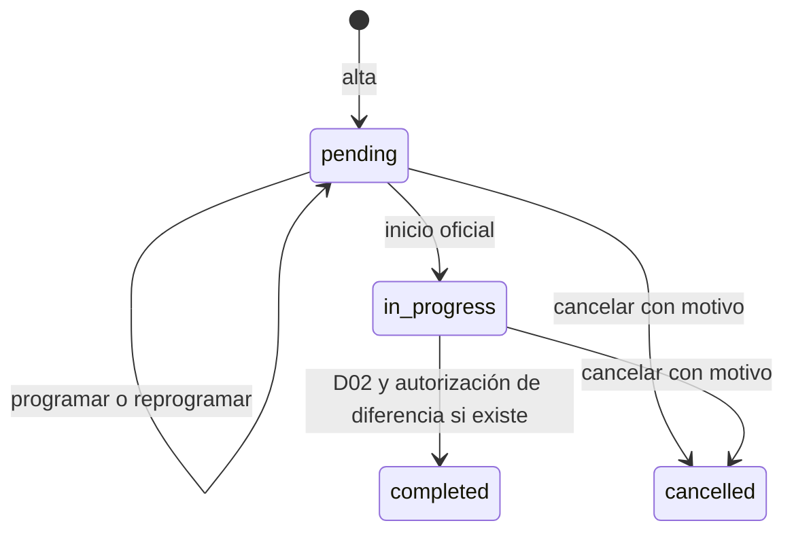
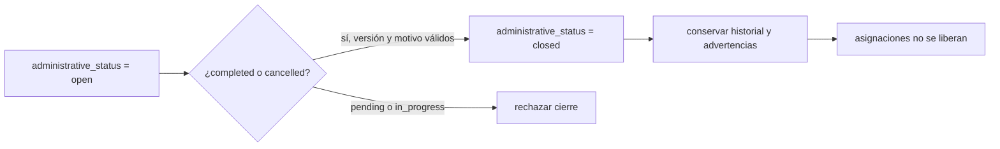
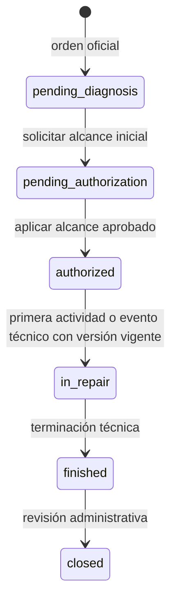

# Guía de estados, cantidades y autorizaciones

[Volver a módulos](../03-modulos.md). Esta guía desarrolla las reglas que suelen confundirse al estudiar las pantallas. Los nombres técnicos son los del código; las flechas no conceden un permiso independiente del servicio, versión y restricciones.

## Viaje: tres dimensiones, no una sola columna

[`Trip`](../../../app/Modules/TransportAndDispatch/Models/Trip.php) conserva `planning_status`, `execution_status` y `administrative_status`. [`TransportAdministration::tripAction()`](../../../app/Modules/TransportAndDispatch/Application/TransportAdministration.php) coordina programación, cancelación y cierre; delega inicio/finalización en [`TripOperations`](../../../app/Modules/TransportAndDispatch/Application/TripOperations.php).

| Dimensión | Valores | Qué expresa |
| --- | --- | --- |
| Planificación | `scheduled`, `rescheduled` | Programación/reprogramación; no prueba que el viaje inició |
| Ejecución | `pending`, `in_progress`, `completed`, `cancelled` | Situación operativa oficial |
| Administración | `open`, `closed` | Si oficina registró cierre administrativo |

El cierre administrativo se representa aparte:

`cancelled_at`, `cancelled_by_id` y `cancellation_reason` no se reemplazan por `officially_completed_at`/`completed_by_id`. Un cancelado se cierra sin completar ficticiamente. Cancelar un completado no está permitido por el contrato actual: `tripAction()` solo define cancelación para pendiente/en curso. Los cambios de una solicitud o el cierre incrementan versión y guardan `transport_changes`; una versión vieja produce conflicto.

Programar/reprogramar exige que no esté iniciado y revalida asignaciones existentes. La programación no determina liberación física. El historial puede seguir conteniendo un recurso en un viaje cerrado hasta que oficina lo libere manualmente.

## Carga, descarga y autorización de diferencia

Una carga tiene varios `load_items`, cada uno con compartimento de la cisterna asignada. La descarga referencia esos detalles mediante `load_item_id`. PostgreSQL protege que cabeceras/detalles correspondan al mismo viaje. No basta con que el UUID de un detalle exista.

Para finalizar, `trip_require_completion()` verifica D02; `trip_volume_content()` produce el contenido exacto de diferencia. `TransportAdministration::requestAuthorization()` construye ese contenido desde el servidor, en lugar de aceptar un resumen arbitrario del navegador. `TripOperations::finish()` aplica la decisión al cambio concreto. Cuando no existe diferencia, no permite consumir una autorización de diferencia innecesaria.

La separación de solicitud → decisión → aplicación impide que una aprobación antigua se use para otros litros, otro objetivo o una versión diferente. Los triggers comprueban correspondencia y unicidad de aplicación; la aplicación no se agota simplemente por consultar el detalle.

## Orden de Taller: estado no equivale a disponibilidad

Los estados son los siguientes:

La primera actividad/evento nuevo en estado `authorized` cambia a `in_repair` dentro de la misma transacción y exige versión vigente. No es una transición que Vue deba simular antes de registrar. `WorkshopExecution::transition()` admite terminación desde `in_repair` y cierre desde `finished`; cierre exige revisión administrativa no vacía. Terminar orden no inventa eventos de finalización de todos los participantes ni libera mecánicos/activo automáticamente.

`WorkshopAuthorizations::applyOrderDecision()` gestiona cancelación, reapertura y rectificación con versión/snapshot exactos:

- Cancelación aplicable desde `pending_diagnosis`, `pending_authorization`, `authorized`, `in_repair`, mediante decisión del administrador. No elimina trabajos ni consumos.
- Reapertura desde `finished`, `closed`, `cancelled`; el destino se determina por hechos existentes: alcance aplicado → `authorized`; diagnóstico sin alcance aplicado → `pending_authorization`; sin esos hechos → `pending_diagnosis`. El solicitante no elige un estado arbitrario.
- Rectificaciones sensibles preservan anterior y decisión. Las revisiones técnicas activas siguen el mecanismo de predecesor/raíz/revisión y las restricciones del registro.

Una avería distinta no es una ampliación del alcance: requiere otra orden. Una ampliación de la misma reparación conserva tareas autorizadas y solicita aprobación independiente para lo nuevo. Un rechazo no autoriza ejecución y no borra decisiones previas.

## Disponibilidad y salida

[`WorkshopAvailability`](../../../app/Modules/Workshop/Application/WorkshopAvailability.php) ejecuta `project()`, que actualiza `fleet_assets.service_status` mediante `workshop_asset_projection(id)` después de ingreso, impedimento, resolución o salida. Por eso `AssignmentAvailability::inspect()` puede consultar el estado de servicio y las asignaciones sin crear otro cálculo frontend de bloqueos.

Un ingreso oficial crea `workshop_admissions` y causa canónica en `fleet_operating_impediments`, con efecto de mantenimiento. Si había asignaciones sin liberar, registra `workshop_warnings`. No modifica ni cancela esos viajes. Las causas anteriores no conocidas pueden registrarse explícitamente como observación histórica autorizada, sin inventar de dónde surgieron.

La solicitud de salida construye revisión con `workshop_exit_content()`, causas elegidas y fecha. El administrador decide y aplica. La aplicación registra resoluciones autorizadas, salida, aplicación, versión y operación antes de recalcular proyección. La causa canónica de ingreso no se resuelve mediante un botón genérico que omita la salida. Otros impedimentos pendientes siguen afectando disponibilidad; cerrar una sola orden no acredita que el activo puede operar.

## Cantidades: cuatro preguntas distintas

| Pregunta | Fuente | No confundir con |
| --- | --- | --- |
| ¿Cuánto se autorizó comprar? | Solicitud y decisión de Compras | Orden o recepción física |
| ¿Cuánto llegó? | Recepciones confirmadas y detalles | Cantidad meramente solicitada |
| ¿Cuánto queda en bodega? | Suma `warehouse_delta` | Cantidad bajo custodia del mecánico |
| ¿Cuánto se utilizó? | Uso confirmado y `consumed_delta` | Todo lo entregado |

Las cantidades de Inventario usan hasta seis decimales según sus tipos y validaciones, con unidad histórica. Litros del viaje usan dos. No redondear cantidades de repuesto a litros ni convertir unidades sin una regla aprobada. El catálogo no puede cambiar libremente una unidad que altere interpretación de movimientos/compras históricas.

## Dinero: hechos y estados derivados

`Money::minor()` convierte una cadena decimal válida a centavos enteros; `format()` la representa con dos decimales y `roundHalfUp()` trata redondeo sin float. No sumar `"10.00" + "20.00"` mediante conversión implícita del navegador para decidir saldo canónico.

Factura: total = suma de `billing_invoice_items.amount`; pagado = suma de `billing_payments.amount`; saldo = total − pagado. Estado derivado: `paid` si ambos son iguales, `pending` si pagado es cero y aún queda saldo, `partially_paid` en el caso intermedio. No hay UPDATE manual de estado para “marcar pagada”. CRC y USD forman grupos separados.

Gasto: estado de **la revisión actual**, decidido en `expense_decisions`, o `pending` si no hay decisión. Una revisión sustituida no se vuelve a sumar ni presta su aprobación a otra. Ese estado no significa que el dinero ya fue desembolsado.

## Reportes: cuál fecha y cuál conjunto se suma

[`AdministrativeReports`](../../../app/Modules/AdministrativeReports/Application/AdministrativeReports.php) aplica período como inicio del día Costa Rica incluido y día posterior al final excluido. Las notas de cada respuesta explican la semántica:

- Transporte: fecha de registro del viaje, estados actuales; filtro por vehículo considera asignaciones históricas mediante EXISTS y cuenta una vez el viaje.
- Facturación: facturas creadas en el período, pagado/saldo **actuales** de ese grupo; cobros del período por `paid_at`, incluyendo facturas anteriores. Los filtros de cliente/moneda/estado actual se aplican según consulta.
- Gastos: fecha del gasto en revisión actual, una fila por gasto.
- Taller: órdenes por creación y estado actual; actividades vigentes de esas órdenes a lo largo de su historia, sin sumar versiones sustituidas.
- Existencias: saldo actual; no permite un período que simule corte histórico. Movimientos sí tienen hechos fechados.

Ejemplo de duplicación evitada: una factura con dos detalles y tres pagos produciría seis filas si se unieran ambos hijos directamente; sumar después multiplicaría importes. La implementación agrega detalles por factura y pagos por factura **antes** de unirlos.
